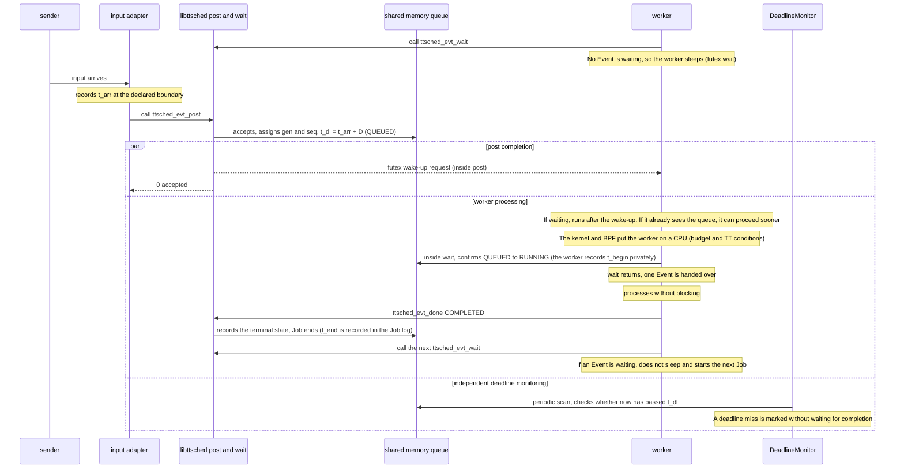

<!--
SPDX-FileCopyrightText: Copyright 2026 LG Electronics Inc.
SPDX-License-Identifier: MIT
-->

# Event-Driven Workload Support — App Developer Guide

| Item | Content |
|:--|:--|
| Status | Draft (design stage, before P1 implementation) |
| Date | 2026-11-26 |
| Author | Seokhee Han |
| Target readers | Application developers who write L2 (Event-driven) sample apps on TIMPANI. Assumes that the reader has not read the 008 design chain |
| Baseline documents | REQ-008 v5.3, SRS-008 v4.3, DDR-008 v3.4, HLD-008 v5.4, LLD-008 v5.3 (the state after the throttle contract revision `937ca3c`, including the follow-up wording cleanup and the poster and producer term clean-up, and the final review corrections of 2026-11-26) |

> **Status of This Document**
> - This guide is a **design-stage** document. It is not an implementation or execution verification result.
> - The `ttsched_evt_*` API, the SHM v2 layout, the new workload field (`min_inter_arrival_us`), and the FaultInfo flag extension are **proposals**. They are not yet implemented, and they await Project Leader approval.
> - The figures in the body (C, D, MIT, T, queue depth, latency targets) are **candidates**. They are not fixed by measurement.
> - This guide is written against REQ v5.3, SRS v4.3, DDR-008 v3.4, HLD v5.4, and LLD v5.3 (the state after the throttle contract revision `937ca3c`, including the follow-up wording cleanup and the poster and producer term clean-up, and the final review corrections of 2026-11-26). If it differs from the formal documents, the formal documents take precedence.
> - The body distinguishes two things. The **[Current]** marker means the behavior that the code runs today. The **[P1 proposal]** marker means what P1 intends to provide. Do not present a proposal as current functionality.
> - Bracketed numbers (for example, [A-08], [H-8]) are design trace IDs. Everything needed for development is in the body.

## Summary

- An L2 task is a workload that runs only when an external input arrives. One input is an **Event**, and the processing of one Event is a **Job**.
- The app writes two parts. The **input adapter** records `t_arr` at the arrival point and posts. The **worker** repeats Event wait (wait) and done (done).
- The deadline is `t_dl = t_arr + D`. It is counted from the arrival time. All delay from arrival to posting counts against D.
- Budget exhaustion and throttling are different. If the budget is 0 and the server remains runnable, it is throttled. If it exhausts the budget exactly and sleeps, it is not throttled.
  However, if it wakes again before the replenishment window ends, the remaining budget is 0, so it is throttled. If the time remaining until the window ends is at most the tolerance `tol` *(candidate: 50 µs)*, the window is treated as ended, and the budget is filled to C.
- The current code has no `ttsched_evt_*` API. The current FCW example uses `libtimpani_rt`, which is based on SOME/IP IDs. P1 changes it to the common post path.
- Where and what to call is in Section 1.1, the development procedure is in Chapter 4, return codes and fault interpretation are in Chapter 7, and the radar -> FCW example is in Chapter 8.
- Undecided items such as approval of the public API, numerical measurement, and the `t_arr` basis at rebinding are in Chapter 12.

**What can be done now (based on current code).** The current libttsched cannot build the app in this guide. It becomes possible after P1 approval and implementation.

| Item | Possible now? | Note |
|:--|:--|:--|
| `ttsched_evt_*` post and wait | No | Not in the current libttsched. After P1 approval and implementation |
| Workload YAML and `scripts/mock_pullpiri.py` | Conditional | Only current keys are used. MIT keys after approval. The protobuf stubs must be regenerated before L2 is classified (8.2 known issue) |
| Running the current FCW example and fault injection | Conditional | Chapter 8. It uses the current `libtimpani_rt` and is not yet modified. Requires Linux, isolated CPUs, and stub regeneration |
| Measuring C and MIT | Partly | `budget_used_us` is a proposed field and cannot be used. Preliminary measurement is in Chapter 4, step 3 |
| Admission formula calculation | By hand | Calculate the admission formula in Chapter 4 directly. Automatic determination by TIMPANI-O is [P1 proposal] |
| Viewing faults and Job records | Partly | The current output is the Dmiss and fault lines in the timpani-n log. Flags and Job records are P1 |

## 1. At a Glance

### 1.1 Where and What to Call [P1 proposal]

The FCW consumer (`fcw_consumer`) is used as the example. The numbers in the table match the numbers in the comments of the code and declarations below. The numbers point to code locations and are not an execution order. The processing order of one Event is in the diagram in Section 1.2, and the explanation for each number follows the 'Details' column of the table. The process startup order is in Section 8.2.

| | Where | What | When | Details |
|:--|:--|:--|:--|:--|
| ① | `main()` | Gets the source handle with `ttsched_evt_open("cbs_task")` | Once at startup, before the middleware starts | Chapter 5 |
| ② | L2 worker thread | Renames the thread to `cbs_task`, then `ttsched_init()` | Once when the worker starts, before the middleware starts | Chapter 4, step 5 |
| ③ | Input callback | Reads `t_arr` in the first statement, then `ttsched_evt_post()` | For each input | Chapter 4, steps 2 and 6 |
| ④ | L2 worker thread | `ttsched_evt_wait()` → processing → `ttsched_evt_done()` | Repeated for each Event | Chapter 4, step 5 |
| ⑤ | Workload declaration (YAML) | `runtime`, `deadline`, `period`, `min_inter_arrival_us` | At deployment | Chapter 4, steps 3 and 4 |

`cbs_task` is the `task_id` of this worker. The thread name, the `ttsched_evt_open()` argument, and the YAML `name` must all be the same (1 to 15 bytes, unique within the node).

```cpp
// The FCW consumer with the change applied (sketch, not yet compile-verified). Full error handling is in Chapter 4, steps 5 and 6, and in Chapter 7.
// handle_post_error and run_collision_check are app functions.
#include <libttsched.h>

static ttsched_evt_t g_src = -1;
static std::mutex g_post_mtx;   // If there may be several input threads (H-8), lock only the post call

// ③ Input callback (vsomeip receive thread)
void on_obstacle_alert_received(const std::shared_ptr<vsomeip::message>& msg) {
    const uint64_t t_arr = clock_ns(CLOCK_MONOTONIC);   // Reads the arrival time in the first statement
    /* payload check and RadarTarget (16 bytes) parsing: same as before */
    std::lock_guard<std::mutex> lk(g_post_mtx);
    const int rc = ttsched_evt_post(g_src, t_arr, target, sizeof(*target), nullptr);
    if (rc < 0) handle_post_error(rc);                   // No Event was created (Section 7.1)
}

// ②④ L2 worker: one Event is one Job
void cbs_worker_loop() {
    pthread_setname_np(pthread_self(), "cbs_task");      // ② name = task_id
    ttsched_init();
    for (;;) {
        struct ttsched_evt_event ev;
        const int rc = ttsched_evt_wait(&ev);            // ④ Receives one Event and starts a Job
        if (rc == TTSCHED_EVT_E_INACTIVE) { ttsched_init(); continue; }  // For example, before binding. Returns after the back-off
        if (rc < 0) abort();                             // E_STATE: a missing done call is a bug
        run_collision_check(*reinterpret_cast<const RadarTarget*>(ev.payload));  // No blocking and no logging
        ttsched_evt_done(TTSCHED_EVT_COMPLETED);         // Always call this
    }
}

// ① main: starts in the order handle, worker, middleware
int main() {
    g_src = ttsched_evt_open("cbs_task");
    if (g_src < 0) return EXIT_FAILURE;
    std::thread(cbs_worker_loop).detach();
    /* vsomeip initialization, register_message_handler, subscribe, app->start(): same as before */
}
```

```yaml
# ⑤ FCW consumer declaration (excerpt from scripts/mock_pullpiri.yaml, after the P1 change).
#   priority, policy, cpu_affinity, and release_time stay as they are now.
workloads:
  - workload_id: verify_wl_cbs
    temporal_class: TEMPORAL_SPORADIC   # L2 (CBS)
    tasks:
      - name: cbs_task                  # Same as the worker thread name
        runtime: 2000                   # C: declared worst-case execution time of one Job (µs, candidate)
        deadline: 5000                  # D: from arrival to completion (µs, candidate)
        period: 18000                   # T: CBS replenishment period, at most MIT (changed from the current 20000)
        min_inter_arrival_us: 18000     # MIT [P1 proposal]. Before approval, use the period value
        max_dmiss: 2                    # Number of DMISS allowed before it is reported
```

Without the Event API, matching only the thread name in ② and the declaration in ⑤ still gives you CBS budget enforcement under [Current]. The protobuf stub regeneration and the startup order follow Section 8.2. However, you do not get per-Event deadline monitoring or MIT counting (Chapter 11, Q2).

### 1.2 Path of One Event

The diagram below shows the case where the worker first calls `ttsched_evt_wait` and sleeps because no Event is available. When the input adapter stamps the arrival time and posts, the Event and its deadline are recorded in the common queue, and post wakes the worker. When the kernel and BPF run the worker, wait starts the Job and hands over the Event ([HLD-008 §4.2]). The Event becomes visible (QUEUED) before the Job starts (RUNNING), but the return order of post and wait is not guaranteed. If an Event is already waiting, wait returns without sleeping. DeadlineMonitor monitors deadlines independently of worker completion.



**Job states.** `t_begin` is the time when wait changed the state to RUNNING. `t_end` is the time that the worker reads just before it posts done. `now` is the current time that DeadlineMonitor reads.

| State | Meaning |
|:--|:--|
| QUEUED | The post accepted the Event, and the worker has not taken it yet |
| RUNNING | wait handed it over. `t_begin` is stamped |
| COMPLETED, DISCARDED | Ended by done. `t_end` is stamped |
| CANCELLED, ABANDONED | TIMPANI closed it. CANCELLED if before the start, ABANDONED if during execution |

**Difference between TT and event-driven.** TT (Time-Triggered) task (L1) runs periodically on predetermined slots.
In the current code, TIMPANI-N wakes the wait in `ttsched_wait_next_period()`.
L2 (CBS) tasks run when an external input arrives.
Because the arrival time cannot be known in advance, TIMPANI enforces the CPU budget with a CBS server. Per-Event deadline monitoring (DeadlineMonitor) is [P1 proposal].
The two kinds can be placed on the same CPU.
In that case, they must also pass admission (the admission formula in Chapter 4).

## 2. Terms You Need to Know

The canonical definitions of terms are in [REQ-008 §2](REQ-008-event-driven-workload-support.md). This table summarizes only the meanings needed for development.

| Term | Meaning | Note |
|:--|:--|:--|
| Event | One accepted arrival. The identifier is `(gen, seq)` | A rejected post is not an Event. `seq` is unique only within the same gen and wraps around after 2^32. Uniqueness across restarts is probabilistic |
| Job | Processing of one Event. Starts at wait and ends at done | One-to-one with Events. Several Events are not merged |
| arrival (`t_arr`) | The time, in `CLOCK_MONOTONIC`, when the input adapter first recognizes the input at its declared boundary | Delay before the boundary is not included in D. If the boundary is placed late, the deadline determination becomes looser by that amount |
| post | The call `ttsched_evt_post` in which the adapter puts an Event into the queue | Returns the result: accepted or rejected |
| Event wait (wait) | The call `ttsched_evt_wait` in which the worker receives one Event and starts a Job | An open Job must not exist. If there is no Event, it sleeps |
| done | The call `ttsched_evt_done` in which the worker ends an open Job | Cannot be omitted |
| deadline (`t_dl`) | `t_dl = t_arr + D`. Set once at acceptance and does not change | A value obtained by adding D to the activation time is not the deadline |
| MIT (`min_inter_arrival_us`) | Minimum interval between consecutive arrivals from the same source | The interval between consecutive arrivals from the same source is measured by arrival time |
| admission | Pre-check in which TIMPANI-O applies the admission formula to all L2 tasks on the placement CPU | It is a different concept from Project Leader approval |
| budget replenishment (replenishment) | Operation that fills the server budget to C when a replenishment window opens | Starting a Job alone does not grant budget |
| throttle (throttling) | Operation that blocks further execution of a runnable server whose budget is 0 | It is not the case merely because the budget was used and the server went to sleep. When it wakes with remaining budget 0 and the replenishment window has not ended, it is throttled (if the remaining time is at most `tol`, the window is treated as ended) |
| producer | The party that creates the input to be posted to a source | It can be the same as the poster or different from it. In the FCW example it is `mock_radar_producer`, which plays the role of the radar |
| poster | The thread or process that calls post for a source | Only one posting context posts to the same source at a time (REQ-008 C-08). In the FCW example the vsomeip receive thread of `fcw_consumer` becomes the poster [P1 proposal] |
| reference poster configuration | Configuration in which the poster thread is not preempted from the recording of the arrival time until post returns (REQ-008 A-10) | Outside this configuration, the upper bound of L_post and the guarantee of the admission formula do not hold |
| D | Relative deadline from arrival to completion | All delay after arrival counts against D |
| C | Declared worst-case execution time of one Job under normal conditions (`runtime`) | Declare it larger than the measured maximum CPU time of one Job. The server gives this value as budget in each replenishment window. It is not refilled for each Job |
| T | CBS server period (`period`) | T ≤ MIT |
| source | One input source. One per L2 task | The origin of the Event |
| jitter (release variation) | The width by which a periodic producer deviates from its period (send time, delivery latency) | Subtracted when MIT is set |
| activation (`t_act`) | Time when the worker thread wakes from sleep and becomes runnable | It is not the basis of the deadline. It is the basis of the budget replenishment window |
| Binding and rebinding | Attaching a worker thread to an L2 server, and attaching it again | The `t_arr` basis at rebinding is H-20 in Chapter 12 |
| replenishment window | Interval of length T_s. When it opens, the budget is filled to C | A new Job alone does not replenish it |
| TT (L1), CBS (L2) | Periodic task on predetermined slots (L1), and Event-driven CBS server task (L2) | The two kinds can share the same CPU |
| SHM | Memory shared by the app and TIMPANI-N | The queue and counters are here |
| sched_ext | Kernel scheduler extension (BPF) | This is where TIMPANI-N enforces the CBS server budget |

## 3. App Structure and Responsibility Split

One L2 task consists of one source and one worker thread. The input adapter only posts on the thread that receives the input. The worker runs only the wait, processing, and done loop.
The app does not create a separate common queue. If there are several input threads, only the post calls are serialized with a lock on the poster side. The worker does not take a lock.

| Actor | What it does | What It Does Not Do | Status |
|:--|:--|:--|:--|
| App input adapter | Records `t_arr` at the boundary, calls `ttsched_evt_post`, handles return codes | Queue management, deadline calculation, MIT determination | [P1 proposal] |
| App worker | `ttsched_evt_wait`, processing, `ttsched_evt_done` (COMPLETED or DISCARDED) | Its own queue, blocking I/O, setting SCHED_EXT or priority | [P1 proposal] |
| libttsched (linked into the app) | Implements post, wait, and done. SHM writes and counting of accepted and rejected posts | Interpreting message content | [P1 proposal]. The current version has only `ttsched_init()` and `ttsched_wait_next_period()` |
| Shared memory (SHM v2) | Per-source slots, fixed-size queue, counters, Job records | Interpreting payload | [P1 proposal] |
| TIMPANI-N BPF (sched_ext) | L2 server budget deduction, throttling, budget replenishment, execution-interval observation | Interpreting Event content | Budget deduction and throttling are [Current]. The replenishment rule (window based on activation) and execution-interval observation are [P1 proposal] |
| TIMPANI-N userspace | Worker binding, fault counting and reporting, DeadlineMonitor (deadline monitoring) | Judging message meaning | Binding and some faults are [Current]. DeadlineMonitor is [P1 proposal] |
| TIMPANI-O | CPU placement, workload parameter validation, admission | Runtime Event handling | CPU placement is [Current]. Parameter validation and the admission formula are [P1 proposal] |

## 4. Development Procedure

Follow the order below. The output of each step is the input of the next step. The worker loop and input adapter code use only the proposed API.

1. **Define the Event and the payload.** Keep the payload at 64 bytes or less (`TTSCHED_EVT_PAYLOAD_MAX`, candidate). Put the value itself into it.
   Do not put a pointer or reference to large data. P1 has no release notification.
   Example: The `RadarTarget` of FCW is 16 bytes.

2. **Define the arrival boundary and the `t_arr` point.** The first statement of the receive callback, or the point just after the datagram read finishes, is appropriate. Record the boundary by file and function name. If the Event cannot be posted at the boundary, D shrinks by that difference ([A-08], REQ-008).

3. **Define C, D, MIT, and T.** The rules are as follows.
   - Keep $0 < C \le D \le MIT$ and $T \le MIT$.
   - **MIT** is the minimum interval observed at the arrival point. The periodic producer subtracts the send jitter and the delivery jitter from its period.
     Example: if the production period is 20 ms and the jitter is 2 ms, the MIT is 18 ms. If there is additional wake-up jitter and delivery jitter, it is 17 ms or less ([HLD-008 §8.4]).
     If there is no specification, subtract a margin from the measured minimum interval. The tolerance is *(candidate: 0)* (tol_mit, before measurement). An optimistic MIT raises MIT_VIOLATION even in normal operation.
   - **C** is declared larger than the measured maximum CPU time per Job. The measurement order is as follows.
     (1) Widen the Event interval so that one execution interval contains one Job, and measure `budget_used_us` (P1 proposal field).
     (2) Look at the maximum for each input type.
     (3) Add the first Job after idle, bursts, and interference conditions.
     (4) Add a margin to the maximum and declare the result. The margin ratio is undecided (H-19).
     (5) Verify with normal operation and anomaly injection.
     (6) Observe during operation.
     Do not use a percentile criterion, because BUDGET_EXCEED can occur even in normal operation ([HLD-008 §8.2]).
     Caution: `budget_used_us` is counted per execution interval, not per Job. If several Jobs are in one interval, they are summed. If a Job sleeps in the middle, one Job is split into several intervals.
     The t_end − t_begin of the Job log is wall-clock time, so it is not used for measuring C.
     The current example has no `budget_used_us`. As a preliminary measurement, you can log the difference in `CLOCK_THREAD_CPUTIME_ID` over the processing interval. This value is not a P1 measurement.
   - **D** is the relative deadline from arrival to completion.
   - **T** is the CBS server period. If there is a production period, set it no larger than that.
   - The starting values for FCW are C 2 ms, D 5 ms, T 18 ms, and MIT 18 ms. All of them are candidates. Under the calculation basis of HLD-008 §8.4, the MIT is 17 ms or less, so 18 ms is only a starting value. Fix the value below the minimum measured in normal operation.

4. **Declare the workload.**
   - [Current] `scripts/mock_pullpiri.yaml` uses `workload_id`, `temporal_class`, and `tasks`.
     The task items are `name`, `priority`, `policy`, `cpu_affinity`, `period`, `runtime`, `deadline`, `release_time`, and `max_dmiss`.
     `max_dmiss` is the number of DMISS allowed before it is reported (PRT-002). `cpu_affinity` is not used for placement (8.1).
     L2 uses `temporal_class: TEMPORAL_SPORADIC`. `name` must be the same as the worker thread comm. `runtime` is C, `deadline` is D, and `period` is T.
   - [Current] This YAML has no MIT field.
   - [P1 proposal] Add `uint32 min_inter_arrival_us = 11;` to `TaskInfo` (LLD-008 §2.1). The YAML key `min_inter_arrival_us` corresponds to this field.
     If the value is 0, `period` is used as the MIT (warning log, approval required). Before approval, the MIT is set by `period`.
   - [P1 proposal] TIMPANI-O rejects the following as ParamInvalid: MIT = 0 even after `period` is substituted, T > MIT, D > MIT, a task_id longer than 15 bytes, and a task_id that is duplicated within the node (LLD-008 §9).
   - The FCW example must change `period` from 20000 to 18000 to satisfy $T \le MIT$. This change is in [HLD-008 §8.4].

5. **Write the worker loop.** Change the thread comm to the `task_id`, call `ttsched_init()` once, and then repeat wait, processing, and done. Avoid blocking calls during processing.
   wait sleeps until an Event arrives. E_INACTIVE returns after the back-off.

   ```c
   /* Required headers: <pthread.h>, <stdint.h>, <stddef.h>, <stdlib.h>, <time.h>, "libttsched.h".
    * pthread_setname_np is Linux-only, and _GNU_SOURCE must be defined before the headers.
    * log_error and process_event are app functions. */
   #define WORKER_TASK_ID "cbs_task"        /* Unique task_id within the node. Same as the worker comm */

   static void *worker_main(void *arg) {
       (void)arg;
       pthread_setname_np(pthread_self(), WORKER_TASK_ID);
       ttsched_init();
       for (;;) {
           struct ttsched_evt_event ev;
           const int rc = ttsched_evt_wait(&ev);
           if (rc == TTSCHED_EVT_E_INACTIVE) {  /* Returns after back-off. Binds again */
               ttsched_init();
               continue;
           }
           if (rc < 0) {                        /* E_STATE is a bug from a missing done. Do not hide it */
               log_error("ttsched_evt_wait", rc);
               abort();
           }
           process_event(&ev);                  /* Uses only ev.len (64 or less). No blocking calls */
           const int done_rc = ttsched_evt_done(TTSCHED_EVT_COMPLETED);  /* Required. A policy discard is DISCARDED */
           if (done_rc < 0) {
               log_error("ttsched_evt_done", done_rc);   /* E_INACTIVE is a late done, after TIMPANI already closed the Job */
           }
       }
   }
   ```

6. **Write the input adapter.** Read `t_arr` in the first statement at the boundary and post immediately. The default is one input thread (before H-8 is confirmed).
   If several threads post, the app serializes only the post calls. The worker does not take a lock.
   Lock waiting is delay after `t_arr`, so it counts against D. If a later `t_arr` is posted first while a thread waits for the lock, E_INVAL can occur. With several threads, it can conflict with the A-10 configuration, so confirm it by measurement.

   ```c
   static ttsched_evt_t g_src = -1;   /* Obtained once at init with ttsched_evt_open("cbs_task"). If negative, do not post */
   static pthread_mutex_t g_post_mtx = PTHREAD_MUTEX_INITIALIZER;   /* Used only when there are several input threads */

   /* Declared boundary: the point where the input first appears in the app code */
   void on_input_received(const uint8_t *msg, uint32_t len) {
       struct timespec ts;
       clock_gettime(CLOCK_MONOTONIC, &ts);
       const uint64_t t_arr = (uint64_t)ts.tv_sec * 1000000000ULL + (uint64_t)ts.tv_nsec;

       pthread_mutex_lock(&g_post_mtx);   /* Only one post context per source at a time */
       struct ttsched_evt_id id;
       const int rc = ttsched_evt_post(g_src, t_arr, msg, len, &id);
       pthread_mutex_unlock(&g_post_mtx);

       if (rc == 0) {
           return;                        /* Accepted: (gen, seq) was created and the deadline is t_arr + D */
       }
       handle_post_error(rc);             /* App function. Count as in the table in Section 7.1 */
   }
   ```

7. **Handle the return codes.** 0 means accepted. E_FULL and E_INACTIVE mean that no Event was created. The table is in Section 7.1.
   After E_INACTIVE, whether to call `ttsched_init()` and retry or to discard is an app policy. The default is undecided.
   When retrying, the app prevents the same input from being accepted twice. E_INVAL is an app bug, so log it.

8. **Configure the poster thread.** The thread that calls post must satisfy the reference poster configuration (REQ-008 A-10).
   - From the recording of the arrival time to the return of post, the thread must not be preempted by other threads. The candidate is a real-time policy thread pinned to an idle or dedicated CPU. The value is fixed by measurement.
   - The deployment owner sets the real-time policy. In P1, TIMPANI does not manage the policy of the input thread ([DDR-008](DDR-008-event-driven-workload-support.md) D-24). SCHED_EXT enforcement for the registered worker is handled by TIMPANI-N.
   - If this configuration is left, the L_post upper bound of TIM-011 and the guarantee of the admission formula do not hold. Verify the configuration at deployment.

9. **Run and check.** Check the following in normal operation. Interpret faults as described in Chapter 7.
   There must be zero faults. If MIT_VIOLATION appears, the MIT is optimistic.
   The number of Job records must equal the number of accepted Events. For every Job, $t_{end} - t_{arr} \le D$, and there must be no `missed`.
   `overflow` must be 0. In the quiescent state, `accepted = started + cancelled-before-start + queued` must hold.
   The execution method is in Chapter 8.

**Admission formula (a determination checked by hand before step 9, proposal).** For every L2 task $i$ placed on the same CPU, check the following. This is the P1 condition of CBS-004 and a sufficient condition.

$C_i + B_{tt}(k, D_i) + L_{del}^{max} + \sum_{j \ne i}(C_j + \delta_{ovr}) \le D_i$, $D_i \le MIT_i$, $T_i \le MIT_i$

- $C_i$ is the budget of task $i$, $D_i$ is the relative deadline, and $MIT_i$ is the minimum arrival interval.
- $B_{tt}(k, D_i)$ is the maximum TT occupancy of CPU $k$ in an interval of length $D_i$. $L_{del}^{max}$ is the upper bound from arrival to the first execution of the worker. $\delta_{ovr}$ is the upper bound of budget overrun before throttling.
- The candidate values are $L_{del}^{max}$ 100 µs and $\delta_{ovr}$ 1 ms ([HLD-008 §10 H-9]). Before measurement, they are not pass criteria.
- This formula is not a proof. If the premises are broken (arrivals keep the MIT, each Job ends before the next arrival so that the worker sleeps, and posting happens right after arrival), there is no guarantee.

## 5. API Summary (P1 proposal)

The API below is the proposal in [LLD-008 §6.1](LLD-008-event-driven-workload-support.md). It awaits Project Leader approval. The signatures are copied from the notation of the proposal document.

```c
/* sample-apps/src/libttsched.h: v2 public part (proposal) */
#include <stdint.h>
#define TTSCHED_EVT_PAYLOAD_MAX 64U              /* candidate. inline payload bytes per Event */

#define TTSCHED_EVT_E_INACTIVE (-1)              /* source inactive, worker not bound, removal, daemon stopped, SHM not writable, Job closed by TIMPANI */
#define TTSCHED_EVT_E_FULL     (-2)              /* Queue full. Counted as overflow */
#define TTSCHED_EVT_E_INVAL    (-3)              /* Invalid argument: len exceeded, t_arr in the future or earlier than the previous arrival, invalid task_id, invalid outcome */
#define TTSCHED_EVT_E_STATE    (-4)              /* wait while a Job is open, done without an open Job */

enum { TTSCHED_EVT_COMPLETED = 0, TTSCHED_EVT_DISCARDED = 1 };

typedef int ttsched_evt_t;                        /* source handle: 0 or greater for success, negative for error */
struct ttsched_evt_id    { uint64_t gen; uint32_t seq; };
struct ttsched_evt_event { uint64_t gen; uint32_t seq; uint32_t len;
                           uint64_t t_arr_ns; uint64_t t_deadline_ns;
                           uint8_t payload[TTSCHED_EVT_PAYLOAD_MAX]; };

ttsched_evt_t ttsched_evt_open(const char *task_id);
int ttsched_evt_post(ttsched_evt_t src, uint64_t t_arr_ns, const void *payload, uint32_t len,
                     struct ttsched_evt_id *id_out);
int ttsched_evt_wait(struct ttsched_evt_event *ev);
int ttsched_evt_done(int outcome);
void ttsched_init(void);                          /* Same name as the current one. In P1 it handles the v2 SHM mapping */
int ttsched_wait_next_period(void);               /* L1 (TT), unchanged */
```

| Call | Caller | Arguments | Return | Rules |
|:--|:--|:--|:--|:--|
| `ttsched_evt_open` | input adapter, worker initialization | `task_id` (1 to 15 bytes) | Handle (0 or greater), negative is an error | Non-RT path. It may be called before registration. A post before registration returns E_INACTIVE |
| `ttsched_evt_post` | input adapter | Handle, `t_arr_ns`, payload, `len`, `id_out` (NULL allowed) | 0 accepted, negative creates nothing | One context per source at a time. If `t_arr_ns == 0`, the call time is used |
| `ttsched_evt_wait` | worker | `ev` buffer | 0 Job started, negative is failure | An open Job must not exist. Sleeps if there is no Event. If E_INACTIVE, returns after back-off |
| `ttsched_evt_done` | worker | `outcome` | 0 recorded, negative is failure | Required for every Job. There is no automatic completion |
| `ttsched_init` | worker, input adapter | None | None | Non-RT path. May be called more than once. Call it after E_INACTIVE |

**Calling rules.**
- If you pass `t_arr_ns`, it must be a CLOCK_MONOTONIC value. A future value, or a value earlier than the previous arrival of the same source, is E_INVAL.
- A value earlier than the current time is accepted as is. That delay counts against D ([A-08]).
- The library does not use locks. Posts for the same source must be one context at a time. If there are several input threads, the app serializes the post calls. If this rule is broken, only the queue of that source can be corrupted. Multi-poster posting at the library level is P2 ([F-13]).
- `ttsched_evt_wait` and `ttsched_evt_done` are called only on the same worker thread. If another thread calls them, it is a contract violation.
- Post and wait do not use the heap or locks. Mapping is done on the non-RT path. If mapping fails, post and wait return E_INACTIVE and do not map again by themselves.
- P1 has no API that wakes a waiting worker without an Event. The worker ends only when the process ends ([L-8], Chapter 12).

## 6. Rules Checklist

**Do**
- [ ] Read `t_arr` in the first statement at the input boundary. The delay after the boundary consumes D.
- [ ] Set the worker thread comm to `task_id`. There is one worker per source. Call wait and done only on that thread.
- [ ] End every Job with `ttsched_evt_done()`. End an Event that is decided not to be processed as DISCARDED. It is not success.
- [ ] Make each Job end before the next arrival so that the worker sleeps. Consecutive Jobs, or resumption after blocking, do not receive new budget and share the remaining budget of the same replenishment window.
- [ ] Handle every return code of post. Count E_FULL and E_INACTIVE as app statistics.
- [ ] The payload is an inline value of 64 bytes or less. Do not put a pointer in it.
- [ ] Check $0 < C \le D \le MIT$ and $T \le MIT$. Declare C larger than the measured maximum.
- [ ] Measure the thread used by the input adapter under the reference poster configuration.
- [ ] Write logs outside the Job. Do not place log output inside a Job.
- [ ] After normal-operation verification, fix MIT and C.

**Do not**
- Do not receive Events through a structure in which the worker reads a socket or timer directly. That structure still gets CBS budget enforcement, but it does not get the Event arrival time, Job records, or deadline monitoring ([HLD-008 §8.3] table, [REQ-008 §2.7]).
- Do not use a lock with contention, blocking I/O, `sleep`, or synchronous calls inside a Job. Blocking is allowed, but it is outside the guarantee of the admission formula, and the deadline is monitored ([A-06]).
- Do not set SCHED_EXT, priority, or affinity directly in the worker.
- Do not place an MIT determination or a deadline determination in the app. TIMPANI-N performs the determination and reporting.
- Do not post the same input again at a rebinding boundary. A re-post becomes a separate Event with a new `gen`. Preventing duplicate processing is the responsibility of the app.
- Do not place several workers on one source. A worker pool is not supported in P1.
- Do not use the `timpani_*` API of `timpani_rt.h` in new code. This library is slated for retirement ([REQ-008 §12]).

## 7. Errors and Diagnosis

### 7.1 Post Return Codes

| Code | Value | Meaning | What the app should do |
|:--|:--|:--|:--|
| 0 | - | Accepted. The Event `(gen, seq)` is created and the deadline is `t_arr + D` | No additional work |
| `TTSCHED_EVT_E_INACTIVE` | -1 | The source is inactive, or the worker is not bound. Removal, daemon stop, and SHM not writable are included here. A short interval just after binding, before the source is turned on, is also included (L-14) | No Event is created. After `ttsched_init()`, decide whether to retry or discard. Prevent duplicate acceptance on retry |
| `TTSCHED_EVT_E_FULL` | -2 | The queue is full. This is an overflow | Not an Event. Count the number of discarded posts. The backlog of the worker is read as `accepted - started - cancelled` (accurate only in the quiescent state) |
| `TTSCHED_EVT_E_INVAL` | -3 | `len` exceeded, `t_arr` in the future or earlier than the previous one, invalid `task_id` | App bug. Log it |

**[P1 proposal]** E_FULL occurs at the queue depth candidate 8. It can occur even when there are fewer than 8 live Events. A slot that the consumer has not yet cleared is also counted as queue occupancy ([HLD-008 §4.9]).
Overflow is counted as `overflow`. `arrivals - accepted` is the sum of overflow and REVOKED. A rejected input is also counted as an arrival and enters the MIT violation count. When the queue is full, the later Jobs are late.

### 7.2 Wait and Done Return Codes

| Call | Return | Meaning | What the app should do |
|:--|:--|:--|:--|
| wait | E_INACTIVE | Cannot wait now. Returns after the back-off *(candidate: 10 ms)* | After `ttsched_init()`, wait again |
| wait | E_STATE | wait was called while a Job is open | Programming error. Find the missing done call |
| done | E_STATE | done was called while no Job is open | Programming error. Check that each done pairs with a preceding wait |
| done | E_INACTIVE | TIMPANI has already closed the Job (ABANDONED). Only the open flag is cleared | This is a late done. Go on to the next wait |
| done | E_INVAL | `outcome` is invalid. The Job ends as DISCARDED | App bug. Check the value |

**Job result.** Only COMPLETED is a successful end.

| Result | Ended by | Meaning |
|:--|:--|:--|
| COMPLETED | Worker (`done(COMPLETED)`) | Processing finished. If `t_end <= t_dl`, the deadline is met. `t_end` is an interpretation fixed by the clock reading just before done (H-10) |
| DISCARDED | Worker (`done(DISCARDED)`) | Discarded by app policy. Not a success. If before the deadline, it is not a failure. If after the deadline, it is a failure (DMISS) |
| CANCELLED | TIMPANI | Closed before start (deactivation, re-registration, daemon cleanup). If before the deadline, it is not a failure. If after the deadline, it is a failure ([undecided H-11, OI-21]) |
| ABANDONED | TIMPANI | Closed during execution (worker exit, re-registration). The deadline rule is the same as for CANCELLED ([undecided H-11, OI-21]) |

### 7.3 Fault Types

The classification is a proposal in [REQ-008 PRT-005] and [LLD-008 §2.1]. The reporting path and values are awaiting approval.

| Item | Where to see it now | P1 (proposal before approval) |
|:--|:--|:--|
| deadline miss (DMISS) | Line `[FaultMonitor] Dmiss ...` in the timpani-n log (task hash) | Count reporting (PRT-007). Flags after approval. Exposure location undecided (OI-19) |
| budget overrun (BUDGET_EXCEED) | `Fault threshold exceeded!` line in the timpani-n log (`dmiss_count=0`) | Counted once per throttle episode |
| MIT violation | `FAULT MIT_VIOLATION` line in the consumer log | Reported with the count in each T_s window |
| Overflow and acceptance count | Only app statistics exist | SHM counters (`overflow`, `accepted`, etc.). Exposure location undecided (OI-19) |

**Meaning and reporting rule of each fault.**

| Fault | Meaning | Reporting rule | Check first |
|:--|:--|:--|:--|
| DMISS | The Job of an Event passed `t_dl`. It was still open when `t_dl` passed, or it ended with completion, discard, cancellation, or abandonment after `t_dl`. Even if COMPLETED, it is a failure if `t_end > t_dl`. Once per Job | Reported when it exceeds `max_dmiss` (PRT-002). It is counted in statistics regardless of whether it is reported. Flags are included after approval | Narrow down the cause with the flags (7.5) |
| BUDGET_EXCEED | Actually entered throttling. It is an informational value. It does not mean a positive excess of execution | Counted at most once per throttle episode (PRT-006) | C declaration, arrival interval, consecutive Jobs, budget replenishment state |
| MIT_VIOLATION | The arrival interval is shorter than the MIT. A violating arrival is also accepted and placed in the queue | Reported with the count for each T_s window | Sender period and bursts, `min_inter_arrival_us` value |
| WATCHDOG | Reserved (P2) | - | - |

**Current wording.** The current README and the log strings differ. The budget overrun line is not printed as `FAULT_BUDGET_EXCEED` (table in 8.4). The source is [examples/someip/README.md](../../examples/someip/README.md).
**Name correspondence.** DMISS = log `Dmiss` = producer output `DEADLINE_MISS`. BUDGET_EXCEED = README `FAULT_BUDGET_EXCEED`. Overflow = `overflow` (E_FULL).
`accepted`, `arrivals`, `started`, and `missed` are SHM counter names. Their exposure location is undecided (OI-19).

### 7.4 DMISS Flags

Flags are not included in reports before approval. Before approval, only the count is reported (PRT-007).

| Bit | Name | Meaning | Set by |
|:--|:--|:--|:--|
| 0x1 | MIT_RELATED | An MIT violation from the same source occurred after `t_arr - T_s` of the deadline-miss Job. It is a temporal-proximity flag, not a cause determination. Cause classification is P2 | FaultMonitor |
| 0x2 | THROTTLED | The server was in the throttled state at the detection time. It has a value only on the detection path | DeadlineMonitor |
| 0x4 | NOT_STARTED | The Event was still QUEUED at the detection time. The worker could not start it | DeadlineMonitor |
| 0x8 | LATE_COMPLETION | The deadline miss was set at the worker's end transition (`t_end > t_dl`) | Worker |
| 0x10 | DETECTED_LATE | Set during the close procedure (startup cleanup, deactivation, re-registration). It is a failure confirmed late, after a daemon outage | TIMPANI-N close procedure |

### 7.5 Check Order

1. **DMISS.** Look at the flags first.
   - NOT_STARTED: Check whether the worker was waiting in wait. Look at binding and CPU interference (TT, other L2).
   - THROTTLED: Check whether C is small and whether arrivals are consecutive. Check whether the budget was insufficient.
   - LATE_COMPLETION: Look at the processing time of the Job. Find blocking inside the Job.
   - MIT_RELATED: Check the MIT violations that are close in time first. Then look at the rest.
2. **BUDGET_EXCEED.** If it appears in normal operation, check the C declaration, arrival interval, and consecutive Jobs again. BUDGET_EXCEED is not evidence of underestimated C alone ([HLD-008 §8.2] ⑥).
3. **MIT_VIOLATION.** If it is not 0, the MIT is optimistic. Violating arrivals pile up in the queue and delay the later Jobs. It does not block them and only reports them.
4. **Count mismatch.** Look at the difference between `accepted` and the number of completions. Check in order: Jobs still open, CANCELLED, and `overflow`.

## 8. radar -> FCW Example

### 8.1 Current Structure [Current]

The current FCW example runs as two processes. The L1 TT task handles the periodic radar scan, and the L2 CBS worker handles the alarm determination.

| Process / thread | Role | Class | API used in the current code |
|:--|:--|:--|:--|
| `mock_radar_producer` / `tt_task` | 20 ms periodic scan, alarm emission | L1 TT | `timpani_rt_init`, `timpani_tt_register`, `ttsched_wait_next_period` |
| `fcw_consumer` / vsomeip receive thread (`on_obstacle_alert_received`) | SOME/IP alarm reception, enqueuing | App input boundary | `timpani_evt_mark_arrival` |
| `fcw_consumer` / `cbs_task` (`cbs_worker_loop`) | Processes one collision determination | L2 CBS | `timpani_cbs_bind_thread`, `timpani_cbs_unbind_thread`, condition-variable queue |
| timpani-o | CPU placement and workload validation | Management | Outside the scope of this guide |
| timpani-n | BPF enforcement (TT wake-up, L2 budget), fault reporting | Node execution | Outside the scope of this guide |
| `scripts/mock_pullpiri.py` | Sends YAML to timpani-o | Test tool | `--host`, `--port`, `--config` |

The current parameters are as follows.
- `tt_task`: period 20000, runtime 2000, deadline 20000 (YAML).
- `cbs_task`: period 20000, runtime 2000, deadline 5000 (YAML). The MIT in the code is in `timpani_evt_register(..., 18000)`.
- The `cpu_affinity` in YAML is not used for placement. timpani-o chooses the placement from `available_cpus`.

The current API of [examples/someip/include/timpani_rt.h](../../examples/someip/include/timpani_rt.h) has eight APIs.
`timpani_rt_init`, `timpani_tt_register`, `timpani_tt_wait_period`, `timpani_evt_register`,
`timpani_evt_mark_arrival`, `timpani_cbs_bind_thread`, `timpani_cbs_unbind_thread`,
`timpani_cbs_register_socket` (legacy).
In P1, this path is deleted ([HLD-008 §8.4] (2)).

The current code calls `timpani_cbs_bind_thread` and `timpani_cbs_unbind_thread` for each Event (`fcw_consumer.cpp`). In P1, TIMPANI takes over the binding.

### 8.2 Execution Environment and Startup Order

[examples/someip/README.md](../../examples/someip/README.md) organizes the current execution procedure. Only a summary is given here.

**Prerequisites [Current]**
- The kernel must support sched_ext and BTF (`/sys/kernel/btf/vmlinux`). Mainline 6.12 has the legacy API, and from 6.13 it has the DSQ API.
  Building requires clang, libelf, and linux-tools ([timpani-n/README.md](../../timpani-n/README.md)).
- Build the example with CMake (`examples/someip`). Build timpani-o and timpani-n. The example and the library are Linux-only (futex, prctl).
  The real vsomeip is not required. The mock headers in the repository (`examples/someip/mock_include`) replace it with 127.0.0.1 UDP.
- Python environment: the required packages are grpcio, grpcio-tools, and pyyaml.
  The virtual environment path differs by script. `mock_pullpiri.py` and `verify_pipeline.sh` use `$TIMPANI_ROOT/.venv`, and the example README uses `scripts/.venv`. Install into both paths until the paths are unified.
- Put **isolated CPUs** (CPUs separated from general work) in `available_cpus` of `node_configurations`. The README example is `[2]`. The node ID must be the same as the node ID of timpani-n.
- timpani-n requires root privilege (`sudo`). Both apps run in a shell inside the isolated CPU cgroup. This README has no cgroup setup procedure. Placement is the responsibility of the system ([A-09]).

**Known issues [Current]** (confirmed by reading the source; not confirmed by running it)
- `scripts/schedinfo_pb2.py` is older than the current proto. It has no `temporal_class` field, and `mock_pullpiri.py` silently skips fields that do not exist.
  As a result, the L2 workloads in the YAML are classified as TT. Regenerate the stubs from `timpani-o/proto/schedinfo.proto` before running.
- If timpani-n cannot find an isolated CPU, it prints FATAL and ends. The repository documentation has no procedure for creating isolated CPUs and cgroups.
- The workload IDs in the app code (`radar_workload`, `fcw_workload`) differ from the `workload_id` in YAML.
  Binding is done by thread name (`tt_task`, `cbs_task`), so it does not affect behavior.
- The example compiles `libttsched.c` separately inside `timpani_rt`. Changing only `libttsched.so` does not affect the example. Rebuild the example.

**Current startup order [Current]**
1. Start the consumer (`fcw_consumer`) first.
2. Start the producer (`mock_radar_producer`). It waits for the wake-up signal.
3. Start timpani-o.
4. Start timpani-n. If necessary, pass the recording option.
5. Run `mock_pullpiri.py --config mock_pullpiri.yaml` last.

**P1 goal [P1 proposal]** The startup order is TIMPANI-O, TIMPANI-N, and then workload registration. The app may start at any time before or after these ([HLD-008 §8.4] (3)). A post before the worker is bound returns E_INACTIVE.

Part of the README is outdated.
`LD_LIBRARY_PATH=.` is still needed now, because the current build creates `timpani_rt` as a shared library (`examples/someip/CMakeLists.txt` line 17). Do not remove the instruction until the build changes to static linking.
The "section 5.3" reference in the body points to a section that does not exist ([HLD-008 §8.4] (2)). The MIT and wake-up rows of the anomaly injection table are logs of `libtimpani_rt`.
In P1, these determinations are removed.

### 8.3 P1 Changes (Before and After)

| Item | Current | P1 proposal | Rationale |
|:--|:--|:--|:--|
| Library | `libtimpani_rt` (`timpani_rt.h`, `/timpani_rt` SHM) | `libttsched` v2 (`ttsched_evt_*`), `/timpani_ttsched` v2 | [HLD-008 §8.4] (2) |
| Workload MIT | `timpani_evt_register(..., 18000)` in code | YAML `min_inter_arrival_us: 18000` (after approval). Not in code | [LLD-008 §7.2] |
| Arrival point | `timpani_evt_mark_arrival(svc, inst, evt, seq)` | `ttsched_evt_post(g_src, t_arr, target, sizeof(*target), &id)`, `t_arr` is the first statement of the handler | [LLD-008 §7.2] |
| Queue and locks | `std::queue`, `std::mutex`, `std::condition_variable` | Common Event queue. No lock in the worker | [HLD-008 §8.4] (2) |
| Worker loop | Condition variable wait, processing of one item, binding and sleep | `ttsched_evt_wait`, processing, `ttsched_evt_done` | [LLD-008 §7.2] |
| Binding | bind and unbind for each Event | Removed. TIMPANI does the binding | [LLD-008 §7.2] |
| Workload period | `period` 20000 | `period` 18000 (T ≤ MIT) | [HLD-008 §8.4] (2) |
| Local determination | `OVER_BUDGET`, `DEADLINE_MISS` strings | Auxiliary log only. The determinations are the TIMPANI faults and Job records | [HLD-008 §8.4] (2) |
| Delay injection | `--wakeup-delay-ms`: sleep before binding | Moved to a delay before post. Delay after arrival consumes D | [LLD-008 §7.2] |
| Termination | Condition variable `notify_all`, worker `join` | Worker detached, left to process exit | [LLD-008 §7.2] |

The detailed list of FCW source code changes is in [HLD-008 §8.4] (2). The verification criteria after the changes are in the same section (3).

### 8.4 Current Anomaly-Injection Method [Current]

The options below are in the current code (`fcw_consumer.cpp`, `mock_radar_producer.cpp`). The confirmation locations are based on the current README.

| Run | Consumer (fcw_consumer) | Producer (mock_radar_producer) | Where to check (current) |
|:--|:--|:--|:--|
| Normal | Default | Default | No anomaly |
| MIT violation | Default | `--burst-ms 5` | `FAULT MIT_VIOLATION` line in the consumer log (`libtimpani_rt`) |
| Wake-up delay | `--wakeup-delay-ms 5` | Default | `FAULT E2E_LATENCY_EXCEEDED` line in the consumer log (`libtimpani_rt`). Limit 3 ms |
| Budget overrun | `--overrun-ms 10` or `-be [N]` | Default | `Fault threshold exceeded!` line in the timpani-n log. The string `FAULT_BUDGET_EXCEED` is not printed |
| TT deadline miss | Default | `--tt-overrun-ms 25` | The `DEADLINE_MISS` marker in the producer output line (`mock_radar_producer.cpp` line 213). The `[FaultMonitor] Dmiss ...` line in timpani-n is printed with a hash. timpani-o forwards it only after `max_dmiss` is exceeded |
| CBS deadline miss | `--overrun-ms 10` | Default | The `DEADLINE_MISS` marker in the consumer output line (`fcw_consumer.cpp` line 126, when the response time exceeds 5 ms). The `Dmiss` line in timpani-n is printed with a hash |

**Note.** `--burst-ms` changes the producer's wake-up to a local timer. It tests only the MIT path. The brackets in `-be [N]` denote an optional argument. If omitted, N is 30, and that Job uses 3 ms. The budget is 2 ms.

**Expected results of the same experiment in P1 (by design, before measurement)** [HLD-008 §8.4] (3). The timeline below is the case of `-be [N]`. It is the sequence in which one Job that uses 3 ms passes through a budget of 2 ms and a replenishment window of 18 ms. The times are in ms, with the arrival time `t_arr` set to 0, and assume that the activation equals the arrival because the worker is sleeping.

| Time (ms) | Occurrence |
|:--|:--|
| 0~2 | After the 2 ms budget is fully used, work remains and the server is still runnable, so it enters throttling. BUDGET_EXCEED once |
| 5 | DeadlineMonitor detects that the deadline has elapsed before completion. DMISS (THROTTLED) |
| 18 | The replenishment window ends, and the 2 ms budget is filled. The throttled server resumes (promotion) |
| 19 | Uses the remaining 1 ms and completes. `t_end` = 19 ms |

This expectation has not been confirmed by measurement.
- `--overrun-ms 10`: Each Job uses 10 ms, so one Job spans several windows (2 ms per window). Each Job produces DMISS. If arrivals (20 ms) pile up faster than processing and the queue fills, E_FULL occurs. Accepted Events are either processed or recorded as deadline misses.
- `--burst-ms 6`: MIT_VIOLATION is counted. This mode is not a test of L1 protection.

## 9. Inputs other than SOME/IP (evttask, planned)

**Status: plan. `sample-apps/src/evttask.c` does not exist yet.** The input source is a Unix datagram (`AF_UNIX`, `SOCK_DGRAM`). One datagram is one Unix socket message, and that is one Event.
The receive thread posts right after it reads the datagram, and the worker `sensor_task` compares the threshold value ([LLD-008 §7.1], [HLD-008 §8.5]).

**Options (proposal).** `--role recv|send`, `--sock PATH`, `--period-us N`, `--burst N`, `--wcet-us N`, `--overrun-us N`.

| Item | FCW (`cbs_task`) | evttask (`sensor_task`) |
|:--|:--|:--|
| Source and input adapter | ObstacleAlert, vsomeip handler | Unix datagram, after `recvfrom` |
| C | 2000 µs | 500 µs |
| D (standalone) | 5000 µs | 5000 µs |
| D (combination b) | 6000 µs | 6000 µs |
| T | 18000 µs | 10000 µs |
| MIT | 18000 µs | 10000 µs |
| Assigned CPU | CPU 0 | (a) CPU 1, (b)(c) CPU 0 |

Assignment codes: (a) standalone placement, (b) the same CPU 0 with combined parameters (FCW's D 6 ms), (c) the same CPU 0 with the default FCW parameters and a second L2 task.

Admission arithmetic (results computed with candidate values; not a measurement).
- (a) Different isolated CPUs: FCW gives 2000 + 2000 + 100 = 4100 ≤ 5000. The sensor gives 500 + 0 + 100 = 600 ≤ 5000. The two checks are independent for each CPU.
- (b) Same CPU 0, combined parameters: FCW raises D to 6000. 2000 + 2000 + 100 + (500 + 1000) = 5600 ≤ 6000. The sensor is also 5600 ≤ 6000. The margin is 400 µs.
- (c) A second L2 task on the same CPU with the default FCW parameters: 5600 > 5000, so it is rejected. TIMPANI-O issues `status -1` and restores the previous set.

The test criteria are as follows. (a) The result of another app must not change even if one app runs away. (b) The runaway app shows BUDGET_EXCEED and its own deadline misses, and the other app has no deadline misses. (c) It must be rejected.

## 10. P1 Limitations

| Limitation | Description | Source |
|:--|:--|:--|
| Posting context | One post context per source. The library has no lock, so a violation can break that source's queue. The app serializes multiple input threads | [LLD-008 §6.4], [C-08] |
| Worker | One worker per source. The worker pool is not supported in P1 | [HLD-008 §8.3] |
| Number of sources | One source per L2 task. For several kinds, split the tasks | [REQ-008 §2.2], [OI-16] |
| payload | Only 64-byte inline is supported. Large payloads are P2 | [F-13] |
| Daemon outage | While the daemon is down, deadlines are not monitored in real time. After restart, it is confirmed with DETECTED_LATE | [LLD-008 §6.4] |
| Blocking Job | Outside the guarantee of the admission formula. Deadlines are monitored | [A-06], [H-17] |
| Cancellation of wait | No API wakes a waiting worker without an Event | [L-8] |
| source activation gap | A post made after the worker is bound and before the source is turned on returns E_INACTIVE. This is an open issue | [L-14] |
| Re-registration boundary | One count can be attributed to the previous or the new registration. It does not affect the determination | [LLD-008 §9] |
| Poster death | If the poster dies after posting, that Event is monitored for its deadline but may not be processed until the next post or TimerMaster wake-up, and one `accepted` count can be missing | [LLD-008 §6.4] (A8) |
| Trust | Every process that can write to SHM is trusted. Isolation is P2 | [C-09], [F-14] |
| Numbers | All numbers are candidates. Do not use them as pass criteria before measurement | [REQ-008 §4.6] |
| Admission formula | It is a sufficient condition. It is not a proof. The values of its terms are to be confirmed by measurement | [HLD-008 §3.6] |
| v1 apps | Apps built with the old `libttsched` must be rebuilt | [LLD-008 §9] |

## 11. Frequently Asked Questions

**Q1. Is one Event one Job? Can several Events be grouped and processed together?**
A. One Event is one Job. They are not grouped. An Event that arrives during processing accumulates as QUEUED and is received one at a time in the next wait ([REQ-008 §2.4] R2, R3).

**Q2. Is it wrong for the worker to read the socket directly?**
A. It can be run. CBS budget enforcement is still kept. However, it does not get the Event arrival time, Job records, MIT counting, or deadline monitoring based on Events. A structure that separates the receive thread and posts is recommended ([HLD-008 §8.2] decision table).

**Q3. If the budget is used up and the worker sleeps, is it throttled?**
A. Exhausting the budget exactly and then sleeping alone does not cause throttling. If it wakes for the next Event when the replenishment window has not ended and the remaining budget is 0,
it is throttled before a new Job starts. If it wakes after the window has ended, the budget is replenished to C. If it wakes when the time remaining until the window ends is at most the tolerance `tol`, it is also treated as ended ([REQ-008 PRT-001], [DDR-008 D-04]). BUDGET_EXCEED is an informational value that signals actual entry into throttling.

**Q4. Is the deadline D after the activation time?**
A. No. The deadline is `t_arr + D`. Activation, budget replenishment, resumption, and worker delay do not move the deadline later ([REQ-008 PRT-008]). A value obtained by adding D to the activation time is not the deadline.

**Q5. What happens when the queue is full?**
A. The post returns E_FULL. The input is not an Event, so the app counts the discarded inputs and decides the processing policy. Accepted Events can also lose their counts or monitoring when the poster dies, when re-registration happens, or during a daemon outage (Chapter 10).

**Q6. Is it acceptable to write logs inside a Job?**
A. We do not recommend it. Log output can block. A full pipe or terminal output also blocks. Do not output logs inside a Job. Store the values you need in variables, and output them after done ([HLD-008 §8.1] item 6).

**Q7. Can several workers be used to split the processing of Events?**
A. Not in P1. Only one worker per source is used. Multiple workers are subject to review in P2.

**Q8. How is C determined? What value do we start with?**
A. It is determined by measurement. The method is in Chapter 4, step 3, and in [HLD-008 §8.2]. After measurement, `budget_used_us` can be used. This field is awaiting approval. The FCW starting value is C 2 ms. This value is a candidate.

**Q9. Must the app check the MIT directly?**
A. No. The app does not make its own MIT determination or deadline determination. TIMPANI-N counts and reports the arrivals ([HLD-008 §8.1] item 12).

**Q10. What happens if the processing time exceeds D?**
A. It is a deadline miss (DMISS). DeadlineMonitor detects it before completion. Even if the worker finishes later, the Job is counted as a failure only once. The LATE_COMPLETION flag is attached when the end transition of the worker records the deadline miss before the monitor does (Sections 7.4 and 7.5).

**Q11. What happens to the Events in the queue when the daemon restarts?**
A. The Events of the object before the restart are cleaned up, and the new object uses a different `gen` ([REQ-008 AC-008-15] (d)).
Deadlines during a daemon outage are not monitored in real time. After restart, they are confirmed with DETECTED_LATE (Chapter 10). The daemon heartbeat and SHM isolation are undecided (H-16).

## 12. References and Undecided Items

**References**
- Requirements and terms: [REQ-008-event-driven-workload-support.md](REQ-008-event-driven-workload-support.md)
- System requirements: [SRS-008-event-driven-workload-support.md](SRS-008-event-driven-workload-support.md)
- Design decisions: [DDR-008-event-driven-workload-support.md](DDR-008-event-driven-workload-support.md)
- High-level design: [HLD-008-event-driven-workload-support.md](HLD-008-event-driven-workload-support.md) (Chapter 8 is the app adoption procedure)
- Detailed design: [LLD-008-event-driven-workload-support.md](LLD-008-event-driven-workload-support.md) (Chapter 6 API, Chapter 2 proto proposal, Chapter 9 failure modes)
- Contract amendment agreement: [P1-008-event-job-contract-amendment.md](P1-008-event-job-contract-amendment.md)
- Overview: [OVERVIEW-008-event-driven-workload-support.md](OVERVIEW-008-event-driven-workload-support.md)
- Current example: [examples/someip/README.md](../../examples/someip/README.md)
- Current example source: [fcw_consumer.cpp](../../examples/someip/radar_based_fcw/fcw_consumer.cpp)
- Current example source: [mock_radar_producer.cpp](../../examples/someip/radar_based_fcw/mock_radar_producer.cpp)
- Current workload YAML: [scripts/mock_pullpiri.yaml](../../scripts/mock_pullpiri.yaml)
- Current sample apps: [sample-apps/README.md](../../sample-apps/README.md), [sample-apps/src/libttsched.h](../../sample-apps/src/libttsched.h)

**Undecided items (items that can change this guide)**

| ID | Undecided content | Effect on this guide |
|:--|:--|:--|
| H-8 | Confirm that the vsomeip handler is called only from one thread | Chapter 4, step 6 post serialization, `t_arr` order, E_INVAL |
| H-10 | Definition of the completion time `t_end` and race tolerance. The definition is left as an interpretation, and the monitoring and race tolerance (OI-20) remain open | Section 1.2 Job states, Section 7.2 completion determination |
| H-11, OI-21 | Interpretation that Jobs closed by TIMPANI (CANCELLED, ABANDONED) are not counted as failures | Section 7.2 table for CANCELLED and ABANDONED |
| H-14, OI-18 | Measurement of posting cost, $L_{post}$, $L_{del}^{max}$, $\delta_{ovr}$, and the 400 µs margin | Chapter 5 call rules and Chapter 9 admission arithmetic |
| H-15 | Approval of FCW example configuration changes (period 18 ms, combined D 6 ms) | Chapter 4, step 4 and the table in 8.3 |
| H-19, OI-23 | C measurement procedure and margin ratio rule | Chapter 4, step 3 |
| H-20, OI-24 | `t_arr` basis at rebinding (original arrival time or re-post time) | Chapter 4, step 6, and Section 7.1 |
| OI-19 | Project Leader approval of the public API, SHM v2 layout, and proto extension, and the exposure location of counters | All |
| H-12, OI-22 | DeadlineMonitor scan cost and jitter PoC | 7.3 detection latency |
| H-16 | Daemon heartbeat and SHM isolation | Chapter 10, daemon outage; Chapter 11, Q11 |
| H-17 | Method to guarantee blocking Jobs in P2 | Chapter 6, blocking rules |
| L-8, L-14 | Cancellation API for wait and handling of the source activation gap | Chapter 5, Chapter 10 |

This guide is a design-stage document. It will be revised when the public API and the numbers are approved or measured.
