<!--
SPDX-FileCopyrightText: Copyright 2026 LG Electronics Inc.
SPDX-License-Identifier: MIT
-->

# HLD-008: Event-Driven Workload Support — High-Level Design

**Date:** 2026-11-11
**Status:** Draft (v5.4, 2026-11-26: cleaned up the poster and producer terms. v5.3, 2026-11-18: aligned terms with the formal documents and reflected the decision of the Project Leader (author). Review corrections: budget replenishment executor, D-22 row, admission Mermaid label, posting expression, $L_{post}$ reference poster configuration. v5.2, 2026-11-16 review reflected: §8.2 correction of the C and MIT measurement procedure (C registration scope, input control limits, MIT observation method, C comparison interval, `budget_used_us` display), §8.1 list indentation, D-22~D-24 reflected (§3, §7, §8.4, §8.5, §10). v5.1 — 2026-11-16 §8 application procedure reinforced: C and MIT measurement procedure, meaning of republication. v5 — P1 Event–Job contract alignment (Issue #53): one Event one Job, arrival-based deadline, common Event queue, DeadlineMonitor, application methodology rewritten) — based on the confirmation of D-01~D-24 in DDR-008 (Proposal). D-22 and D-24 were reflected in v5.2 in the §3 component table, the §7 decision table, and the §8.4 placement premises. D-23 is P2 and does not change the P1 mechanism
**Author:** Human + AI
**Parent documents:** [REQ-008](REQ-008-event-driven-workload-support.md), [SRS-008](SRS-008-event-driven-workload-support.md), [DDR-008](DDR-008-event-driven-workload-support.md)
**Related documents:** [P1 contract amendment agreement](P1-008-event-job-contract-amendment.md), [DDR-002](DDR-002-scheduling-architecture.md), [DDR-003](DDR-003-interface-protocol.md), [DDR-005](DDR-005-sched-ext-bpf-scheduler.md), [DDR-006](DDR-006-communication-architecture.md), [DDR-007](DDR-007-tt-cbs-integrated-scheduling.md), [DDR-011](DDR-011-runtime-table-update.md), [DDR-012](DDR-012-fault-management.md)
**Child documents:** LLD-008

> This document elaborates the decisions of DDR-008 (D-01~D-24) from the viewpoint of **component structure, runtime flow, deployment, and data**. The rationale of each decision is not re-argued; D-NN is referenced. Code-level structure (struct field order, functions, memory layout) is covered in LLD-008. The scope is Phase 1, and the Phase 2 impact points are marked in §11.
>
> The public API, SHM layout, protobuf fields, and numeric bounds of this document are **proposals**. Project Leader approval and measurement on a Linux target are required; numbers are written only as candidate values. This document is a design document and does not claim that anything has been implemented or verified.

---

## Summary

- The design basis is the **common Event/Job model** of REQ-008 §2. Following the P1 contract amendment (Issue #53), **one accepted Event becomes one independent Job**. The **absolute deadline of one Event is fixed at acceptance as arrival time + D** (§1, D-18, D-20).
- Implementation is divided into three layers: **model / explicit Event connection and kernel execution observation / enforcement** (§3.0, D-01). The only path that creates an Event is the explicit connection (`libttsched` v2 Event queue). Kernel observation (BPF) observes only execution intervals and budget.
- The common Event queue (libttsched + SHM v2 slots) holds, in a fixed-size record ring, the Event identifier, arrival time, deadline, and a short inline payload. It defines the acceptance, rejection, overflow, cancellation, re-registration, and restart rules (D-19). The worker receives one Event with `ttsched_evt_wait()` and ends it with `ttsched_evt_done()`.
- A new **DeadlineMonitor** (RT thread) is added to TIMPANI-N. It detects the elapse of the deadline without waiting for completion, even while the Event is in the queue, running, or throttled (§4.7~4.8, D-20). The upper bounds of detection latency and reporting latency are candidate values and are subject to measurement.
- BPF is in charge of CBS budget enforcement, CPU pinning, TT protection, and execution interval observation. The MIT check, the L2 DMISS determination, and the `MIT_VIOLATION` emission are removed from BPF (D-02, D-05).
- The TIMPANI-O admission formula is one formula: $C_i + B_{tt}(k, D_i) + L_{del}^{max} + \sum_{j \ne i}(C_j + \delta_{ovr}) \le D_i$, $D_i \le MIT_i$, $T_i \le MIT_i$ (§3.6, D-09). If there are two or more L2 tasks on the same CPU, the default FCW parameters are rejected (§8.5).
- Application methodology (§8): common contract (post, Event wait, done) (§8.1), 7-step procedure (§8.2), table of application by Event kind (§8.3), per-file modification guide for FCW and expected observation (§8.4), and the admission arithmetic of the non-SOME/IP example `evttask` (Unix datagram source) (§8.5). Even if only standard blocking is used and the explicit Event connection is not used, CBS budget management is maintained, but the Event-based deadline is not monitored (MOD-011). This does not change the classification of the application.
- Status: Draft. The public API (`libttsched` v2), SHM v2 layout, protobuf fields, and numeric bounds are subject to approval and measurement. Implementation and verification have not yet been performed based on this document.

---

## 1. Context

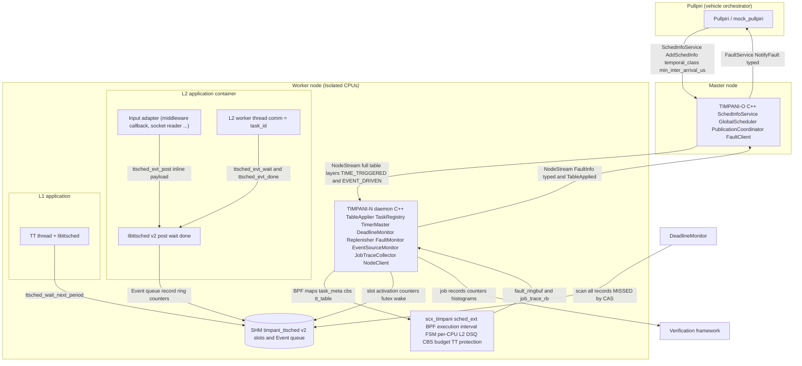

Boundary principle (D-01): no TIMPANI component outside the `L2 application container` knows the middleware type of the input adapter. Middleware code exists only in the sample app area (`examples/`). What the worker passes to `libttsched` is only the Event identifier, arrival time, deadline, and inline payload.

---

## 2. Architectural Drivers

| Driver | Requirement | Architectural impact |
|:--|:--|:--|
| One Event–one Job, explicit Job boundary | REQ-008 MOD-009, DET-007, MOD-010 | The worker receives one Event with `ttsched_evt_wait()` to start a Job, and ends it with `ttsched_evt_done()` (D-18). One queue entry is one Job |
| Arrival-based deadline, detection without waiting for completion | REQ-008 PRT-008, PRT-009, TIM-009, TIM-010 | The absolute deadline $t_{arr} + D$ is fixed at acceptance. The TIMPANI-N DeadlineMonitor detects it during queue wait, execution, or throttling (D-20) |
| Consistency of the queue, notification, and recovery | REQ-008 IF-007, AC-008-15 | The SHM record ring, `(gen, seq)` identification, state transition CAS, and generation check keep the data and times of different Events from mixing (D-19) |
| Division of responsibility between CBS budget management and Event/Job management | REQ-008 MOD-011, FR-G-003 | BPF execution interval observation and explicit Event connection provide the information that different responsibilities of the same L2 worker need (D-21) |
| L1 protection and FFI | CBS-002/005, ORD-003, TIM-007 | Per-CPU L2 DSQ (D-06), TT-first dispatch maintained, FIFO in activation order (D-08), per-window budget cap (D-04) |
| Replenishment determinism | PRT-001/003, TIM-003 | Activation-based replenishment window (D-04), Replenisher thread and kernel kick path (D-07), window condition P-a (§4.3) |
| Admission with deadline guarantee | CBS-004, ORD-001 | One admission formula (D-09, §3.6): $\delta_{ovr}$, $L_{del}^{max}$, $D_i \le MIT_i$, $T_i \le MIT_i$ |
| Preservation of fault meaning, rate limiting | PRT-005/006/007, IF-004 | Separation of the count path (lossless) and the detail path (best effort, drop count) (D-10) |
| Verifiability and mandatory statistics | OBS-001/002, OBS-004 | Slot cumulative counters (independent of trace), Job log, execution-interval record (D-16) |
| Compatibility and governance | NFR-005, C-03 | Only proto field additions (D-11, approval required). SHM ABI breaks are identified by `magic` and `version` |
| Shared-memory trust (P1) | REQ-008 IF-007 | All processes that can write to SHM are trusted. Object isolation is P2 (F-14) |
| Simplicity (P1) | REQ-008 §0.1 | Full-table publication maintained (D-17), FIFO, conservative admission formula, 1 ms periodic scan candidate (D-20) |

---

## 3. Component View

### 3.0 Common Model and Three-Layer Correspondence

| Layer (REQ-008 §2.1) | Responsibility | What it creates / what it uses |
|:--|:--|:--|
| **① Model** | Document contract (REQ-008 §2), application contract (§8.1), output format (§6.5) | Event source, Event (`gen`, `seq`, $t_{arr}$, $t_{dl}$), Job, Event lifecycle state, rules R1~R4, invariant I1 |
| **② Explicit Event connection** | `libttsched` v2 Event queue (§3.4) + SHM v2 slots (§6.2) | Acceptance and rejection, Job boundary (post·wait·done), arrival and deadline records. This is the only path that can create an Event |
| **② Kernel execution observation** | BPF `ops.runnable/running/stopping/quiescent` execution interval FSM (§3.3) | Execution interval (activation $t_{act}$, first run $t_{start}$, sleep), budget usage. It does not create Job boundaries or Events |
| **③ Enforcement** | BPF CBS, CPU pinning, TT protection (budget enforcement), TIMPANI-N DeadlineMonitor and FaultMonitor (deadline-miss detection and reporting), TIMPANI-O admission | Budget overrun enforcement, deadline-miss detection, admission formula (§3.6) |

The canonical source of the common terms is [REQ-008 §2](REQ-008-event-driven-workload-support.md#2-conceptual-model-common-eventjob-model). **CBS budget management** and **Event/Job management** are complementary responsibilities of the same L2 worker, not two apps, classes, or modes, or two parts of an app. The L2 classification of DDR-001 is unchanged.

- **CBS budget management**: responsible for budget enforcement, budget replenishment, and throttling per server window. Enforcement and replenishment are performed by BPF on the assigned CPU, and TIMPANI-N's Replenisher only kicks (§3.3, D-04, D-07). CPU pinning and BPF execution interval observation are related common mechanisms, and they are maintained even without an explicit Event connection.
- **Event/Job management**: through explicit Event connection, performs Event acceptance, identification, and queuing, the explicit Job lifecycle, and arrival-based MIT counting and deadline monitoring. Without a connection, it cannot obtain the necessary Event arrival times and Job records, and it does not estimate them from BPF execution intervals.

P1 does not have additional classification or configuration flags for this responsibility split. If there is no Event record in the source, there is no object for DeadlineMonitor to monitor, and a temporary post silence does not reclassify the app. The same admission formula applies to all L2 tasks. When there is no Event record, the declared D is an admission parameter based on kernel activation, not a monitored Job deadline (MOD-011, D-21). The existing compatibility of optional connection and the principle of not having two Event sources (D-01) are maintained. Automatic connections in P2, such as the middleware boundary and completion of a preceding task, are accepted by adding an adapter to the ② path (§11).

### 3.1 TIMPANI-O

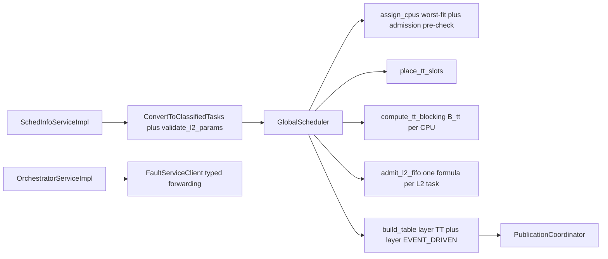

| Component | Change | Responsibility (P1) | Decision |
|:--|:--|:--|:--|
| `SchedInfoServiceImpl` | Modified | `min_inter_arrival_us` takes priority. If it is 0, switch to `period` (warning). L2 parameter validation: $0 < C \le D \le MIT$, $T \le MIT$, `task_id` 15 bytes or less and unique within the node. On rejection, restore the previous workload | D-09, D-11 |
| `GlobalScheduler` | Modified | Separation of `ClassifiedTask.mit_us`. Per-CPU and global hyperperiod made consistent. HP definition for a CBS-only node (FR-O-015; CBS execution does not use this value, D-22). L2 placement and admission on a CPU without TT slots ($B_{tt} = 0$, FR-O-022) | D-09, D-22 |
| `compute_tt_blocking` | New | Merges the TT slots per CPU → $B_{tt}(k, L)$: the maximum TT occupancy within any window of length $L$ | D-09 |
| `admit_l2_fifo` | New (extends the existing `allocate_cbs_budgets`) | Rejection by utilization and min-gap. Checks the one formula of §3.6 for **every** L2 task $i$ on CPU $k$. The remaining conditions of the existing D-09 (for example, 16 or fewer L2 tasks per CPU) are maintained | D-09 |
| `build_table` | Modified | `layer_index=1 TIME_TRIGGERED` (TT only) + `layer_index=2 EVENT_DRIVEN` (CBS only: `budget`, `period`, `deadline`, `min_inter_arrival_us`, `cpu`). `table_id` increases monotonically | D-06, D-11 |
| `OrchestratorServiceImpl::handle_fault_info` | Modified | Maps the fault type to a type with the same meaning (removes the collapse into UNKNOWN). Passes the new fields | D-10 |

### 3.2 TIMPANI-N (userspace)

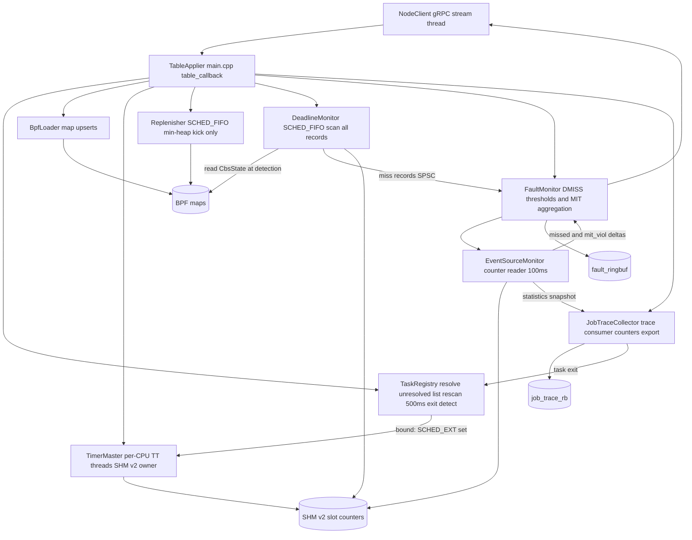

| Component | Change | Responsibility (P1) | Decision |
|:--|:--|:--|:--|
| `TableApplier`(main.cpp) | Modified | Branches on the layer `model`. EVENT_DRIVEN entry: `cpu` check (an application error if it is missing or not an isolated CPU; not replaced with the partition cpuset) → TaskRegistry resolution request → `cbs_map` setting → `TaskMeta(CBS, cpu, bind_gen)` → switch to `SCHED_EXT` → notify TimerMaster of binding completion to activate the slot (§4.1). If the registered entry is unchanged, it **writes nothing** (the execution interval and budget state owned by BPF are preserved). If the parameters changed, remove and register again. Passes the server list to Replenisher. Before binding, checks that the assigned CPU is in the worker's allowed CPU set (FR-N-033). If not, it does not bind, records an error, and leaves the task on the unresolved list (distinguished from the application error of the isolated CPU check) | D-06, D-11, D-17, D-24 |
| `TaskRegistry` | Revived and extended | Name-to-TID resolution (process to thread), unresolved list, 500 ms rescan, binding callback on discovery (registration), callback on TID disappearance (cleanup). Counts `bind_gen` so that it can ignore the end record of an earlier binding that arrives late | D-12, D-17 |
| `TimerMaster` | Modified | Owns SHM v2. At startup, if an SHM object remains, performs the shutdown procedure (§6.3 protocol 7) and creates a new object. If the TT slot set is the same, does not restart the TT threads (`update_evt_slots`). For L2 sources, a **fixed assignment** of the slot is made at table application (only the name is recorded, before activation), and **activation** is done at binding: first writes `kind = NONE`, closes the remaining non-terminal records, then writes the configuration → `last_arr_ns = 0` → new `gen` → `kind = EVT`, records the counter baseline. On deactivation or termination, `kind = NONE` → closing sweep → `counter` increment → wake-up. Jitter samples go to JobTraceCollector | D-03, D-16, D-17 |
| `DeadlineMonitor` | New | SCHED_FIFO thread (candidate priority 97, below Replenisher 98 and TimerMaster 99, above general app RT threads). Non-isolated CPU. Reads every entry of all slots every `DL_SCAN_PERIOD_US` (candidate 1000 µs). For a record that is QUEUED or RUNNING, has no MISSED, has $now > t_{dl}$, and whose `gen` equals the slot's current `gen`, performs the MISSED CAS and `missed++`. Records of other generations are skipped and their state is not changed. Reads BPF `CbsState.throttled` once, only at detection. Sends the miss record to FaultMonitor (SPSC; drop count if full). Does not depend on the worker or the L2 scheduler. Does not depend on TT events or the hyperperiod (FR-N-032, D-22). No heap allocation, blocking I/O, or gRPC. Whether to merge with Replenisher is F-12 | D-20 |
| `Replenisher` | New | Heap of "next check time" per L2 server. When it wakes, runs `timpani_replenish_kick` (kicks only the assigned CPU of a server that is throttled, whose window has ended, and whose TT slot is not active on that CPU; alternative: kicker thread). A server whose window has ended but is not yet promoted is checked again after 1 ms. **Does not write the server state (`cbs_map`).** The heap is created and replaced by the table application thread. Does not use TT events or hyperperiod boundaries as execution conditions (FR-N-032, D-22) | D-04, D-07 |
| `FaultMonitor` | Modified | **Count path** (lossless): every period, aggregates the increments of the `missed` and `mit_viol` counters of all sources against the activation baseline, and feeds them into the threshold rules (`max_dmiss`, `current_limit`) and the cumulative report. **Detail path** (best effort, drop count): deduplicates the DeadlineMonitor miss records and the MISSED entries of the Job log by `(task, gen, seq)` and attaches them to the report. Flags `NOT_STARTED`, `THROTTLED`, `MIT_RELATED`, `LATE_COMPLETION`, `DETECTED_LATE` (§6.5). `MIT_VIOLATION` is created from the increment of `mit_viol`, with one FaultInfo per source per $T_s$ window (including the count). Sends only the FaultInfo of the current registration. All misses are counted on the count path, and a FaultInfo is sent only when the existing threshold rule (`max_dmiss`) calls for it | D-05, D-10 |
| `JobTraceCollector` | New | Consumes execution-interval records of `job_trace_rb`, consumes the slot Job log (drop count), outputs the Job records closed by TIMPANI-N, per-task statistics, histograms, and output, runtime toggle (`trace_enabled`), and notifies TaskRegistry of task exit records. Trace drops are not used for the deadline-miss determination | D-16, D-12 |
| `EventSourceMonitor` | New | Reads all slot cumulative counters every 100 ms, on the FaultMonitor polling thread. Sends the `missed` and `mit_viol` increments to FaultMonitor, and sends the statistics snapshot (`arrivals`, `accepted`, `overflow`, `revoked`, `started`, `completed`, `discarded`, `cancelled`, `abandoned`, `missed`, `mit_viol`, `resp_max_ns`) to JobTraceCollector. The count path and the statistics operate even when tracing is off | D-03, D-16 |
| `BpfLoader` | Modified | New maps and program handles (`job_trace_rb`, `timpani_replenish_kick`, `trace_enabled`), passes the per-CPU DSQ count | D-06, D-07, D-16 |

### 3.3 BPF Scheduler (`scx_timpani`)

BPF handles budgets and execution intervals. Code identifiers may keep the `job_` prefix (when renaming gives no benefit). In this document, the unit that BPF observes is called an **execution interval** (kernel activation → first run → voluntary sleep), and it is not called a Job.

| Element | Change | Content | Decision |
|:--|:--|:--|:--|
| `TaskMeta` | Extended and reduced | Added: `bind_gen` (binding count, carried in the end record), execution interval state, `run_seq`, `t_act`, `t_start`, `last_act`, execution interval flags (`CARRYOVER`, `THROTTLED`), `queue_key_ns` (L2 queue rank). Removed: `mit_us`, `mit_viol_count`, the MIT check based on activation, and the L2 DMISS and EARLY determination flags | D-02, D-05, D-08, D-17 |
| `CbsState` | Meaning kept | `replenish_at_ns` = end of the current replenishment window. Only BPF writes `remaining` and `replenish_at`. Userspace only reads `throttled` (at detection time) | D-04 |
| DSQ | Maintained | `DSQ_CBS_BASE + cpu`, `DSQ_THROTTLED_BASE + cpu` (created in `init` for each isolated CPU) | D-06 |
| `ops.runnable` | Modified | WAITING→ACTIVE, records $t_{act}$, increments `run_seq`. Window check: if the previous window has ended (rule 1), fills the budget and starts a new window; if it has not ended, runs with the remaining budget and marks `CARRYOVER`. The activation-based MIT check and the `MIT_VIOLATION` emission are deleted | D-02, D-04 |
| `ops.select_cpu` | Modified | Removes the activation record. Returns `assigned_cpu` | D-02, D-06 |
| `ops.enqueue` | Modified | Using the remaining budget after applying the activation replenishment, selects the L2 DSQ or the THROTTLED DSQ of the assigned CPU. Performs the episode count and the `BUDGET_EXCEED` emission only when actually entering THROTTLED. Does not replenish here | D-04, D-06, D-08, D-10 |
| `ops.dispatch` | Modified | Promotes, among the throttled servers of its own CPU, the servers whose window has ended (fills the budget, new window, rank = promotion time) → consumes the L2 DSQ in activation order. TT-first is maintained. On a CPU with no TT slots, the TT activity check is false, so dispatch is not blocked by the TT gate (FR-B-025, D-22) | D-04, D-06, D-08 |
| `ops.running` | Modified | Records `t_start` at the first run. Slice cap maintained | D-02 |
| `ops.stopping` | Modified | Charges the budget (accumulates in ns). If the task remains runnable with zero remaining budget, prevents reuse of the remaining slice. An enqueue path that also blocks re-run after expiry of a sole runnable task is required (LLD-008 §4.4). Sleep only charges. **Early DMISS determination deleted** | D-04, D-10 |
| `ops.quiescent` | Modified | ACTIVE→WAITING (voluntary sleep = end of execution interval). Records `t_sleep` and `budget_used_us`, emits the execution-interval record (when `trace_enabled`). **DMISS determination deleted** | D-02, D-16 |
| `ops.exit_task` | New | Emits the task exit record (including `bind_gen`) to `job_trace_rb` (no gate) → JobTraceCollector → TaskRegistry | D-12, D-16 |
| `job_trace_rb` | Modified | Execution-interval records (256 KiB, gated by `trace_enabled`). Task exit records are emitted regardless of the gate | D-16 |
| `timpani_replenish_kick` | Maintained (SYSCALL prog) | Reads `cbs_map`, and calls `scx_bpf_kick_cpu(cpu, 0)` only when the server is in the throttled state, its window has ended, and the TT slot is not active on that CPU. Does not write state and returns `(throttled, remaining, replenish_at)` | D-07 |

BPF does not know the Event queue, the deadline, or the MIT. The deadline-miss determination is handled by TIMPANI-N's DeadlineMonitor and the worker's termination transition (§6.3 protocol 6).

### 3.4 Application Library (`libttsched` v2)

The Event queue API is a **proposal** and requires Project Leader approval. The constants and limits are candidate values to be placed as build constants.

```c
#define TTSCHED_EVT_PAYLOAD_MAX  64   /* bytes carried inline per Event (P1 build constant, candidate) */
#define TTSCHED_EVT_QDEPTH        8   /* ring occupancy: QUEUED + RUNNING + closed entries head has not passed (power of two, candidate) */
#define TTSCHED_EVT_E_INACTIVE  (-1)  /* source not active, or the open Job was closed by TIMPANI */
#define TTSCHED_EVT_E_FULL      (-2)  /* queue full: rejected, counted as overflow */
#define TTSCHED_EVT_E_INVAL     (-3)  /* len > PAYLOAD_MAX, t_arr in the future or earlier than the previous arrival; done with an invalid outcome (the Job is ended as DISCARDED) */
#define TTSCHED_EVT_E_STATE     (-4)  /* wait while a Job is open, or done with no open Job */
enum { TTSCHED_EVT_COMPLETED = 0, TTSCHED_EVT_DISCARDED = 1 };

typedef int ttsched_evt_t;
struct ttsched_evt_event { uint64_t gen; uint32_t seq; uint32_t len;
                           uint64_t t_arr_ns; uint64_t t_deadline_ns;
                           uint8_t payload[TTSCHED_EVT_PAYLOAD_MAX]; };

ttsched_evt_t ttsched_evt_open(const char *task_id);   /* non-RT: maps SHM, resolves slot */
int ttsched_evt_post(ttsched_evt_t src, uint64_t t_arr_ns, const void *payload,
                     uint32_t len, struct ttsched_evt_id *id_out);  /* 0 accepted; <0 nothing created */
int ttsched_evt_wait(struct ttsched_evt_event *ev);    /* worker: take exactly one Event, start its Job */
int ttsched_evt_done(int outcome);                     /* worker: end the open Job (mandatory) */
```

| API | Caller | Behavior |
|:--|:--|:--|
| `ttsched_init()` | TT and L2 (common) | Maps SHM v2 (remaps only when the object has changed), validates `magic` and `version`, searches for the slot by comm. Non-RT path. It may be called several times. If the object has not changed, it does not add a mapping. The previous mapping of a replaced object remains (P1 limitation) |
| `ttsched_wait_next_period()` | L1 TT | Existing behavior maintained |
| `ttsched_evt_open(task_id)` | Input adapter, worker initialization | Non-RT. The handle `ttsched_evt_t` refers to `task_id`. It remains valid after `ttsched_init()`, and at the next use it looks up the slot again (bounded scan, no system call) |
| `ttsched_evt_post(...)` | Input adapter (one context at a time per source) | Acceptance protocol (§6.3 protocol 2). 0 means that the Event was created, has identifier `(gen, seq)` and deadline $t_{arr} + D$, and has become subject to monitoring. A negative value means that nothing was created. If `t_arr_ns == 0`, the call time (CLOCK_MONOTONIC) |
| `ttsched_evt_wait(ev)` | Worker (one thread per source) | There must be no open Job. Takes the Event at the head of the queue, `QUEUED → RUNNING`, and starts the Job (protocol 3). If E_INACTIVE, returns after a short back-off (candidate 10 ms), and the caller retries after `ttsched_init()` |
| `ttsched_evt_done(outcome)` | Worker | Ends the open Job (protocol 4). `COMPLETED` or `DISCARDED`. If the seq of `W0` differs from the seq of the open Job, or `W0` is ABANDONED, returns E_INACTIVE (TIMPANI closed it, or the slot was reused). The open-Job flag is cleared even when E_INACTIVE is returned |

- **Only inline payload is supported in P1.** If `len > TTSCHED_EVT_PAYLOAD_MAX`, E_INVAL is returned. TIMPANI guarantees that the payload bytes match the Event identifier and time. If the app puts a reference to its own storage in the payload, the lifetime of that storage is outside the contract (P1 has no release notification). Large payloads and explicit release are P2 (F-13). The `RadarTarget` of FCW (16 bytes) fits inline.
- **Posting context is one per source.** `ttsched_evt_post` calls for the same source must not run concurrently (one adapter thread, or the adapter serializes the calls). libttsched uses no locks and does not detect violations. On violation, only the queue of that source may be corrupted. Multiple posters are P2 (F-13). The poster may be a thread of the same process as the worker, or another process on the same host with SHM write permission.
- **The worker is one thread per source.** The thread name is `task_id` (1 to 15 bytes, validated at table application). If a second thread calls wait/done for the same source, it is a contract violation.
- **Arrival time `t_arr`.** If `t_arr_ns == 0`, the post call reads CLOCK_MONOTONIC. If a value is given, it must be CLOCK_MONOTONIC, must not be in the future, and must not be earlier than the previous arrival of the same source (E_INVAL). A value earlier than the current time is accepted as given. The time the adapter has already used is part of the response time, and the admission formula does not cover it (§3.6 assumption 5).
- **Cost limit.** post, wait (when not blocking), and done are bounded in the number of atomic operations (the count per call is given in LLD-008 §6, candidate), one payload copy (64 bytes or less), and at most one futex system call. There is no heap, lock, or blocking. Mapping and remapping are outside this limit and are performed by `ttsched_evt_open()` and `ttsched_init()` on the non-RT path. If the mapping cannot be written, post and wait do not remap and return E_INACTIVE.
- **Termination and cancellation of a wait:** same as 9209bc5. P1 has no API that cancels a wait (LLD-008 L-8).
- **Trust:** In P1, all processes that can write to the SHM object are trusted. A writer that writes incorrectly can corrupt any slot. Isolation of the object per source is P2 (F-14).

### 3.5 Sample App Adapter (outside the core)

- `examples/someip/radar_based_fcw`: the vsomeip message handler posts the `RadarTarget` inline with `ttsched_evt_post`. The worker receives one Event with `ttsched_evt_wait()` and ends it with `ttsched_evt_done()`. The receive queue, mutex, condition variable, and `timpani_evt_*` calls are removed (§8.4).
- `libtimpani_rt` is retired (REQ-008 §12). The SOME/IP ID-based API that this library had, and its own MIT and E2E determination, are not part of the TIMPANI contract.
- The second workload `evttask` is a non-SOME/IP sample that uses a Unix datagram source (§8.5). It uses the same contract.

### 3.6 Admission Formula (TIMPANI-O, D-09)

The deadline of an Event is counted from its arrival. For every L2 task $i$ on CPU $k$, the following one admission formula is checked regardless of whether there is an explicit Event connection. The division of responsibility between CBS budget management and Event/Job management is not the criterion for dividing the admission formula.

$$C_i + B_{tt}(k, D_i) + L_{del}^{max} + \sum_{j \ne i}(C_j + \delta_{ovr}) \le D_i \quad\text{and}\quad D_i \le MIT_i \quad\text{and}\quad T_i \le MIT_i$$

| Term | Meaning | P1 value (candidate, subject to measurement) |
|:--|:--|:--|
| $C_i$ | Budget `runtime` of task $i$. Declared larger than the measured maximum CPU time per Job (§8.1 item 9) | Declared value |
| $B_{tt}(k, D_i)$ | Maximum TT occupancy of CPU $k$ within any window of length $D_i$ | Computed value (from the TT table) |
| $L_{del}^{max}$ | Upper bound from arrival to the first dispatch of the worker = $L_{post}$ (TIM-011, from $t_{arr}$ to runnable, candidate 50 µs) + $L_{wake}$ (TIM-001, from runnable to the first run, on an idle CPU with no TT, 50 µs). TIM-002 (wake-up during TT occupancy) is not included, and its wait is covered by the $B_{tt}$ term. The $L_{post}$ bound holds in the **reference poster configuration** (a configuration in which the poster thread is not preempted by other threads from the recording of the arrival time to the return of the post call, REQ-008 A-10). | Candidate 100 µs |
| $\delta_{ovr}$ | Maximum overrun until a server is throttled after another server has overrun its budget. One scheduler tick (TIM-004/TMG-004) | Candidate 1 ms (HZ=1000) |
| $MIT_i$ | `min_inter_arrival_us`, or the period if absent (D-11 rule) | Declared value |
| $T_i$ | CBS server period (`period`) | Declared value |

The two parts of $L_{del}^{max}$ are both **measurement targets** and not proven worst-case values. TIM-001/002 keep their kernel-side definitions as they are. $D_i \le MIT_i$ and $T_i \le MIT_i$ make the Job of one Event finish within the arrival interval $MIT_i$, and the next activation lies outside the window. Therefore, no separate term for its own queuing is included.

**Assumptions (conditions under which this formula is a sufficient condition; the document holds them as a list)**

1. TT tasks run within the declared runtime. A TT overrun is a TT DMISS and is outside the L2 guarantee.
2. $\delta_{ovr}$ and $L_{del}^{max}$ hold as measured values. The $L_{post}$ bound holds in the reference poster configuration (A-10).
3. The arrival of the source keeps the MIT.
4. The Job does not block (§8.1 item 6). A-06 is an application condition of this formula, not a precondition of correctness. A source that blocks is monitored for its deadline, but the admission formula does not guarantee it.
5. The adapter posts at the time of arrival. If the given $t_{arr}$ is earlier than now, $D$ is consumed by that amount.
6. The net execution time from activation to the actual sleep (including the cost of entering the wait) is at or below the declared $C_i$ (budget margin recommendation).
7. Each Job finishes fast enough for the worker to sleep in `ttsched_evt_wait()` before the next arrival (boundary case of P-a in §4.3).
8. `tol` (§4.3) covers the measured activation jitter.

**Results and impact**

- Even when there is no Event record, the same admission formula must be passed. In this case, $D$ is the admission parameter based on kernel activation, not a monitored Job deadline. The $L_{post}$ part remains as margin.
- If there is an arrival that violates the MIT, the queue accumulates up to QDEPTH and the later Jobs are late. This is not prevented; it is reported.
- If there are several L2 tasks on a CPU, the $\delta_{ovr}$ term reduces the admission rate. This is subject to review in R-5 and P2 HRTICK.
- With the default FCW parameters, a second L2 task cannot be placed on the same CPU (§8.5 (c)).
- The formula is a sufficient condition, not a proof. The values of the terms are to be confirmed by measurement.

---
## 4. Runtime View

### 4.1 L2 Workload Registration → Admission → Publish → Application

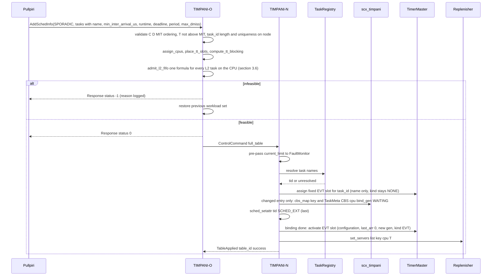

- During table application, only the **slot name** is assigned to the L2 source. `kind` is left as NONE. Activation happens only after the worker thread is bound and switched to `SCHED_EXT` (protocol 1). Therefore, accepting an Event means that a managed worker exists.
- If the TT slot set is the same, the TT threads are not restarted, and only the EVT slot assignment is updated (`update_evt_slots`). If the set changes, SHM v2 is published again (`set_schedule_table`).
- If admission rejects the workload, the previous workload set is restored. In this case, nothing is written to BPF and SHM.

### 4.2 Normal Event → Job

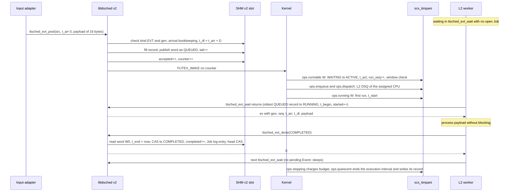

One Event is one Job. If the worker was asleep, the Event becomes runnable immediately upon acceptance (R1). The activation time $t_{act}$ and the arrival time $t_{arr}$ are different values. The admission formula and the Event-based response time use $t_{arr}$. The execution interval is kernel observation, so it is not used as a Job boundary. The worker opens a Job when `ttsched_evt_wait()` acquires the Event, and the Job ends at the completion time $t_{end}$ that `ttsched_evt_done()` writes.

### 4.3 Budget Exhaustion → Throttling → Backup Replenishment → Resumption

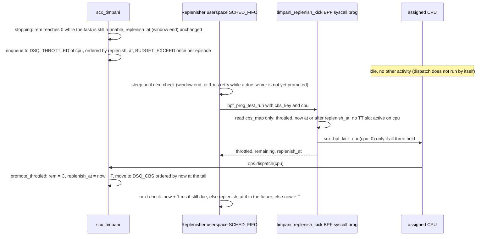

The start of the replenishment window is tied to kernel activation (the runnable transition) and is not tied to the time of the first run. Promotion and replenishment are performed by BPF on the assigned CPU, and the Replenisher only causes a dispatch (D-04 rule 6, D-07). Even if an execution interval starts anew, no new budget is given. A Job started within the same window (a consecutive Job, or a resumption after blocking) shares the remaining budget (D-04). Within an open window, the budget does not increase. A server returns to the normal state only at the next kernel activation (rule 1) or at promotion (rule 3).

**Window condition P-a (restated).** If the arrival of the Event keeps the MIT, the net execution time from activation to the actual sleep is at or below $C_s$, and the Job does not block, then the following holds.

- $T_s \le MIT$ ($T_s$ is the declared CBS period `period`, MIT is `min_inter_arrival_us`, and the period if it is absent). Without this condition, on a server with $T_s > MIT$, a conforming arrival falls inside an open window and does not receive a new budget.
- $D \le MIT$.
- Each Job finishes fast enough for the worker to sleep in `ttsched_evt_wait()` before the next arrival. Then the interval between consecutive activations is $T_s - tol$ or more, and every Job starts with a full budget (it is not throttled).

**Boundary case.** If a Job ends so close to the next arrival that the worker has not yet gone to sleep (possible only when R is close to MIT), the next Job starts without a kernel activation and runs with the remaining window budget. That window ends after the activation delay of the previous Job, and the budget is refilled by promotion. The additional delay is small and bounded, but BUDGET_EXCEED may occur. It is recommended to leave a margin between D and MIT.

**Behavior after a violation.** If a Job passes its deadline or an arrival violates the MIT, the next Job starts within the open window, shares the remaining budget, and may be throttled until the window ends (`CARRYOVER`). It may also pass its deadline. This is not prevented and is reported. In this case, the window is not pushed back, and promotion happens only at the window end (the "behavior after a violation" of D-04 is rewritten in window terms).

**`tol` (`CBS_ACT_TOL_US`)** is the tolerance of window rule 1 only. The candidate value is 50 µs ($L_{post}$), and it must be larger than the spread of the delay from the arrival time $t_{arr}$ to runnable. It is not used for the MIT check and is not tied to `L_wake_max`. It is subject to measurement.

No kick is sent to a CPU on which a TT slot is active. When a TT task sleeps, dispatch is called as the CPU selects the next task, so the server is promoted. The Replenisher checks every 1 ms until promotion occurs.

Alternative path (D-07 option 2): instead of `KP`, a per-CPU kicker thread is woken by futex to cause `schedule()`.

### 4.4 Job A Execution While Event B Arrives, and Consecutive Jobs

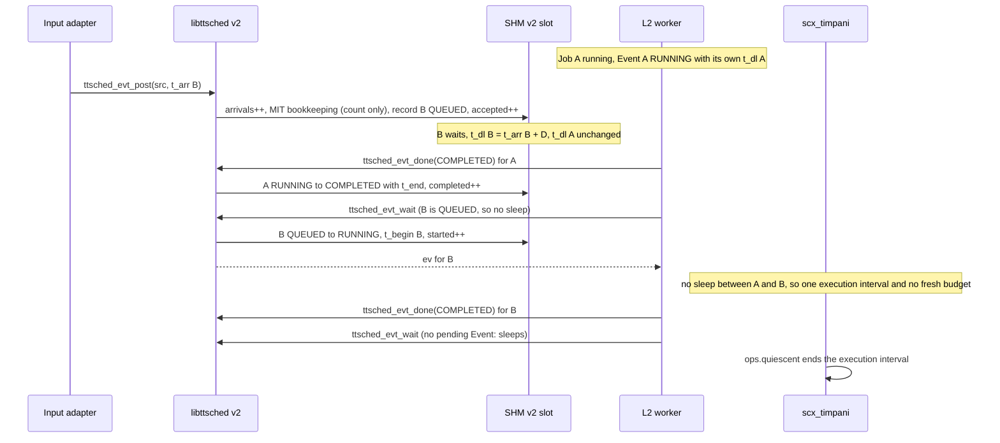

When B arrives while A is being processed, B remains `QUEUED` (R2). It is not merged into A, and the deadline of A does not change. When A ends, the worker does not sleep. It takes B and starts a second Job (R3). The two Jobs are different Jobs, and each is recorded and determined separately (AC-008-13). BPF sees both Jobs in one execution interval, so a single execution-interval record spans both Jobs. No new budget is given in this interval. If the worker calls wait while there is an open Job, it gets E_STATE, so the previous Job must always be ended with done.

### 4.5 Late Binding (late-created worker / restart)

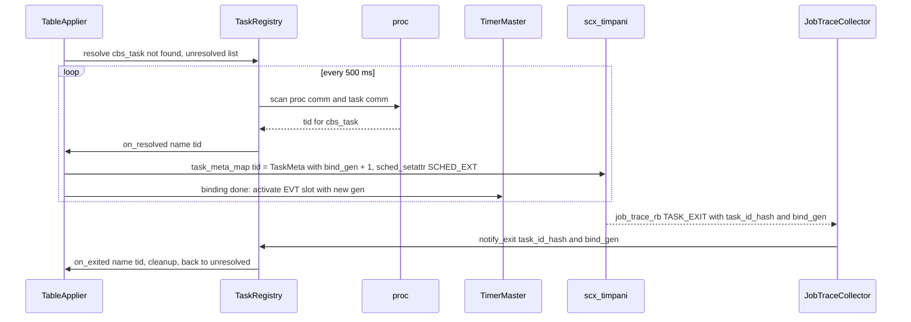

`bind_gen` increases with every binding. A late end record of an earlier binding has a `bind_gen` that does not match, so it cannot deactivate the new binding. The slot is activated only when a worker thread appears and is bound. No Event has arrived before that. While the worker is not yet bound, post receives E_INACTIVE.

### 4.6 STOP (removal)

The existing removal path and the recovery STOP path of DDR-012 §5.1 are maintained. The STOP and removal decisions of DDR-011 Phase 0 ([§3](DDR-011-runtime-table-update.md#3-d-p0-02--o-input-recovery-stop-and-one-at-a-time-confirmation), [§8](DDR-011-runtime-table-update.md#8-d-p0-07--ack-after-application-and-normal-removal)) cover the L1 TT scope, and L2 removal is decided together in DDR-011 Phase 1. The added steps are as follows. First, revert with `sched_setattr(SCHED_OTHER)`. Next, TimerMaster deactivates the slot (§6.3 protocol 5): it first writes `kind = NONE`, performs a closing sweep over the whole slot to change QUEUED records to CANCELLED, and changes RUNNING records to ABANDONED after confirming that the worker has finished. Finally, it raises `counter` to wake the worker. After that, it clears `TaskMeta`, `cbs_map`, the Replenisher heap entry, and the unresolved list. JobTraceCollector statistics remain as cumulative values. The SHM slot is not cleared. The slot remains fixed-assigned to `task_id`, and if the same `task_id` is registered again, it continues the cumulative counters but receives a new `gen`.

### 4.7 Deadline Elapse Detection: Event waiting in the queue

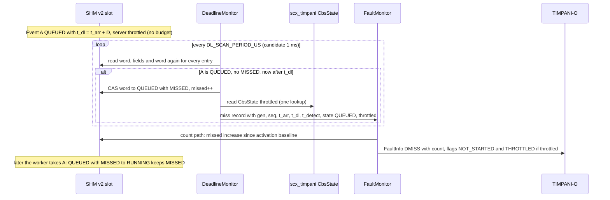

An Event that the worker has never been able to start is also detected. Detection does not depend on the worker or the L2 scheduler. The record only has MISSED set in `QUEUED`, so its state does not change. It is cleaned up later, when the worker takes it or it is closed. One deadline miss is counted only once (protocol 6).

### 4.8 Deadline Elapse Detection: Job running during throttling and the completion race

> **Review of the wake-up method:** The criterion of §4.7~4.8 is periodic scanning (1 ms candidate). The alternative that manages the earliest $t_{dl} = t_{arr} + D$ in a heap and sets a single absolute timer is reviewed in [DDR-008 D-20](DDR-008-event-driven-workload-support.md#d-20-deadline-detection-without-waiting-for-completion-arrival-based-absolute-deadline-deadlinemonitor--p1), F-10 and REQ-008 OI-22. All of the following must be maintained: the notification and reset race of an earlier post, execution delay after expiry, reconfirmation of the same `gen`/`seq` and the determination of $now > t_{dl}$, the single MISSED CAS, and the late end path. Do not assume that the existing counter for the worker also wakes the monitor. The timer is not settled as the solution to the completion race (OI-20) or to the jitter bound, and the criterion is not changed before design review and the target PoC.

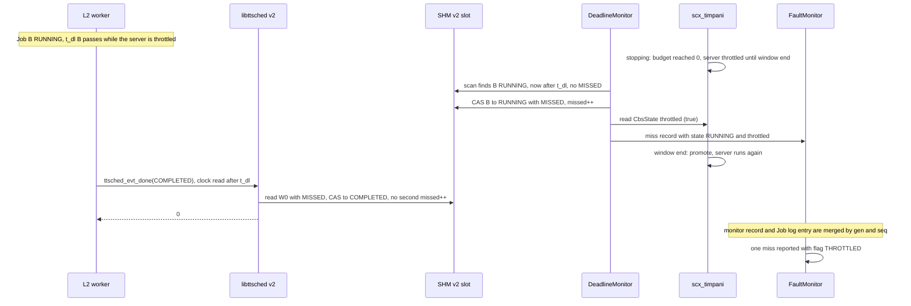

This Job did not complete before the deadline, so the deadline miss occurs once, even though the completion time is late. The `t_end` of the completion record is the late value, and the deadline miss is counted at the detection time. If the completion was posted before the deadline but TIMPANI-N collected it late, that completion is not a miss. The determination uses the recorded `t_end`.

**Definition of the completion time and race rule.** $t_{end}$ is the clock value that `done()` reads just before the worker posts the termination transition. For the Job to be on time, $t_{end} \le t_{dl}$ must hold, and the monitor must not have marked it as late before that. If the transition overlaps the monitor's marking, the transition fails, and the worker re-reads the clock (now after $t_{dl}$) and retries. Therefore, the recorded $t_{end}$ and the MISSED flag do not diverge. If the worker is preempted after reading the clock and before posting the transition, a Job recorded as on time may actually be posted after $t_{dl}$. This error is accepted, and it is not later than the first monitor check (§9 R-18).

### 4.9 Queue Overflow (E_FULL)

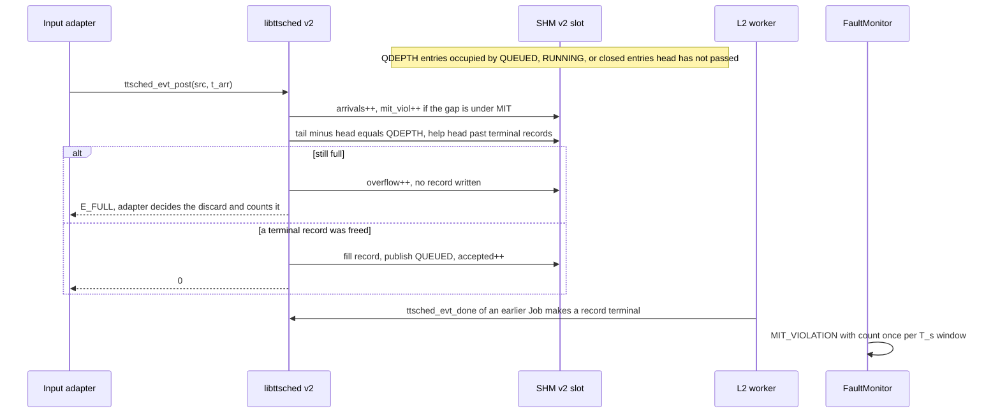

Overflow occurs before acceptance. `QDEPTH` is the upper bound on ring occupancy. The occupancy includes not only QUEUED and RUNNING entries but also the closed slots that `head` has not yet passed. Therefore, E_FULL can occur even when the number of live Events is less than QDEPTH. This happens only while a RUNNING Job is at `head` and blocks passing the closed slots behind it. A rejected post is not an Event: it does not count `accepted`, and it counts `overflow`. The MIT count is counted as an arrival even if it is rejected (`arrivals`, `mit_viol`). When the app receives E_FULL, it discards that Event and adds the number of discards to its own statistics. Because the app keeps no app queue outside the queue, the overflow remains in the SHM counter and the app statistics, and the Event data does not mix with other Events. A burst that violates the MIT can fill the queue up to QDEPTH, and the later Jobs are late (§4.4, §8.4 (3)). In this case, the overflow and the MIT violation are reported but not prevented (D-19).

### 4.10 Deactivation and Re-registration

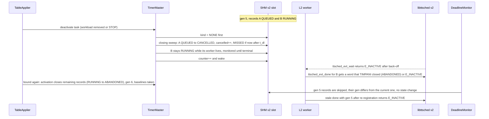

Deactivation clears `kind` first, so a new post receives E_INACTIVE. The closing sweep changes QUEUED to CANCELLED, and if the deadline has already passed, it also sets MISSED (cancellation does not erase a miss). A RUNNING record remains RUNNING while its worker is alive, continues to receive deadline monitoring, and becomes ABANDONED when the worker has finished. Re-registration (activation) closes all remaining records. RUNNING always becomes ABANDONED, receives a new `gen`, and records the counter baseline. A late `done` of the previous generation sees ABANDONED and receives E_INACTIVE. The state of records of the previous generation does not change the new registration state. Deadline monitoring skips records whose `gen` differs. The closing sweep closes all records designated for closing. If the worker takes a QUEUED record after writing `kind = NONE` and before the closing sweep, that Job runs and is monitored, and it is recorded normally (allowed in P1). A miss found in the previous generation remains only in the records and statistics, and is not sent as a FaultInfo of the current registration.

### 4.11 Daemon Restart and Behavior during Daemon Outage

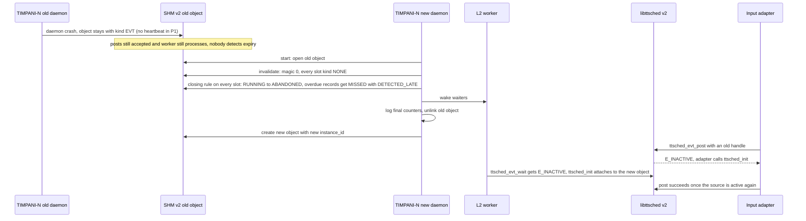

On restart, the new daemon first sets `magic` to 0 and changes all slots to NONE. Therefore, a post accepted before invalidation is caught by the closing sweep, and later posts receive E_INACTIVE. (In step (a) of protocol 2, only `kind` is checked. Updating `magic` does not block a post; what blocks a post is `kind`.) It then performs the closing rule on all slots, attaching MISSED and DETECTED_LATE to records whose deadline has passed. After that, it creates a new object together with `instance_id`. A process attached to the previous object receives E_INACTIVE and attaches to the new object with `ttsched_init()`. `seq` starts again from 0 in the new object. Because `gen` differs, `(gen, seq)` is unique within the object. Because `gen` is based on `instance_id` and spans restarts, it is practically unique, but this is not a guarantee. The trace records the 64-bit `instance_id` to distinguish daemon runs.

**While the daemon is down (P1 limitation).** The previous object keeps `kind = EVT` as it is. Therefore, post is accepted and the worker continues to process. The termination transition of the worker still determines late completion. However, no entity detects an Event whose deadline passes while it is waiting in the queue or running. Such a miss is found as DETECTED_LATE in the closing cleanup at the next daemon start, and it appears as final statistics rather than as real-time reporting. P1 has no daemon heartbeat. Execution in that interval is outside TIMPANI management, and any uncompleted Event accepted at that time becomes CANCELLED or ABANDONED by the closing rule at restart.

---
## 5. Deployment View

### 5.1 Threads within the Node (timpani-n process)

| Thread | Policy/priority | CPU | RT path | Change |
|:--|:--|:--|:-:|:--|
| TimerMaster per-CPU | SCHED_FIFO 99 | Each isolated CPU (unpinned, current) | ● | SHM v2 slot activation and closing |
| **DeadlineMonitor** | SCHED_FIFO 97 (candidate, to be fixed in PoC, below Replenisher 98) | Non-Isolated | ● | New |
| Replenisher | SCHED_FIFO 98 (TM−1; default, to be fixed in PoC, DDR-007 §11) | Non-Isolated | ● | Maintained (separate thread, F-12) |
| (alternative) kicker per-CPU | SCHED_FIFO 97 | Pinned to each isolated CPU | ● | When D-07 option 2 |
| FaultMonitor·EventSourceMonitor polling | default | Non-Isolated | — | Count path and detail path, statistics reading |
| JobTraceCollector | default | Non-Isolated | — | Consumes execution-interval records and Job log |
| TaskRegistry rescan | default | Non-Isolated | — | Maintained (including binding callback) |
| NodeClient stream | default | Non-Isolated | — | — |
| main | default | — | — | — |

RT-path threads (TimerMaster, DeadlineMonitor, Replenisher) do not perform gRPC, heap allocation, or blocking I/O (DDR-006 §4). DeadlineMonitor passes the detected misses to FaultMonitor through a fixed-size SPSC queue. When the queue is full, it counts drops. The heap of Replenisher is newly created outside the lock by the table application thread (non-RT) and replaced in a short critical section, and the RT loop does not allocate. The lock is a priority-inheritance mutex. Whether to merge DeadlineMonitor and Replenisher into one thread is F-12. P1 assumes separate threads. It does not assume that Replenisher takes over the function of DeadlineMonitor.

### 5.2 BPF Object

It includes the `scx_timpani` skeleton with struct_ops (`runnable/quiescent/exit_task` added), `job_trace_rb` (execution-interval records), `timpani_replenish_kick` (SEC("syscall")), and the global `trace_enabled`. The load order and privileges are maintained as current (`CAP_BPF`, `CAP_SYS_NICE`).

### 5.3 Application

- **Worker TID invariant:** A registered L2 worker runs on its assigned isolated CPU under `SCHED_EXT`/timpani-n kernel BPF CBS, and the assigned CPU must be in the worker's allowed set (CBS-008). It does not require an isolated placement of the whole container. The app accesses `/dev/shm/timpani_ttsched` **with write permission**, because the worker's wait and done change the record states and counters (this differs from the read-only access of the current TT app).
- Each L2 source has one worker thread. The comm of the thread is `task_id`. A thread that is not the worker does not call wait or done.
- The post context is one per source (§3.4). It may be a thread of the same process, or another process on the same host with SHM write permission (OI-15 resolved, DDR-008 D-03). If there are several posters, the app serializes them.
- **Distinction between the current state and the review target:** The current state follows the container cpuset configuration of the system and Pullpiri, and binding by N does not move the cgroup. The target of placing only the worker on an isolated cpuset and non-workers on non-isolated CPUs is under deployment review. For the common threaded domain / `cgroup.threads` condition, the difference from partition isolation, and the open items on runtime delegation, privileges, inheritance, restart, and the responsibility of N for moving and verification, follow [DDR-008 D-24](DDR-008-event-driven-workload-support.md#d-24-application-abstraction-and-execution-environment-assumptions--p1). It is not treated as implemented or verified.
- The API runs on the calling thread, and the SHM itself does not run. The CPU execution cost of wait and done belongs to the worker's CBS, and the cost of post belongs to the poster's context. The selection and management among fair/FIFO/RR for non-workers is outside the P1 scope, and environment verification of placement, policy, and interference is maintained (D-24).

---

## 6. Data View

### 6.1 BPF Maps (changed and new only; full list in LLD-008)

| Map | Key → value | Change |
|:--|:--|:--|
| `task_meta_map` | TID → `TaskMeta{bind_gen, exec_state, run_seq, t_act_ns, t_start_ns, last_act_ns, exec_flags, queue_key_ns, ...}` | Extended and reduced. Removes `mit_us`, `mit_viol_count`, and the L2 DMISS determination flags, and adds `bind_gen` (D-02, D-05, D-17) |
| `cbs_map` | `wl_hash ^ task_hash` → `CbsState{..., exec_frac_ns, throttle_episodes}` | Maintained. `replenish_at_ns` is the end of the replenishment window and is written only by BPF together with `remaining` (D-04). Userspace writes only before a task enters SCHED_EXT (creation) and after it leaves (deletion). It reads `throttled` at detection |
| DSQ | `DSQ_CBS_BASE+cpu`, `DSQ_THROTTLED_BASE+cpu` | Maintained (per CPU) |
| `fault_ringbuf` | `FaultEvent{task, kind, activation...}` | Reduced. BPF emits no L2 types. `MIT_VIOLATION` and L2 `DMISS` are not emitted by BPF. The TT DMISS path (DDR-012) is maintained |
| `job_trace_rb` | `ExecRecord{workload_id_hash, task_id_hash, bind_gen, run_seq, cpu, t_act_ns, t_start_ns, t_sleep_ns, budget_used_us, flags}` (canonical: LLD-008) | Content changed to execution-interval records. The `job_` prefix in the name is maintained (renaming gives no benefit) |
| `.bss trace_enabled` | u32 | New |

### 6.2 SHM v2 (`/timpani_ttsched`)

The header is `{magic(v2), version, n_tasks, generation, instance_id, reserved}`. A slot is fixed to `task_id` for the lifetime of the object. All times are CLOCK_MONOTONIC ns. The total object size, field layout, alignment, and static checks are determined by LLD-008. Candidate values: 64 slots, object 256 KiB or less.

**Fixed part of a slot.** The fields below are the state of one Event source. The writing party is determined for each field.

| Field | Writer | Meaning |
|:--|:--|:--|
| `name[16]` | TimerMaster (at table application) | `task_id` (fixed assignment) |
| `counter` (u32) | post (at acceptance), TimerMaster (at deactivation and closing) | futex wake word. The value itself has no meaning |
| `kind` (NONE, TT, EVT) | TimerMaster | Slot activation state. post checks it first |
| `mit_us`, `deadline_us` | TimerMaster (at activation) | Configuration publication |
| `gen` (u64) | TimerMaster (at activation) | Upper 32 bits are derived from `instance_id`. Lower 32 bits are the binding count, incremented at each activation |
| `head`, `tail` (u32) | `head`: multiple parties advance it by CAS. `tail`: post only | Freely increasing index. The slot number is the value modulo QDEPTH |
| `last_arr_ns`, `last_viol_ns` | post | Arrival record. `last_arr_ns = 0` at activation |
| Counters (atomic u64) | post, worker, TimerMaster, DeadlineMonitor | `arrivals`, `accepted`, `overflow`, `revoked`, `started`, `completed`, `discarded`, `cancelled`, `abandoned`, `missed`, `mit_viol`. The maximum `resp_max_ns` is written only by the worker. These are cumulative values, not per generation. TIMPANI-N takes a baseline at activation. `pending = accepted − started − cancelled` may be temporarily negative, and the reader clips it to 0. It is accurate only in a quiescent state |

**Event record ring.** A slot has QDEPTH (candidate 8) entries. One entry is 128 bytes (candidate, including alignment padding).

| Field | Meaning |
|:--|:--|
| `word` (u64, atomic) | Upper 32 bits `seq`. Lower bits hold the lifecycle state and the MISSED flag (bit layout in LLD-008) |
| `gen` (u64) | Registration generation. Changes when re-registered |
| `t_arr_ns`, `t_dl_ns` | Arrival time, absolute deadline $t_{arr} + D$ (computed once at acceptance, does not change) |
| `len`, `payload[PAYLOAD_MAX]` | Inline payload (candidate 64 bytes) |

`t_begin` and `t_end` are not kept in the shared record. The worker keeps them privately and writes them to the Job log.

**Event state.** The state is in the lower bits of `word`.

| State | Meaning | Terminal | Changed by |
|:--|:--|:--|:--|
| FREE | Initial value of a zero-filled object. Not published | No | — |
| QUEUED | Accepted, not yet started | No | post publishes it. The worker's wait changes it to RUNNING |
| RUNNING | Taken by the worker, Job in progress | No | Worker (wait) |
| COMPLETED | Completed normally by the worker | Yes | Worker (done) |
| DISCARDED | Given up by the worker by policy (not a success) | Yes | Worker (done) |
| CANCELLED | Closed by TIMPANI before start (deactivation, re-registration, generation mismatch, cleanup) | Yes | TimerMaster, worker (wait), poster (rollback, when MISSED is present) |
| ABANDONED | Closed by TIMPANI during execution (worker termination, re-registration) | Yes | TimerMaster |
| REVOKED | post rollback. Not an Event, and not counted in `accepted` | Yes | post (rollback) |

The terminal states are final. Every state transition is a CAS on the whole `word`. Because `word` contains `seq`, the CAS of a party that observed the previous occupant of the same slot fails.

**Job log.** Each time the worker ends a Job, it writes one entry `{gen, seq, t_arr, t_dl, t_begin, t_end, outcome, miss_src}`. `flags` and `missed` are not written by the worker. FaultMonitor computes them from `miss_src` and the state (§6.5). The entry is made from the worker's private copy and does not read the shared record after the end transition. It is an SPSC (worker → JobTraceCollector); loss is possible, and a drop count is kept. The record of a Job closed by TimerMaster is written by TIMPANI-N to its own output. The log capacity is determined by LLD-008.

**Write rules.**

- **R-a.** `head` advances to `s+1` by CAS only when slot `s` is `(s, terminal state)`. A slot is reused only after `head` has passed it. Therefore QUEUED or RUNNING records are not overwritten. The worker copies the payload while it is RUNNING.
- **R-b.** Only the poster writes `tail` and the fields of the `tail` slot. The order is: fill fields → publish `word = (seq = tail, QUEUED)` → `tail + 1`. A slot is published only when `word.seq` equals the expected `seq` and the state is not FREE. A publication record left by a poster that died between the last two steps is recovered by the next post, which sees that `tail` points to that slot and advances `tail` first. `tail` is used only for the poster's full check.
- **R-c.** A party that is not the owner (DeadlineMonitor, TimerMaster, helpers) reads `word`, reads the fields, and reads `word` again. If the two values differ, it retries or skips. It changes the state only by CAS against the value it read. The monitor and the closing sweep scan the whole slot (QDEPTH) and select by state. They do not limit the range by `head` and `tail`. A `word` in QUEUED or RUNNING is always a live record under R-a.

**Summary of writers.**

- Poster: record fields, publication of `word`, `tail`, arrival record, `arrivals`, `accepted`, `overflow`, `revoked`, `mit_viol`, increment and wake of `counter`. CANCELLED (`cancelled`) and REVOKED transitions on rollback.
- Worker: QUEUED→RUNNING, `t_begin`, end transition and `t_end`, `started`, `completed`, `discarded`, `resp_max_ns`, Job log. CANCELLED transition of a stale-generation record while waiting (MISSED included if the deadline has passed).
- DeadlineMonitor: MISSED flag (CAS) and `missed` increment only.
- TimerMaster: `kind`, `name`, configuration, `gen`, `last_arr_ns = 0` (activation), closing transitions (CANCELLED, ABANDONED, and MISSED if present) and their counters, `counter` increment and wake.

**Memory ordering.** `kind`, `gen`, `word`, `head`, `tail`, and `counter` are read and written with sequentially consistent atomic operations. The protocol relies on store-then-load pairs (poster: after publishing, reads `kind` and `gen`; TimerMaster: writes `kind`, then reads `word`). Weaker ordering is not safe. The LLD-008 test list includes two-thread tests for each pair.

### 6.3 SHM Protocol (summary; numbers are fixed here)

Detailed steps and the interleaving argument are in LLD-008. Only the purpose and invariants are written here.

The public API terms are post, Event wait (wait), and done (REQ-008 §2). wait waits until there is an Event to process, and within the same call it confirms and records the Job start, and then hands over the Event and returns. If a QUEUED Event already exists, it can return without blocking. There is no separate public acquire API. The CAS (compare-and-swap) below is an atomic conditional update that updates only when the read state word and the current value are the same. The wait's `QUEUED → RUNNING` is the **Job-start state transition (confirmation of processing start)**. It does not mean copying or additional queue or scheduler operations. QUEUED and RUNNING are the logical lifecycle of an SHM Event record, not membership in a BPF DSQ or whether the record is currently executing on a CPU. Even when the worker is processing a previous Job on a CPU, the next Event may be QUEUED, and RUNNING is maintained until termination, even during preemption, throttling, or blocking.

1. **Activation** (TimerMaster, at binding): first writes `kind = NONE` → closes the remaining non-terminal records (RUNNING becomes ABANDONED) → writes the configuration → `last_arr_ns = 0` → new `gen` → `kind = EVT`. Takes the counter baseline. The index is not reset.
2. **Acceptance** (post): (a) If `kind != EVT`, returns E_INACTIVE and nothing is changed. (b) Reads `gen`. (c) Arrival record: validates the values; `arrivals++`; if the gap to the previous arrival is shorter than the MIT, `mit_viol++` and updates `last_viol_ns` and `last_arr_ns`. (d) R-b recovery; if `tail - head == QDEPTH`, helps `head`. If still full, `overflow++`, E_FULL. (e) Fills the slot, publishes `word = (tail, QUEUED)`, and `tail++`. (f) Checks `kind == EVT` and `gen` again. If they match, `accepted++`, `counter++`, FUTEX_WAKE(1), and returns 0. Otherwise, runs a rollback loop on the current `word`. If it is not QUEUED (the worker or TIMPANI has processed it), it is handled as accepted. If it is QUEUED and has MISSED, it keeps MISSED and changes it to CANCELLED, `accepted++`, `cancelled++`. If it is QUEUED and has no MISSED, it changes it to REVOKED, `revoked++`, and E_INACTIVE. If the CAS fails, it repeats.
   - P1 limitation: a post that straddles a re-registration may be counted in the arrival record of the new registration. This is at most one post per re-registration.
   - P1 limitation (poster death): If the poster dies after publishing and before advancing `tail`, the next post recovers that record, counts it in `accepted`, and wakes the worker. If it dies after advancing `tail` and before (f), one `accepted` is missing and is not recovered. In both cases, the worker is not woken by that Event before the next post or a TimerMaster wake, and the Event is subject to deadline monitoring. Therefore, "accepted count + rejected count = number of post attempts" and "the counts agree with the Job records" hold only in intervals in which no poster died.
3. **Wait** (wait): If there is an open Job, E_STATE. Repeats. Reads `counter` first and checks `kind`. If `kind != EVT`, E_INACTIVE after back-off. Reads the `word` of the `head` slot. If it is not published or is FREE, `FUTEX_WAIT(counter, c)` (repeat on EINTR and EAGAIN; does not skip an unpublished slot). If terminal, CAS `head` to `s+1` and repeat. If QUEUED and the record's `gen` differs from the current `gen`, changes it to CANCELLED (if the deadline has passed, sets MISSED as well and performs `missed++`; this miss is marked DETECTED_LATE), `cancelled++`, and repeats. If QUEUED, CAS to RUNNING (MISSED kept; retries on failure), records local `t_begin`, `started++`, copies the record, and returns 0. If RUNNING, it is a record of a worker that is not alive, so `FUTEX_WAIT` (TimerMaster closes it and wakes).
4. **Done** (done, order matters): (i) Reads `word` as `W0`. If the `seq` of `W0` differs from the `seq` of the open Job, or `W0` is ABANDONED, clears the open flag and returns E_INACTIVE. ABANDONED is terminal, so the slot may have been reused for another Event after `head` passed it. Without this check, done could overwrite that Event. (ii) `t_end = now` (after reading `W0`). (iii) New `word = (seq, COMPLETED or DISCARDED)`. If `W0` has MISSED, it is kept, and if $t_{end} > t_{dl}$, MISSED is added. (iv) CAS from `W0`. If it fails, go to (i). In this case, a MISSED mark that arrives after `W0` makes the CAS fail, and the new clock value is after $t_{dl}$. After success, if this CAS added MISSED, `missed++`; `completed++` or `discarded++`; `resp_max_ns`; the Job log entry is written as a private copy; `head` is advanced by CAS; and the open flag is cleared.
   - P1 limitation: `missed++` of the last Job of the previous binding may come after the baseline of the next registration. There is at most one such case per binding. DeadlineMonitor's `missed++` also runs after the CAS, so it has the same limitation.
5. **Deactivation** (workload removal, STOP, detection of worker termination, daemon termination): first writes `kind = NONE` → closing sweep over all slots: QUEUED → CANCELLED. RUNNING → ABANDONED only if the worker has finished. Otherwise, it stays RUNNING, the worker may finish it, and it receives deadline monitoring until it becomes terminal. In the same CAS, if `now > t_dl` and MISSED is not yet present, attaches MISSED and `missed++`. Increments the counters, helps `head`, `counter++`, and wakes. A waiting worker receives E_INACTIVE.
   - Closing rule (used by activation and by the daemon-start cleanup): as above, but RUNNING → ABANDONED is applied unconditionally.
6. **Deadline result** (decision): MISSED is set only by one successful CAS. The setting party is (a) DeadlineMonitor (QUEUED or RUNNING and $now > t_{dl}$), (b) the worker's end transition ($t_{end} > t_{dl}$), (c) the closing sweep ($now > t_{dl}$), or (d) cancellation in which the worker changes a stale-generation record to CANCELLED while waiting (protocol 3, $now > t_{dl}$). A poster's rollback only keeps an already-set MISSED and does not set a new one. The party that sets it performs `missed++`. Therefore, a miss is counted once per Job regardless of which party detected it, a completion posted at or before $t_{dl}$ is not a miss even if it is collected late, and a later transition does not clear MISSED.
7. **Daemon restart** (object lifetime maintained from 9209bc5, LLD-008 startup section): if the object exists, the new daemon opens it and writes `magic = 0` and `kind = NONE` for all slots, performs the closing rule on all slots (MISSED and DETECTED_LATE on overdue records), wakes the waiters, logs the final counters, unlinks the object, and creates a new object with a new `instance_id`. A process attached to the previous object receives E_INACTIVE and attaches to the new object with `ttsched_init()`. `seq` starts again in the new object, and because `gen` differs, `(gen, seq)` is practically unique. It is not a guarantee, and the trace records `instance_id` together. The P1 limitation while the daemon is down is in §4.11.

### 6.4 Protocol Changes (protobuf, approval required)

The items below are add-only changes and require Project Leader approval. If not approved, the report carries only counts. Before approval, `flags`, `job_seq`, and `job_gen` are not carried, and the tests that check them are performed after approval. The queue depth and payload size are build constants in P1, so no proto change is needed. `deadline_us` and MIT are already in the table and are published to the slot.

- `schedinfo.TaskInfo.min_inter_arrival_us`: D-11 proposal. Approval required.
- `schedinfo.FaultType`: `BUDGET_EXCEED` and `MIT_VIOLATION` added. `WATCHDOG` is reserved (P2).
- `schedinfo.FaultInfo`: `timestamp_ns`, `count`, `flags` added. Approval required.
- `node_control.CbsConfig`: `min_inter_arrival_us` and optional `cpu` added. Approval required.
- `node_control.LayerConfig`: `model = EVENT_DRIVEN`, `layer_index = 2` (existing D-11 proposal).
- `node_control.FaultType`: `MIT_VIOLATION` added. `WAKEUP_LATENCY_EXCEED` is reserved.
- `node_control.FaultInfo`: `count`, `flags`, `job_seq`, `job_gen` (uint64) added. `job_gen` is added to distinguish `(task, gen, seq)` across daemon restarts. Uniqueness is not guaranteed. Approval required.
- Meaning of `count`: the number of occurrences that this report covers. The existing cumulative verification fields (`dmiss_count` of `node_control`, `cumulative_dmiss` of `schedinfo`) are not reused. `timestamp_ns` is already in `node_control.FaultInfo` (field number 5, currently unset), and it is a new field in `schedinfo.FaultInfo`.

### 6.5 Records and Flags

**Output records.**

| Record | Source | Fields |
|:--|:--|:--|
| Job record (ended by the worker) | Job log | `node`, `task`, `gen`, `seq`, `t_arr`, `t_dl`, `t_begin`, `t_end`, `outcome` (COMPLETED or DISCARDED), `miss_src` (the `flags` and `missed` of the output record are computed by FaultMonitor and attached) |
| Job record (closed by TIMPANI) | TimerMaster closing sweep | Same as above, but `outcome` is CANCELLED or ABANDONED, there is no `t_end`, and there is the closing time `t_close`. `t_begin` exists only for a started Job (ABANDONED), and not for a Job closed before start (CANCELLED) |
| Deadline-miss record | DeadlineMonitor | `slot`, `gen`, `seq`, `t_arr`, `t_dl`, `t_detect`, `state_at_detect`, `throttled` |
| Execution-interval record | `job_trace_rb` (BPF) | `workload_id_hash`, `task_id_hash`, `bind_gen`, `run_seq`, `cpu`, `t_act`, `t_start`, `t_sleep`, `budget_used_us`, `flags` |
| Event source statistics | Slot counter snapshot (100 ms) | `node_id`, `task_id`, `gen`, counters of §6.2, `t_sample` |
| TT jitter | TimerMaster | `cpu`, `slot_idx`, `target`, `actual`, `jitter` |

The `flags` and `missed` of a Job record are not written by the worker. FaultMonitor computes them from `miss_src` and the state, and attaches them to the output record. They are not carried before approval (§6.4).

The output lines are CSV/gpdata compatible, and the times are CLOCK_MONOTONIC. A Job record has no `n_events`. Because each Job record has its own `t_arr`, there is no offline pairing rule. The response time statistic is $t_{end} - t_{arr}$. The work of the verification framework matching Events and Jobs is done by `(gen, seq)`. The statistics are slot counters and BPF counters, and they accumulate regardless of `trace_enabled`. Statistics that require a tracing facility (for example, execution on a CPU that is not assigned) are outside the mandatory set, and their location is recorded alongside.

**FaultInfo flags** (a single table, the same in all documents. The values are determined by LLD-008).

| Bit | Name | Meaning | Setter |
|:--|:--|:--|:--|
| 0x1 | `MIT_RELATED` | Last MIT violation time ≥ $t_{arr} - T_s$ | FaultMonitor (calculated by reading `last_viol_ns`) |
| 0x2 | `THROTTLED` | At the detection time, the server was in the throttled state (read from `CbsState`). Not present for misses set by the worker or by the closing sweep | DeadlineMonitor |
| 0x4 | `NOT_STARTED` | At the detection time, the state was QUEUED (not started). Replaces `EARLY` | DeadlineMonitor |
| 0x8 | `LATE_COMPLETION` | The miss was set at the worker's end transition. Replaces `MARKER` | Worker |
| 0x10 | `DETECTED_LATE` | Set in the closing procedure. Includes the misses of the closing sweep, the daemon-start cleanup, and the stale-generation records that the worker closes while waiting (close_stale) | TimerMaster, start cleanup, worker (closing while waiting) |

Job records use the same bits with the same meaning, and add their own `outcome` field and a `missed` mark (MISSED state bit). The execution-interval record uses a separate table. Its values are determined by LLD-008 and include `CARRYOVER` (an interval started without new budget, one per kernel activation), `THROTTLED`, and `TASK_EXIT`. The retired BPF bits `MIT_VIOLATION`, `EARLY_DMISS`, L2 `DMISS`, and `MARKER` (JobTraceCollector) are not used in any table. Even though the same name `THROTTLED` appears in the execution-interval table and the FaultInfo table, the two tables are separate. `CARRYOVER` is a mark of the execution-interval record and not a DMISS report flag.

---

## 7. Design Decision Table

| Decision | Title | Applicable components |
|:--|:--|:--|
| D-01 | Common Event/Job model and three-layer structure (one Event source: explicit connection) | All components, adapters |
| D-02 | BPF: execution-interval observation and budget enforcement (Job definition and L2 DMISS determination removed) | BPF, JobTraceCollector |
| D-03 | Event queue SHM v2: fixed slot assignment, acceptance protocol | libttsched, TimerMaster, SHM |
| D-04 | Activation-based replenishment window, mandatory backup replenishment, window condition P-a ($T_s \le MIT$) | BPF, Replenisher |
| D-05 | MIT: arrival-based counting only (activation-based check and BPF emission removed) | libttsched, FaultMonitor, EventSourceMonitor |
| D-06 | Per-CPU L2 DSQ | BPF, TableApplier |
| D-07 | Replenisher (rescheduling trigger only) + kick path | Replenisher, BPF syscall prog |
| D-08 | Activation-order FIFO (P1) / EDF (P2) | BPF, GlobalScheduler |
| D-09 | One admission formula and assumption list (§3.6), $T_i \le MIT_i$ | GlobalScheduler |
| D-10 | Fault classification and reporting path (count path and detail path), rate limiting | FaultMonitor, OrchestratorService |
| D-11 | proto field additions (add-only, approval required, includes `job_gen`) | proto, O, N |
| D-12 | TaskRegistry rescan, binding callback | TaskRegistry |
| D-13 | TT floor/watchdog not adopted | — |
| D-14 | Alignment with DDR-005 (L2 worker uses `ttsched_evt_wait`/`ttsched_evt_done`) | Document |
| D-15 | C++ path | All |
| D-16 | Trace ring and statistics: execution-interval records, Job log, drop count, mandatory statistics | BPF, JobTraceCollector, EventSourceMonitor |
| D-17 | Full-table publication maintained, slot name assignment and activation at binding, `bind_gen` | O, TableApplier, TimerMaster |
| D-18 | One Event–one Job, explicit Job boundary (post·wait·done) | libttsched, worker, document |
| D-19 | Common Event queue: fixed-size record ring, inline payload, acceptance·overflow·closing·generation rules, one post context | libttsched, SHM |
| D-20 | Arrival-based deadline, DeadlineMonitor, completion time definition and race rules, behavior during daemon outage | TIMPANI-N, libttsched |
| D-21 | Division of responsibility between CBS budget management and Event/Job management in the same L2 worker | Document, BPF, TIMPANI-O |
| D-22 | CBS execution on a CPU without TT (independent of TT; expression of the table hyperperiod is OI-25) | TIMPANI-O placement and admission (B_tt = 0), TIMPANI-N replenishment kick and monitoring, BPF budget replenishment and dispatch |
| D-23 | Separation of the deadline-miss fact from cause and recovery (P2; no change to P1 mechanism) | P1 only detects, counts, and reports. Cause classification is P2 |
| D-24 | App abstraction and cpuset placement premise | Adapter·libttsched, TIMPANI-N binding (allowed CPU check) |

Retired alternatives (placement count $n$, activation-based DMISS, an app-owned queue and invalidate/RESET, multi-poster ring, payload handle, implicit completion, guard band for races and provisional determination) are recorded in the alternatives table for the corresponding decision in DDR-008. This document does not use those alternatives as design rationale.

---
## 8. Application Adoption Methodology and Sample App Guide (Phase 1)

This section defines **the procedure for raising several kinds of Event in the same way** on top of the Phase 1 contract. §8.1 is the contract for the case where explicit Event connection is used for Event/Job management. §8.2 is the 7-step procedure for raising a new kind of Event. §8.3 is the application table by Event kind. §8.4 is the modification guide for the FCW example (`examples/someip`) and the observations expected for each run. §8.5 shows, with the non-SOME/IP workload `evttask`, the admission arithmetic of AC-008-16.

Even if the transport layer or the middleware differs, the TIMPANI side (TIMPANI-O, TIMPANI-N, BPF, `libttsched`) does not change. What differs for each kind of Event is only the **position of the input adapter** inside the app (where it reports that an Event has arrived) and the **parameter values** of the workload declaration.

### 8.1 L2 Application Contract (transport-independent)

The contract is written in the terms of the common model (REQ-008 §2). The responsibilities of the four parties are as follows (amendment §3).

| Party | Responsibility |
|:--|:--|
| Input adapter (thread at the arrival point) | On recognizing one Event, calls `ttsched_evt_post`. Handles the arrival time, the inline payload, and the result (accepted, rejected, overflow) |
| Common Event path (libttsched + SHM) | Confirms acceptance. Makes the identifier, arrival time, deadline, and data of an accepted Event published consistently before consumption. Counts rejections and overflows. Gives one Event at a time to the worker |
| Worker (one thread per source) | At the wait point, receives one Event, starts the Job, processes without blocking, and explicitly ends the Job with COMPLETED or DISCARDED |
| TIMPANI | Connects the source, the worker, and the actual thread. Manages the identification and deadline of Jobs and Events. Enforces CPU budget and observes execution intervals. Detects and reports deadline misses |

The rules the app must keep are as follows.

1. **Identification.** Set the comm of the worker thread to `task_id` (1 to 15 bytes, unique within the node) (`pthread_setname_np`). Only one thread calls wait and done for a `source`. If another thread with the same comm calls wait or done, it is a contract violation. The source handle that the input adapter uses is obtained once at initialization with `ttsched_evt_open(task_id)`.
2. **Post at the arrival point.** Post immediately at the point where the Event first becomes visible to the app (callback entry, completion of the datagram read, etc.). If posting later, the deadline $D$ shrinks by the delay from arrival to posting. This delay is included in the response time, and the admission formula does not cover it (§3.6 assumption 5). The poster thread follows the **reference poster configuration** (REQ-008 A-10). The $L_{post}$ bound of TIM-011 holds only if the thread is not preempted by another thread from the recording of the arrival time to the return of the post call. The candidate is a real-time-policy thread pinned to an idle or dedicated CPU, to be confirmed by measurement. TIMPANI does not manage the policy of this thread (DDR-008 D-24).
3. **Post arguments.** The payload is 64 bytes or less (inline). If `t_arr_ns` is 0, it is the call time. If a value is given, it must be CLOCK_MONOTONIC, must not be in the future, and must not be earlier than the previous arrival of the same source (E_INVAL).
4. **Handling the post result.** 0 means accepted. E_FULL means overflow; TIMPANI counts `overflow`, and the app adds the number of discarded Events to its own statistics. E_INACTIVE means that no Event was created. The app decides by policy whether to retry after calling `ttsched_init()` or to discard. The retry policy is stated explicitly so that the same Event is not accepted twice. E_INVAL is an application bug, so it is written to the log.
   - **Re-post at a re-binding boundary.** If, at a re-binding boundary (worker restart, re-application of a table with changed parameters, re-addition after removal, daemon restart), the app posts the same input again, that input becomes a **separate Event** of the new `gen`. TIMPANI does not interpret the payload, so it cannot know whether the input is the same. An Event of the previous `gen` becomes CANCELLED or ABANDONED by the closing rule, and its deadline miss remains only in the records and statistics (D-17, D-19). Prevention of duplicate processing is done by the app, for example by a unique message ID.
   - If the original arrival time is used as `t_arr` when re-posting, and the new registration's D is the same, the deadline $t_{arr} + D$ is maintained, and the reconnection delay enters the response time. If D changes, the deadline is computed with the new configuration, so it is not the same deadline as the previous Event. If the re-posting time is used, the deadline is pushed back even with the same D. Which one to use is not yet fixed in the contract (§10 H-20). Because `last_arr_ns` is initialized to 0 at activation, the interval check against the previous registration does not apply to the first valid post of the new registration. However, if a more recent input has already been posted to the new registration, re-posting with the original time may also become E_INVAL, and the later MIT check follows the order of arrival times observed in the new registration.
5. **Post context.** Posts for the same source are made by one thread at a time (§3.4). If there are several input threads, only the post calls are serialized by the app. The lock is placed only on the poster side, and the worker does not lock.
6. **Wait point and blocking inside a Job.** The worker's wait point is the single `ttsched_evt_wait()`. Blocking inside a Job (a contended mutex lock, blocking I/O (including a full pipe or terminal output), `sleep`, a synchronous call that waits for a response) is allowed, and it is observed and included in the response time. However, the admission formula (§3.6) guarantees only Jobs that do not block, so the sample app guide advises avoiding it. It also advises doing log output outside the Job. If the worker reads a socket or timer directly without explicit Event connection, CBS budget management is maintained, but the information for Event/Job management is not obtained (§8.3).
7. **Ending a Job.** When processing finishes, `ttsched_evt_done()` must always be called. There is no implicit completion. An Event that is decided not to be processed is ended as DISCARDED. This is discard by policy and not a success. It is not a failure if it is before the deadline, and it is a failure if it is after the deadline. Calling wait while a Job is open returns E_STATE, which is a programming error.
8. **Error handling.** When `ttsched_evt_wait()` returns E_INACTIVE, it returns after the short back-off (candidate 10 ms) has ended, so the caller waits again after `ttsched_init()`. The worker side has no app queue. A waiting Event is held by the common path. No worker-side entry remains across a restart.
9. **Budget declaration.** `runtime` (= $C$) is declared larger than the measured maximum CPU time per Job. The charge includes the wait return path and all of the processing. If the margin is 0, the budget does not recover after a single overrun (§4.3). The measurement method follows the "C and MIT measurement procedure" in §8.2.
10. **Termination.** The worker detaches and leaves termination to the process exit. P1 has no API that wakes a waiting worker without an Event (LLD-008 L-8).
11. The SCHED_EXT, priority, and affinity of a registered L2 worker are not set by the app itself (DDR-002, REQ-NFR-003). The policy selection and management for the input adapter and other app threads are outside the P1 scope, and placement and environment verification are maintained (DDR-008 D-24).
12. The app does not have its own MIT determination and deadline determination. Determination and reporting are done by TIMPANI-N. Local logs are free, but output inside a Job is advised against (rule 6).

**Meaning of the completion time.** $t_{end}$ is the time when the worker has finished the declared processing and the publication of the result. It does not automatically mean the completion of network delivery or device reflection (P1 contract amendment agreement §2). TIMPANI does not automatically enforce budgets on IRQ/ISR, middleware internal threads, or the entire network path (outside the scope of REQ-008 §7).

The minimal form of the worker loop is as follows. The input thread calls only `ttsched_evt_post` on the same source.

```c
/* worker thread: comm = task_id; one thread per source */
pthread_setname_np(pthread_self(), "cbs_task");
ttsched_init();
for (;;) {
    struct ttsched_evt_event ev;
    if (ttsched_evt_wait(&ev) != 0) {   /* E_INACTIVE: back-off already done inside wait */
        ttsched_init();
        continue;
    }
    process_event(&ev);                 /* no blocking call inside the Job */
    ttsched_evt_done(TTSCHED_EVT_COMPLETED);  /* or TTSCHED_EVT_DISCARDED by policy */
}
```

### 8.2 Procedure for Raising a New Kind of Event

Any Event is raised in the following seven steps. The output of each step is the input of the next step.

| Step | Task | Output |
|:--|:--|:--|
| 1. Declare the source and boundary | Find the four elements in the app. **Event source**: what creates the Event. **Input adapter boundary**: the point where the Event first becomes visible in the app code (callback, read completion). **Worker**: one thread that processes the Event (`task_id`). **Job**: from receiving the Event at wait until done. If one task has several kinds, follow the "P1 handling" table of §8.3 | `task_id`, boundary location (file and function) |
| 2. Decide where to stamp t_arr | Decide the point where the arrival time is stamped. Right after entering the receive callback or completing a datagram read is appropriate. All delays after this point (queuing, wake-up, delay before processing) consume $D$. If it cannot post at that point, put the time difference into the given `t_arr`, and $D$ shrinks by that much | Point code, source of `t_arr` |
| 3. Fit the data inline | The payload is 64 bytes or less. Do not put a reference to large data in it. There is no lifetime contract (P2, F-13). Example: `RadarTarget` is 16 bytes | Message struct size |
| 4. Serialize post | The post context is one per source. If there are several input threads, only the post calls are serialized (the lock is on the poster side). The poster thread follows the reference poster configuration (REQ-008 A-10). On the target configuration, measure $L_{post}$ and check that it is within the TIM-011 bound. | Number of input threads and serialization method |
| 5. Worker loop and discard policy | Use the loop wait → process → done. Remove blocking during processing (lock contention, log output, sleep). Decide the conditions for ending with DISCARDED | Modified worker loop |
| 6. Parameters and admission | Decide MIT, C, D, T, and check $0 < C \le D \le MIT$, $T \le MIT$. Determine by the admission formula of §3.6. If rejected, increase D within MIT, reduce the other L2 tasks on the CPU, move to another CPU, or lower C to match the measured values (do not declare it smaller than the measured maximum) | `SchedInfo` entry, admission result |
| 7. Verification | **Normal run**: zero faults (if MIT_VIOLATION appears, the MIT in the parameters above is optimistic). Number of Job records (the sum of the records ended by the worker and the records closed by TIMPANI) = `accepted` (in intervals where the poster did not die). In a quiescent state, `accepted = started + cancelled-before-start + queued`. In all Job records ended by the worker, $t_{end} - t_{arr} \le D$ and there is no `missed`. The maximum of `budget_used_us` (a proposed field, not usable before implementation) is at or below C, and the worker actually sleeps before the next arrival. `overflow` is 0. **Anomaly injection**: execution-time overrun → BUDGET_EXCEED and throttling; arrival at a short interval → MIT_VIOLATION. In both cases, check that L1 TT jitter and other L2 tasks are not affected | Verification record (corresponding to AC-008-01~07, 13~16) |

**Criteria for determining parameters.**

- **MIT.** The minimum interval seen at the arrival point. For a periodic producer, take $period - (send-time jitter + delivery jitter)$. For a non-periodic producer, subtract the delivery jitter from the minimum interval of the specification. If there is no specification, subtract a margin from the measured minimum interval. The arrival-based check has no tolerance (tol_mit candidate 0), so an optimistic MIT produces MIT_VIOLATION even in normal operation.
- **C.** Declared larger than the measured maximum CPU time per Job (§8.1 item 9).
- **D.** The relative deadline from arrival to completion. $0 < C \le D \le MIT$.
- **T.** The CBS server period. $T \le MIT$, and if there is a production period, it is set no larger than that period. Example: with a production period of 20 ms and an MIT of 18 ms, $T = 18$ ms.
- **max_dmiss.** The reporting threshold.

**C and MIT measurement procedure (proposal, before measurement).** Even for an Event-based workload, C is not measured by waiting for actual Events. C (CPU time per Job) is mainly determined by the input content (processing path) and the execution environment (cache, interference), and the arrival timing mainly affects the response time R and MIT. However, an arrival pattern that changes the cache state, such as the first Job after a long idle, also changes C, so it is measured separately in ③. Therefore, C is measured by **feeding in stimuli with controlled inputs**, and MIT is measured separately with the **actual sender**. The stimulus passes through the actual input adapter and worker code as is. A stimulus that controls and replays the input content does not currently exist in the repository. It requires `evttask` (§8.5, not implemented) or an application-specific stimulus tool. The `mock_radar_producer` of the FCW example (§8.4) changes only the arrival interval (`--burst-ms`), so it is used only for arrival interval measurement. The non-SOME/IP case uses a datagram sender.

What is included in C and what is excluded from C follow the same criteria as the budget charge of BPF.

| Included in C | Excluded from C (covered by response time R and the other terms of the admission formula) |
|:--|:--|
| The remaining path of `wait()` after waking (queue check, CAS, payload copy), the whole processing, the on-CPU path up to `done()` and entering the next wait (including the system call path) | Queue waiting, preemption, TT occupancy, sleep time due to blocking inside a Job, post cost of the input adapter (the adapter thread or the WCET share of a preceding task, §8.3) |

| Step | Condition | Collected value |
|:--|:--|:--|
| ① Per-Job measurement | Register C larger than the expected demand, within the range that keeps the §3.6 admission formula: $C \le D - L_{del}^{max} - B_{tt}(k, D) - \sum_{j \ne i}(C_j + \delta_{ovr})$. Throttling occurs only when the demand exceeds C, so C does not need to be close to D. If the demand may exceed even this range, measure in a measurement-only configuration (one L2 on that CPU, larger D), and record that it is not the deployment configuration. Widen the Event interval to several tens of times the Job time so that **one Job becomes one execution interval**. Use the same hardware, kernel, and isolated CPU as the deployment | `budget_used_us` of the execution-interval record. As an auxiliary, measure `CLOCK_THREAD_CPUTIME_ID` in the same interval and compare. Based on the proposed API, the interval is the difference between the value read right after `ttsched_evt_wait` returns and the value read right before the next `ttsched_evt_wait` call (including `done`). CPU time spent inside wait does not enter this value and goes only into `budget_used_us`, so this value comes out smaller by that amount. The current reference consumer measures only from binding and delay injection to the end of the processing body (`fcw_consumer.cpp`), so before the example is changed this value comes out smaller |
| ② Input coverage | For input-dependent workloads: replay of the actual inputs recorded, boundary and worst-case inputs (for example, inputs per decision branch), and abnormal inputs that take the discard path. Replay and control of the input content require `evttask` (§8.5) or an application-specific stimulus tool (a tool task to be implemented). The FCW example's normal path is a fixed repetition independent of the input, so it is measured with `--overrun-ms` and `-be` turned off | Maximum `budget_used_us` per input kind |
| ③ Environment stress | The first Job after a long idle (cache and TLB cold), consecutive arrivals (bursts), memory and cache load on other cores (for example, `stress-ng`), and simultaneous execution of TT and other L2 tasks on the same CPU. Mix the arrival intervals randomly | Maximum per condition |
| ④ Declaration | Add margin to the maximum values of ① to ③ and declare the result as `runtime`. A percentile basis is not used, because it can produce BUDGET_EXCEED even in normal operation | `runtime` |
| ⑤ Verification | The normal run of step 7 (`budget_used_us` maximum ≤ C, confirm actual sleep, zero BUDGET_EXCEED) and anomaly injection (`-be`, `--overrun-ms`) | Verification record |
| ⑥ Operational observation | Even after deployment, track `budget_used_us` and BUDGET_EXCEED of the execution intervals. Budget overruns are a signal to review the C setting, arrival intervals, consecutive Jobs, and replenishment state, and are not evidence of C underestimation alone. At first, C may be set with margin (even without explicit Event connection, CBS budget management limits CPU interference), and C may be fixed after operational data is collected. If C is changed, the admission is obtained again | Operational statistics |

- **Caution:** `budget_used_us` is in units of **execution intervals**, not Jobs. If several Jobs are processed consecutively in one execution interval because Events are waiting, they are summed. Conversely, if the worker sleeps within a Job, one Job is split into several execution intervals. Therefore, in ① confirm that one Job and one execution interval actually corresponded. In conditions where this correspondence breaks, such as the bursts in ③, do not use the maximum execution interval directly as the per-Job C. Complement it by linking Jobs and intervals, or by separate CPU time measurement. The $t_{end} - t_{begin}$ of the Job log is wall-clock time, so it is not used for C measurement.
- **MIT** is determined as a candidate by observing the arrival interval of the actual sender, as described in the criteria above under "Criteria for determining parameters". The minimum interval is obtained from the difference of `t_arr` at the adapter boundary (from the Job log or the sender log). `mit_viol` is the cumulative count of arrivals shorter than the registered MIT, so it does not give the minimum interval. It is used to confirm that it is 0 in normal operation after registering the candidate MIT. Because the observed minimum interval cannot prove a lower bound on future inputs, the sender contract and the burst conditions are also checked.
- **Limit:** A measurement-based approach cannot prove an upper bound. The inputs and conditions that were checked are recorded in the verification record. Budget enforcement limits CPU interference caused by C underestimation, but the deadline protection of other tasks is limited to the scope where the admission assumptions and the excess execution bound hold. It does not mean that the effects on shared resources and data are isolated, or that P2's TT overrun protection is provided. The agreement on the margin ratio rule and the measurement conditions is §10 H-19. The "observed maximum + 20%" of `sample-apps/wcet_analyzer.sh` may be used as a starting point, but it is not a tool built on the `budget_used_us` basis of L2.

**Boundary decision table (used in step 1).** Ask from the top, and follow the first row whose answer is "yes."

| Question | If "yes" |
|:--|:--|
| Is the thread that receives the Event different from the worker that processes it? | The post is made on the receiving thread, and the worker waits with `ttsched_evt_wait`. **Event connection** |
| Does the worker receive one Event with a single blocking read (the worker reads a socket or timerfd directly)? | To provide the information for Event/Job management, separate the receiving thread and change it to post after the read. Left as is, CBS budget management is still maintained (§8.3) |
| Does one thread receive several kinds of Event? | Split into sources by kind (the "P1 handling" table of §8.3) |
| Do several workers share the processing of the Events of the same source? | P1 does not support it. There is one worker per source |

### 8.3 Application by Event Kind

| Event kind | Input adapter boundary | Post location | Connection method for Event/Job management | MIT estimation | P1 notes |
|:--|:--|:--|:--|:--|:--|
| Middleware message callback (SOME/IP event·field, DDS sample) | Middleware receive callback (middleware thread) | Post the message data inline in the callback | Event connection | Send period − (send jitter + delivery jitter). For DDS, writer period − jitter | FCW is this case (§8.4). One DDS sample is one post. If samples are taken out together, each sample is posted. The service·instance·event IDs exist only inside the app |
| Socket datagram (UDP, Unix datagram) | Right after the receiving thread reads one datagram | Post each datagram read. The worker waits | Explicit Event connection | Minimum interval of the sender's specification. If absent, measure | The datagram boundary is the Event boundary. If receiving and processing are done in the same thread and there is no post, the information for Event/Job management is not obtained (the §8.5 sample separates the receiving thread) |
| Stream socket (TCP, etc.) | Message after the receiving thread has finished framing | Post each message | Event connection | Sender specification | The message boundary (framing) is decided by the app. If there is no boundary, an Event cannot be defined |
| Timer (app timer such as timerfd) | Thread that read the timer expiry | Post at each expiry. `t_arr` is the expiry time (timer clock) | The timer thread posts explicitly. If the worker only does `read(timerfd)` directly, the information for Event/Job management is not obtained | Minimum interval of the timer | A strictly periodic task is declared as L1 TT, not L2 |
| pipe, eventfd | Reader thread that read the message | Post each message. For eventfd, the counter value n posts n times. Merging it into one Event changes the definition of the Event, so it is stated explicitly | Event connection | Minimum interval of the writing side | When the pipe is full, the writing side blocks. Check whether the writing side is inside a Job |
| In-process queue (work created by another thread) | Point where the producing thread creates the work | The producing thread posts (common queue used, no app queue) | Event connection | Minimum work creation interval of the producing thread | If there are several producing threads, serialization of posts is needed (multi-poster is P2) |
| Completion of a preceding task (output of an L1 TT or another L2) | Right after the preceding task writes its output to shared memory or a queue | The preceding task's thread (or a process on the same host with SHM write permission) posts | Event connection | If the preceding task is TT, period − completion-time jitter | The post cost (candidate 1–2 µs) is included in the WCET of the preceding task. Automatic linkage of the preceding and following tasks (adapter D) is P2 |
| Hardware input (GPIO edge, UIO, input device) | User thread that reads the file descriptor passed by the kernel | Post for each event read. If the worker only does `read()` directly, the information for Event/Job management is not obtained | The user thread posts explicitly | Debounce interval, maximum occurrence rate of the sensor | Interrupt handling itself is not the target. The target is the user thread after it. Measurement is needed to use the kernel time as `t_arr` |
| Event with an unclear lower bound (diagnostic request, user input) | Receive point | Post on each receipt | Event connection | Design value: "the deadline is guaranteed up to this interval" | An arrival denser than the declared one is counted as MIT_VIOLATION, and the later Jobs are late. When the queue is full, the Event is discarded with E_FULL, and both sides count the discarded number |

**Relationship between connection method and responsibility.** Even a structure that uses only standard blocking (the "worker reads directly" case in the table) keeps CBS budget management, CPU pinning, and execution-interval observation. Without explicit Event connection, the arrival times of Events, Job records, Event-based deadline monitoring, Event-level acceptance and overflow, and MIT counting are not obtained. Such a structure is not described as equivalent to Event-based deadline support, and it is not used as the target of AC-008-14. The classification of the app does not change, and it is included in the same admission formula (§3.6).

**How to handle it in P1** (when the conditions of step 1 are not met):

| Situation | How to handle it in P1 | P2 |
|:--|:--|:--|
| One task processes several kinds of Event | (a) Split by kind: each kind has its own worker thread and source, each with its own `task_id`, MIT, C, D, T. (b) Declare one source by merging them. MIT is the minimum gap between two consecutive arrivals in the merged flow, and C is the maximum per kind. (b) can make MIT very small | Multiple sources per task (a variant of `ttsched_evt_open` that specifies the source) |
| One Event processed by several tasks (fan-out) | The receiving thread posts for each task. Each task is an independent source and an independent server | — |
| A response must be waited for during processing | Split the processing into steps, and post the arrival of the response as a new Event. Each step is one Job. Blocking between steps is blocking inside a Job, so it is outside the guarantee of the admission. Advise avoiding it | — |
| Several workers share the processing of one source (worker pool) | Not supported. There is one worker per source | Subject to review |

### 8.4 FCW Modification Guide (`examples/someip`)

The FCW example is the "middleware message callback" row of §8.3. Below is the result of applying the §8.2 procedure to the current code (HEAD `4201573`). The changes are not yet applied. The code sketch is in LLD-008.

**(1) Model correspondence**

| Model element | In FCW |
|:--|:--|
| Event source | ObstacleAlert notification of the radar producer (service 0x1024, instance 0x0001, event 0x8001). TIMPANI does not know this ID |
| Arrival point and t_arr | `on_obstacle_alert_received()` of `fcw_consumer.cpp` (vsomeip receive thread). At this point, `CLOCK_MONOTONIC` is read and given as `t_arr` |
| Input adapter post | `ttsched_evt_post(g_src, t_arr, &target, sizeof(RadarTarget), NULL)` |
| Worker | `cbs_worker_loop()` thread, comm `cbs_task` |
| Job | Collision determination of one alert. From `ttsched_evt_wait` to `ttsched_evt_done` |
| MIT | 18 ms (starting value). Producer period 20 ms − producer execution-time jitter 2 ms. The wake-up jitter of the producer (target bound 1 ms) and the delivery jitter up to the receiving thread are not included, so under the MIT estimation criteria of §8.2 it is 17 ms or less. 18 ms is the starting value. In the normal run of step 7, measure the minimum arrival interval and fix a value smaller than that. If MIT is lowered, T is also lowered to the same value or less ($T \le MIT$). After changing the two values, check all three conditions of §3.6 again. The left side of the admission formula does not use T, so the value of the formula is the same, but if any of the three conditions breaks, the workload is not admitted |
| C / D / T | C 2 ms, D 5 ms, T 18 ms (YAML). The existing `period` 20 ms violates $T \le MIT$, so it is changed to 18 ms (see item 12 in (2) below). C is checked again with the `budget_used_us` of step 7 |
| Producer | L1 TT task `tt_task` (period 20 ms, slot 2 ms) |
| Connection method for Event/Job management | Explicit Event post. The adapter boundary is the separation of the vsomeip receive thread and the worker thread, and it is not an app sub-classification |

Admission check (step 6): on the same CPU 0, $C$ 2000 + $B_{tt}(0, 5000)$ 2000 + $L_{del}^{max}$ 100 + no other L2 0 = **4100 µs ≤ D 5000 µs**. $D = 5000 \le MIT = 18000$, and $T = 18000 \le MIT = 18000$, so it is admitted. If the current YAML `period: 20000` is kept, $T = 20000 > MIT = 18000$, and the third condition of the admission formula breaks. Therefore, the change of item 12 in (2) is needed.

**(2) File-by-file modification**

| File | Current | Change |
|:--|:--|:--|
| `examples/someip/include/timpani_rt.h`, `include/timpani_rt_shm.h`, `src/libtimpani_rt.cpp` | Eight APIs that take SOME/IP IDs as arguments, its own SHM `/timpani_rt`, the MIT determination inside the library, and the E2E 3 ms determination | **Delete**. TIMPANI-N does not read this SHM, so its determination does not enter the TIMPANI report |
| `CMakeLists.txt` (examples/someip), `radar_based_fcw/CMakeLists.txt` | Links to the `timpani_rt` shared library (`libtimpani_rt.cpp` + `libttsched.c`). `dummy_tasks` target. A comment that mentions `hello_world/`, which does not exist now | Remove the `timpani_rt` target, and build the static library `ttsched` only from `../../sample-apps/src/libttsched.c`, linked into both executables (the `../../sample-apps/src` path is kept because of `libttsched.h`). Remove the `dummy_tasks` target not used in this example and the `hello_world` comment |
| `fcw_consumer.cpp`, `mock_radar_producer.cpp` — include | Includes `<timpani_rt.h>`. The producer also includes `<libttsched.h>` | The consumer changes `<timpani_rt.h>` to `<libttsched.h>` and removes `<queue>`, `<mutex>`, `<condition_variable>`. The producer deletes the `<timpani_rt.h>` line |
| `fcw_consumer.cpp` — initialization (`main`) | `timpani_rt_init()`, `timpani_evt_register("fcw_workload", "cbs_task", "0x1024", "0x0001", "0x8001", 18000)` | Delete the two calls. Before creating the worker thread, call `g_src = ttsched_evt_open("cbs_task")` once. The MIT 18000 is placed not in the code but in the workload declaration (YAML). The vsomeip subscription code is kept as it is |
| `fcw_consumer.cpp` — reception (`on_obstacle_alert_received`) | `timpani_evt_mark_arrival(...)`, lock of `cbs_mtx`, `cbs_queue.push`, `cbs_cv.notify_one()` | In the first statement of the handler, measure `t_arr` before the lock (so that lock waiting enters the response time), and after reading `RadarTarget`, call `ttsched_evt_post(g_src, t_arr, &target, sizeof(target), NULL)`. If posts for the same source are called from several threads, the order of `t_arr` can be reversed and E_INVAL can occur, so the confirmation H-8 that the handler is called from one thread only is taken as a premise of this section. Before the confirmation, E_INVAL is counted in the app statistics. Return value: 0 means accepted; E_FULL means the app raises its overflow statistics and discards; E_INACTIVE means discard after `ttsched_init()`. Delete the `timpani_evt_mark_arrival` call and the queue, lock, and condition variable calls. `--wakeup-delay-ms` is inserted before the post (see (3) below) |
| `fcw_consumer.cpp` — queue | `std::queue` + `std::mutex cbs_mtx` + `std::condition_variable cbs_cv`. Reception and the worker take the same lock | **Delete**. The common Event queue takes over this role. Serialization on the poster side depends on whether the vsomeip handler is called from only one thread. If it can be called from several threads, the lock is placed only on the handler side, and the worker does not lock (open question H-8) |
| `fcw_consumer.cpp` — worker (`cbs_worker_loop`) | Waits with `cbs_cv.wait` → processes one item. `timpani_cbs_bind_thread` / `unbind` before and after processing. `wakeup_delay_ms` sleep before processing | Keep `pthread_setname_np(…, "cbs_task")`, and add `ttsched_init()`. The loop is `ttsched_evt_wait(&ev)` → process → `ttsched_evt_done(COMPLETED)`. If E_INACTIVE, retry after `ttsched_init()` (§8.1 item 8). Delete `bind`/`unbind` and the sleep inside the worker. The Job boundary is set by wait, and the binding is done by TIMPANI |
| `fcw_consumer.cpp` — worker frame log | Output during processing with `std::cout ... << std::endl` | Remove the worker's frame output (`std::cout`). The correspondence between frames and Jobs is made by `(gen, seq, t_arr)` in the Job log (LLD-008 7.2, L-16). No new ring buffer is created (§8.1 item 6) |
| `fcw_consumer.cpp` — local determination | `OVER_BUDGET`, `DEADLINE_MISS` strings (`cpu_ms > 2.0`, `resp_ms > 5.0`) | Keep them only as auxiliary logs. The determination criteria are the faults of TIMPANI-N and the Job records. The app's `resp` is also measured from $t_{arr}$, so the definition is the same, but the points of reading differ, and differences arise |
| `fcw_consumer.cpp` — shutdown (`signal_handler`, `main`) | `cbs_cv.notify_all()`, worker `join` | Delete `notify_all`. The worker thread is detached. `main` ends when `app->start()` returns. A worker that is waiting is not woken (§8.1 item 10) |
| `mock_radar_producer.cpp` | `timpani_rt_init()`, `timpani_tt_register("radar_workload", "tt_task")`, periodic wait `ttsched_wait_next_period()` | Replace the first two with `pthread_setname_np(pthread_self(), "tt_task")` and `ttsched_init()`. The `ttsched_wait_next_period()` loop, `--burst-ms`, and `--tt-overrun-ms` are kept as they are |
| `scripts/mock_pullpiri.yaml` | `verify_wl_cbs` / `cbs_task`: `period: 20000`, `runtime: 2000`, `deadline: 5000`, no MIT field | Change `period` of `cbs_task` to `18000` (T ≤ MIT), and add `min_inter_arrival_us: 18000`. `runtime` and `deadline` stay as they are. The workload ID is not used by the app code, so there is no name mismatch. Before the proto approval, the MIT field is not read, so MIT is set to `period` 18000 (D-11 rule). Because the values are the same, both cases are correct |
| `scripts/mock_pullpiri.py`, `timpani-o/scripts/grpcurl/cbs.json` | Does not read or send `min_inter_arrival_us` | After the proto approval, send `min_inter_arrival_us: 18000` in the task entry (§6.4) |
| `examples/someip/README.md` | The "section 5.3" reference in the body (a section that does not exist), the `LD_LIBRARY_PATH=.` guidance, the anomaly-injection table whose expected logs differ from the code, the "WAKEUP/E2E LATENCY EXCEEDED" row, and the part that cites the `libtimpani_rt` log as a place to check | Change "section 5.3" to the actual document location. Delete the `LD_LIBRARY_PATH` guidance, since linking is static. Align the anomaly-injection table with §8.4 (3), and change the "place to check" to the TIMPANI-N fault log and the Job records. Change the wake-up row to "a test in which the deadline is exhausted by the delay from arrival to post". The startup order is TIMPANI-O → TIMPANI-N → workload registration. The app may start at any time before or after that. A post before the worker is bound is E_INACTIVE |
| Source comments | The "(DDR-008)" comment in `fcw_consumer.cpp` (MIT description), and the `hello_world/` mention in `radar_based_fcw/CMakeLists.txt` | Change to the current document numbers (REQ/SRS/DDR/HLD/LLD-008), or delete |

**(3) Expected observation for each run**

The following are design-expected values. They are not results confirmed by implementation or execution. The determination is made by TIMPANI-N's fault log, Job records, and source statistics. Confirmation of the flags (NOT_STARTED, THROTTLED, MIT_RELATED, LATE_COMPLETION, DETECTED_LATE) is done after proto approval. Before approval, only the counts are checked. The example times assume $t_{arr}$ is 0 and activation equals the arrival. This assumption holds when the worker is asleep.

| Run | Expected | Acceptance criterion |
|:--|:--|:--|
| No option (normal) | After MIT is fixed by measurement, there are zero faults. (If MIT_VIOLATION appears at the starting value of 18 ms, MIT is optimistic, so reduce it according to the MIT estimation criteria of §8.2.) Number of Job records = number of alerts. Each Job is one wait and one done. In all Jobs, $t_{end} - t_{arr} \le 5$ ms and there is no `missed`. After stopping, `accepted = completed` and `overflow` is 0. `budget_used_us` is at or below C. The jitter of `tt_task` is the same as when run without L2 | AC-008-01, 02, 05, 13 |
| `fcw_consumer -be [N]` (the Job of the N-th Event uses 3 ms, budget 2 ms, window 18 ms) | In that Job, BUDGET_EXCEED occurs once. The budget is used up at 0–2 ms and the task is throttled. At promotion at 18 ms, the remaining 1 ms is used with a new budget of 2 ms, and the Job completes at 19 ms. At 5 ms, DeadlineMonitor detects the elapse of the deadline **before completion** and issues DMISS (THROTTLED). The completion record has $t_{end}$ = 19 ms, and `missed` is counted only once. The next Event (arrival at 20 ms) uses the remaining 1 ms of the open window [18, 36) as CARRYOVER. If the net charged demand c until the next actual sleep exceeds 1 ms, the task is throttled before additional execution and waits until 36 ms, so the example misses its deadline (THROTTLED, CARRYOVER). If c is 1 ms or less and the worker sleeps when the budget is exhausted, it is not throttled because of the carried-over budget. Deadline satisfaction is determined separately. c is checked with the `budget_used_us` of the normal run. `tt_task` is not affected | AC-008-03, 14 |
| `fcw_consumer --overrun-ms 10` (every Job uses 10 ms) | Every Job exceeds its budget. BUDGET_EXCEED occurs for each throttle episode, and DMISS for each Job. The detection is during queue waiting (NOT_STARTED) or during execution or throttling (THROTTLED). The server uses only 2 ms per 18 ms, so one Job needs several windows, and arrivals (20 ms) pile up faster than that. When the common queue fills QDEPTH (candidate 8), E_FULL occurs and the app discards the Event (`overflow` and app statistics). An accepted Event is either processed or recorded as a deadline miss, and it does not silently disappear. `tt_task` is not affected | AC-008-04, 15 |
| `mock_radar_producer --burst-ms 6` (arrival interval 6 ms, MIT 18 ms) | For each arrival whose interval is shorter than the MIT, `mit_viol` rises, and FaultMonitor issues MIT_VIOLATION with the count for each $T_s$ window. The server uses only 2 ms per 18 ms, so Jobs pile up, and those DMISS carry MIT_RELATED. When the burst ends, the queue empties and the acceptance relation holds. Because this mode uses a local timer instead of TIMPANI's TT wake-up, it is not a test of L1 protection. It checks only the MIT path | AC-008-07 |
| `fcw_consumer --wakeup-delay-ms 5` (receive thread delays 5 ms before post, D 5 ms) | The delay exhausts the deadline from $t_{arr}$. The post happens at $t_{arr} + 5$ ms, that is, at the same time as the deadline. If the worker takes it right away, it is recorded as a late completion (LATE_COMPLETION). If it waits longer, it is detected first as NOT_STARTED while in the queue. This experiment shows a deadline counted from arrival, and it is not TIMPANI's activation criterion | AC-008-01, 14 |
| `mock_radar_producer --tt-overrun-ms` | L1 TT fault (existing path). No change on the L2 side | (L1) |

**(4) Timing of application.** The above changes are applied after `libttsched` v2 and the proto field additions (§6.4) are in. What can be done before that is queue structure changes, log separation, cleanup of comments from the old draft, and the change of `period` to 18000 in the YAML. The last one is compatible with the old script. If the MIT field is not read, MIT is set by `period`, and the values are the same.

**Thread placement (D-24, A-09).** The policy and affinity of a registered worker follow §8.1 item 11, and the policy selection and management for non-workers, such as vsomeip receiving and routing, is not decided in P1. The placement of cgroup and cpuset is the responsibility of the system and Pullpiri. The review target of isolating only the worker follows §5.3 and DDR-008 D-24. In P1, check by recording the PID/TID, the actual CPU, the policy, the allowed mask, and the cgroup. If the assigned CPU is not in the worker's allowed CPU set, binding must fail explicitly (CBS-008, AC-008-19). The current `timpani-n/src` has no call that reads the allowed CPU set (`sched_getaffinity`).

### 8.5 Non-SOME/IP Workload `evttask` (new, `sample-apps/src/evttask.c`)

**Purpose.** The workload of a transport layer different from FCW is placed on the same contract, to test AC-008-16. AC-008-17 (CBS execution on a CPU without TT) is tested with the `evttask` task placed on a CPU without TT slots. The source is a Unix datagram (`AF_UNIX`, `SOCK_DGRAM`). A sender (sensor simulator) sends samples, the receiving thread reads the datagrams and posts them, and the worker `sensor_task` compares the value with a threshold. One datagram is one Event. There is no SOME/IP code.

**Options (proposal).** `--role recv|send`, `--sock PATH`, `--period-us N` (send period), `--burst N` (sends N samples at an interval shorter than the MIT), `--wcet-us N` (CPU time per Event, nsqrt load), `--overrun-us N` (uses N µs more in every Event, overrun test).

**Parameter table (example values).** The values below are example table parameters, not measured values. The $D$, $T$, and MIT of the second workload are chosen so that (b) holds. In (b), both tasks need $D \ge 5600$, so 6000 is chosen, and the sensor's MIT is set to 10000 so that $D \le MIT$ is kept.

| Item | FCW (`cbs_task`) | evttask (`sensor_task`) |
|:--|:--|:--|
| Source / input adapter | ObstacleAlert (vsomeip handler) | Unix datagram (after `recvfrom` in the receiving thread) |
| C | 2000 µs | 500 µs |
| D (standalone run) | 5000 µs | 5000 µs |
| D (combination (b)) | 6000 µs | 6000 µs |
| T | 18000 µs | 10000 µs |
| MIT | 18000 µs | 10000 µs |
| Assigned CPU | (a) CPU 0, (b)(c) CPU 0 | (a) CPU 1, (b)(c) CPU 0 |

**(a) Different isolated CPUs.** The sensor is placed on CPU 1. CPU 1 must be an isolated CPU (TableApplier check). CPU 1 has no TT slot, so $B_{tt}(1, \cdot) = 0$.

- FCW (CPU 0, default): $2000 + 2000 + 100 + 0 = 4100 \le 5000$. $D = 5000 \le MIT = 18000$, $T = 18000 \le 18000$. Admitted.
- Sensor (CPU 1): $500 + 0 + 100 + 0 = 600 \le 5000$. $D = 5000 \le MIT = 10000$, $T = 10000 \le 10000$. Admitted.

The two checks are independent for the different CPUs. The test criterion is that an overrun of one app (`--overrun-us`) does not change the results of the other app (AC-008-16 (a)).

**(b) Same CPU 0; the two-parameter combination passes the admission determination.** The $D$ of FCW is raised to 6000. $B_{tt}(0, 6000) = 2000$. The TT slot of 2 ms occurs once per period of 20 ms, so the maximum occupancy of a 6 ms window is 2 ms.

- FCW: $2000 + 2000 + 100 + (500 + 1000) = 5600 \le 6000$. Margin 400 µs. $D = 6000 \le MIT = 18000$, $T = 18000 \le 18000$.
- Sensor: $500 + 2000 + 100 + (2000 + 1000) = 5600 \le 6000$. Margin 400 µs. $D = 6000 \le MIT = 10000$, $T = 10000 \le 10000$.

The FCW parameter of this combination uses $D = 6000$ only in the combined run. The expected value of the standalone run (§8.4 (3)) is based on $D = 5000$. The test criterion is that, when one app (the sensor) is made to overrun, the deadline misses of the other app (FCW) are zero and its Job records are the same. The sensor side must show its own budget overrun (BUDGET_EXCEED) and its own deadline misses (AC-008-16 (b)). This is an expected condition and not a measurement result.

**(c) Default FCW parameters + a second L2 task on the same CPU: rejected.** The sensor is placed on CPU 0 with $C = 500$, $D = 5000$, $T = 10000$, MIT $= 10000$.

- FCW: $2000 + 2000 + 100 + (500 + 1000) = 5600 > 5000$. Fails.
- Sensor: $500 + 2000 + 100 + (2000 + 1000) = 5600 > 5000$. Fails.

Whatever the $C_j$ of the second task, the check for FCW is $5100 + C_j > 5000$, so it fails. Adding one more L2 task with the default FCW parameters on the same CPU is not admitted. TIMPANI-O returns the response `status -1` and restores the previous workload set (§4.1). This is the expected result of AC-008-16 (c).

**Nature of the admission formula.** This arithmetic uses the sufficient condition of §3.6. If the values of $\delta_{ovr}$ (candidate 1 ms) and $L_{del}^{max}$ (candidate 100 µs) are not confirmed by measurement, the margin of 400 µs in combination (b) is also not fixed. Do not write that this combination is verified without measurement results.

---
## 9. Risks and Technical Debt

| # | Risk | Impact | Mitigation |
|:--|:--|:--|:--|
| R-1 | `scx_bpf_kick_cpu` cannot be called from a SYSCALL program (depends on the kernel version) | Bound on backup replenishment delay (TIM-003) | Prepare D-07 option 2 (kicker thread). Initial P1 PoC (OI-9) |
| R-2 | Increased overhead of the `ops.runnable/quiescent` callback path (for execution-interval observation) | TIM-008 | Only one map lookup for the registered TID. Confirm by measurement |
| R-3 | The slice expiry is evaluated at the scheduler tick, so a budget overrun can be up to one tick (1 ms on the target kernel with HZ=1000) | TIM-004 P1. The $\delta_{ovr}$ term of the admission formula | Document the HZ assumption (REQ-008 C-01). Reflect it by putting $\delta_{ovr}$ into the admission formula. Review P2 HRTICK |
| R-4 | SHM ABI break requires recompilation of external TT apps | Deployment | The `version` field and `magic` change detects the mismatch immediately (returns -1) |
| R-5 | The $\delta_{ovr}$ term of the admission formula and FIFO reduce the admission of L2 tasks on the same CPU. The default FCW values do not allow a second L2 on the same CPU (§8.5 (c)) | Placement failure, configuration constraint | Check the combined parameters in advance by arithmetic (§8.5 (b)). P2 precise admission determination (EDF, sbf/dbf) |
| R-6 | Blocking inside a Job (mutex contention, blocking I/O, synchronous call). The blocking time is included in the Job and observed, but the admission formula does not guarantee such Jobs | Increased deadline misses, violation of admission assumption 4 | Documented by the rule of §8.1 item 6, the connection method for Event/Job management in the boundary decision table, and the admission assumptions. The guarantee method for blocking Jobs is a P2 review |
| R-7 | No CI for the C++ path | Undetected regressions | Add local GTest (including the new timpani-n test target), and an integration script. Includes the two-thread SHM test (§6.2 memory ordering) |
| R-8 | `/proc` cost of the rescan (500 ms) | Load on non-isolated CPUs | Stop the scan when the unresolved list and the tracking list are both empty |
| R-9 | Restart of TT threads when the full table is republished (current) | TT activation may be missed (allowed in P1) | Skip the restart if the TT slot set is the same (D-17). P2 diff application (DDR-011 revision) |
| R-10 | TT apps built with `libttsched` v1 receive only −1 from the v2 SHM | Deployment order | Rebuild TT apps with v2, then deploy them together with timpani-n (an explicit exception to NFR-003) |
| R-11 | Boundary between kick and TT slot | TT jitter | Do not send a kick to a CPU on which a TT slot is active. The effect of the boundary where a slot starts right after a kick is to be measured in the PoC (D-07) |
| R-12 | After an MIT violation or budget overrun, the next Job shares the open window and CARRYOVER continues, so deadline misses chain. The window itself is not pushed back | A server declared without margin can keep being throttled after one overrun | Declare C with margin (§8.1 item 9). Identify by the `CARRYOVER` mark. Re-evaluate in P2 (DDR-008 F-9) |
| R-13 | Fixed assignment of SHM slots | If the number of `task_id` kinds used during the daemon lifetime exceeds the number of slots (candidate 64), an application error occurs | Report the error explicitly. Resolved by a daemon restart |
| R-14 | In a full-queue state (MIT violation burst, overrun), acceptance is rejected (E_FULL) and the app discards that Event | Data loss (Events not accepted) | Count rejections and overflows in `overflow` and app statistics. Decide the queue depth (candidate 8) together with the MIT declaration. Overflow is a reporting target (§4.9) |
| R-15 | DeadlineMonitor scan cost and jitter: the whole slot (candidate 64 × 8 = 512 entries) is scanned every 1 ms. If high-priority load occupies the CPU, detection is late | Bound on detection latency (TIM-009) | PoC: measure the jitter of the 1 kHz scan on the Linux target (including under TT load). Review event-based wake-up (F-10). Do not fix the bound before measurement |
| R-16 | While the daemon is down, deadline misses during queue waiting or execution are not detected in real time | Gap in real-time reporting | Find them as DETECTED_LATE at the next startup cleanup, and keep them in the final statistics. Daemon heartbeat (F-14). Documented as a P1 limitation (§4.11) |
| R-17 | The definition of the completion time (clock just before done) and the race rule between worker and monitor are interpretations | Mismatch of determination criteria | Mark as interpretation and raise in the confirmation items (§10 H-10). Race tests (§6.3 protocol 4·6) |
| R-18 | If the worker is preempted after reading the clock and before posting the transition, a Job recorded as on time may actually be posted after $t_{dl}$ (tolerance, §4.8) | The on-time determination may be recorded earlier than the actual posting | The upper bound of the error is the time of the first monitor check (if the posting is later than that, the transition fails and is changed by a re-read of the clock). Include the length of the preemption interval in the measurement items |
| R-19 | The FCW default is changed (period 20 → 18 ms). Before approval there is no MIT field, so MIT is set by `period`, and the values are the same | Admission rejection or optimistic MIT on configuration mismatch | Record the reason for the change in §8.4 (2) item 12 and (4). Put an item in the workload YAML that checks T ≤ MIT |
| R-20 | Trust in all processes that can write to the SHM object (P1). A process that writes incorrectly can corrupt any slot | Data integrity, corruption of other sources' queues | Mode 0660 and a group for the object are not adopted (the 0666 decision of 9209bc5 is kept, and trust is documented). Object isolation is P2 (F-14) |
| R-21 | Posts for the same source arrive at the same time (violation of the post context). libttsched does not detect it | Only the queue of that source is corrupted | App serialization rule (§3.4, §8.1 item 5). Multiple posters are P2 (F-13) |
| R-22 | When DeadlineMonitor and Replenisher are merged into one thread, priority inversion or increased scan delay | RT bound | P1 uses separate threads. Merging is reviewed after the PoC as F-12 |

---

## 10. Open Items

REQ-008 §11, SRS-008 §9, and DDR-008 §3.3 are referenced. The HLD-level items are as follows. Items that require approval are marked **Approval**, items that require measurement are marked **Measurement**, and items for interpretation confirmation are marked **Interpretation**.

| # | Issue |
|:--|:--|
| H-1 | Permitted scope of cross-process post — **resolved**: the P1 scope is fixed in DDR-008 D-03 (OI-15) (same process by default; same-host processes with SHM write permission are allowed). The policy for reducing permissions is P2 (F-14). |
| H-2 | JobTraceCollector output format (gpdata extension vs separate CSV) and Perfetto linkage (LLD-008 L-5) |
| H-3 | Whether to merge Replenisher with the TimerMaster thread (DDR-007 §11) — **resolved**: P1 uses a separate thread (§5.1). Merging with DeadlineMonitor is reviewed in P2 as F-12. The priority (TM−1 or 98) is fixed in the PoC |
| H-4 | **revised**: Kernel identification of the marker wait point (REQ-008 OI-17, DDR-008 F-8) — **Withdrawn**: the explicit Job boundary (post·wait·done) is the Job boundary of P1, so identification of the wait point is not needed in P1. Automatic boundary inference remains only as an item for P2 adapter review |
| H-5 | **Approval**: `libttsched` v2 public API (`ttsched_evt_open/post/wait/done` in §3.4, constants, error codes, `ttsched_init()` re-call rule) |
| H-6 | **Approval**: SHM v2 layout (fixed part of slot, Event record ring, Job log, counters) and protocols 1~7 (§6.2, §6.3). Detailed alignment and static checks are in LLD-008 |
| H-7 | **Approval**: protobuf field additions (§6.4, including `job_gen`). If not approved, the report carries only counts |
| H-8 | Open question: confirm that the vsomeip message handler is called from only one thread. If it is called from several threads, the post serialization lock of FCW is placed on the handler side (§8.4 (2)). The method of measuring `t_arr` before the lock presumes this confirmation. The thread placement premise is D-24 (§8.4) |
| H-9 | **Measurement**: numerical candidate values — PAYLOAD_MAX 64 B, QDEPTH 8, 64 slots, object 256 KiB or less, `DL_SCAN_PERIOD_US` 1000, detection latency 2 ms or less (candidate), reporting latency 200 ms or less (candidate), $L_{post}$ 50 µs, $L_{wake}$ 50 µs (TIM-001 target), $L_{del}^{max}$ 100 µs, $\delta_{ovr}$ 1 ms, `tol` 50 µs, `tol_mit` 0, DeadlineMonitor priority 97, back-off 10 ms, post cost 1–2 µs. All are candidates until measured on the Linux target |
| H-10 | **Interpretation**: definition of the completion time $t_{end}$ (clock read just before done, posting basis) and the race rule (clock re-read after a failed transition). The determination criterion that an on-time posting collected late is not a failure. The project must confirm this interpretation (the amendment's sentence "based on the actual completion time" is read this way) |
| H-11 | **Interpretation**: the rule that a Job closed by TIMPANI (CANCELLED, ABANDONED) is not a failure if it was closed before the deadline. The amendment speaks of explicit discard and cancellation before the deadline; applying the same rule to termination by TIMPANI is an interpretation |
| H-12 | **Measurement**: DeadlineMonitor scan cost and jitter (1 kHz RT thread, under TT load, on the chosen CPU). Decide whether event-based wake-up (F-10) is needed. PoC item |
| H-13 | **Measurement**: replenishment kick path (R-1, OI-9) and the effect of the TT boundary right after a kick (R-11). Existing PoC item |
| H-14 | **Measurement**: posting cost and $L_{post}$ (upper bound in the reference poster configuration, A-10), and whether $\delta_{ovr}$ on several L2 tasks on the same CPU and the margin of the admission formula (400 µs of §8.5 (b)) hold as measured values. Also set the reference poster configuration of the FCW example (policy and placement of the input callback thread) |
| H-15 | Functional approval: example configuration changes — FCW `period` 18 ms (T ≤ MIT) and D 6 ms for the FCW combination (§8.4, §8.5). The example configuration changes are a Project Leader decision |
| H-16 | Daemon heartbeat and per-source isolation of the SHM object (F-14). Means of filling the detection gap during daemon outage (R-16) |
| H-17 | Review in P2 of the guarantee method for blocking Jobs (A-06 admission assumption 4). At present it is only stated that the admission formula does not guarantee them, and no separate app classification is defined |
| H-18 | Job log capacity and alignment of the Event record slot (LLD-008 SHM section). Relation to the upper limit of the object size |
| H-19 | **Measurement**·**Approval**: measurement procedure for L2 `runtime` (C) and the margin ratio rule (§8.2 "C and MIT measurement procedure"). Agree on the measurement conditions (input coverage, first Job after idle, interference), the limit of `budget_used_us` as an execution-interval unit, and the declaration margin (for example, observed maximum + x%) (REQ-008 OI-23) |
| H-20 | **Interpretation**·**Approval**: the `t_arr` basis when the same input is re-posted at a re-binding boundary (keep the original arrival time vs the re-posting time), and the responsibility for preventing duplicate processing (§8.1 item 4). The deadline determination result differs, so it is fixed in the contract (REQ-008 OI-24) |

---

## 11. Phase 2 Impact Points

- BPF: EDF queue ranking (`scx_bpf_dsq_insert_vtime`, D-08 P2), `WAKEUP_LATENCY_EXCEED` (reserved).
- O: precise admission determination with $sbf/dbf$, task-level time class (existing Periodic/Sporadic declaration scope), rejection reason codes, maintenance of epoch and publication of affected nodes. Whether explicit Event connection exists is not used as an app classification.
- N: diff-based table application (no disturbance to TT), NodeStatus statistics, daemon heartbeat and detection during outage (F-14, R-16), cgroup-based identification, review of merging DeadlineMonitor and Replenisher (F-12), event-based monitor wake-up (F-10).
- LIB: The P1 signatures are maintained. Additional candidates are the source-specifying variant of `ttsched_evt_open` for multiple sources per task, multi-poster post and large payloads with release notification (F-13), and per-source isolation of the SHM object (F-14). The queue depth and payload size in the workload declaration require proto (F-11).
- Observation adapters: **automatic** linkage of middleware boundaries and completion of preceding tasks (adapter D, added to layer ②) and inter-node E2E measurement (send time) are P2. ① and ③ do not change.

---

## Revision History

| Version | Date | Change |
|:--|:--|:--|
| v4 | 2026-11-10 | Common Event/Job model, reflection of independent review·verification, added application methodology and FCW modification guide, Phase 1 scope |
| v5 | 2026-11-11 | Aligned with the P1 Event–Job contract amendment agreement (Issue #53). One Event one Job, explicit connection (post·Event wait·done), absolute deadline $t_{arr} + D$, common Event queue (SHM v2), DeadlineMonitor introduced, BPF limited to execution-interval observation and budget enforcement (MIT check and L2 DMISS removed), one admission formula and assumptions, §8 contract·procedure·Event-kind table·FCW guide·non-SOME/IP arithmetic rewritten, risks and open items updated. This is a design alignment, not implementation or verification |
| v5.1 | 2026-11-16 | Reflected review discussion of the overview (OVERVIEW-008). Added to §8.1 item 4 the meaning of re-posting at a re-binding boundary (separate Event of a new `gen`, `t_arr` basis undecided), and referenced the measurement procedure in item 9. Added to §8.2 the "C and MIT measurement procedure" (stimulus injection, C inclusion·exclusion scope, measurement steps, limit of the execution-interval unit of `budget_used_us`). Added H-19 (C measurement and margin) and H-20 (`t_arr` on re-posting) to §10. No change in design decisions |
| v5.2 | 2026-11-16 | Review reflected. In the §3 table, D-22 and D-24 were reflected (GlobalScheduler: L2 placement and admission on CPUs without TT, FR-O-022, annotation of the FR-O-015 wording; TableApplier: allowed CPU check before binding, FR-N-033; Replenisher·DeadlineMonitor·BPF dispatch: no dependence on TT events, FR-N-032·FR-B-025). Added D-22~D-24 to §7. Corrected indentation of the sub-list in §8.1 item 4. §8.2: matched the C registration scope to the §3.6 admission formula, limits of input control and replay tools, observation method of the minimum MIT interval (`t_arr` difference), C comparison interval, marking of the `budget_used_us` proposed field. §8.4 thread placement (D-24, A-09). §8.5 test configuration for AC-008-17. Added references to H-8, H-19, and H-20 in §10. No change in API or protocol (before implementation and verification) |
| v5.3 | 2026-11-18 | Reflects the change of 3e307da (2026-11-17). The wording for admission was changed to admission determination and admission formula, and the Korean wording for post was unified to one term (the English term is unchanged), so the terms match the formal documents. The budget-only L2 class was changed to the division of responsibility between CBS budget management and Event/Job management, and neither a class nor a flag is kept (D-21). Job start is confirmed inside wait, and there is no separate public acquire API. Added the P1 policy boundary and the worker TID invariant (D-24), and included a comparison of timer wake-up alternatives (F-10, OI-22). These decisions are decisions of the Project Leader (author). 2026-11-18 review correction: specified BPF as the executor of budget replenishment, and organized the D-22 row, the Mermaid labels, and the posting expression. The terms in the earlier history rows were also changed to the new terms. Aligned with REQ-008 v5.2, SRS-008 v4.2, DDR-008 v3.3, and LLD-008 v5.2. The $L_{post}$ bound (TIM-011) is kept as a requirement that TIMPANI keeps in the reference poster configuration, and that deployment satisfies that configuration is added as assumption A-10 (Project Leader (author) decision). The starting point of $L_{post}$ was unified to $t_{arr}$. |
| v5.4 | 2026-11-26 | Term clean-up (Project Leader (author) decision): the side that calls post is the poster, and the side that creates the input to be posted to an Event source is the producer. "Producer" where it meant the thread that calls post was changed to "poster", and the Korean wording for poster was unified to one term (reference producer configuration → reference poster configuration, multi-producer → multi-poster). "Producer" for the side that creates the input, such as the radar producer, is unchanged. Design content and numbers are unchanged. The terms in the earlier history rows were also changed to the new terms. The formal documents are REQ-008 v5.3, SRS-008 v4.3, DDR-008 v3.4, HLD-008 v5.4, and LLD-008 v5.3 |
