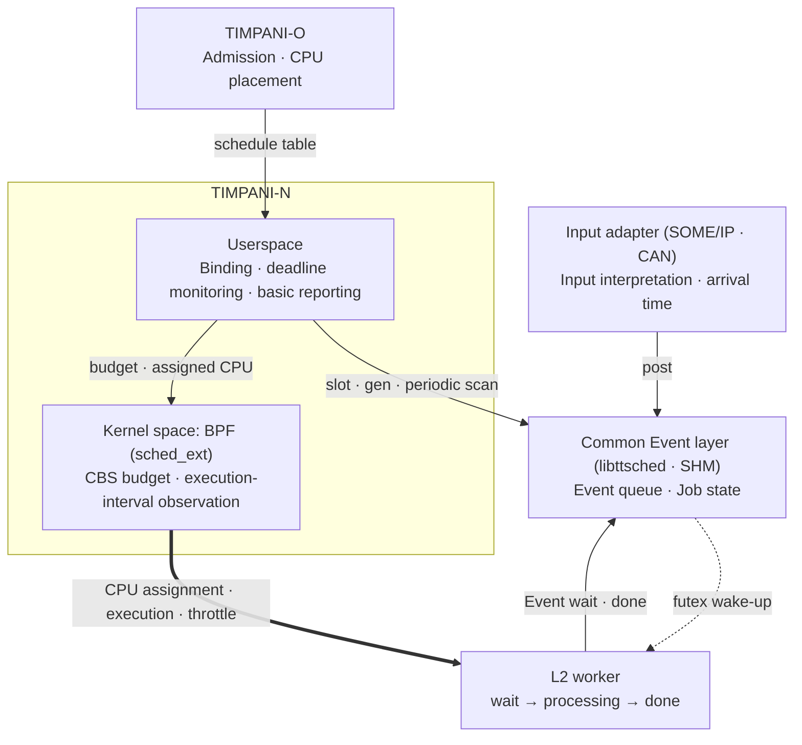
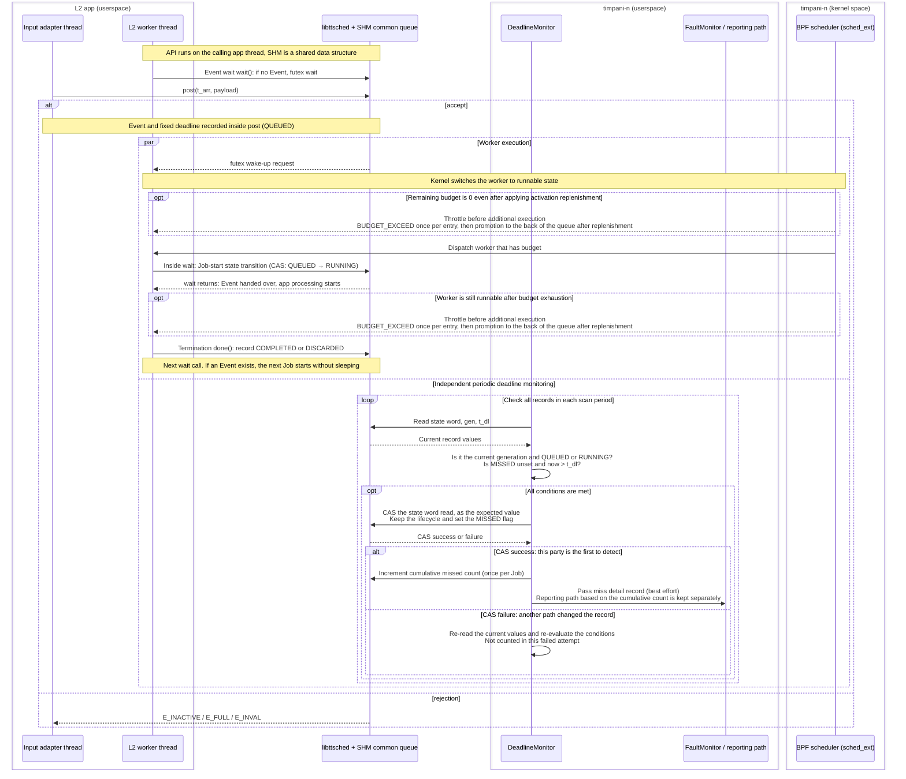

<!--
SPDX-FileCopyrightText: Copyright 2026 LG Electronics Inc.
SPDX-License-Identifier: MIT
-->

# Event-Driven Workload Support — Design Overview and Review Guide

| Item | Content |
|:--|:--|
| Purpose | Review the common Event/Job model, the execution flow, the P1/P2 scope, and the remaining decisions |
| Audience | Owners of architecture, scheduler, application, and verification |
| Basis | 2026-11-26. Includes the 008 design chain (REQ-008 v5.3, SRS-008 v4.3, DDR-008 v3.4, HLD-008 v5.4, LLD-008 v5.3), the throttle contract revision `937ca3c` and the follow-up wording cleanup, the poster and producer term clean-up, the final review corrections, and the [App Developer Guide](GUIDE-008-event-driven-app-developer-guide.md) |
| Status | **Draft / before P1 implementation** |
| Revision | On 2026-11-17, the document was reorganized concisely for the review. On 2026-11-18, the terms were aligned with the formal documents, and the decisions of the Project Leader (author) were reflected: the P1/P2 scope, the division of responsibility between CBS budget management and Event/Job management, and the P1 policy boundary. The $L_{post}$ upper bound was kept as a requirement that TIMPANI enforces in the reference poster configuration, and the assumption that the deployment satisfies that configuration was added as A-10. On 2026-11-19, the distinction between budget exhaustion and actual throttling was reflected in the figure, the explanation, and the verification plan. On 2026-11-24, the document was synchronized with the latest documents (budget exhaustion and throttle terms, the link to the App Developer Guide, and the notation of the rationale section). On 2026-11-26, the poster and producer terms were cleaned up and the definitions of the two terms were added to the Terms section. On the same day, the final review corrections of the formal documents (counting by kind of rejection, the Jobs covered by the response time statistics, the overrun allowance in the consumption bounds, the Job log entry, and others; the full list is in the change history of each document) were included in the basis |

## Review Order

| Order | Section | What to check in review |
|:--|:--|:--|
| 1 | [1. Goals and Scope of Responsibility](#1-goals-and-scope-of-responsibility) | P1 goals, responsibilities |
| 2 | [2. Event and Job](#2-event-and-job) | Boundaries, `gen` |
| 3 | [3. Structure and Roles](#3-structure-and-roles) | Component responsibilities |
| 4 | [4. Flow of One Event and Deadline Monitoring](#4-flow-of-one-event-and-deadline-monitoring) | Queue, rejection, deadline monitoring |
| 5 | [5. CPU Budget and Admission](#5-cpu-budget-and-admission) | Budget replenishment, admission formula, CPUs without TT, C·MIT |
| 6 | [6. P1 and P2](#6-p1-and-p2) | Boundaries, limitations |
| 7 | [7. Examples and Verification Plan](#7-examples-and-verification-plan) | Examples, verification order |
| 8 | [8. Decisions to Make in Review](#8-decisions-to-make-in-review) | Decision list |
| 9 | [9. Detailed Documents](#9-detailed-documents) | Formal documents and the App Developer Guide |

> **Status of This Document**
> - Explanatory summary. The formal documents take precedence.
> - Public interfaces, numbers, and some determination methods are proposals, and they are not yet approved or measured. Numbers are marked *(candidate)*.
> - It is not an implementation or a target verification result. The existing [FCW HTML figure](../../Radar-FCW-P1-event-job-contract.html) is outdated.

> **Review starting point:** [Issue #53](https://github.com/eclipse-timpani/timpani26/issues/53) · [P1 Contract Amendment Agreement](P1-008-event-job-contract-amendment.md)

> [DDR-008 §3.5](DDR-008-event-driven-workload-support.md#35-reflection-of-the-2026-11-12-weekly-and-phase-determination) · [Discussion #4](https://github.com/eclipse-timpani/timpani26/discussions/4)

## Terms

The terms and definitions follow the [common definitions in REQ-008 §2](REQ-008-event-driven-workload-support.md#2-conceptual-model-common-eventjob-model). This overview and the detailed documents use the same terms and do not define separate translated names or app categories. Admission is the pre-scheduling schedulability check on the target CPU for placement, and it differs from the project approval (Project Leader approval).

- **L1 / L2:** L1 is a TT (Time-Triggered) task, and L2 is a CBS (Constant Bandwidth Server) task. MIT is the minimum inter-arrival time of the same source.
- **P1 / P2:** Stages of Event-Job support (different from the Phase in other DDRs). **TIMPANI-O / TIMPANI-N:** schedule computation / node execution and monitoring.
- **CBS:** It is not Linux `SCHED_DEADLINE`; TIMPANI implements it directly inside `sched_ext`.
- **Budget exhaustion / throttle:** The state in which the remaining budget is 0 after a charge / BPF preventing additional execution of a runnable task whose remaining budget is 0. Exhaustion alone is not throttling (REQ-008 terms, PRT-001).
- **Poster / producer:** The poster is the thread or process that calls post for an Event source, and the producer is the party that creates the input to be posted to an Event source. The two can be the same or different.
- **Other abbreviations:** DMISS (deadline miss), IRQ/ISR (interrupt), CAN, SHM (shared memory), futex (sleep and wake-up), CAS (conditional atomic operation).
- PoC (trial), FCW (forward collision warning), E2E (end to end), SOME/IP (communication protocol), BPF (in-kernel program), PID/TID, cgroup, cpuset, HZ (timer tick), PREEMPT_RT (real-time preemption).

## 1. Goals and Scope of Responsibility

- **What and how:** Manages **apps that run only when an external input arrives**, such as socket or CAN input. Each accepted input is an **Event**, and the processing of one Event is a **Job**. The explicit Event connection uses the same queue and rules (post → Event wait → done).
- **TIMPANI boundary:** It does not interpret the message meaning (payload). It enforces the CPU budget and monitors the deadline of each Event.
- **P1 goal:** Common Event/Job and the basic execution environment. **P2 goal:** TT time-boundary enforcement and distinguishing the **causing task and affected task** of a CBS deadline miss.

| Layer | Responsibility |
|:--|:--|
| **App input adapter** | Interprets input, records arrival time, posts Events |
| **Common Event layer** (libttsched + SHM) | Accept or reject, fixed-size queue, delivery of data, identifiers, and times |
| **TIMPANI** | CPU placement of L2 workers·CBS budget enforcement·execution observation; per-Event deadline monitoring·basic reporting |
| **Out of scope** | IRQ/ISR, middleware internal threads, the whole path from remote transmission to device reflection |

### Two Responsibilities of the Same L2 Worker and App Connection

Both responsibilities apply to the same L2 worker. They do not mean the type, class, or mode of an app, or two parts of an app. **Explicit Event connection** is the means of providing the information needed for Event/Job management.

| Responsibility | Role | App connection requirement |
|:--|:--|:--|
| **CBS budget management** | Charges and replenishes CPU budget per replenishment window, and throttles a task that tries to run further without remaining budget. CPU pinning and BPF execution-interval observation are common mechanisms related to this | Match the worker comm (thread name) with `task_id`. Event API connection is not required |
| **Event/Job management** | Event acceptance/rejection·identification·queue management·explicit Job lifecycle·arrival-based MIT counting·deadline monitoring | Post from the input adapter, and connect Event wait → processing → done on the same worker |

- **Same API, same contract:** Uses `ttsched_evt_open/post/wait/done` and the rules of HLD-008 §8.1. Posts happen at the arrival point. One worker per source processes the Event and must always call `done()` afterward. The rule that the app does not directly set policy, priority, or affinity applies to the registered L2 worker. Where and what to call, and the development procedure, are summarized in the [App Developer Guide](GUIDE-008-event-driven-app-developer-guide.md).
- Even without an explicit Event connection, the CBS budget management, CPU pinning, and execution-interval observation of the same worker are kept. However, the Event arrival time, Job record, MIT count, and other input metadata cannot be obtained, so the Event/Job deadline is not monitored, and it is not estimated from BPF observation. Even when a connected source has no input for a while, L2 is not reclassified. Existing compatibility and optional connection are kept, and automatic connection without app changes is not a P1 guarantee.
- **Posting (post) is done by the input adapter.** The default is the same app process, and a process with SHM write permission on the same host is also allowed in P1 (HLD-008 H-1).

**Project Leader (author) decision on P1 scope:** A registered L2 worker runs under the BPF scheduler in TIMPANI-N kernel space as `SCHED_EXT`/CBS. Selection and management of the scheduling policy of the input adapter and other app threads are outside the P1 scope. This does not mean that checking the allowed CPUs of the worker or verifying the placement environment is excluded. `post()` runs on the poster thread, and `wait()`, processing, and `done()` run on the worker. SHM is a shared data structure, not a scheduling target.

**cgroup placement responsibility and method under review:** cgroup and cpuset placement is the responsibility of the system and Pullpiri. The P1 requirement is that TIMPANI-N checks, before binding, whether the assigned CPU is in the worker's allowed CPU set, and if not, it does not bind and records an explicit error (REQ-008 CBS-008). The current code has no such check. The L2 binding path does not change the cgroup or affinity of a thread, and TIMPANI-N has no per-thread cgroup movement function. The method of placing only the workers of the same app on isolated CPUs and other threads on non-isolated CPUs is under review, and whether TIMPANI-N takes on moving the workers in this deployment, or only verifies, is open. Per-TID movement in cgroup v2 is constrained by a valid threaded domain and the parent cpuset, so the hierarchy, permissions, container integration, and inheritance of the target environment must be verified. This does not mean that a specific placement method or a fair or FIFO/RR policy has been adopted ([DDR-008 D-24](DDR-008-event-driven-workload-support.md#d-24-application-abstraction-and-execution-environment-assumptions--p1)).

## 2. Event and Job

| Concept | Meaning |
|:--|:--|
| **Event source** | Input source. P1 has one per L2 task and one consuming worker. It is identified by `(workload_id, task_id)`, and task_id is a name of 15 B or less that is unique within the node |
| **Event** | One **accepted** input. `(gen, seq)`, arrival time, fixed absolute deadline, payload |
| **Job** | Processing of one Event. The worker starts it, and the worker ends it or TIMPANI closes it. One-to-one with the Event |

```
L2 task    = scheduling contract (task_id, C, D, MIT, assigned CPU, CBS server)   ← registered in the table
 └─ L2 worker = one actual thread bound to the contract                            ← long-lived
     └─ Job    = processing of one Event (wait → processing → done)                ← one per Event

time →   wake-up                                                 sleep
Worker   |=== Job #1 (seq=1) ===|=== Job #2 (seq=2) ===|  (no waiting Event)
BPF      |<------------------- one execution interval ----------------------->|
CPU budget|<----------- continuously charged against the same CBS budget (not granted anew for each Job) ---->|
```

- **One Event, one Job:** A Job processes only one Event and does not batch Events together. An Event that arrives during processing remains in the queue and is handed to the worker in FIFO order (order of posting) within the source.
- After finishing, if there is a waiting Event, the worker does not sleep and starts the Job for the oldest Event.
- Sleep, preemption, and blocking are not Job boundaries. Resuming after blocking is not a new Job, and that time is included in response time R.
- **Job results:** `COMPLETED` (completed), `DISCARDED` (discarded by the app), `CANCELLED` (closed by TIMPANI before start), `ABANDONED` (closed by TIMPANI during execution). `MISSED` is a deadline result attached separately.
- Termination at or before $t_{dl}$ is not a failure, and termination after it is a failure. A failure once set is not cleared. Only treating a close by TIMPANI before the deadline as a separate result is subject to interpretation check ([§8](#8-decisions-to-make-in-review), OI-21).
- **`gen`:** Binding generation number (64-bit). The upper 32 bits are the lower 32 bits of the SHM `instance_id`, and the lower 32 bits are `bind_gen` (DDR-008 D-03, [LLD-008](LLD-008-event-driven-workload-support.md) §5.6).
- A new `gen` arises when the worker is bound to `SCHED_EXT` and activates a slot, and it does not arise from table application alone. The monitor and fault report look only at the current `gen` (D-17 (c), D-19).
- A new `gen` arises in these cases: worker rebinding, re-application of a table whose parameters changed (rebinding after re-registration), re-adding a workload, and TIMPANI-N restart. It does not arise in these cases: republication of a table with the same parameters, republication of TT only, and during a daemon outage.
- Before creating a new `gen`, close the previous unfinished Events (CANCELLED if waiting, ABANDONED if processing).
- The `gen` of one Event does not change. If the same input is posted again at a rebinding boundary, it becomes a **separate Event** with a new `gen`.
- Preventing duplicate processing is proposed as an app responsibility, and it is finalized in §8.

| Symbol | Meaning |
|:--|:--|
| $t_{arr}$ / $t_{dl}$ | Arrival time / absolute deadline $t_{arr}+D$. Fixed when accepted, and not extended |
| $t_{begin}$ / $t_{end}$ | Job start / time of the worker's explicit termination or of TIMPANI's close (the completion point is subject to interpretation check, OI-20) |
| $R=t_{end}-t_{arr}$ | Response time (including waiting, preemption, and throttling). Differs from the declared field `runtime` |
| $C$ / $D$ | Declared worst-case execution time of one Job under normal conditions (`runtime`). Granted as the server budget $C_s=C$ in every replenishment window / relative deadline from arrival to completion |
| $MIT$ / $T_s$ | Minimum inter-arrival time of the same source / CBS budget replenishment period. The proposed condition is $T_s\le MIT$ |

## 3. Structure and Roles



**How to read the lines:** Solid line = call and data, dotted line = wake-up, thick line = BPF scheduling control.

| Component | Role | What It Does Not Do |
|:--|:--|:--|
| **Pullpiri / app declaration** | Execution requirements·budget·deadline·minimum interval·reporting threshold, cgroup placement | None |
| **TIMPANI-O** | Input validation·admission, CPU placement, CBS configuration·schedule table | None |
| **TIMPANI-N userspace** | Worker binding·generation, BPF initial setup, waking the Replenisher, deadline monitoring·basic fault | Automatic cancellation |
| **TIMPANI-N kernel space（BPF）** | CBS budget charge·budget replenishment·throttle·promotion, CPU pinning, TT protection, execution-interval observation | Job deadline determination, MIT check |
| **libttsched + SHM** | Fixed-size queue, post·Event wait·done, identifiers·times·payload, MIT violation count | CPU budget enforcement·scheduling |
| **App adapter and worker** | Declaration of the arrival boundary·input interpretation·post / processing of one Event·explicit termination | Direct setting of the scheduling policy·affinity of the registered L2 worker |

- **BPF does not know about Jobs.** It handles wake-up and sleep transitions, CBS budget, CPU pinning, TT protection, and execution order.
- The DeadlineMonitor in **TIMPANI-N userspace** directly monitors the common queue. The BPF scheduler is also a TIMPANI-N component, but it is a program that runs in the kernel, not a separate userspace process.
- The public API, SHM v2, protobuf, and internal interfaces are **proposals subject to approval**. This overview does not approve function signatures.

## 4. Flow of One Event and Deadline Monitoring



- **Event wait (wait)** is a library function that the worker calls. If no Event exists, it sleeps. If an Event exists, it confirms the Job start within the same call, hands over the Event, and then returns. If an Event already exists, it does not sleep. There is no separate acquisition API or second queue.
- **Job-start state transition (CAS)** is a step inside wait. It is an atomic conditional update that changes `QUEUED → RUNNING` only when the state word read earlier equals the current value. After success, it returns the identifier, the time, and the payload. It is not an operation that assigns a CPU.
- **CAS(compare-and-swap)** is an atomic operation that changes the current value to a new value only when the current value equals the expected value. No other thread can intervene between the comparison and the change. If the values differ, it does not change anything and fails, and the caller checks the current value again. The Job-start CAS and the deadline-miss marking CAS use the same operation for different purposes. Both must maintain the consistency of generation, identity, state, and existing flags (detailed layout is in LLD-008).
- **QUEUED** is a record that has been accepted but whose Job processing has not yet started. **RUNNING** is a record for which the worker has confirmed the Job start and has not yet ended. Neither means membership of a BPF run queue or the current CPU execution state. RUNNING is still kept during preemption, throttling, or blocking within a Job.
- **The lifecycle and the deadline result are separate.** The non-terminal states are QUEUED and RUNNING. The terminal states are COMPLETED, DISCARDED, CANCELLED, and ABANDONED. MISSED is not a terminal state but a separate flag, so `RUNNING + MISSED` and `COMPLETED + MISSED` are possible. Detecting a miss alone does not end a Job.
- The two parallel flows in the figure show that monitoring is independent of the execution stage of the worker. The DeadlineMonitor is a separate thread in TIMPANI-N userspace, and it detects the passing of the deadline even if the worker has never run in the QUEUED state. CAS success does not mean that the detailed report was delivered successfully. MISSED can also be set on a late termination or cleanup path, and the detailed race rules for monitoring and termination transitions follow HLD-008 and LLD-008.
- A wake-up does not disappear. Even if an Event arrives just before sleeping, the wake-up counter (`counter`) has already been raised.
- The wake-up counter is also raised on activation, deactivation, and close, so a woken worker checks the queue again and sleeps again if there is none.
- **Queue record 128 B, depth 8, inline payload 64 B** *(candidate)*. The app passes `t_arr`, `payload`, and `len`, and libttsched fills in `(gen, seq)`, the absolute deadline, and QUEUED.
- **Rejection codes:** `E_INACTIVE` (connection inactive), `E_FULL` (queue full), `E_INVAL` (invalid input). A rejected input is not an Event.
- `E_FULL` is a rejection before acceptance and is counted as overflow. Even when the queue is full, an accepted Event is not dropped.
- **DeadlineMonitor** does not wait for completion. From the moment of acceptance, it monitors waiting, execution, preemption, throttling, and idle states alike.
- A failure is counted once per Job, and it is not automatically cancelled. The race rule between reading the completion time and recording the state is subject to interpretation check (DDR-008 D-20 rule 6, REQ-008 OI-20).

**Absolute deadline timer alternative (not selected):** The figure above and the current design baseline are the periodic scan. The other method discussed sets an absolute timer at the fixed $t_{dl}=t_{arr}+D$, and at expiry it checks whether the same `(gen, seq)` is still unfinished. It can also be built with a min-heap and one timer for the earliest deadline, but it additionally requires handling a notification and reset race when an earlier Event is posted. The timer expiry time and the time when the monitoring thread actually runs are different, and the current boundary condition is $now>t_{dl}$. A Job that ends after $t_{dl}$ must be recorded as a miss on the termination path even before the expiry check. The timer also does not resolve the race of completion time and state publication in OI-20, so it is not treated as a decision that replaces the existing periodic scan or as a delay guarantee (DDR-008 D-20·F-10, REQ-008 OI-22).

## 5. CPU Budget and Admission

### 5.1 Budget Replenishment Rules

Basic conditions *(proposal)*: $0<C_i\le D_i\le MIT_i$, $T_s\le MIT_i$

- At activation, if the previous replenishment window has ended (including the tolerance `tol`), the budget is replenished to $C$ and a new window is opened.
- **Budget exhaustion and throttling are different.** Exhausting the budget exactly and then sleeping does not throttle. If the remaining budget is 0 and the server can still run, or if the budget is still 0 after the activation replenishment is applied on wake-up, the server is throttled before any additional execution. `done()` alone does not mean sleep. `BUDGET_EXCEED` is emitted once per actual throttle entry, and it does not mean a positive overrun (SRS-008 FR-B-013).
- A throttled server is replenished after the end of the existing window, and on promotion it moves to the **back** of the run queue.
- An active server that is not in the throttled state is not replenished merely because its window ends, and a change of Job is also not a trigger for budget replenishment.
- Replenishment and promotion are performed by BPF.
- So that an already throttled server can be promoted in time even without other scheduler activity, the Replenisher induces a reschedule of the assigned CPU at the replenishment time. It does not change the budget state directly. The kick means (`scx_bpf_kick_cpu`) is to be confirmed in a P1 PoC (OI-9, H-13), and the alternative is a per-CPU kicker thread (D-07).

### 5.2 Admission: Sufficient Condition

Admission is a pre-scheduling schedulability check that applies the admission formula to all L2 tasks on the target CPU for placement. The proposed formula in DDR-008 D-09 is a sufficient condition, not a proof. When it is satisfied, deadlines are kept within the range in which the preconditions and measured values hold, and failing it does not by itself mean failure.
The sum of the four terms on the left must be less than or equal to $D_i$, and $D_i \le MIT_i$ and $T_s \le MIT_i$ must also hold.

$$
C_i + B_{tt}(k,D_i) + L_{del\_max} + \sum_{j \ne i}\left(C_j + \delta_{ovr}\right) \le D_i
$$

| Term | Meaning |
|:--|:--|
| $C_i$ | $C$ of the L2 $i$ under check. Equal to the server budget granted in each replenishment window |
| $B_{tt}(k,D_i)$ | Maximum TT occupancy time within an interval of length $D_i$ on the assigned CPU $k$ |
| $L_{del\_max}$ | Delivery and wake-up delay, the sum of $L_{post}$ and the wake-up delay. The upper bound of $L_{post}$ holds when the poster thread is in the reference poster configuration (A-10) *(initial verification candidate 100 µs = 50 + 50 µs. The whole is measured directly: [REQ-008 TIM-011](REQ-008-event-driven-workload-support.md#46-quantitative-timing-requirements-tim))* |
| $\sum_{j \ne i}(C_j+\delta_{ovr})$ | The sum of the amounts that other L2 $j$ on the same CPU execute first in FIFO order |
| $\delta_{ovr}$ | The amount by which execution can exceed the budget, due to tick resolution *(candidate: 1 ms based on HZ=1000; on nohz_full CPUs, measure with the tick restart delay added)* |

Assumption (D-09): TT runs within the declared range, inputs keep the MIT and are posted immediately after arrival. Within a Job the worker does not block, and the worker **actually sleeps before the next arrival**. The budget charged from activation to that sleep (including the cost of entering the wait) is $C_i$ or less, and `tol` covers the activation jitter. The delay and excess-execution upper bounds are to be confirmed by measurement, and the poster thread must satisfy the reference poster configuration (A-10).

**Reference poster configuration:** A configuration in which the poster thread is not preempted by other threads from the time the arrival time is recorded until the post call returns *(candidate: a real-time policy thread pinned to an idle or dedicated CPU, proposal, to be fixed by measurement)*. TIMPANI does not manage the policy of the poster thread, and it is the responsibility of the deployment (D-24).

CPU utilization, minimum Gap, and the limit on the number of tasks per CPU are also checked (D-09).

When a new app is added, all L2 tasks on that CPU are checked again. In P1, coexistence with TT is a conditional guarantee, and enforcement of slot termination is P2.

### 5.3 CBS Execution on CPUs Without TT: Required for P1

- On a CPU without TT, $B_{tt}=0$, and CBS execution, per-server budget replenishment, and deadline monitoring must work **without a TT slot signal** (CBS-007).
- CBS enforcement does not use the hyperperiod value (P1 verification target). Do not make the TT hyperperiod from the least common multiple of the MIT values or from an arbitrary default value (D-22).
- The `hyperperiod_us` of an L2-only node is a defined, non-zero value according to FR-O-015, and it is not a CBS execution parameter. The current code writes 0 to a node that has tasks and no TT, which is a pre-existing bug.
- The representation and verification method (including whether 0 is allowed) and the update timing are fixed before implementation (OI-25). DDR-011 Phase 0 covers only the L1 TT update on a fixed E/H, so the representation and transition of CBS updates and of tables without TT are decided together in [DDR-011 Phase 1](DDR-011-runtime-table-update.md#10-deferrals-and-review-gate).

### 5.4 Setting C and MIT

- The measured maximum is not a proof of the worst-case execution time, so when declaring $C$, a margin for execution-time scatter is recommended (DDR-008 §3.4, [HLD-008 §8.2](HLD-008-event-driven-workload-support.md#82-procedure-for-raising-a-new-kind-of-event)). Measure the on-CPU cost (including system calls) from the `wait()` return path after waking from the wait, through processing and `done()`, to the next actual sleep.
- Measure with controlled stimuli instead of real Events (`evttask` is not implemented, and the `mock_radar_producer` of FCW changes only the arrival interval and the L1 TT overrun).
- `budget_used_us` (proposed field) is a value per execution interval. During operation as well, C and the arrival interval are reviewed with this value and `BUDGET_EXCEED`, and if C is changed, it undergoes admission again.
- Several Jobs can be summed in one execution interval, or one blocking Job can be divided into several intervals. Per-Job measurement needs interval linkage or separate CPU-time measurement.
- Throttling is not evidence of underestimating $C$ alone. The cases in which sleep did not occur before the next arrival, or where budget was carried over in an open window, are also examined. CBS limits CPU interference, but it does not isolate shared resources and data (HLD-008 §8.2).
- The MIT candidate is set from the differences in $t_{arr}$ of the actual sender, and there is no guarantee that the observed minimum interval is a lower bound on future input.

## 6. P1 and P2

> **One-line summary:** **Observing** "whether the deadline was missed" is P1, and **strengthening** "why it was missed and what action to take for whom" is P2.

| P1: Basic Event-Driven execution environment | P2: Time isolation and diagnosis strengthening |
|:--|:--|
| Common Event/Job definition, one Job per Event | TT slot range·termination enforcement·incomplete TT handling, EDF order·precise admission |
| Common queue·identifiers·arrival time·explicit start/termination | TT overrun: verification of the next TT and CBS protection |
| Consistency of queue·notification·re-registration·restart | Classification of deadline-miss causes, combining TT and CBS records |
| Separation of responsibilities between CBS budget management and Event/Job management in the same L2 worker·bounded budget replenishment·CPU placement (including checking the allowed CPUs of the assigned CPU)·execution on CPUs without TT | Distinction between affected task and causing task·recovery by cause |
| Arrival-based deadline detection·counting·basic reporting, minimum fault classification (DMISS·BUDGET_EXCEED·MIT_VIOLATION), basic observation·trace | Review of automatic analysis and intelligent diagnosis methods |

- P1 reports an actual throttle entry as `BUDGET_EXCEED`, and the `THROTTLED` and `NOT_STARTED` flags at the time of deadline detection show only the observed state. Neither determines the cause of the deadline miss, and cause-specific recovery is in the P2 scope. The flag fields are carried in the report only after the FaultInfo protocol proposal (IF-004) is approved, and before approval only the count is carried (REQ-008 PRT-007).
- P1 can be completed without TT termination enforcement and cause analysis, but strong isolation and determinism are not claimed before P2 verification.
- The P1/P2 division is the scope decided by the Project Leader (author) in the design review. Approval of the schedule and implementation method, and target verification, are performed separately (DDR-008 §3.5).
- The schedule of follow-up items such as EDF, multiple sources, and large data is not approved by this division.

### P1 Limitations

| Item | Limitation |
|:--|:--|
| Poster and consuming worker | One each per source. Multiple posters are a follow-up |
| Payload | Only inline payload is proposed. No lifetime or release contract for external payload |
| Security | Processes with SHM write permission are trusted. No isolation per source |
| Daemon outage | Detection stops during an outage. After restart, determination is possible, but restoration of detailed records is not guaranteed |
| Lifecycle boundary | Poster death, `E_INACTIVE` before activation, and counting at the re-registration boundary follow the LLD limitations |
| Timing values | Detection 2 ms·report 200 ms·scan 1 ms·delivery and wake-up delay 100 µs·priority 97 *(all candidates)* |

## 7. Examples and Verification Plan

The two examples differ only in the input method and use the **same Event/Job contract**.

| Category | FCW (forward collision warning) | Non-SOME/IP sensor example |
|:--|:--|:--|
| Input | SOME/IP radar alert | Unix datagram, etc. |
| Connection | Common post at the app adapter | Same common post after input reception |

- **FCW arrival time:** Recorded right after the callback, before locking and message interpretation. If there are several callback threads, the arrival order cannot be guaranteed, so check whether there is only one (H-8).
- **FCW starting values:** C=2 ms, D=5 ms, MIT=18 ms *(candidate)*. MIT 18 ms is a starting value, and by the calculation in HLD-008 §8.4 (with the §8.2 basis applied), it is 17 ms or less.
- The final MIT is fixed to be smaller than the minimum of the arrival intervals measured in normal operation (HLD-008 §8.4). If the MIT is lowered, T_s is also lowered, and the admission conditions are reviewed again.
- The change of the period from 20→18 ms is a proposal to match T_s ≤ MIT, and its configuration approval is separate.
- **Three placement configurations** (HLD-008 §8): admission and execution per isolated CPU, an admissible combination on the same CPU (D 6 ms, sensor C 500 µs, calculated value 5.6 ms *(before verification)*), and confirmation of **rejection** of the second L2.
- Radar L1 → Event → FCW L2 is a P1 example (not a TT/CBS dual-mode switch). The E2E deadline is a subject of DDR-009, and there is no canonical document for it.
- The standard blocking wait does not provide the information needed for Event/Job management. Without an explicit Event connection, the CBS budget management and execution-interval observation of the same worker are kept, but per-Event deadline verification cannot be performed (MOD-011).

### Verification Order

1. Approve the P1 contract (accept, post, and termination races, recovery, and reporting scope) and the public interfaces.
2. Implement the common queue, Event/Job connection, admission, binding, BPF enforcement, and DeadlineMonitor.
3. Verify, in an environment without TT, the first Event, arrival after idle, budget replenishment, and deadline detection (AC-008-17). The budget boundaries are examined separately: sleep after exactly exhausting the budget, continued runnable state after exhaustion (including a sole worker), wake-up that cannot be replenished, and wake-up that can be replenished (including the `tol` boundary). Confirm one emission per actual throttle entry and no re-execution before replenishment (AC-008-03). Runaway and restart follow AC-008-04·14·15, MIT violation by bursts follows AC-008-07, and L2 preservation when TT is added or removed follows AC-008-18.
4. Connect the FCW and non-SOME/IP apps with the same contract, and verify the three placement configurations (AC-008-16). An explicit failure of incorrect cpuset placement is checked by AC-008-19.
5. Verify coexistence assuming normal TT execution (AC-008-02). TT overrun boundary enforcement and cause analysis are deferred to P2.

### Observation Items

| Target | Recorded content |
|:--|:--|
| **source** | Counts of arrival·acceptance·overflow·rejection, and start·completion·discard·cancellation·abandonment·deadline miss·MIT violation |
| **Job** | `(gen, seq)`, arrival·deadline·start·termination times, result. The number of detailed log losses is counted separately |
| **Execution interval** | Runnable transition·first execution·voluntary sleep, budget·throttle·budget replenishment information. Not mixed with Job records |
| **Execution environment** | Jitter, budget replenishment delay, actual CPU, thread policy, allowed CPU mask, cgroup |

### Execution Environment Notes

- Actual verification requires Linux, sched_ext/PREEMPT_RT configuration, and permissions. When a problem occurs, check the PID/TID, the process composition, cgroup, online CPUs, and the host/container, and distinguish between deployment and scheduler responsibility.
- Observation at the same time does not prove the cause, and interference such as `dl_server` is to be measured on the target system.
- When the assigned CPU is not in the allowed set, TIMPANI-N does not bind and records an explicit error (CBS-008, AC-008-19). No thread can move its affinity outside `cpuset.cpus.effective` (D-24).
- Binding after correction is within TIM-006 `T_bind`, and the measurement starting point is the correction time.

## 8. Decisions to Make in Review

| Category | Item | What to agree on |
|:--|:--|:--|
| Approval | Public contract | libttsched API·SHM v2·protobuf·internal interfaces (OI-19, H-5~H-7), the transition period of the period change (OI-8) |
| Interpretation check | Race between completion time and monitoring | Confirm the interpretation of the proposed definition of completion time (the clock value just before the completion is posted) (OI-20, D-20 rule 6) |
| Interpretation check | Cancellation and abandonment | Whether to treat TIMPANI closes before the deadline (CANCELLED, ABANDONED) as a separate result (OI-21). P1 has no worker cancellation call |
| Interpretation check | `t_arr` on re-posting | Whether to use the original arrival time or the re-posting time at rebinding, together with duplicate-processing prevention (H-20, OI-24) |
| Interpretation check·approval | App application | Preserving the arrival order when there are several callback threads (H-8), change of FCW configuration (H-15, feature approval), the two-app configuration and success criteria. The P1 rule that there is one poster per source has been settled (D-19) |
| Measurement·PoC | Timing·admission | Measurement environment (OI-5), candidate values, scan cost, wake-up method and merging with the Replenisher (OI-22), availability of the budget replenishment kick (OI-9, H-13), jitter, tick upper bound, admission rate of multiple L2 (SRS OI-11, H-14) |
| Measurement·PoC | C measurement·margin ratio | Measurement conditions (input coverage, first Job after idle, interference), limit of `budget_used_us`, declaration margin (H-19, OI-23) |
| Measurement·PoC | Reference poster configuration | Fix the candidate for the reference poster configuration (a real-time policy thread on an idle or dedicated CPU) and the configuration of the FCW example by measurement (A-10, H-14) |
| Policy | Default reporting and queue lifecycle | Deadline-miss count and threshold-based reporting·reporting latency criteria (separate from P2). Acceptance/rejection on poster death, restart, a previous generation, and overflow |
| Policy | Reporting of overrun without throttling | Whether to report separately when the budget is actually exceeded and the worker sleeps right after without being throttled is open. It is included in overrun measurement (DDR-008 D-10, TIM-004). |
| Policy | Follow-up for a Job that missed its deadline | Whether to continue or cancel (D-20 rule 8, DDR-008 §3.4) |
| Policy | How to guarantee blocking Jobs | To be reviewed in P2. A separate app classification is not decided. The current admission formula does not guarantee blocking Jobs (H-17) |
| Policy | TT-free table | Agree before implementation on whether `hyperperiod_us` may be 0, and the update boundary when TT is added or removed (OI-25) |
| Policy | Document alignment | Align the description of periodic grid replenishment in DDR-007 §4.5 with D-04·D-07 (DDR-008 §3.3 F-2) |

Also check the remaining open items of the canonical documents (LLD L-2·L-20·L-23, HLD H-2·H-18).

**Items not newly added to the P1 completion criteria:** TT slot termination enforcement, TT/CBS correlated cause analysis, and automatic recovery per affected task (P2 items).

## 9. Detailed Documents

| Document | What to look for |
|:--|:--|
| [REQ-008](REQ-008-event-driven-workload-support.md) · [SRS-008](SRS-008-event-driven-workload-support.md) · [LLD-008](LLD-008-event-driven-workload-support.md) | Requirements, functions, data structures and tests |
| [DDR-008](DDR-008-event-driven-workload-support.md) | Event/Job design decisions. D-22 CBS execution without TT, D-23 P2 cause analysis, D-24 app abstraction and execution environment premises, §3.5 |
| [HLD-008](HLD-008-event-driven-workload-support.md) | Structure, §8 app application and examples |
| [App Developer Guide](GUIDE-008-event-driven-app-developer-guide.md) | Where and what to call, development procedure, return codes·fault interpretation, FCW example *(Draft, based on the proposed API)* |
| [DDR-007 §4.3.1](DDR-007-tt-cbs-integrated-scheduling.md#431-tt-slot-end-enforcement--2026-11-12-weekly-follow-up-design) | P2 TT time boundary design |
| [DDR-005](DDR-005-sched-ext-bpf-scheduler.md) · [DDR-011](DDR-011-runtime-table-update.md) · [DDR-012 §4.4](DDR-012-fault-management.md#44-2026-11-12-weekly-follow-up--separating-affected-task-and-causing-task-for-review) | BPF enforcement, runtime table update (Phase 0 is L1 TT, CBS is Phase 1), distinction between cause and affected task |
