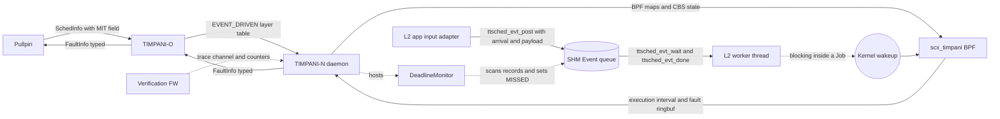

<!--
SPDX-FileCopyrightText: Copyright 2026 LG Electronics Inc.
SPDX-License-Identifier: MIT
-->

# SRS-008: Event-Driven Workload Support Software Requirements Specification (SRS)

**Date:** 2026-11-11 (first written 2026-11-09, Last Updated: 2026-11-26)
**Status:** Draft (v4.3 — reflects the P1 Event-Job contract amendment, Issue #53)
**Author:** Human + AI
**Parent documents:** [REQ-008](REQ-008-event-driven-workload-support.md), [SRS-000](SRS-000-timpani-system.md)
**Related documents:** [P1 contract amendment agreement](P1-008-event-job-contract-amendment.md), [DDR-001](DDR-001-workload-model.md), [DDR-003](DDR-003-interface-protocol.md), [DDR-004](DDR-004-resource-allocation.md), [DDR-005](DDR-005-sched-ext-bpf-scheduler.md), [DDR-006](DDR-006-communication-architecture.md), [DDR-007](DDR-007-tt-cbs-integrated-scheduling.md), [DDR-011](DDR-011-runtime-table-update.md), [DDR-012](DDR-012-fault-management.md)
**Child documents:** DDR-008 (design decisions), HLD-008, LLD-008

> This document refines the parent requirements of [REQ-008](REQ-008-event-driven-workload-support.md) to a **level that can be allocated to software components and verified**. Following the convention in SRS-000 §1, the feature SRS (`SRS-008`) refines the requirements of a specific decision record (`DDR-008`).
> Design choices (algorithms, data structures, thread model) are **not decided** in this document. DDR-008 decides them. For verifiability, however, "observable behavior" is described concretely. Memory ordering, ring rules, and byte layout are in the scope of LLD-008.
> This document inherits the two principles of REQ-008 (**transport-layer neutrality**, **Phase 1/2 split**). Each requirement shows its Phase. `P1*` means that the requirement is satisfied in simplified form in Phase 1 and reinforced in Phase 2.
>
> **Keyword convention**: **SHALL** = mandatory, **SHOULD** = recommended, **MAY** = optional.
> **Verification method abbreviations**: A = Analysis, T = Test (unit/integration), M = Measurement (timing benchmark), D = Demonstration (PoC).
> **Proposal notation**: items that introduce a public API, SHM layout, protobuf field, or numeric upper bound are marked "(proposal, approval required)". Numbers that are not agreed or measured are marked "(candidate)". No item in this document means that implementation or verification on a Linux target is finished.

---

## Summary

- Purpose: For L2 (Sporadic + SafetyCritical) Event-driven workloads, define the software requirements by component (proto, TIMPANI-O, TIMPANI-N userspace, BPF scheduler, application library, verification framework) so that TIMPANI creates **one independent Job for each Event it accepts**, and monitors and reports the absolute deadline of that Event, measured from its arrival time.
- Structure: Based on the **common Event/Job model** of REQ-008 §2, the requirements are split into three layers, (①) the model, (②) explicit Event connection (libttsched Event queue) and kernel execution observation (BPF), and (③) enforcement and determination (CBS and CPU pinning, DeadlineMonitor, admission), and they are allocated to components (FR-G-002). The Events and Jobs that are created come only from the explicit Event connection. Kernel execution observation only observes execution intervals and budgets, and it does not create Events.
- Core (P1): (1) Through the calls of the adapter and the worker to post, wait, and done, the Event posting, the start of the Job inside wait, and the end of the Job are made explicit, and the identifier `(gen, seq)`, the lifecycle state, and the deadline result (MISSED) are kept separate (FR-L-009~012). (2) The absolute deadline is fixed at acceptance as arrival time + D. The DeadlineMonitor of TIMPANI-N does not wait for completion. It detects the elapse of the deadline also during queue waiting, execution, preemption, and throttling, and makes one determination per Job (FR-N-027, FR-N-028). (3) BPF is responsible only for CBS budget enforcement, CPU pinning, TT protection, and execution-interval observation, and does not determine the L2 deadline or the MIT (FR-B-024). (4) The admission applies one formula to all L2 tasks, and states the assumptions of the formula (FR-O-013). (5) CBS budget management and Event/Job management are complementary responsibilities of the same L2 worker. Without the explicit Event connection, CBS budget management, CPU pinning, and execution-interval observation are still maintained, but the information of Event/Job management is not obtained (FR-G-003). (6) The detection, reporting, and delivery latencies (TMG-014~016) are candidate values to be confirmed by measurement, and the mandatory statistics are kept regardless of tracing (FR-N-030).
- Subject to approval: the public API (libttsched Event connection API), SHM layout, proto field additions (FaultInfo count, flag, generation), and build constants (queue depth, payload upper bound) are proposals that require Project Leader approval.
- Deferred to P2: multi-poster posting and large payloads, per-source isolation of SHM and the daemon heartbeat, event-driven wake-up of monitoring, merging of the monitoring thread and Replenisher, EDF order, per-task time class, rejection reason code, NodeStatus statistics, watchdog and wake-up latency faults, HRTICK.
- Status: Draft v4.3 (reflects the P1 contract amendment and the design chain alignment). This is the design stage, and it does not mean that implementation or verification is finished. The numbers are candidate values.

---

## 1. Introduction

### 1.1 Purpose
Decompose each requirement of REQ-008 into software requirements that the implementation and test owners can use directly, and assign each requirement its **owning component, verification method, parent traceability, and Phase**.

### 1.2 Scope
- In scope: TIMPANI-O (admission, table generation and publication), TIMPANI-N userspace daemon (Event source lifecycle management, deadline monitoring, fault aggregation), `scx_timpani` BPF scheduler (execution-interval observation, CBS enforcement), application library (extension of `libttsched` — explicit Event connection API), Pullpiri↔O / O↔N protocols, and the observation points that the verification framework requires.
- Excluded: the out-of-scope items of REQ-008 §7 (Aperiodic, D > MIT, inter-node chains, middleware-specific semantics, watchdog, QNX porting, Pullpiri YAML), multi-poster posting, and release rules for data beyond the payload upper bound (P2).
- Out of scope (not subject to budget enforcement): IRQ/ISR, middleware internal threads, the whole network path. TIMPANI does not reserve budgets for these automatically (A21). The completion time $t_{end}$ is the completion of the declared processing and of the result posting, and it does not mean completion of network delivery or device reflection (FR-L-011(c)).

### 1.3 Term Definitions (exact meaning in this document)

The canonical source of common terms is [REQ-008 §2](REQ-008-event-driven-workload-support.md#2-conceptual-model-common-eventjob-model). **CBS budget management** and **Event/Job management** are complementary responsibilities of the same L2 worker, and they are not classes or modes of the application. The table below maps those definitions to components. The compatibility between the L2 classification of DDR-001 and the optional Event connection is maintained.

| Term | Definition |
|:--|:--|
| **L2 task** | Kernel scheduling unit (thread) that belongs to a `Sporadic + SafetyCritical` workload. Corresponds 1:1 to one CBS server |
| **CBS server** | Bandwidth server with budget $C_s$, replenishment period $T_s$, remaining budget, replenishment time, and relative deadline $D$ |
| **Event source** | Declared source that delivers Events to an L2 task. P1: one per task; its identifier is the `task_id` of the consuming task (worker thread name, 1~15 bytes). It has an Event queue and an MIT setting |
| **Input adapter** | Application code that receives external arrivals (network reception, sensor interrupts, and so on) inside the app and posts Events to an Event source. It can supply the arrival time |
| **Event** | One **accepted** arrival that the input adapter posts. It has identifier `(gen, seq)`, arrival time $t_{arr}$, absolute deadline $t_{dl} = t_{arr} + D$, and an opaque payload. A rejected post is not an Event |
| **seq** | Sequence number inside the Event source (u32, wrapping). It is assigned when a post is issued |
| **Registration generation (gen)** | Value (u64) that changes each time the Event source is activated again. It changes on worker rebinding, workload re-addition, and daemon restart |
| **post** | Call by which the input adapter puts one Event into an Event source. It returns acceptance or rejection |
| **Poster** | The thread or process that calls post for an Event source. It executes the post call of the input adapter. Which threads and processes can be a poster and the constraint of one posting context per source follow C-08, and the assumption on the configuration of the thread that calls post follows A-10 |
| **Producer** | The party that creates the input to be posted to an Event source. It is a different concept from the Event source, which is the declared source. It can be the same as the poster or different from it |
| **Job** | Unit that processes one Event. It starts when the worker takes the Event (`t_begin`), and it ends with the worker's explicit end call (`done`) or with TIMPANI's close decision. It does not merge several Events |
| **Event lifecycle state** | `QUEUED` (waiting before Job start), `RUNNING` (after Job start is confirmed and before the end), `COMPLETED` (completed), `DISCARDED` (policy discard by the worker), `CANCELLED` (closed by TIMPANI before Job start), `ABANDONED` (closed by TIMPANI during execution), `REVOKED` (internal state reverted during posting, not an Event). It is the logical lifecycle of an SHM Event record, not DSQ membership in BPF or whether a CPU is currently running it. While the worker processes the previous Job on a CPU, the next Event can still be QUEUED. RUNNING is kept until the end, also during preemption, throttling, or blocking |
| **Job-start state transition / confirmation of processing start** | State transition `QUEUED → RUNNING` inside wait. CAS (compare-and-swap) is an atomic conditional update that replaces the value only when the state word that was read equals the current value. It is not an Event data copy, an additional queue, a public API, or a scheduler operation (REQ-008 §2, LLD-008 §6.2) |
| **Deadline miss (MISSED)** | State in which the Job is still open after $t_{dl}$, or was ended after $t_{dl}$. It is set at most once per Job and is never cleared. It is a result separate from the lifecycle state |
| **DeadlineMonitor** | Dedicated thread inside TIMPANI-N. It periodically detects the elapse of the absolute deadline of open Events (FR-N-027) |
| **Execution interval** | Execution unit from the kernel's point of view. It runs from the point when the task wakes from voluntary sleep and becomes runnable (activation, $t_{act}$) until the next voluntary sleep. Resumption after preemption or slice expiry is the same interval. BPF observes it, and it is not a Job boundary |
| **Activation** | Event in which the task wakes from voluntary sleep and becomes runnable (`WAITING → ACTIVE`). BPF records $t_{act}$ |
| **Arrival** | Event in which the input adapter sends a post request to an Event source. It has arrival time $t_{arr}$. A post that enters the MIT counting stage is counted as an arrival regardless of acceptance, rejection (full), or reversion (FR-L-009) |
| **Absolute deadline** | $t_{dl} = t_{arr} + D$. It is fixed once at acceptance, and it does not change with activation, replenishment, or resumption |
| **Wake-up latency** | $L_{wake} = t_{start} - t_{act}$ ($t_{start}$ = first start of execution of the execution interval) |
| **Delivery latency** | $L_{del} = L_{post} + L_{wake}$. $L_{post}$ is the time from the arrival time $t_{arr}$ recorded in the Event until the worker becomes runnable |
| **Response time** | $R = t_{end} - t_{arr}$ (per Job). Deadline met is the case in which the state is COMPLETED and $t_{end} \le t_{dl}$ |
| **Gap** | Time interval on the assigned CPU in which no L1 TT slot is active |
| **$B_{tt}(k)$** | Maximum TT occupation time $B_{tt}(k, L)$ within any window of length $L$ on CPU $k$ (based on merged slots, including wrap at the hyperperiod boundary). The P1 admission formula uses $L = D_i$. If the window covers several TT blocks, it is their sum |
| **MIT violation** | Event in which the interval between consecutive **arrivals** of the same Event source is less than `min_inter_arrival_us`. It is counted only on the arrival basis, and it is not approximated by activation intervals |
| **Replenishment window** | Interval of length $T_s$ in which the server budget $C_s$ is valid. It starts when an execution interval is activated (when the previous window has ended), or when the server is promoted after throttling. It is not aligned to a grid. The start of a Job alone does not start it |
| **Budget exhaustion** | State in which the remaining budget is 0 after the deduction. It is not throttling by itself (FR-B-013) |
| **Throttle episode** | Interval from the point when BPF blocks further execution of a runnable task whose remaining budget is 0, until the budget replenishment lifts that restriction. Budget exhaustion alone while the task is sleeping does not start it |
| **Rated load** | Condition in which all admitted L1/L2 workloads are active and L2 Events arrive at MIT intervals |
| **Explicit Event connection** | Path on which the input adapter posts Events and the worker marks Job boundaries with `wait` and `done`. It is the only path that provides an arrival-based deadline for each Event |
| **Kernel execution observation** | Path on which BPF observes the execution intervals and CPU budgets of L2 tasks. It applies to all L2 tasks and does not create Events |
| **CBS budget management / Event/Job management** | Follows the division of responsibility in REQ-008 §2. CBS budget management, CPU pinning, and execution-interval observation are maintained even without the explicit Event connection. Without Event records, there is no monitored object for Event/Job management (FR-G-003) |
| **Mandatory statistics** | Cumulative counters that are always maintained regardless of the tracing setting (FR-N-030) |

### 1.4 References
REQ-008, SRS-000, DDR-001~007/011/012, P1 contract amendment agreement (`P1-008-event-job-contract-amendment.md`, Issue #53), `timpani26` source (based on 9209bc5 and later), Linux sched_ext documentation (`Documentation/scheduler/sched-ext.rst`).

### 1.5 Phase Mapping Summary

| Phase | Included SRS-008 IDs |
|:--|:--|
| **P1** | FR-G-001~003; FR-O-001, 003, 004 (P1: reason log), 005, 010, 011, 012 (P1 scope), 013 (P1 single formula), 014, 015, 016, 020; FR-N-002~007, 010~015, 020~022, 024, 026, 027~031; FR-B-001~005, 010~017, 022, 023, 024; FR-L-001~012; TMG-001~004, 006~016 (measurement start; TMG-005 is withdrawn); IF-PO-001, 004, 005, 006; IF-ON-001~004, 006; IF-L-001~004; IF-V-001~004; NFR-001, 002, 003, 005, 006, 007; FR-O-022; FR-N-032, FR-N-033; FR-B-025 |
| **P2** | FR-O-002, 004 (response reason field), 017, 018, 021; FR-N-001 (incremental application), 023, 025; FR-B-016 (EDF), 022 (reservation type activation); IF-PO-002, 003; IF-ON-005; NFR-004. Withdrawn items (FR-B-006, FR-B-020, FR-B-021, TMG-005) are neither P1 nor P2 requirements. Forced termination of TT slots and deadline-miss cause analysis and cause-specific recovery are P2, and their SRS IDs are set in the P2 revision (DDR-008 D-23, DDR-007 §4.3.1). |

> Note: FR-N-001 (incremental application) and FR-N-023 (NodeStatus reporting) are P2 items.

---

## 2. System Context and Component Allocation

### 2.1 Context



### 2.2 Allocation Matrix

| Component | Abbreviation | Responsibility (from the viewpoint of this feature) |
|:--|:--|:--|
| Common | **G** | Transport-layer neutrality principle, common Event/Job model and three-layer separation, division of responsibility between CBS budget management and Event/Job management |
| Pullpiri↔O protocol (`schedinfo.proto`) | **IF-PO** | MIT-specific field, fault type extension (P2: per-task time class, rejection reason code) |
| O↔N protocol (`node_control.proto`) | **IF-ON** | EVENT_DRIVEN layer, CBS entry extension (MIT, CPU), fault information extension (count, flag, generation) (P2: statistics reporting) |
| TIMPANI-O | **O** | Parameter validation, placement, admission (single formula), table generation and publication, fault delivery |
| TIMPANI-N userspace | **N** | Table application, task identification and binding, Event source activation, close, and generation management, backup replenishment, deadline monitoring (DeadlineMonitor), fault aggregation and reporting, mandatory statistics and trace exposure |
| BPF scheduler (`scx_timpani`) | **BPF** | Kernel execution observation (execution-interval state machine), CBS budget enforcement, CPU pinning, server order, BUDGET_EXCEED generation |
| Application library (`libttsched`) | **LIB** | Explicit Event connection: Event queue API (open, post, wait, done), worker-side Job boundaries, arrival-based MIT counting |
| Verification framework | **VF** | Trace collection, histograms, pass/fail determination (this document defines only the required observation points) |

---

## 3. Functional Requirements

> ID format: `SRS-008-FR-<component>-NNN`. Each item: specification / parent REQ / verification / Phase.
> A withdrawn item keeps its ID and records "Withdrawn" and the replacement item. IDs are not reused.

### 3.0 Common (G)

| ID | Requirement | Parent REQ | Verification | Phase |
|:--|:--|:--|:-:|:-:|
| **SRS-008-FR-G-001** | The sources, proto, and public headers of TIMPANI-O, TIMPANI-N, BPF, and `libttsched` SHALL NOT reference identifiers, types, or headers of a specific middleware or transport layer (for example, SOME/IP service/instance/event ID, vsomeip, DDS topics). An Event is identified by `(gen, seq)` inside the Event source of the consuming task, and in P1 the identifier of the Event source is `(workload_id, task_id)` of the consuming task. | MOD-006 | A (code review, grep) | P1 |
| **SRS-008-FR-G-002** | The implementation SHALL separate the three layers of REQ-008 §2.1. (①) **Model**: the identification of Events and Jobs, lifecycle states, results, rules R1 to R4, and the definition of the absolute deadline (MOD-009, MOD-010, PRT-008) are defined independently of OS, scheduler, and library mechanisms. (②) **Connection and observation**: only the explicit Event connection (the libttsched Event queue, and the Job start boundary and the end (done) boundary that the worker signals inside the Event wait (wait) call) creates Events and Jobs, while kernel execution observation (BPF) observes execution intervals and budgets and does not create Events. (③) **Enforcement and determination**: only CBS budget, CPU pinning, and TT protection (BPF), deadline monitoring and MISSED setting (TIMPANI-N DeadlineMonitor), and admission (TIMPANI-O) produce enforcement results. Even when a connection means is added (P2), the interfaces of ① and ③ SHALL NOT change. | MOD-008, MOD-009, MOD-010 | A | P1 |
| **SRS-008-FR-G-003** | The **CBS budget management** and **Event/Job management** of the same L2 worker SHALL be distinguished as complementary responsibilities, and the app SHALL NOT be reclassified by whether an explicit Event connection exists. Without a connection, CBS budget management, CPU pinning, BUDGET_EXCEED reporting, and execution-interval recording are still maintained. Without a connection, Event identification, arrival time, Job record, Event-based deadline monitoring (MISSED), and MIT violation counting are not obtained. P1 does not provide additional classification or configuration flags for this distinction. If the Event source has no Event records, DeadlineMonitor has no object to determine, and a temporary silence in posting does not reclassify the app. The same admission formula (FR-O-013) is used for all L2 tasks. When there are no Event records, the declared D is an admission parameter based on kernel activation, not a monitored Job deadline. BPF SHALL NOT estimate Event or Job deadlines from execution intervals, or describe them as equivalent to the arrival-based per-Event deadline support. | MOD-011, DET-003 | A, T | P1 |

### 3.1 Workload Model and Verification (O)

| ID | Requirement | Parent REQ | Verification | Phase |
|:--|:--|:--|:-:|:-:|
| **SRS-008-FR-O-001** | TIMPANI-O SHALL read `min_inter_arrival_us` (MIT), `wcet_us`, `deadline_us`, and `max_dmiss` from the L2 task specification. For a Sporadic input whose MIT-specific field is 0 and whose `period` is set, TIMPANI-O SHOULD interpret `period` as the MIT **during the transition period** and record a warning. | MOD-001, IF-001 | T | P1 |
| **SRS-008-FR-O-002** | TIMPANI-O SHALL support a per-task time class. If the task class is unspecified (0), the task inherits the workload class. Periodic (TT) tasks and Sporadic (CBS) tasks must be able to coexist within one workload. | IF-002 | T | P2 |
| **SRS-008-FR-O-003** | For L2 tasks, TIMPANI-O SHALL verify `0 < wcet_us ≤ deadline_us ≤ min_inter_arrival_us`, `min_inter_arrival_us > 0`, `max_dmiss ≥ 0`, the length of `task_id` ≤ 15 bytes (Linux comm limit), and the uniqueness of `task_id` within the same node, and SHALL reject the entire workload when a violation occurs. `deadline_us = 0` defaults to `min_inter_arrival_us`. | MOD-004/005, A-03 | T | P1 |
| **SRS-008-FR-O-004** | When admission rejects a workload, TIMPANI-O SHOULD include in the response a structured reason code (at minimum: `PARAM_INVALID`, `UTIL_EXCEEDED`, `DEADLINE_INFEASIBLE`, `NO_CPU`, `NODE_UNKNOWN`, `NON_HARMONIC`) and a message (P2 — REQ-008 IF-006). In P1, TIMPANI-O SHALL record the same reason in the log. The mapping to internal implementation reasons follows the table in LLD-008. | IF-006 | T | P2 (log is P1) |
| **SRS-008-FR-O-005** | When admission rejects a workload, TIMPANI-O SHALL **preserve the valid workload set and table that existed before the rejection**, and if an update of the same `workload_id` is rejected, it SHALL restore the previous version. | RTU-001, AC-08 | T | P1 |

### 3.2 Placement and Admission (O)

| ID | Requirement | Parent REQ | Verification | Phase |
|:--|:--|:--|:-:|:-:|
| **SRS-008-FR-O-010** | TIMPANI-O SHALL derive the CBS parameters of each L2 task as $C_s = \text{wcet\_us}$, $T_s$ = the declared CBS period `period` (if there is no period, `min_inter_arrival_us` is used), and $D = \text{deadline\_us}$. $C_s$ is declared as the upper bound of the CPU demand per Job (FR-O-013 assumption (6)). Formula (3) $T_s \le MIT$ is checked by FR-O-013 (A15). | CBS-001 | T | P1 |
| **SRS-008-FR-O-011** | For each CPU $k$, TIMPANI-O SHALL verify $U_{tt}(k) + \sum_j C_{s,j}/T_{s,j} + U_{overhead} \le U_{bound}$. $U_{bound}$ and $U_{overhead}$ use the values of DDR-004/007 (0.80, 0.02) as configurable constants. TIMPANI-O SHALL also verify the TT utilization $U_{tt}(k) \le U_{bound}$ (closes the current unchecked gap). | CBS-001 | T | P1 |
| **SRS-008-FR-O-012** | TIMPANI-O SHALL be able to compute, from the TT table of CPU $k$, the maximum TT occupation $B_{tt}(k, L)$ within a window of length $L$ (based on merged slots, including wrap at the hyperperiod boundary) (P1; the admission formula uses $L = D_i$). In P2, it SHALL be extended to a precise formula based on the Gap supply function $sbf_k(L)$. | CBS-004, ORD-001 | T | P1* |
| **SRS-008-FR-O-013** | For **every** L2 task $i$ placed on CPU $k$ (both newly added tasks and existing tasks), TIMPANI-O SHALL verify the following single formula, and SHALL reject the workload with `DEADLINE_INFEASIBLE` when any condition is not satisfied. This admission formula SHALL apply regardless of whether an explicit Event connection exists. The formula consists of the following three conditions. $C_{s,i} + B_{tt}(k, D_i) + L_{del}^{max} + \sum_{j \ne i} (C_{s,j} + \delta_{ovr}) \le D_i$ (formula 1), $D_i \le MIT_i$ (formula 2), $T_{s,i} \le MIT_i$ (formula 3). Here $MIT_i$ is `min_inter_arrival_us`, and if that value does not exist, it is the period (rule D-11). $L_{del}^{max}$ is the maximum delivery and wake-up delay (candidate $L_{post}$ of TMG-016 + target $L_{wake}$ of TMG-001 (for an idle assigned CPU with no TT); sum candidate 100 µs. TMG-002 is not included, and TT occupation is the $B_{tt}$ term), and $\delta_{ovr}$ is the positive upper bound of the amount by which another server can run beyond its budget before it is throttled (TMG-004; P1: 1 scheduler tick, candidate). The assumptions of the formula are listed below, and this formula is a **sufficient condition** when the assumptions hold. $C_{s,i}$ is the upper bound of the CPU demand per Job (declared by the app, HLD-008 §8). **P2 condition**: window demand and supply function formulas under the EDF ordering premise (follow-up to DDR-008). | CBS-004, MOD-011 | T, A | P1* |
| **SRS-008-FR-O-014** | The L2 CPU placement of TIMPANI-O SHALL consider as candidates only CPUs that satisfy both FR-O-011 and FR-O-013. CPUs whose minimum Gap length is less than `CBS_MIN_EXEC_US` SHALL be excluded from the candidates (the current warning becomes a rejection). The number of L2 tasks per CPU at placement SHALL be less than or equal to the promotion scan limit (16) of FR-B-015. The selection rule among the candidates (worst-fit, and so on) is decided in DDR-008. | ORD-001, ORD-002 | T | P1 |
| **SRS-008-FR-O-015** | TIMPANI-O SHALL remove the mismatch between the TT slot repetition period and the table `hyperperiod_us` (per-CPU LCM vs. global LCM), and the `hyperperiod_us` of a node dedicated to L2 SHALL be a defined value other than 0. This value is a table format value, and CBS execution does not use it (DDR-008 D-22). A change of representation (allowing 0, and so on) follows the decision of REQ-008 OI-25. | §10-16 (prior bug) | T | P1 |
| **SRS-008-FR-O-016** | TIMPANI-O SHALL publish the L2 entries as a separate layer with `LayerConfig.model = EVENT_DRIVEN`, and each entry SHALL include $C_s$, $T_s$, MIT, $D$, `current_limit`, and the assigned CPU. | IF-003 | T | P1 |
| **SRS-008-FR-O-017** | When a table is published with only L2 workload changes, TIMPANI-O SHALL NOT update `epoch_ns`. An epoch update is allowed only when the TT slot set has changed. | RTU-002/003 | T | P2 |
| **SRS-008-FR-O-018** | When L2 workloads are added or removed, TIMPANI-O SHOULD publish tables only to the affected nodes. | RTU-002 | T | P2 |
| **SRS-008-FR-O-022** | TIMPANI-O SHALL place and admit L2 tasks, and publish tables, also on CPUs that have no TT slots (including nodes with no TT task at all). On such a CPU, $B_{tt}(k, D) = 0$ and the Gap is the entire interval. The L2 count limit, the utilization check, and FR-O-013 apply unchanged. | CBS-007, CBS-004 | T | P1 |

**FR-O-013 admission assumption list** (the result of the formula is guaranteed only when all of the following assumptions hold. A violation of an assumption is not a rejection, but falls outside the guarantee)

1. TT tasks execute within their declared execution time. An overrun of a TT task is a TT deadline miss and falls outside the L2 guarantee.
2. $\delta_{ovr}$ and $L_{del}^{max}$ use values confirmed by measurement (TMG-004, TMG-016). Before measurement, they are candidate values. The upper bound of $L_{post}$ holds in the reference poster configuration (a configuration in which the poster thread is not preempted by another thread from the arrival-time recording until the post call returns) (TMG-016, A-10).
3. Arrivals from the source respect the MIT.
4. A Job does not block. A blocking source is subject to deadline monitoring, but it is not guaranteed by the admission (§7 revised assumption).
5. The adapter posts at the arrival time. A supplied past $t_{arr}$ consumes part of $D$ and is not covered by the admission formula.
6. The deducted execution time from activation until the worker actually goes back to sleep (including the cost of entering the wait) is less than or equal to the declared $C_s$. A budget margin for the dispersion of execution time is recommended.
7. Each Job ends before the next arrival, and the worker enters sleep (see the boundary condition in FR-B-017).
8. `tol` (CBS_ACT_TOL_US) covers the measured activation jitter (FR-B-014).

- The same admission formula is used for all L2 tasks regardless of whether an explicit Event connection exists. When there are no Event records, $D$ is an admission parameter based on kernel activation, not a monitored Job deadline, and the $L_{post}$ part acts only as additional margin.
- As a result of the formula, the admission rate falls as the number of L2 tasks on the same CPU grows. This is recorded as a risk and is addressed in HRTICK and in multi-L2 admission improvements in P2.
- Existing tasks are also rechecked in every admission determination (FR-O-013, "every L2 task $i$").

### 3.3 Fault Delivery (O)

| ID | Requirement | Parent REQ | Verification | Phase |
|:--|:--|:--|:-:|:-:|
| **SRS-008-FR-O-020** | TIMPANI-O SHALL deliver the fault types that it receives from TIMPANI-N (`DMISS`, `BUDGET_EXCEED`, `MIT_VIOLATION`; the reserved type `WATCHDOG` is activated in P2) to Pullpiri as types with the **same meaning**, and SHALL NOT reduce them to `UNKNOWN`. The L2 `DMISS` comes from the deadline monitoring result of TIMPANI-N (FR-N-031). | PRT-005, IF-004 | T | P1 |
| **SRS-008-FR-O-021** | When fault delivery fails, TIMPANI-O SHOULD place the fault into a retry queue, and fault delivery SHOULD NOT block the node stream reception processing. | TIM-005, OI-7 | T | P2 |

### 3.4 Table Application and Task Identification (N)

| ID | Requirement | Parent REQ | Verification | Phase |
|:--|:--|:--|:-:|:-:|
| **SRS-008-FR-N-001** | TIMPANI-N SHALL compare the received table with the currently applied table and apply **only the changed entries**. (The P1* should that omits the restart of the Timer Master when the TT table is identical is FR-N-006.) | RTU-002, RTU-003 | T, M | P2 |
| **SRS-008-FR-N-002** | For each EVENT_DRIVEN layer entry, TIMPANI-N SHALL register the CBS state (budget $C_s$, period $T_s$, MIT, $D$, remaining = $C_s$, replenishment time) in BPF, switch the task to `SCHED_EXT`, and record the assigned CPU specified in the entry. The Event source setup on activation follows FR-N-029(a). | CBS-001/005 | T | P1 |
| **SRS-008-FR-N-003** | When the table is applied, TIMPANI-N SHALL keep the L2 task names that are not identified in an **unresolved list**, and SHALL attempt re-identification at a period within `T_bind` (REQ-008 TIM-006). When an identification is found, it SHALL immediately increase the **binding generation `bind_gen` by 1**, record it in TaskMeta, and then perform FR-N-002 and FR-N-029(a). Re-identification covers both processes and threads (`/proc/<pid>/task/<tid>/comm`). | DET-006 | T, M | P1 |
| **SRS-008-FR-N-004** | TIMPANI-N SHALL detect the termination of an identified L2 task (disappearance of the TID), clean up the BPF state, and return that name to the unresolved list. The task termination record SHALL carry `bind_gen`, and a record with a `bind_gen` different from the current binding SHALL be ignored without changing the state. At cleanup, the corresponding Event source is closed by the close rule of FR-N-029(b). | DET-006, RTU-004 | T | P1 |
| **SRS-008-FR-N-005** | When a workload is removed (by STOP or by disappearance from the table), TIMPANI-N SHALL remove all CBS state, task metadata, statistics, and unresolved entries of the L2 task, and SHALL restore the scheduling class to `SCHED_OTHER`. When the table is applied again, the BPF state of an unchanged L2 entry (execution-interval state, budget, counters) SHALL NOT be touched, and an entry whose parameters have changed is handled by removal followed by re-registration (P1). In this case, an Event in progress is closed as CANCELLED or ABANDONED according to FR-N-029(b). | RTU-001, RTU-004 | T | P1 |
| **SRS-008-FR-N-006** | The table application process SHOULD NOT block the gRPC reception thread for 1 hyperperiod or longer, and SHOULD NOT restart the Timer Master thread for a table whose TT slot set, offsets, hyperperiod, and epoch are identical (only L2 entries change) (DDR-008 D-17(b)). | RTU-002, TIM-007 | M | P1* |
| **SRS-008-FR-N-025** | The table application process SHALL NOT omit the activation of a running L1 TT. It is implemented together with the incremental application of FR-N-001. | RTU-002, TIM-007 | M | P2 |
| **SRS-008-FR-N-007** | For identifying L2 tasks, TIMPANI-N SHALL use the comm name (15 bytes or less, unique within the node — FR-O-003) in P1, and SHALL isolate the identification logic in a single replaceable module (TaskRegistry). | A-03, REQ-008 NFR-004 | A | P1 |
| **SRS-008-FR-N-029** | TIMPANI-N SHALL perform the activation, closing, and generation management of the Event source as follows. **(a) Activation**: performed at the point when the worker thread is identified and bound to SCHED_EXT (not at the point of table application). Activation closes the remaining unclosed records (RUNNING becomes ABANDONED, because a new registration starts), publishes the settings (MIT, D), gives a new `gen`, changes the slot kind to the Event connection, and sets the counter reference values. **(b) Closing**: on workload removal, STOP, detection of worker termination, or daemon shutdown, the Event connection kind is turned off first, then QUEUED records are closed as CANCELLED, and RUNNING records are closed as ABANDONED only when worker termination is confirmed. An unconfirmed RUNNING record is kept, with deadline monitoring continuing until it ends, because the worker may still finish it. P1 permitted behavior: a Job that takes a QUEUED entry after passing the kind check of the worker, before the closing sweep reaches it, is executed, monitored, and recorded normally (A12). If $t_{dl}$ has passed at the time of closing and there is no MISSED, MISSED is set (FR-N-028). **(c) Daemon startup cleanup**: if a previous object remains, the daemon invalidates magic, turns off all slot kinds, closes all records (RUNNING is unconditionally ABANDONED), writes the final counters to the log, removes the object, and creates an object with a new instance identifier. Because posting is blocked only by the slot kind (it does not check magic, A2), a post after the kind is turned off becomes E_INACTIVE, and posts accepted before that are closed during the cleanup. **(d) Generation check**: all records, monitoring records, and log entries have `(gen, seq)`. The monitoring thread SHALL NOT change the state of a record whose generation differs from the current generation. The closing processes (activation, closing, daemon startup cleanup) close the unclosed records designated for closing regardless of generation (A9). The cancellation of a worker's generation mismatch is defined in FR-L-010(g). A state change of a previous generation does not create a FaultInfo of the current registration (FR-N-031(d)). **(e) Behavior when the daemon is absent (P1 limitation)**: while the daemon is down, the previous object keeps the Event connection kind, so posts are accepted and the worker continues to process. The `done` of the worker determines its own completion, but no entity detects Events that expire in the queue or during execution. Such Events are recorded with the DETECTED_LATE flag during the cleanup at the next daemon start, and they appear in the final statistics. They are not real-time fault reports. P1 has no daemon heartbeat (follow-up item F-14). | DET-006, IF-007, RTU-004, PRT-009 | T, M | P1 |
| **SRS-008-FR-N-033** | Before binding an L2 task (FR-N-002, FR-N-003), TIMPANI-N SHALL check whether the assigned CPU is in the allowed CPU set of the worker thread (the `sched_getaffinity` result). If it is not, it SHALL NOT perform the SCHED_EXT switch or the BPF state registration, SHALL record an error containing the task name, the assigned CPU, and the allowed set (repeated records for the same cause are limited), and SHALL keep the task in the unresolved list so that it is checked again at the re-identification period of FR-N-003. The L2 binding path SHALL NOT change the thread's affinity or cgroup. This check is distinguished from the table application error when the assigned CPU is not an isolated CPU. The existing affinity behavior of the TT path and the recovery path is outside the scope of this requirement. | CBS-008, CBS-005, A-09 | T | P1 |

### 3.5 Deadline Monitoring and Fault Aggregation (N)

| ID | Requirement | Parent REQ | Verification | Phase |
|:--|:--|:--|:-:|:-:|
| **SRS-008-FR-N-010** | When a throttled L2 server reaches the end of its replenishment window (`replenish_at_ns`), TIMPANI-N SHALL provide a **backup replenishment path** that causes a reschedule on the assigned CPU, regardless of other activity in the BPF path, so that BPF promotes that server. The backup path SHALL NOT write the server state directly (remaining budget, window), and BPF performs the state change only under the runqueue lock of the assigned CPU. An unnecessary reschedule trigger must be harmless (idempotent). | PRT-003 | T, M | P1 |
| **SRS-008-FR-N-011** | The backup replenishment path SHALL comply with the RT critical path rules (gRPC, heap allocation, and blocking I/O are prohibited), and its execution priority SHALL be lower than that of Timer Master (candidate 98 = TimerMaster 99 − 1; A1). | NFR-002 | A | P1 |
| **SRS-008-FR-N-027** | TIMPANI-N SHALL perform the absolute deadline monitoring of L2 Events with a **DeadlineMonitor** (a dedicated thread). **(a) Execution**: an SCHED_FIFO dedicated thread, with priority candidate 97 (lower than Timer Master 99 and higher than general RT application threads; Replenisher is 98; both values are to be confirmed in the PoC, A1), assigned to a non-isolated CPU. Heap allocation, blocking I/O, and gRPC are not used. The clock is CLOCK_MONOTONIC. Merging the monitoring thread and the Replenisher is an open item (F-12). **(b) Periodic scan**: every period `DL_SCAN_PERIOD_US` (candidate 1000 µs), the clock is read once, and all entries of all slots (all of QDEPTH) are scanned by state regardless of slot kind. head and tail are not written. RUNNING records of a closed Event source are also monitored until they end. **(c) Determination**: when a record that is QUEUED or RUNNING, has no MISSED, and satisfies $now > t_{dl}$ is found (applying read rule R-c), MISSED is set by CAS according to FR-N-028, and `missed` is incremented by 1. If the record's `gen` differs from the slot's current `gen`, the record is skipped without changing its state (A9). **(d) Miss recording**: when the setting succeeds, a fixed-size record `{slot, gen, seq, t_arr, t_dl, t_detect, state_at_detect, throttled}` is passed to FaultMonitor through a low-latency SPSC queue. If the queue is full, the overflow count is counted (FR-N-031(b)). **(e) Throttle flag**: only at the point of detection, the CbsState of the server is read with one non-blocking map lookup to fill `throttled`. The lookup key is the BPF key that was stored in the slot table at activation. **(f) Independence**: monitoring does not depend on the worker or the L2 scheduler, so it SHALL work also during queue waiting, execution, preemption, throttling, and CPU idle states. **(g) Latency**: the detection latency (TMG-014) is regarded as the sum of the scan period and the wake-up jitter. The reporting latency (TMG-015) is a separate boundary. | PRT-009, TIM-009 | T, M | P1 |
| **SRS-008-FR-N-028** | The deadline result of a Job SHALL be determined only once per Job. MISSED is set only by **exactly one successful CAS** among the following four: the monitoring thread (QUEUED or RUNNING, $now > t_{dl}$), the worker's end transition ($t_{end} > t_{dl}$), the closing process ($now > t_{dl}$), and the process in which the worker closes, during wait, a QUEUED entry of a different generation as CANCELLED ($now > t_{dl}$, FR-L-010(g)). The posting reversion process keeps an existing MISSED and does not set it anew (A11). The entity that sets MISSED increments `missed` by 1. Thus, the failure of one Job is counted only once regardless of who finds it, a completion posted before $t_{dl}$ does not become a failure even if it is collected late, and no later transition SHALL clear MISSED. The determination SHALL use the **actual completion time at which the transition was posted**, not the collection time. If the worker's end transition collides with the monitoring setting, the transition CAS fails, and the worker reads the time again and retries (FR-L-011(d)). A Job closed by TIMPANI before its deadline (CANCELLED, ABANDONED) is not a failure, and a Job closed after its deadline is a failure. This interpretation and the completion-time determination rule are interpretations that need confirmation (§9). | PRT-009, MOD-010 | T, A | P1 |
| **SRS-008-FR-N-012** | TIMPANI-N SHALL count L2 deadline misses by Event source (FR-N-031(a)), and SHALL report when the cumulative count of the current registration exceeds `current_limit` (DDR-012 rule kept). All misses are counted in the mandatory statistics, and a FaultInfo is sent only when this rule determines it. The TMG-015 reporting latency boundary applies to the reports that are actually sent (A4). The source of counting is the increment of the slot's `missed` counter minus the reference value taken at activation. Misses of a previous registration are not included in the current limit count (FR-N-031(d); the P1 limit of FR-N-030(e) is the exception). The TT deadline-miss path (DDR-012) does not change. The deadline-miss report SHALL include the MIT-violation-related flag (REQ-008 PRT-007: observation of an arrival-based MIT violation from the same source after the arrival time of the Job minus $T_s$) and the THROTTLED flag (CbsState at the time of detection) (after approval of the proposed fields; before approval, only the count is delivered, FR-N-031(e)). CARRYOVER is a flag of the BPF interval record and, in P1, is not a flag of the deadline-miss report. | PRT-002, PRT-007 | T | P1 |
| **SRS-008-FR-N-013** | TIMPANI-N SHALL aggregate `BUDGET_EXCEED` into at most one report per throttle episode per server. Duplicate events within the same episode only increase the counter. | PRT-006 | T | P1 |
| **SRS-008-FR-N-014** | TIMPANI-N SHALL count MIT violations by Event source, and SHALL send to TIMPANI-O one aggregated report per $T_s$ window of each source, including the number of violations. The source of counting is the **arrival-based counter** `mit_viol` (FR-L-007). The approximation by activation intervals is not used, and BPF does not generate `MIT_VIOLATION` (FR-B-024). The reference value of the aggregation is taken at activation (FR-N-029(a)). The increase of `mit_viol` within the reporting window is the aggregated count of that window. A difference of at most one may occur at the re-registration boundary (FR-L-009 limit). | PRT-004, PRT-005 | T | P1 |
| **SRS-008-FR-N-031** | TIMPANI-N SHALL report L2 faults through two paths. **(a) Count path (mandatory, lossless)**: at each FaultMonitor period (candidate 100 ms, existing period), the `missed` and `mit_viol` counters of all Event sources are read, and the increase after the reference value is used as the count of the current registration. This count enters the current limit rule (`max_dmiss`/`current_limit`) and the cumulative value of the report. Since the counters are cumulative, an increase between periods is not lost. **(b) Detail path (best effort, drop count)**: the miss record of the monitoring thread and the MISSED log entry of the worker provide `(gen, seq)`, time, and flags. Duplicates are removed by `(task, gen, seq)`, and the details are attached to the report when possible. Drops are counted. **(c) Flags**: NOT_STARTED (QUEUED at the time of detection), THROTTLED (CbsState at the time of detection; absent for failures set by the worker or by the closing process), MIT_RELATED (`last_viol_ns ≥ t_arr − T_s`), LATE_COMPLETION (set by the worker's end transition), DETECTED_LATE (set by the closing process). The flag values are defined by LLD-008. **(d) Only the current registration is reported**: a FaultInfo is sent only for the current registration of the task. Failures of a previous generation (found when stale records are closed) SHALL remain only in the records and statistics. **(e) Proposed fields**: adding fields that carry the count, flags, `job_seq`, and `job_gen` in FaultInfo requires Project Leader approval. If it is not approved, the report delivers only the count. `count` is the number of occurrences that the report covers, and it is not reused for the existing cumulative verification fields (`dmiss_count`, `cumulative_dmiss`) (A19). | PRT-002, PRT-007, IF-004 | T | P1 |
| **SRS-008-FR-N-032** | The backup replenishment (Replenisher), the deadline monitoring (DeadlineMonitor), and the re-identification and binding of late threads (FR-N-003) of TIMPANI-N SHALL work regardless of whether the Timer Master has a TT slot. TT_START/TT_END events and hyperperiod boundaries are not used as their execution conditions. The timing of application of a table update is outside the scope of this requirement (REQ-008 RTU-003, OI-25). | CBS-007, PRT-003, PRT-009 | T | P1 |
| **SRS-008-FR-N-015** | TIMPANI-N SHALL fill `task_id`, `node_id`, and `timestamp_ns` when it reports a fault (closes the gap where these fields are currently not set). `timestamp_ns` uses the existing field of node_control FaultInfo (No. 5, currently not set), and it is a new field in schedinfo FaultInfo (A19). | IF-004 | T | P1 |

### 3.6 Observability (N)

| ID | Requirement | Parent REQ | Verification | Phase |
|:--|:--|:--|:-:|:-:|
| **SRS-008-FR-N-020** | TIMPANI-N SHALL maintain, for each L2 task: Event source counters (FR-N-030(a)) and execution-interval counters (FR-N-030(b)), the deadline-miss count, the number of BUDGET_EXCEED episodes, the MIT-violation count, the replenishment count, and the recent and maximum values of budget use per execution interval. The number of executions on CPUs other than the assigned CPU is not in this mandatory set (FR-N-030(f)). | OBS-001, CBS-005, MOD-007 | T | P1 |
| **SRS-008-FR-N-021** | TIMPANI-N SHALL maintain, for each L2 task, histograms (resolution of at least 10 µs, able to compute p50/p99/p99.9/p99.99) of the response time $R = t_{end} - t_{arr}$ (from Job records, computed for the Jobs ended by the worker, that is, COMPLETED and DISCARDED, including Jobs that ended after the deadline) and of the wake-up latency $L_{wake} = t_{start} - t_{act}$ (from execution-interval records). Jobs closed by TIMPANI-N (CANCELLED, ABANDONED) have no $t_{end}$, so they are not put into the response time histogram, and they are counted by separate counters. Deadline misses are also counted by the `missed` counter. `resp_max_ns` (FR-N-030(a)) and the response time distribution of IF-V-004 cover the same Jobs. | OBS-001, TIM-001, TIM-002 | T | P1 |
| **SRS-008-FR-N-022** | TIMPANI-N SHALL expose **Job records** (the log of Jobs ended by the worker, and the records of Jobs closed by TIMPANI-N) and **execution-interval records** (BPF) as trace channels that the verification framework can subscribe to. The record format follows IF-V-001. When tracing is disabled, the additional cost must be close to 0, and when it is enabled, it must also be within REQ-008 TIM-008. Trace drops are counted. | OBS-002, TIM-008 | T, M | P1 |
| **SRS-008-FR-N-023** | TIMPANI-N SHOULD periodically report the summary of FR-N-020/021 as `NodeStatus`. The reporting period is configurable, and the default is 1 s. | OBS-003 | T | P2 |
| **SRS-008-FR-N-024** | The Timer Master jitter statistics SHOULD be exposed through the FR-N-022 trace channel in addition to stdout (for TIM-007 A/B comparison). | TIM-007 | T | P1 |
| **SRS-008-FR-N-026** | TIMPANI-N SHALL periodically (default 100 ms, candidate) collect the statistics snapshot of each Event source (the cumulative counters of FR-N-030(a), `last_arr_ns`, `last_viol_ns`) and expose it through the FR-N-022 trace channel (IF-V-004). Since they are cumulative counters, changes between collection periods must not be lost. A failure of the collection must not affect the values of the mandatory counters. | OBS-001, OBS-002, MOD-007 | T | P1 |
| **SRS-008-FR-N-030** | TIMPANI-N and BPF SHALL maintain the following statistics **regardless of the tracing setting** (mandatory statistics). **(a) Event source counters** (in a slot, incremented atomically, cumulative across generations): `arrivals`, `accepted`, `overflow`, `revoked`, `started`, `completed`, `discarded`, `cancelled`, `abandoned`, `missed`, `mit_viol`, `resp_max_ns` (maximum written only by the worker), `last_arr_ns`, `last_viol_ns`. **(b) Execution-interval counters** (BPF): the number of intervals, the number of actual throttle episodes, the number of replenishments, the number of CARRYOVER intervals, and the cumulative execution time. **(c) Reference values**: at activation, TIMPANI-N takes reference values of `missed`, `mit_viol`, and so on. The value of the current registration is the current value minus the reference value. **(d) Relations**: the relations between cumulative counters (for example, accepted = started + cancelled before start + pending) hold in a quiescent state, and they may be temporarily inconsistent while an operation is in progress. The waiting value (`pending` = accepted − started − cancelled before start) can be temporarily negative, and the reader clamps it to 0 (A10). **(e) Limitation (P1)**: an increase of `missed` caused by the last Job of the previous binding may come after the reference value of the new registration (at most 1 per binding). Because the increase of `missed` by the monitoring thread also runs after the CAS, it has the same limitation (A9). **(f) Execution on CPUs other than the assigned CPU**: since a tracepoint is needed, it is not a mandatory statistic. It is counted in the trace path of FR-N-022 and measured by TMG-010. | OBS-004, OBS-001, OBS-002 | T | P1 |

### 3.7 Execution Interval State and Activation Observation (BPF)

| ID | Requirement | Parent REQ | Verification | Phase |
|:--|:--|:--|:-:|:-:|
| **SRS-008-FR-B-001** | BPF SHALL maintain the execution-interval state `{WAITING, ACTIVE}` of each L2 task. `WAITING` is the state in which there is no open execution interval (during voluntary sleep), and `ACTIVE` is the state in which an execution interval is open (from activation until the next voluntary sleep). The initial state is `WAITING`. This state is not a state of an Event or a Job. If the code identifier keeps the `job_` prefix, renaming it has no benefit, so it can be left as is. | MOD-002, MOD-003 | T | P1 |
| **SRS-008-FR-B-002** | BPF SHALL record `activation_ns` and change the state to `ACTIVE` only on a wake-up of a task in the `WAITING` state (the transition to runnable after voluntary sleep). A re-wake in the `ACTIVE` state (resumption after preemption, resumption after slice expiry) SHALL NOT create a new execution interval and SHALL NOT change `activation_ns`. A wake-up after a mutex or I/O blocking during Job processing is an activation after voluntary sleep, and it is therefore a new execution interval. This interval is not a Job boundary, and it does not receive a new budget in the replenishment window (FR-B-017). | DET-001, DET-005 | T | P1 |
| **SRS-008-FR-B-003** | When an `ACTIVE` task enters voluntary sleep (`ops.quiescent`, `SCX_DEQ_SLEEP`), BPF SHALL close the execution interval, record the end time $t_{sleep}$, and then change the state to `WAITING`. This event is not the completion of a Job, and it is not used for Job completion or deadline determination. The boundaries of a Job are signaled by the worker's `wait` and `done` calls (FR-L-010, FR-L-011). A Job that continues without sleep can fall within one execution interval, so the correspondence between an execution interval and a Job is matched by task and time (IF-V-001). Preemption and slice expiry (`ops.stopping(runnable=true)`) SHALL NOT close the interval, and `ops.stopping(runnable=false)` SHALL perform only the budget deduction. | DET-002, DET-007 | T | P1 |
| **SRS-008-FR-B-004** | The boundaries of an execution interval SHALL be deterministic and SHALL NOT include heuristics or random numbers. The boundaries are determined only by kernel observation events (activation, first execution, voluntary sleep, preemption and slice expiry), and the kind of a blocking call SHALL NOT be classified to be used as a Job boundary. Job boundaries are determined by the explicit calls of FR-L-010 and FR-L-011 (DDR-008 D-18). Earlier P2 rules, such as the classification of blocking system calls and the post-hoc reclassification by a duration threshold, are withdrawn (OI-10). | DET-005, DET-007 | T | P1 |
| **SRS-008-FR-B-005** | BPF SHALL record the first execution start time $t_{start}$ of the execution interval at the first `running` callback after the transition to `ACTIVE`. $t_{start} - t_{act}$ is the wake-up latency $L_{wake}$ (TMG-001, TMG-002). The Job processing start time $t_{begin}$ recorded by the worker can differ from the BPF value. | TIM-001, TIM-002, MOD-002 | T | P1 |
| **SRS-008-FR-B-006** | **Withdrawn.** BPF does not check the MIT and does not generate the MIT violation fault. MIT violations are counted on the arrival basis (FR-L-007, FR-N-014). Replacement item: FR-B-024. The approximation method by activation intervals is not used. | PRT-004 | — | P1 (withdrawn) |
| **SRS-008-FR-B-024** | BPF SHALL perform only the observation of execution intervals and CPU budget enforcement. BPF does not determine the deadline miss of an L2 task's Event (including both the determination at completion time and the early determination), and SHALL NOT check the MIT or generate MIT violation faults. BPF SHALL record each execution interval `{t_act, t_start, t_sleep, budget_used_us, flags}` in the trace buffer. The TT deadline-miss path (DDR-012) is outside the scope of this requirement and is not changed. | OBS-002, PRT-002, PRT-004, MOD-008 | T | P1 |

### 3.8 CBS Enforcement (BPF)

| ID | Requirement | Parent REQ | Verification | Phase |
|:--|:--|:--|:-:|:-:|
| **SRS-008-FR-B-010** | BPF SHALL insert an L2 task only into the L2 queue of its assigned CPU, and the dispatch of CPU $k$ SHALL consume only the L2 queue of CPU $k$. An L2 task SHALL NOT run on a non-assigned CPU. | CBS-005 | T, M | P1 |
| **SRS-008-FR-B-011** | BPF SHALL NOT dispatch L2 on the assigned CPU while TT is active there (a runnable TT task exists or a TT slot is in progress), and SHALL limit the slice during L2 execution to `min(remaining budget, time remaining until the next TT start)`. | CBS-002 | T, M | P1 |
| **SRS-008-FR-B-012** | BPF SHALL deduct the actual execution time of each execution interval of an L2 task (`running`→`stopping`) from the remaining budget at 1 µs resolution. To prevent accumulation of truncation error, it SHOULD accumulate in ns units and then convert to µs. The overrun limit due to tick resolution is TMG-004 (strengthened in P2). | CBS-003, CBS-006 | T | P1* |
| **SRS-008-FR-B-013** | A remaining budget of 0 means **budget exhaustion**, and it is not by itself a throttle transition. When the remaining budget after the deduction is 0 and the task remains runnable, or when the remaining budget is still 0 after the replenishment rule of FR-B-014 is applied at re-wake, BPF SHALL move that task to the Throttled queue and keep the replenishment time of the existing window before allowing further execution. A task that exactly exhausts its budget and enters voluntary sleep SHALL NOT be moved to the Throttled queue or generate `BUDGET_EXCEED` by the exhaustion alone. BPF SHALL generate the `BUDGET_EXCEED` event **once per episode** at an actual throttle transition, and SHALL NOT dispatch a throttled task before replenishment. | PRT-001, PRT-006 | T | P1 |
| **SRS-008-FR-B-014** | BPF SHALL apply the **activation-based replenishment window** (DDR-008 D-04). (a) At activation of an execution interval, if the previous window has ended (including within the tolerance `CBS_ACT_TOL_US`), it fills the remaining budget with $C_s$ and sets the window again as $[t_{act}, t_{act} + T_s)$. If the window has not yet ended, it keeps the remaining budget. (b) A throttled server, after its window has ended, at the first dispatch of the assigned CPU (when the time $now \ge replenish\_at$), fills the remaining budget with $C_s$ and sets $[now, now + T_s)$ as the new window. (c) A server that is active and not throttled does not refill its budget even when the window ends. As a result, the amount by which another server can run ahead of any execution interval is at most $C_s + \delta_{ovr}$ per server (premise of FR-O-013), and within any interval of length $L$ the consumption of a server is at most $(\lceil L/(T_s - tol) \rceil + 1) \cdot (C_s + \delta_{ovr})$. $\delta_{ovr}$ is the overrun allowance of TMG-004. Here $tol$ = `CBS_ACT_TOL_US` is the tolerance of rule (a), and its candidate value is 50 µs, to be confirmed by measurement (it must be at least the dispersion of the activation jitter). `tol` is a value different from the tolerance of the arrival-based MIT check (`tol_mit`). Premise: $T_s \le MIT$. | ORD-003, CBS-006, PRT-001 | A, M | P1 |
| **SRS-008-FR-B-015** | BPF SHALL have, at the dispatch entry point of the assigned CPU, a path that promotes throttled tasks whose window has ended to the L2 queue, and the userspace backup path (FR-N-010) only triggers that dispatch. The promotion scan has an iteration limit (16), and because the number of L2 tasks per CPU is admitted within that limit (FR-O-014), tasks whose window has ended SHALL NOT be missed by the scan. | PRT-001, PRT-003 | T | P1 |
| **SRS-008-FR-B-016** | When the execution intervals of two or more L2 tasks on the same CPU are runnable, BPF SHALL select deterministically. **P1**: activation time order (FIFO). An interval that is reinserted after preemption SHALL keep its rank by activation time, and a task promoted after throttling SHALL receive the promotion time as its rank and SHALL enter at the back of the queue. The BPF order does not decide the order of Jobs. The order of Jobs is decided by the FIFO of the Event source (FR-L-010). **P2**: ascending absolute deadline (EDF, follow-up to DDR-008). | ORD-002, MOD-009 | T | P1* |
| **SRS-008-FR-B-017** | When an execution interval that is activated before the previous window has ended does not satisfy the replenishment condition even with the tolerance of FR-B-014(a) applied, BPF SHALL NOT give new budget, and SHALL leave the **budget carry-over flag (CARRYOVER)** (absorbed within the P1 remaining budget). Even if a new Job starts in the same execution interval, the budget is not replenished. Throttling and promotion after the remaining budget is exhausted follow FR-B-013 and FR-B-014(b). The CPU consumption per window SHALL NOT exceed the sum of $C_s$ and the overrun allowance of TMG-004. The activation of a server that keeps the **P-a condition** SHALL start with a full $C_s$. P-a presupposes MIT compliance of arrivals, $T_s \le MIT$, $D \le MIT$, no blocking inside the Job, actual sleep before the next arrival, an execution time from activation to that sleep that is $\le C_s$, and `tol` covering the activation jitter. If the worker does not sleep before the next arrival, the next Job shares the remaining budget without a new activation, and it may be throttled or miss its deadline. To avoid this, a margin between $D$ and MIT is recommended. After a violation, the full budget is restored at an eligible activation or at a promotion (DDR-008 D-04, A16). | PRT-001, PRT-004, PRT-007, ORD-003 | T, M | P1 |
| **SRS-008-FR-B-025** | The BPF scheduler SHALL dispatch L2 tasks on a CPU that has no TT slot, without any TT slot state transition, and SHALL apply lazy replenishment. On this CPU, the TT activity determination is always false, so dispatch is not blocked by the TT gate, and the upper bound of the execution slice is determined only by the remaining budget, because there is no next TT slot. | CBS-007 | T | P1 |

### 3.9 Fault Detection (BPF)

| ID | Requirement | Parent REQ | Verification | Phase |
|:--|:--|:--|:-:|:-:|
| **SRS-008-FR-B-020** | **Withdrawn.** BPF does not determine the deadline miss (`DMISS`) of an L2 task at completion time. The deadline determination is handled by the DeadlineMonitor of TIMPANI-N and by the worker's end transition (FR-N-027, FR-N-028), and the record format is FR-N-031. The TT deadline-miss path (DDR-012) is not changed. | PRT-002, PRT-007 | — | P1 (withdrawn) |
| **SRS-008-FR-B-021** | **Withdrawn.** The early deadline-miss determination by BPF (the method that observes the elapse of the deadline in the active state) is not used. The detection of deadline elapse is handled by FR-N-027. | PRT-002 | — | P1 (withdrawn) |
| **SRS-008-FR-B-022** | The BPF fault event structure SHALL distinguish `BUDGET_EXCEED` in the type field, and the reserved values `WAKEUP_LATENCY_EXCEED` and `WATCHDOG` SHOULD be placed (activation is P2). The value of the TT deadline miss (DDR-012) is used only in the TT path. The BPF generation of the L2 deadline miss and of the MIT violation is removed. The reporting of the L2 DMISS and of the MIT violation is generated by TIMPANI-N, and the BPF `BUDGET_EXCEED` follows FR-B-013 and FR-N-013. LLD-008 states explicitly the discarded BPF bits (MIT violation, L2 early deadline miss, L2 deadline miss), so that the two tables do not get mixed. | PRT-005 | T | P1 (reserved activation is P2) |
| **SRS-008-FR-B-023** | The BPF fault event SHALL increase the drop counter when ringbuf space is insufficient, and a drop SHALL NOT affect scheduling behavior. | NFR-002 | T | P1 |

### 3.10 Application Event Connection Interface (LIB)

| ID | Requirement | Parent REQ | Verification | Phase |
|:--|:--|:--|:-:|:-:|
| **SRS-008-FR-L-001** | `libttsched` SHALL provide the **explicit Event connection API** set for L2 tasks (`ttsched_evt_open`, `ttsched_evt_post`, `ttsched_evt_wait`, `ttsched_evt_done`) (public API proposal — Project Leader approval required). This API is the only means of delivering Event input (post) and Job boundaries (wait, done). The meaning of each call is given in FR-L-009 to FR-L-012, and the signatures and return codes are defined in IF-L-003. The API does not take middleware identifiers as arguments (FR-G-001). | DET-004, MOD-007, DET-007 | T | P1 |
| **SRS-008-FR-L-002** | `libttsched` SHALL provide an API (post) that posts an Event to an Event source (FR-L-009). The poster is any thread of the same process, or a process on the same host that has SHM write permission (OI-15). The payload SHALL be received as opaque bytes that TIMPANI does not interpret. This contract does not use a scheme in which only a wake-up signal is passed and the data is kept separately by the caller. By carrying the data and the identifier together in the post, the problem of aligning two storage locations is removed. The API SHALL NOT take middleware identifiers as arguments. | DET-004, MOD-006, MOD-007 | T | P1 |
| **SRS-008-FR-L-003** | An L2 task SHALL be able to use standard blocking calls (socket, epoll, futex, and so on) as they are, without an explicit Event connection, and CBS budget management, CPU pinning, and execution-interval observation SHALL be maintained (FR-G-003). Without a connection, the arrival-based deadline for each Event and the Event statistics are not obtained, and this limit does not mean reclassification of the app. The use of the explicit Event connection SHALL be optional. | DET-003, MOD-011 | T, D | P1 |
| **SRS-008-FR-L-004** | The Event connection API (post, the part of wait excluding the wait itself, and done) SHALL satisfy C ABI, thread safety, no heap allocation, and no mutex or blocking. The cost of a call SHALL have an upper bound made of (a) a bounded number of atomic operations (per-call counts are candidate values in LLD-008 §6), (b) payload copying of at most `PAYLOAD_MAX` bytes, and (c) at most one futex system call. The per-call counts of atomic operations (post success path, wait, done) are given in LLD-008 §6. These counts are candidates and are not fixed before measurement (A25). The cost per call must be within REQ-008 TIM-008 (TMG-011). `ttsched_evt_open()` and `ttsched_init()` are calls outside the RT path, and post, wait, and done SHALL NOT perform remapping. | IF-005, TIM-008 | M | P1 |
| **SRS-008-FR-L-005** | The Event connection API SHALL share the same SHM object and initialization path as the existing TT API (`ttsched_init`, `ttsched_wait_next_period`). Errors are reported by negative return codes (IF-L-003 table), and the connection-unavailable return (E_INACTIVE) SHALL be handled by the caller re-initializing with `ttsched_init()` and retrying. Before a retry, a short backoff (candidate 10 ms) SHALL be applied, so that the empty loop does not use the CPU when the daemon is absent. After a daemon restart, an Event of the previous object is closed by the closing rule of FR-L-012, and no return code dedicated to reconfiguration is provided. Repeated calls of `ttsched_init()` for the same object SHALL NOT increase the mapping. The mapping of a replaced object remains (P1 limitation, A7). Events of a source whose registration does not change through a table republication are kept. An Event of a source that was re-registered because its parameters changed is closed by FR-N-029(b). | NFR-003, MOD-007, IF-007 | T | P1 |
| **SRS-008-FR-L-006** | The L2-related functions of `examples/someip/libtimpani_rt` (`timpani_evt_*`, `timpani_cbs_*`) SHALL be reduced or removed to the **application-side adapter** of FR-L-001/002, and SHALL NOT have a SHM, fault determination, or server key hash separate from the TIMPANI core. The application procedure of the sample app and the per-file guidance are covered in HLD-008 §8 and in the sample section of LLD-008. | §10-15, §12 | T | P1 |
| **SRS-008-FR-L-007** | When posting, if the interval from the previous arrival is less than the MIT of that source (published in SHM by TIMPANI-N), `libttsched` SHALL increase the **arrival-based MIT violation counter** `mit_viol` and SHALL update `last_viol_ns`. The tolerance is `tol_mit` (candidate 0; the arrival time is not affected by wake-up jitter). Arrival counting is performed for each arrival regardless of acceptance (FR-L-009(f)). An arrival that violates the MIT is also accepted as an Event and enters the queue. The library keeps the cumulative counter and the recent time in the slot, and TIMPANI-N reads them (IF-L-002). The library does not determine or report faults; it only counts. | PRT-004, OBS-001 | T | P1 |
| **SRS-008-FR-L-008** | `libttsched` SHALL provide an API that obtains an Event source handle from the task identifier (`ttsched_evt_open`). open is a non-RT call that maps the SHM and finds the slot. The handle refers to the `task_id`, and it remains valid after table updates and TIMPANI-N restarts without reacquisition. When the handle is next used, the slot table is searched again within a bounded range (no system call). If the target source is not yet registered, post SHALL return E_INACTIVE, and it SHALL operate automatically after the source is registered. | DET-004 | T | P1 |
| **SRS-008-FR-L-009** | Event posting (post) SHALL follow the rules below (public API proposal — approval required). **(a) Acceptance**: when it returns 0, the Event exists, has identifier `(gen, seq)`, has the absolute deadline $t_{dl} = t_{arr} + D$, and is subject to monitoring. When it returns a negative value, no Event is created. **(b) Rejection**: E_INACTIVE if the source is not active, E_FULL if the ring is full (overflow count: in addition to the QUEUED and RUNNING entries, it counts the closed entries that head has not yet passed; it can occur even when the live Events are fewer than QDEPTH, A13), and E_INVAL if an argument is wrong (payload length above the limit, a future arrival time, or an arrival time earlier than the previous arrival). A rejected post is not an Event. **(c) Arrival time**: if `t_arr = 0`, the post call reads CLOCK_MONOTONIC. A supplied value must be CLOCK_MONOTONIC. A supplied value earlier than the current time is accepted as it is; its delay is included in the response time and is not covered by the admission formula (FR-O-013 assumption 5). **(d) Payload**: only inline bytes are allowed (P1). The length must be at most `PAYLOAD_MAX` (candidate 64 bytes). If a reference to app storage is put in the payload, its lifetime is outside the contract, and there is no release notification. The consistency of the payload, the identifier, and the time SHALL be guaranteed by the common TIMPANI path. **(e) Posting context**: posts to one Event source must not be called concurrently (one input adapter thread, or the adapter serializes the calls). The library holds no lock and does not detect violations, and a violation can corrupt only the queue of that source. Multi-poster posting is P2 (F-13). **(f) Arrival counting**: when a post enters the MIT counting stage, it is counted as one arrival regardless of acceptance, rejection (full), or reversion. A post rejected at the first check because the source is not active is not an arrival. A post that passes through the reversion (REVOKED) process is not an Event and is not counted as accepted. **(g) Re-registration limit (P1)**: if re-registration happens during a post, that post may be reverted to E_INACTIVE or accepted as an Event. This post may enter the arrival counting of the new registration at most once per re-registration. **Poster interruption limit (P1)**: if the poster dies after advancing `tail` and before (f), the Event is processed and monitored, but one `accepted` count is missing, and later posts do not recover it. If it dies before advancing `tail` (after it becomes visible), the next post recovers the record, counts it as `accepted`, and wakes the worker. In both cases, the worker does not wake for this Event until the next post or the wake-up of TimerMaster, and the Event remains subject to deadline monitoring (A8). Therefore, the relation "accepted + rejected = attempts" holds only in the interval in which the poster has not died. **(h) Cost**: it completes within the bound of FR-L-004, without heap allocation, locks, or blocking. | IF-007, PRT-008, MOD-010, DET-004 | T, M | P1 |
| **SRS-008-FR-L-010** | Event wait (`ttsched_evt_wait`) SHALL follow the rules below. **(a) Exactly one Event**: it waits until there is an Event to process, and within the same call it confirms and records the start of the Job of one QUEUED Event (the oldest in FIFO order), and then returns 0. There is no separate public acquisition API. A Job consumes exactly one Event and does not merge Events (R4). **(b) Blocking**: if there is no QUEUED Event, it blocks until the next post. This wait closes the execution interval (FR-B-003). When a post wakes a waiting worker, the Job of that Event becomes runnable immediately (R1). **(c) Return without blocking**: if a QUEUED Event exists, it returns without blocking (R3). Consecutive Jobs are different Jobs, and each has its own `t_begin`. **(d) State rules**: calling it while a Job is open returns E_STATE. Only one thread may call wait and done for the same source (the worker thread name = `task_id`, 1 to 15 bytes). A call from another thread is a contract violation. **(e) Return**: the handover of the Event is done by the return of this call, and it provides `gen`, `seq`, `t_arr`, `t_dl`, and a copy of the payload. The copy is for the worker only and does not point to a shared record. **(f) Connection loss**: if waiting cannot continue (daemon termination, source deactivation, mapping not possible), it returns E_INACTIVE, and after a backoff it re-initializes with `ttsched_init()` and retries. Since no Job is open, Event data is not consumed incorrectly on this path. **(g) Cancellation**: an Event closed as CANCELLED while waiting is not delivered to the worker, and the result remains only in the statistics (FR-L-012). wait does not take a QUEUED entry whose generation differs from the current generation of the slot, and closes it as CANCELLED (if its deadline has passed, it also sets MISSED, FR-N-028, A11). | DET-007, MOD-009, IF-007 | T | P1 |
| **SRS-008-FR-L-011** | End (`ttsched_evt_done(outcome)`) SHALL always end the open Job. **(a) Required call**: every Job must end with done. An implicit completion that treats the next wait as completion is not allowed, so that failed processing is not recorded as successful. **(b) Outcome**: outcome is `COMPLETED` (processing and result posting are finished) or `DISCARDED` (the worker gives up by policy). A discard is not a success. **(c) Completion time**: $t_{end}$ is the time that the worker reads immediately before done posts the end transition. Completion means that the declared processing and result posting are finished, and it does not automatically mean that network delivery or device reflection is complete (A21). **(d) Race**: the end transition is posted by CAS. If the monitoring thread has set MISSED before the transition, the CAS fails, and the worker reads the time again and retries. Therefore, the recorded $t_{end}$ and the MISSED flag do not contradict each other. In this retry rule, a Job recorded as on time may in fact be posted immediately after $t_{dl}$ (P1 limitation). Even in this case, the posting ends before the first monitoring scan. **(e) Collection delay**: a posted completion is judged by the recorded $t_{end}$ even if TIMPANI-N collects it late, and an on-time completion is not changed into a deadline miss (FR-N-028). **(f) Already-closed Job**: done first reads the state word W0. If the seq of W0 differs from the seq of the open Job, or if W0 is ABANDONED, it returns E_INACTIVE and only clears the open state. Since an entry can be reused after ABANDONED, the seq check is required (A6). **(g) Return**: 0 means recording is complete. E_STATE means there is no open Job. | DET-002, DET-007, PRT-009 | T | P1 |
| **SRS-008-FR-L-012** | The identification and termination of Events and Jobs as seen by the app SHALL be as follows. **(a) Identifier**: an Event is identified by `(gen, seq)`. `seq` is the sequence number per source (u32, wrapping), and `gen` is the registration generation (u64, changed each time the source is activated again). Within one SHM object, `(gen, seq)` is unique until `seq` wraps around (within 2^32 acceptances). After a daemon restart, `seq` starts again from 0, but the upper 32 bits of `gen` (derived from the instance identifier) differ, so they are practically distinguished. This is not a guarantee, and trace records also keep the 64-bit `instance_id` to distinguish daemon runs (A14). **(b) Lifecycle**: `QUEUED → RUNNING → COMPLETED` or `DISCARDED`, `QUEUED → CANCELLED`, `RUNNING → ABANDONED`. Terminal states are final. An accepted Event reaches exactly one terminal state (invariant I1). REVOKED is an internal state and is not exposed to the app. **(c) Result**: deadline miss (MISSED) is a result separate from the lifecycle. It is set at most once per Job and is not cleared. An end before the deadline (COMPLETED, DISCARDED, or CANCELLED and ABANDONED closed by TIMPANI) is not a failure. An end after the deadline in any way (completion, discard, cancellation, or abandonment) is a failure. **(d) Close signals**: the close signals that the app sees are E_INACTIVE from wait (connection loss) and E_INACTIVE from done (already closed as ABANDONED). The app does not receive a CANCELLED Event, and this fact is checked through the mandatory statistics. **(e) Generation**: a new registration of the same `task_id` (worker rebinding, workload re-addition, daemon restart) produces a new `gen`. Events, completions, and end information of a previous generation SHALL NOT change the state of the new registration. **(f) Data consistency**: the payload, identifier, arrival time, and deadline of an accepted Event are posted consistently before consumption, and the worker SHALL NOT see the data of another Event. | MOD-010, IF-007, DET-006, AC-008-15 | T, M | P1 |

---

## 4. Timing & Determinism

> The candidate values of REQ-008 §4.6 are inherited. Every item uses **isolated CPU, PREEMPT_RT, rated load, and one hour of continuous observation** as its default conditions, and the measurement is performed by the verification framework through the FR-N-022 trace channel. Until the target value is confirmed, it is marked "(candidate)". Every item starts measurement in P1. The numbers in this section are not agreed values, and the measurement environment and procedure are decided in the test strategy.

| ID | Requirement | Target | Condition | Measurement |
|:--|:--|:--|:--|:--|
| **SRS-008-TMG-001** | Wake-up latency in a Gap or idle state $L_{wake} = t_{start} - t_{act}$ (based on execution intervals) | ≤ 50 µs @ p99.99 (candidate) | No runnable TT on the assigned CPU, no other L2 task | Histogram of execution-interval records |
| **SRS-008-TMG-002** | Wake-up latency when an arrival occurs during TT occupation | ≤ $B_{tt}(k) + 50$ µs @ p99.99 (candidate) | TT active at arrival | Execution-interval records + $B_{tt}$ from the table |
| **SRS-008-TMG-003** | Backup replenishment delay: from `replenish_at_ns` of a throttled server → the task becomes runnable (L2 queue promotion + CPU reschedule) | ≤ 100 µs @ p99.99 (candidate) | Includes the condition that the assigned CPU is idle and no enqueue/dispatch occurs after the replenishment time | Replenisher firing time vs. BPF promotion time |
| **SRS-008-TMG-004** | Budget overrun (overrun) within the $T_s$ window per server. Used as $\delta_{ovr}$ of FR-O-013 | P1: ≤ 1 scheduler tick (1 ms at HZ=1000, candidate; the actual nohz_full and tick restart delay needs measurement); P2: ≤ 50 µs (if HRTICK is adopted, candidate) | Continuous CPU-consuming execution intervals | BPF exec accumulation vs. $C_s$ |
| **SRS-008-TMG-005** | **Withdrawn.** Kernel-side detection time of an L2 deadline miss (determination at completion time). Replacement: TMG-014 (detection latency), TMG-015 (reporting latency) | — | — | — |
| **SRS-008-TMG-006** | Arrival latency at TIMPANI-O of a TT deadline miss. The reporting latency of an L2 deadline miss is covered in TMG-015 | ≤ kernel detection + 200 ms (candidate, existing value) | TT deadline-miss path (DDR-012), including FaultMonitor polling of 100 ms | Log time of O reception |
| **SRS-008-TMG-007** | Late binding `T_bind` | ≤ 1 s (candidate) | Thread creation after table application | Thread creation time vs. BPF registration time |
| **SRS-008-TMG-008** | L1 non-interference: difference in TT activation jitter p99.99 in A/B with and without L2 | ≤ 10 µs (candidate) | Same TT table, both L2 rated and runaway (MIT/3) conditions | Timer Master jitter trace |
| **SRS-008-TMG-009** | Event/Job counting accuracy. For 100,000 posts: (a) omission or duplication in the `arrivals` count, (b) accepted Events that do not reach exactly one terminal state (violation of invariant I1), (c) in the rated section (MIT compliance, no overflow, load that can meet the deadline), the number of Job records (including all end results) ≠ the number of accepted Events | 0 each | Explicit Event connection used. The generator keeps a record of its posts | Mandatory statistics and Job records compared with generator records |
| **SRS-008-TMG-010** | Execution on CPUs other than the assigned CPU | 0 times / 1 hour | Rated + runaway | `sched_switch` trace (based on tracepoints and not a mandatory statistic, FR-N-030(f)) |
| **SRS-008-TMG-011** | Event connection call overhead (additional CPU time per call of post, done, and the non-blocking part of wait) + BPF execution-interval observation overhead | ≤ 2 µs (candidate) | Rated | `bpf_prog` run_time_ns / run_cnt, per-call microbenchmark |
| **SRS-008-TMG-012** | Fault report rate: number of `BUDGET_EXCEED` reports | ≤ 1 per server / throttle episode | Continuous runaway | O reception count |
| **SRS-008-TMG-013** | Loss of activation of existing L1/L2 during runtime L2 addition/removal | 0 cases / 10 repetitions (P2); P1: 0 daemon restarts, 0 residual state | UC-04 | Continuity of execution-interval and TT records |
| **SRS-008-TMG-014** | **Deadline detection latency**: difference $t_{detect} - t_{dl}$ from the absolute deadline $t_{dl}$ to the time $t_{detect}$ at which MISSED is set | ≤ 2 ms (candidate: scan period 1 ms + wake-up jitter 1 ms; agreement and measurement needed) | Rated load. Inject a Job in each of the waiting, execution, preemption, throttling, and CPU idle states. Monitoring thread SCHED_FIFO 97 (candidate, A1) | Histogram of $t_{detect} - t_{dl}$ from miss records, injection per scenario |
| **SRS-008-TMG-015** | **Deadline-miss reporting latency**: from the MISSED setting time $t_{detect}$ to reception by TIMPANI-O (applies only to reports that are sent; failures that are not reported under the threshold rules are only counted) | ≤ 200 ms (candidate; including FaultMonitor 100 ms period; agreement and measurement needed) | Rated load + injection of deadline misses | `t_detect` recorded by N and the O reception log time (compared on the same host clock) |
| **SRS-008-TMG-016** | **Delivery latency**: from the arrival time $t_{arr}$ recorded in the Event (supplied value or the time of the post call) to the first execution of the worker. Composition: $L_{post}$ (arrival time → runnable, candidate ≤ 50 µs @ p99.99) + $L_{wake}$ (TMG-001, for an idle assigned CPU with no TT). Candidate total $L_{del}$ ≤ 100 µs. The upper bound of $L_{post}$ holds in the reference poster configuration (REQ-008 A-10), and TIMPANI judges it by test (REQ-008 TIM-011). | $L_{post}$ ≤ 50 µs @ p99.99 (candidate); $L_{del}$ ≤ 100 µs (candidate) | Idle assigned CPU with no TT; the poster thread in the reference poster configuration. It is a measurement target and does not prove the worst case | Difference between the recorded $t_{arr}$ and the execution-interval $t_{act}$ ($L_{post}$), and difference of $t_{start}$ ($L_{del}$) |

---

## 5. Interface Requirements

> The final confirmation of field numbers and types is done in DDR-008/LLD-008, and this section defines the **required information elements** and the compatibility rules. The addition of public APIs, SHM layout, and protobuf fields is all subject to Project Leader approval.

### 5.1 Pullpiri → TIMPANI-O (`schedinfo.proto`) — IF-PO

| ID | Requirement | Parent REQ | Verification | Phase |
|:--|:--|:--|:-:|:-:|
| **SRS-008-IF-PO-001** | An MIT-specific information element (`min_inter_arrival_us`, µs, 32-bit or more) SHALL be added to `TaskInfo` with a **new field number**. The number and type of the existing fields 1 to 10 SHALL NOT change. | IF-001, NFR-005 | T | P1 |
| **SRS-008-IF-PO-002** | A per-task time class information element SHALL be added to `TaskInfo`, and the value 0 SHALL mean "inherit the workload class" (compatible with the proto3 default value). | IF-002 | T | P2 |
| **SRS-008-IF-PO-003** | A rejection reason code (enum) and a message information element SHOULD be added to `Response` (REQ-008 IF-006). The meaning of the `status` field (0 success / non-0 failure) is kept. | IF-006 | T | P2 |
| **SRS-008-IF-PO-004** | `BUDGET_EXCEED` and `MIT_VIOLATION` SHALL be added to `schedinfo.FaultType`, and `WATCHDOG` SHALL be reserved (use of `WATCHDOG` is P2), and the values SHOULD use the same numbers as the same types in `node_control.FaultType`. The reserved type that exists only in `node_control` (`WAKEUP_LATENCY_EXCEED`) is added in P2. | IF-004 | T | P1 |
| **SRS-008-IF-PO-005** | The information elements `timestamp_ns`, the aggregated count (`count`), and the flags (`flags`) SHOULD be added to `FaultInfo` (schedinfo) (proposal — Project Leader approval required). `job_seq` and `job_gen` are added only to the `FaultInfo` of node_control (IF-ON-004, DDR-008 D-11). `job_gen` makes `(task, gen, seq)` unique across daemon restarts. | PRT-007, PRT-002 | T | P1 |
| **SRS-008-IF-PO-006** | Requests from existing clients (using only fields 1 to 10, and `temporal_class` per workload) SHALL be accepted without change. | NFR-005 | T | P1 |

### 5.2 TIMPANI-O → TIMPANI-N (`node_control.proto`) — IF-ON

| ID | Requirement | Parent REQ | Verification | Phase |
|:--|:--|:--|:-:|:-:|
| **SRS-008-IF-ON-001** | L2 entries SHALL be carried in a layer whose `LayerConfig.model = EVENT_DRIVEN`, and the TT layer (`TIME_TRIGGERED`) SHALL have an empty `cbs_entries`. TIMPANI-N SHALL read the layer model value and branch its processing path. | IF-003 | T | P1 |
| **SRS-008-IF-ON-002** | An MIT information element SHALL be added to `CbsConfig` (or a later name) as a **separate field** from $T_s$ (`period_us`). During the transition period, if the MIT field is 0, $T_s$ SHOULD be interpreted as the MIT. | IF-003 | T | P1 |
| **SRS-008-IF-ON-003** | The assigned CPU information element SHALL be specified explicitly in `CbsConfig` (removes the implicit use of the first element of the current partition cpuset). The presence of the field SHALL be expressible, so that CPU 0 can be distinguished from "unspecified". TIMPANI-N SHALL treat an entry whose field is absent, or whose CPU is not an isolated CPU, as a table application error. | CBS-005 | T | P1 |
| **SRS-008-IF-ON-004** | `MIT_VIOLATION` SHALL be added to `node_control.FaultType`, and `WAKEUP_LATENCY_EXCEED` SHOULD be reserved. The existing `WATCHDOG` value is kept and is not used until P2. The aggregated count, the flags (flags), `job_seq`, and `job_gen` information elements SHALL be added to `FaultInfo` (PRT-007 — proposal, Project Leader approval required). If it is not approved, the report delivers only the count (FR-N-031(e)). | PRT-005, PRT-007 | T | P1 |
| **SRS-008-IF-ON-005** | An L2 task statistics summary information element (FR-N-020/021) SHOULD be added to `NodeStatus`. | OBS-003 | T | P2 |
| **SRS-008-IF-ON-006** | `HierarchicalScheduleTable.table_id` SHOULD be an identifier that increases monotonically with each publication (improves the current fixed `"table_v1"`; for correlation with `TableApplied`). | RTU-002 | T | P1 |

### 5.3 TIMPANI-N ↔ Application (SHM / `libttsched`) — LIB

| ID | Requirement | Parent REQ | Verification | Phase |
|:--|:--|:--|:-:|:-:|
| **SRS-008-IF-L-001** | An L2 task SHALL also be assigned an SHM task slot (currently released only for TT), and a slot once assigned to an L2 `task_id` SHALL NOT be reused for another `task_id` while the daemon is alive. When the same `task_id` is registered again, it continues to use the same slot and the same cumulative counters. The slot index and the cumulative values of a task that is kept when the table is republished SHALL NOT change. The maximum number of tasks SHALL accommodate REQ-008 NFR-001 (≥ 32 L2 per node + existing TT). Trust assumption (P1): every process that can write to the SHM object is trusted. An untrusted writer can corrupt any slot, and isolation per source is P2 (F-14). | DET-004, NFR-001 | T | P1 |
| **SRS-008-IF-L-002** | The fixed part of an SHM slot SHALL have the following information elements (size, alignment, and byte layout are in LLD-008). `task_id` (name); counter word for waking the worker (futex target, separated from the Event state word); slot kind (unused, TT, Event connection); settings published at activation (MIT, D, registration generation `gen`); ring indices `head` and `tail` (free-running increment; entry selection is the value modulo QDEPTH); arrival records (`last_arr_ns`, `last_viol_ns`); cumulative counters (FR-N-030(a)). The upper 32 bits of `gen` are derived from the instance identifier, and the lower 32 bits are the binding count that increases at each activation. The header SHALL have `magic`, a version, the number of tasks, and an instance identifier (a different value each time the daemon creates the object). Layout changes and daemon restarts are identified by this value. After publication, changes of the state word and of `head` SHALL be made only by CAS. `magic` is checked when `ttsched_init()` maps the object, and whether posting and waiting are possible is determined only by the slot kind (`kind`) (A2). The memory ordering and the write rules by entity are defined by LLD-008. | DET-004, MOD-007, IF-007 | T | P1 |
| **SRS-008-IF-L-003** | The signatures and return codes of the Event connection API follow the list below (proposal, Project Leader approval required). `ttsched_evt_open` obtains an Event source handle (0 or more; negative on failure). `ttsched_evt_post` posts one Event (0 accepted, negative rejected). `ttsched_evt_wait` waits until there is an Event to process, confirms and records the Job start within the same call, and then returns with one Event handed over (if a QUEUED Event already exists, it returns without blocking). `ttsched_evt_done` ends the open Job. The values and meanings of the return codes follow the table below. | FR-L-001, FR-L-002, FR-L-008 | T | P1 |
| **SRS-008-IF-L-004** | The information elements of the Event record (a ring of QDEPTH entries per source, candidate 8) and of the Job log SHALL be as follows. **Event record**: (a) state word — the sequence number `seq`, the lifecycle state (FREE, QUEUED, RUNNING, COMPLETED, DISCARDED, CANCELLED, ABANDONED, REVOKED), and the MISSED flag are held in one atomic value. FREE is an entry that has not been posted, and it is not a terminal state. (b) `gen`, arrival time `t_arr`, absolute deadline `t_dl`, length `len`, and an inline payload (at most `PAYLOAD_MAX`, candidate 64 bytes). The worker's `t_begin` and `t_end` are not kept in the record; they are kept in the worker-only copy and written to the Job log. All state changes after posting SHALL be done by CAS. Posting (from FREE to QUEUED) is done as a store and follows the R-b order. **Job log entry** (SPSC queue produced by the worker; loss is possible, and drops are counted): `gen`, `seq`, `t_arr`, `t_dl`, `t_begin`, `t_end`, `outcome` (COMPLETED or DISCARDED), and `miss_src` (whether the MISSED flag is absent, was set before the end transition, or was set by the end transition). The flags of the output record (LATE_COMPLETION and so on, FR-N-031(c)) are not written by the worker; FaultMonitor computes them from `miss_src` and the state. A log entry is made from the worker's copy, and SHALL NOT be made by reading the shared record later. The record of a Job closed by TIMPANI-N SHALL be written not to the log but to the trace output of TIMPANI-N. | IF-007, MOD-010, AC-008-15 | T | P1 |

**IF-L-003 signatures and return codes (proposal, approval required)**

```c
#define TTSCHED_EVT_PAYLOAD_MAX 64   /* candidate: P1 build constant, to be measured */
#define TTSCHED_EVT_QDEPTH       8   /* candidate: ring entries per source (QUEUED + RUNNING + closed entries not yet passed by head, A13), P1 build constant */

ttsched_evt_t ttsched_evt_open(const char *task_id);
int ttsched_evt_post(ttsched_evt_t src, uint64_t t_arr_ns,
                     const void *payload, uint32_t len,
                     struct ttsched_evt_id *id_out);
int ttsched_evt_wait(struct ttsched_evt_event *ev);
int ttsched_evt_done(int outcome);   /* TTSCHED_EVT_COMPLETED = 0, TTSCHED_EVT_DISCARDED = 1 */
```

| Code | Value | Meaning |
|:--|:-:|:--|
| `TTSCHED_EVT_E_INACTIVE` | −1 | The source is not active (not registered, worker not bound, daemon absent), or at done the Job was closed by TIMPANI or the entry has been reused (A6). Re-initialize and retry |
| `TTSCHED_EVT_E_FULL` | −2 | The ring is full (including QUEUED, RUNNING, and closed entries that head has not yet passed, A13). The post is rejected, and the overflow count is incremented |
| `TTSCHED_EVT_E_INVAL` | −3 | Argument error: payload length exceeded, future arrival time, or arrival time earlier than the previous arrival (post). If the outcome of done is neither COMPLETED nor DISCARDED, the Job is ended as DISCARDED and this value is returned |
| `TTSCHED_EVT_E_STATE` | −4 | An open Job exists at wait, or no open Job exists at done |

### 5.4 TIMPANI-N ↔ Verification Framework — VF

| ID | Requirement | Parent REQ | Verification | Phase |
|:--|:--|:--|:-:|:-:|
| **SRS-008-IF-V-001** | The trace channel SHALL provide two kinds of records. **(a) Job record**: `{node_id, task, gen, seq, instance_id, t_arr, t_dl, t_begin, t_end or close time, outcome, flags, missed}` (`instance_id` distinguishes the daemon runs, A14) (the close time is written only for a Job closed by TIMPANI-N). The sources are the Job log of the worker, the miss records of deadline misses, and the closing records of TIMPANI-N. `t_begin` and `t_end` are omitted when the time does not exist. The response time is computed as $t_{end} - t_{arr}$, and the offline pairing rule is not used. **(b) Execution-interval record** (BPF): `{task, run_seq, t_act, t_start, t_sleep, budget_used_us, flags}`. The execution-interval record is a kernel observation, and it is a different kind of record from the Job record. The two records are matched by task and time. The canonical source of flag values is LLD-008. The flags of the Job record use the flags of FR-N-031(c), and the flags of the execution-interval record use BPF flags such as CARRYOVER, THROTTLED, and TASK_EXIT. The discarded BPF bits (MIT violation, L2 early deadline miss, L2 deadline miss) do not appear in the records. | OBS-002, OBS-004 | T | P1 |
| **SRS-008-IF-V-002** | The trace channel SHALL be switchable between active and inactive at runtime, and when inactive, the BPF path SHOULD have at most one additional branch. Even when inactive, the mandatory statistics (FR-N-030) are maintained. | TIM-008 | M | P1 |
| **SRS-008-IF-V-003** | To allow the verification framework to compare the event creation time (the generator-side $t_{arr}$) with the TIMPANI-side $t_{act}$, the common monotonic clock (`CLOCK_MONOTONIC`) reference SHALL be used. | OBS-002 | A | P1 |
| **SRS-008-IF-V-004** | The trace channel SHALL provide the Event source statistics record `{workload_id_hash, task_id_hash, gen, arrivals, accepted, overflow, revoked, started, completed, discarded, cancelled, abandoned, missed, mit_viol, resp_max_ns, last_arr_ns, last_viol_ns, collection time}` (FR-N-026). The verification framework checks this statistics record, the Job records, and the generator records against the common monotonic clock, and confirms the correspondence between Events and Jobs. The response time distribution of the reported results is computed from $t_{end} - t_{arr}$ of the Job records that have $t_{end}$ (the same Jobs as in FR-N-021). | OBS-002, OBS-004, MOD-007 | T | P1 |

---

## 6. Non-Functional Requirements

| ID | Requirement | Parent REQ | Verification | Phase |
|:--|:--|:--|:-:|:-:|
| **SRS-008-NFR-001** | L2 tasks per node ≥ 32, per CPU ≥ 8 (upper bound 16, FR-B-015). The BPF map capacity, the SHM slots (TT plus L2 total 64: L2 32 + TT 32, candidate), and the N data structures SHALL accommodate this. | NFR-001 | T | P1 |
| **SRS-008-NFR-002** | The RT critical path (BPF ops, Timer Master, Replenisher, DeadlineMonitor, the post part and the wait part excluding the waiting, and done of the Event connection API) SHALL NOT include gRPC, heap allocation, or blocking I/O. The instructions added to the BPF path SHALL be within the verifier limit, and loops SHALL have an explicit upper bound. | NFR-002 | T, A | P1 |
| **SRS-008-NFR-003** | For a table without L2 entries, the behavior and timing of TIMPANI-N/BPF SHALL be the same as before the change. Regression measurement: difference in TT jitter p99.99 ≤ 5 µs. Exception (REQ-008 NFR-003): because of SHM ABI v2, a TT application linked with `libttsched` must be rebuilt, and the deployment order follows LLD-008. | NFR-003 | M | P1 |
| **SRS-008-NFR-004** | The Event detection and classification logic (FR-B-001~005, FR-N-027~028) SHOULD be implemented by separating the OS-dependent parts (system call numbers, kernel callbacks) and the policy parts (state machine, determination rules). | NFR-004 | A | P2 |
| **SRS-008-NFR-005** | Every proto change SHALL allow only field additions, and the generated code SHALL be able to deserialize existing messages. | NFR-005 | T | P1 |
| **SRS-008-NFR-006** | New code (timpani-o, timpani-n C++) SHALL be accompanied by GTest unit tests, and the admission determination logic (FR-O-010~014), the execution-interval state machine (FR-B-001~005), and the Event lifecycle and deadline determination (FR-L-009~012, FR-N-027~028) SHALL have table-driven tests for deterministic inputs. | Development rule | T | P1 |
| **SRS-008-NFR-007** | Considering the current constraint that tests of the C++ path are not run in CI, the local execution script and the result report format SHOULD be defined in the test strategy. | C-04 | A | P1 |

---

## 7. Constraints & Assumptions

The assumptions and constraints of REQ-008 §8 are inherited, and they are changed or added as follows.

| ID | Content |
|:--|:--|
| **REQ-008 A-01~03, A-05** | Inherited. A-03 (identification by comm name) and A-05 (candidate values of `U_bound`, `U_overhead`, `CBS_MIN_EXEC_US`) are used as they are. |
| **REQ-008 A-06 (revised)** | In P1, an L2 task can block during a Job. Blocking is observed within the Job and is included in the response time. A-06 is no longer a premise of correctness. The admission formula (FR-O-013) gives a guarantee only for Jobs that do not block. The deadline of a blocking Event source is monitored, but it is not guaranteed by the admission determination. |
| **A-04 (withdrawal record)** | The assumption that uses the activation time as an approximation of the arrival time is withdrawn. The arrival time is supplied at the posting boundary (FR-L-009), and the activation time is used only as the start of an execution interval. |
| **A-07** | The sched_ext callbacks (`enqueue/running/stopping`) and an auxiliary BPF program (P2: tracepoints such as `sys_enter`) can coexist in the same BPF object (Linux 6.12+). |
| **C-05** | Because a futex wake-up and a CPU reschedule cannot be performed directly from BPF on a userspace request, backup replenishment must cause the reschedule either through a userspace thread that runs a BPF program (syscall type) or through the wake-up of an auxiliary thread. Availability is to be confirmed by the DDR-008 PoC (REQ-008 OI-9). |
| **C-06** | (SRS notation of the same content as REQ-008 C-01) The resolution of slice expiry depends on the kernel tick (HZ). The TMG-004 P1 value assumes HZ=1000. |
| **C-07** | The P1 sample app registers the TT producer and the L2 consumer as **separate workloads** (IF-002 is P2). |
| **A-08** | (REQ-008 A-08) The adapter posts immediately after the arrival. If a past time is specified (a `t_arr` earlier than the posting time), that delay uses part of $D$, and it is a delay outside the guarantee of the admission determination. This delay is included in the response time and recorded (FR-L-009(c), FR-O-013 assumption 5). This is a different item from the SRS-local A-07 above. |
| **C-08** | The posting context per source is one at a time. The poster is a thread of the same process as the worker thread, or another process that can write to the shared SHM. The library uses no lock and does not detect violations. A violation can corrupt only the queue of that source. Multi-poster posting is P2 (F-13). |
| **C-09** | Every process that can write to the shared SHM object is a trusted party. A misbehaving writer can corrupt any slot. Isolation per source is P2 (F-14). |
| **REQ-008 A-09** | Inherited. The cgroup and cpuset placement is the responsibility of the system (DDR-003 §2, DDR-008 D-24). FR-N-033 |
| **A-10** | (REQ-008 A-10) In a deployment, the poster thread that calls post satisfies the **reference poster configuration**: it is not preempted by another thread from the arrival-time recording until the return of the post call. The candidate is a real-time policy thread pinned to an idle or dedicated CPU (proposal, to be confirmed by measurement). Because TIMPANI does not manage the policy of the poster thread (DDR-008 D-24), this configuration is the responsibility of the app and the deployment. In a deployment that does not satisfy it, the upper bound of TIM-011 and the guarantee of FR-O-013 do not hold (TMG-016). |

---

## 8. Traceability Matrix

### 8.1 REQ-008 → SRS-008

| REQ-008 | SRS-008 |
|:--|:--|
| MOD-001 | FR-O-001 |
| MOD-002 | FR-B-001, FR-B-002, FR-B-003, FR-B-005, FR-L-010, FR-L-011 |
| MOD-003 | FR-B-002, FR-B-004 |
| MOD-004 | FR-O-003 |
| MOD-005 | FR-O-003 (MIT > 0) |
| MOD-006 | FR-G-001, FR-L-002, FR-L-006 |
| MOD-007 | FR-L-001, FR-L-002, FR-L-005, FR-N-020, FR-N-026, FR-N-030, IF-L-002, IF-L-004, IF-V-004, TMG-009 |
| MOD-008 | FR-G-002, FR-B-024 |
| MOD-009 (new) | FR-L-010, FR-L-011, FR-B-016, TMG-009 |
| MOD-010 (new) | FR-L-009, FR-L-011, FR-L-012, FR-N-028, IF-L-004 |
| MOD-011 (new) | FR-G-003, FR-L-003, FR-O-013 |
| DET-001 | FR-B-002 |
| DET-002 | FR-B-003, FR-L-011 |
| DET-003 | FR-G-003, FR-L-003 |
| DET-004 | FR-L-001, FR-L-002, FR-L-008, FR-L-009, IF-L-001, IF-L-002, IF-L-003 |
| DET-005 | FR-B-002, FR-B-004 |
| DET-006 | FR-N-003, FR-N-004, FR-N-029, FR-L-012, TMG-007 |
| DET-007 (new) | FR-L-010, FR-L-011, FR-B-003, FR-L-001 |
| CBS-001 | FR-O-010, FR-O-011, FR-N-002 |
| CBS-002 | FR-B-011 |
| CBS-003 | FR-B-012 |
| CBS-004 | FR-O-012, FR-O-013, FR-O-014 |
| CBS-005 | FR-B-010, FR-N-002, IF-ON-003, TMG-010 |
| CBS-006 | FR-B-012, FR-B-014, TMG-004 |
| CBS-007 (new) | FR-O-022, FR-N-032, FR-B-025 |
| CBS-008 (new) | FR-N-033 |
| PRT-001 | FR-B-013, FR-B-015, FR-B-017 |
| PRT-002 | FR-B-024, FR-N-012, FR-N-027, FR-N-028, FR-N-031, IF-V-001 |
| PRT-003 | FR-N-010, FR-N-011, FR-B-015, TMG-003 |
| PRT-004 | FR-B-024, FR-B-017, FR-L-007, FR-N-014 |
| PRT-005 | FR-B-022, FR-O-020, IF-PO-004, IF-ON-004 |
| PRT-006 | FR-B-013, FR-N-013, TMG-012 |
| PRT-007 | FR-B-017, FR-N-012, FR-N-031, IF-PO-005, IF-ON-004 |
| PRT-008 (new) | FR-L-009, FR-N-027, FR-B-017 |
| PRT-009 (new) | FR-N-027, FR-N-028, FR-N-029, FR-L-011, FR-N-031, TMG-014, TMG-015 |
| ORD-001 | FR-O-012, FR-O-014 |
| ORD-002 | FR-B-016, FR-O-014 |
| ORD-003 | FR-B-014, FR-B-016, FR-B-017 |
| TIM-001 | TMG-001, TMG-016, FR-B-005, FR-N-021 |
| TIM-002 | TMG-002, FR-N-021 |
| TIM-003 | TMG-003 |
| TIM-004 | TMG-004 |
| TIM-005 | TMG-006, TMG-014, TMG-015, FR-O-021 |
| TIM-006 | TMG-007, FR-N-003 |
| TIM-007 | TMG-008, FR-N-006, FR-N-024, FR-N-025 |
| TIM-008 | TMG-011, FR-L-004, FR-N-022, IF-V-002 |
| TIM-009 (new) | TMG-014, FR-N-027 |
| TIM-010 (new) | TMG-015 |
| TIM-011 (new) | TMG-016 |
| IF-001 | IF-PO-001, FR-O-001 |
| IF-002 | IF-PO-002, FR-O-002 |
| IF-003 | IF-ON-001, IF-ON-002, IF-ON-003, FR-O-016 |
| IF-004 | IF-PO-004, IF-PO-005, IF-ON-004, FR-O-020, FR-N-015, FR-N-031 |
| IF-005 | FR-L-004, IF-L-003 |
| IF-006 | FR-O-004, IF-PO-003 |
| IF-007 (new) | FR-L-005, FR-L-009, FR-L-010, FR-L-011, FR-L-012, FR-N-029, IF-L-002, IF-L-004 |
| RTU-001 | FR-O-005, FR-N-005, TMG-013 |
| RTU-002 | FR-N-001, FR-N-006, FR-N-025, FR-O-017, FR-O-018, IF-ON-006 |
| RTU-003 | FR-N-001, FR-O-017 (P2 incremental application) |
| RTU-004 | FR-N-004, FR-N-005, FR-N-029, TMG-013 |
| OBS-001 | FR-N-020, FR-N-021, FR-N-026, FR-L-007, IF-V-004 |
| OBS-002 | FR-N-022, FR-B-024, IF-V-001, IF-V-003, IF-V-004, TMG-009 |
| OBS-003 | FR-N-023, IF-ON-005 |
| OBS-004 (new) | FR-N-030, FR-N-026, IF-V-001, IF-V-004 |
| NFR-001 | NFR-001, IF-L-001 |
| NFR-002 | NFR-002, FR-N-011, FR-L-004, FR-B-023 |
| NFR-003 | NFR-003, FR-L-005 |
| NFR-004 | NFR-004, FR-G-002 |
| NFR-005 | NFR-005, IF-PO-001, IF-PO-006 |
| AC-008-01 | TMG-009, FR-N-030 |
| AC-008-02 | TMG-008, IF-V-002 |
| AC-008-03 | FR-B-013, FR-B-014, TMG-003, TMG-004 |
| AC-008-04 | FR-N-027, FR-N-028, TMG-014, TMG-015 |
| AC-008-05 | TMG-001, TMG-002 |
| AC-008-06 | TMG-010, FR-B-010 |
| AC-008-07 | FR-L-007, FR-N-014, FR-B-017 |
| AC-008-08 | FR-O-013, FR-O-014 |
| AC-008-09 | FR-N-005, FR-N-029, TMG-013 |
| AC-008-10 | TMG-007, FR-N-003 |
| AC-008-11 | FR-O-020, FR-N-013, TMG-012, FR-B-022 |
| AC-008-12 | FR-G-001, FR-G-002 |
| AC-008-13 (new) | FR-L-009, FR-L-010, FR-L-011, FR-B-003, FR-N-028 |
| AC-008-14 (new) | FR-N-027, FR-N-028, FR-N-031, FR-L-011, TMG-014, TMG-015 |
| AC-008-15 (new) | FR-L-009, FR-L-012, FR-N-029, IF-L-002, IF-L-004 |
| AC-008-16 (new) | FR-G-003, FR-G-002, FR-O-013, FR-O-014 (configuration and numbers are in HLD-008 §8) |
| AC-008-17 (new) | FR-O-022, FR-N-032, FR-B-025 |
| AC-008-18 (new) | FR-N-005, FR-N-032 |
| AC-008-19 (new) | FR-N-033 |
| A-01 | §7 (inherited) |
| A-02 | FR-B-010, FR-O-014 |
| A-03 | FR-O-003, FR-N-007 |
| A-04 | §7 (withdrawal record: the activation time is not used as an approximation of the arrival time) |
| A-05 | FR-O-011, §7 (inherited) |
| A-06 | §7 (revised: no longer a premise of correctness; remains only as admission assumption 4), FR-O-013 |
| A-08 | §7 A-08 (posts immediately after the arrival), FR-L-009(c), FR-O-013 |
| A-09 (new) | §7 REQ-008 A-09 (responsibility for cgroup and cpuset placement), FR-N-033 |
| A-10 (new) | §7 REQ-008 A-10 (reference poster configuration), TMG-016, FR-O-013 |
| C-01 | §7 (same content as C-06) |
| C-02 | §7 (same content as C-05) |
| C-03 | IF-PO-001, IF-ON-004, FR-N-031(e) (approval of proto changes) |
| C-04 | NFR-007 |
| C-05, C-06 | The C-05 and C-06 in §7 are SRS-local items (they are not REQ-008 C-05 and C-06. The posting context and the SHM trust constraint of REQ-008 are C-08 and C-09, A22) |
| C-08 | §7 C-08, FR-L-002, FR-L-009(e) |
| C-09 | §7 C-09, IF-L-001 |
| UC-01 | FR-L-009, FR-L-010, FR-L-011, FR-B-002, FR-B-010~012 |
| UC-02 | FR-B-013, FR-B-014, FR-N-010 |
| UC-03 | FR-B-011, NFR-003, TMG-008 |
| UC-04 | FR-N-005, FR-N-029, TMG-013 |
| UC-05 | FR-O-013, FR-O-014, FR-B-016 |
| UC-06 | FR-L-007, FR-N-014, FR-N-012, FR-B-017 |
| UC-07 | P2 reference use case; no P1 requirement (out of the §1.2 scope) |
| OI-1 | Resolved: replaced by the explicit Job boundary (DET-007). A task without an explicit connection has no Job boundary (MOD-011, FR-B-004). OI-10 Withdrawn |
| OI-2 | FR-B-016 (P2 EDF) |
| OI-3 | P2 (alternative policy for handling MIT violations), no P1 requirement in this SRS |
| OI-4 | FR-B-014 (resolved by the activation-based replenishment window) |
| OI-5 | TMG-001~016 (measurement environment and procedure in the test strategy) |
| OI-6 | TMG-004 (P2 HRTICK) |
| OI-7 | FR-O-021 |
| OI-8 | IF-PO-001 (transition period, FR-O-001) |
| OI-9 | C-02, FR-N-010 |
| OI-16 | §1.3 Event source definition (P1: one per task); multiple sources in P2 are outside this SRS |
| OI-17 | Resolved: identification of the marker (wait point) is replaced by the explicit Job boundary (FR-L-010, FR-L-011, FR-B-003). Boundary identification based on sleep points is withdrawn |
| OI-18 | Numerical agreement: TMG-014, TMG-015, TMG-016, TMG-004 ($\delta_{ovr}$), FR-O-013 ($L_{del}^{max}$), FR-L-009 (QDEPTH, PAYLOAD_MAX). Candidate values before measurement |
| OI-19 | Proposal approval: FR-L-001, IF-L-002, IF-L-003, IF-L-004, IF-PO-005, IF-ON-004, FR-N-031(e). Before approval, the design is not final |
| OI-20 | Interpretation check 1 (completion-time determination and retry rule): FR-L-011(c)(d), FR-N-028 |
| OI-21 | Interpretation check 2 (an Event closed by TIMPANI before its deadline is not a failure): FR-N-028, FR-L-012(c) |
| OI-22 | DeadlineMonitor PoC (scan cost and jitter, comparison of periodic scan with the single-timer alternative for the earliest absolute deadline (F-10), merging of the monitoring thread and Replenisher): FR-N-027(a)(b), TMG-014 |

> In the requirement rows, `AC-08` written in the "Parent" column is an abbreviation of AC-008-08.

### 8.2 REQ-008 IDs Reached by New and Revised SRS-008 IDs

| SRS-008 (new/revised) | REQ-008 IDs reached |
|:--|:--|
| FR-O-022 | CBS-007, CBS-004, AC-008-17 |
| FR-G-003 | MOD-011, DET-003, AC-008-16 |
| FR-L-009 | MOD-010, PRT-008, IF-007, AC-008-13, AC-008-15 |
| FR-L-010 | MOD-009, DET-007, AC-008-13 |
| FR-L-011 | MOD-009, DET-002, DET-007, PRT-009, AC-008-13, AC-008-14 |
| FR-L-012 | MOD-010, IF-007, AC-008-15 |
| FR-N-027 | PRT-009, TIM-009, AC-008-04, AC-008-14 |
| FR-N-028 | PRT-009, MOD-010, AC-008-04, AC-008-13, AC-008-14 |
| FR-N-029 | DET-006, IF-007, PRT-009, RTU-004, AC-008-09, AC-008-15 |
| FR-N-030 | OBS-004, AC-008-01 |
| FR-N-031 | PRT-002, PRT-009, IF-004, AC-008-14 |
| FR-N-032 | CBS-007, PRT-003, PRT-009, AC-008-17, AC-008-18 |
| FR-N-033 | CBS-008, CBS-005, DET-006, AC-008-19 |
| FR-B-024 | OBS-002, PRT-004, MOD-008 |
| FR-B-025 | CBS-007, AC-008-17 |
| IF-L-004 | IF-007, MOD-010, AC-008-15 |
| TMG-014 | TIM-009, AC-008-04, AC-008-14 |
| TMG-015 | TIM-010, AC-008-04, AC-008-14 |
| TMG-016 | TIM-011, TIM-001 |

> Carried-over items (existing items that do not correspond to a REQ-008 ID): FR-O-015 (tracking of the prior defect in §10-16) and NFR-006 (test rules for new code) have no REQ-008 traceability path, so this section manages them explicitly. FR-B-023 has NFR-002 as its parent, so it is in the NFR-002 row of §8.1.

### 8.3 SRS-000 Linkage (summary)
REQ-008 §6 is inherited as it is. In particular, `REQ-FUN-004` (L2 CBS execution) ↔ FR-B-010~017, `REQ-FUN-013` (feasibility) ↔ FR-O-010~014, `REQ-FUN-014` (anomaly classification) ↔ FR-B-022/FR-N-012~014/FR-N-027~031/FR-O-020, `REQ-NFR-003` (transparency) ↔ FR-G-003, FR-L-003, `REQ-NFR-004` (restart resilience) ↔ FR-N-003/004/007/029.

---

## 9. Open Items

REQ-008 §11's OI-2~9, OI-16, OI-18~25 are inherited. OI-1 and OI-17 were replaced by the explicit Job boundary and are resolved (OI-1: a task without an explicit connection has no Job boundary, MOD-011. OI-17: withdrawal of boundary identification based on sleep points). OI-10~OI-15 are managed in SRS-008 §9 (the numbering system is shared).

| # | Issue | Impact | Decision document | Phase |
|:--|:--|:--|:--|:-:|
| OI-10 | **Withdrawn.** Implementation point and system call set of the classification of blocking system calls (the P2 rule before FR-B-004). Since Job boundaries are determined by explicit calls, it is no longer needed | — | DDR-008 D-18 | Withdrawn |
| OI-11 | Confirmation of the measurements of $L_{del}^{max}$ and $\delta_{ovr}$ in the single admission formula (FR-O-013), and the admission rate on CPUs with multiple L2 tasks | Admission rate | DDR-008 D-09; HLD-008 §8 (verification of the AC-008-16 configuration) | P1 |
| OI-12 | Whether the "once per episode" guarantee of FR-B-013 is done in BPF or in N aggregation (both are recommended) | ringbuf bandwidth | DDR-008 D-10 (one issue at the BPF transition + episode-key aggregation in N → resolved) | P1 |
| OI-13 | Keep the `CbsConfig` name vs. add a new `EventEntry` (IF-ON-002/003) | proto approval scope | DDR-008 D-11 (keep `CbsConfig`, add fields → resolved) | P1 |
| OI-14 | Name of the Event connection API and header placement (extension of `libttsched` `ttsched_evt_open/post/wait/done`) | App migration, public API approval | DDR-008 D-03, D-19 (proposal, approval required) | P1 |
| OI-15 | Scope of the Event poster (same process, or a process with SHM write permission) and the rule of one posting context | Input adapter placement, trust boundary | DDR-008 D-19 (P1: one posting context, trusted writer. Multi-poster is F-13, SHM isolation is F-14) | P1 |

The remaining confirmation items of the P1 contract amendment are managed in the DDR-008 open issues. The items are as follows: numerical agreement and measurement (TMG-014~016, $\delta_{ovr}$, $L_{del}^{max}$, `tol`, `PAYLOAD_MAX`, QDEPTH), L2 runtime (C) measurement procedure and margin ratio (OI-23), the `t_arr` basis for re-posting and the responsibility for duplicate handling (OI-24), and the representation of `hyperperiod_us` for a table without TT (OI-25). Approval of the public API, SHM, and protobuf. Monitoring thread PoC (including F-10). Confirmation of the two interpretations (REQ-008 OI-20, OI-21: the completion-time determination and its retry rule, and the rule that a Job closed by TIMPANI before its deadline is not a failure). The scope in which the BPF `DMISS` value is kept in the TT path.

---

## 10. Revision History

| Version | Date | Change summary |
|:--|:--|:--|
| v4.3 | 2026-11-26 | Term clean-up (Project Leader (author) decision): the side that calls post is the poster, and the side that creates the input to be posted to an Event source is the producer. "Producer" where it meant the thread that calls post, and "caller of post", were changed to "poster" (reference producer configuration → reference poster configuration, multi-producer posting → multi-poster posting). Definition rows for poster and producer were added to the §1.3 term table. Final review corrections: the Jobs covered by the response time statistics of FR-N-021 were corrected to the Jobs ended by the worker (including Jobs that ended after the deadline), and IF-V-004 was aligned. The overrun allowance of TMG-004 ($\delta_{ovr}$) was added to the consumption bounds of FR-B-014. The Job log entry of IF-L-004 was corrected to `miss_src`. The P1 limit of FR-N-030(e) was written into FR-N-012 as the exception. Other requirement IDs, numbers, and requirement content are unchanged. The terms in the earlier history rows were also changed to the new terms. Aligned with REQ-008 v5.3, DDR-008 v3.4, HLD-008 v5.4, and LLD-008 v5.3 |
| v4.2 | 2026-11-18 | Revised 2026-11-17 (3e307da): unified the terms (admission determination in place of the former approval term; admission formula in place of the former approval-formula term). Replaced the budget-only L2 task class with the division of responsibility between CBS budget management and Event/Job management, and no class or flag is kept (D-21). The Job start confirmation is made inside wait, and there is no separate public acquisition API. This scope decision is the decision of the Project Leader (author). Review correction on 2026-11-18: added the single-timer alternative (F-10) and the comparison with periodic scan to the OI-22 row, to align with REQ-008 OI-22. The terms of the previous history rows were also changed to the new terms. The upper bound of $L_{post}$ (TIM-011) is kept as a requirement that TIMPANI enforces in the reference poster configuration, and the assumption that the deployment satisfies this configuration was added as A-10 (decision of the Project Leader (author)). The starting point of $L_{post}$ was unified to $t_{arr}$. Aligned with DDR-008 v3.3, HLD-008 v5.3, LLD-008 v5.2, and REQ-008 v5.2 |
| v4.1 | 2026-11-16 | Design chain alignment (review reflected; aligned with DDR-008 v3.2, HLD-008 v5.2, and LLD-008 v5.1). **New**: FR-O-022 (L2 placement and admission on CPUs without TT, $B_{tt} = 0$), FR-N-032 (TT independence of backup replenishment, deadline monitoring, and re-identification), FR-N-033 (check of the assigned CPU against the allowed CPU set before binding, and explicit failure), FR-B-025 (BPF dispatch and slice upper bound on CPUs without TT), §7 A-09, and §8 traceability rows (CBS-007, CBS-008, AC-008-17 to AC-008-19, A-09). **Changed**: added a sentence on the interpretation of the table-format value to FR-O-015 (D-22; the representation change is OI-25), added new IDs and a P2 scope note to the P1/P2 rows of §1.5, and reflected OI-23 to OI-25 in the open items of §9. The requirement content of existing requirements was not changed. This is a design proposal, before implementation and verification. The numbers are candidate values. |
| v4 | 2026-11-11 | Reflected the P1 Event-Job contract amendment (Issue #53, `P1-008-event-job-contract-amendment.md`). **Changed**: one accepted Event = one Job; the posting, Event wait, and end calls of the adapter and the worker, and the Job boundary; separation of the identifier `(gen, seq)`, the lifecycle, and MISSED; absolute deadline = arrival time + D; deadline detection based on DeadlineMonitor and one determination per Job; transition of BPF to execution-interval observation (removal of the L2 deadline miss and MIT determination); a budget-only L2 task class; the single admission formula and the assumption list; the rules for activation, closing, and generation of the Event source; making the mandatory statistics independent of tracing; and candidate values for detection, reporting, and delivery latency (TMG-014~016). **New**: FR-G-003, FR-L-009~012, FR-N-027~031, FR-B-024, IF-L-004, TMG-014~016. **Withdrawn**: FR-B-006, FR-B-020, FR-B-021, TMG-005, OI-10. **Resolved**: OI-1, OI-17 (replaced by the explicit Job boundary). **§7 added**: C-08, C-09 (same content as REQ-008 C-08, C-09). This is the design stage, and it does not mean that implementation or verification is finished. The numbers are candidate values. |
| v3 | 2026-11-10 | Reflected REQ-008 v4. The 9209bc5 contract, covering the common Event/Job model, observation adapters K and M (BPF kernel observation and library markers), batch consumption (`n_events`), MIT check based on activation, and DMISS determination based on activation–completion. Superseded in v4. |
