<!--
SPDX-FileCopyrightText: Copyright 2026 LG Electronics Inc.
SPDX-License-Identifier: MIT
-->

# HLD-008: Event-Driven Workload Support — 상위 설계 (High-Level Design)

**날짜:** 2026-11-11
**상태:** Draft (v5.3, 2026-11-18 용어를 정식 문서와 맞추고 Project Leader(작성자)의 결정을 반영했다. 리뷰 정정: 예산 보충 실행 주체, D-22 행, 수용 판정 Mermaid 라벨, 게시 표현. v5.2, 2026-11-16 리뷰 반영: §8.2 C·MIT 측정 절차 정정(C 등록 범위, 입력 제어 한계, MIT 관측 방법, C 대조 구간, `budget_used_us` 표시), §8.1 목록 들여쓰기, D-22~D-24 반영(§3, §7, §8.4, §8.5, §10). v5.1 — 2026-11-16 §8 적용 절차 보강: C·MIT 측정 절차, 재게시 의미. v5 — P1 Event–Job 계약 정렬(Issue #53): 한 Event 한 Job, 도달 기준 마감, 공통 Event 큐, DeadlineMonitor, 적용 방법론 재작성) — DDR-008(Proposal)의 D-01~D-24 확정을 전제로 함. D-22와 D-24는 v5.2에서 §3 컴포넌트 표, §7 결정 표, §8.4 배치 전제에 반영했다. D-23은 P2이며 P1 메커니즘을 바꾸지 않는다
**작성:** Human + AI
**상위 문서:** [REQ-008](REQ-008-event-driven-workload-support.md), [SRS-008](SRS-008-event-driven-workload-support.md), [DDR-008](DDR-008-event-driven-workload-support.md)
**관련 문서:** [P1 계약 보강 합의](P1-008-event-job-contract-amendment.md), [DDR-002](DDR-002-scheduling-architecture.md), [DDR-003](DDR-003-interface-protocol.md), [DDR-005](DDR-005-sched-ext-bpf-scheduler.md), [DDR-006](DDR-006-communication-architecture.md), [DDR-007](DDR-007-tt-cbs-integrated-scheduling.md), [DDR-011](DDR-011-runtime-table-update.md), [DDR-012](DDR-012-fault-management.md)
**하위 문서:** LLD-008

> 본 문서는 DDR-008의 결정(D-01~D-24)을 **컴포넌트 구조·런타임 흐름·배포·데이터** 관점에서 전개한다. 결정의 근거는 재논증하지 않고 D-NN을 참조한다. 코드 수준 구조(구조체 필드 순서, 함수, 메모리 배치)는 LLD-008에서 다룬다. 범위는 Phase 1이며, Phase 2 영향 지점은 §11에 표시한다.
>
> 본 문서의 공개 API, SHM 레이아웃, protobuf 필드, 수치 경계는 **제안**이다. Project Leader 승인과 Linux 타깃 측정이 필요하며, 수치는 후보값으로만 적는다. 이 문서는 설계 문서이며 구현되었거나 검증되었다는 주장을 하지 않는다.

---

## 요약 (Korean Summary)

- 설계 기준은 REQ-008 §2의 **공통 Event/Job 모델**이며, P1 계약 보강(Issue #53)에 따라 **수락한 Event 한 건이 독립된 Job 한 건**이 된다. Event 한 건의 **절대 마감은 도달 시각 + D**로 수락 시 고정된다(§1, D-18, D-20).
- 구현은 **모델 / 명시적 Event 연결과 커널 실행 관측 / 집행**의 3층으로 나뉜다(§3.0, D-01). Event를 만드는 경로는 명시적 연결(`libttsched` v2 Event 큐)뿐이고, 커널 관측(BPF)은 실행 구간과 예산만 관측한다.
- 공통 Event 큐(libttsched + SHM v2 슬롯)는 고정 크기 기록 링에 Event 식별자·도달 시각·마감·짧은 인라인 payload를 담는다. 수락·거절·넘침·취소·재등록·재시작 규칙을 정의하고(D-19), 워커는 `ttsched_evt_wait()`로 Event 한 건을 받아 `ttsched_evt_done()`으로 끝낸다.
- TIMPANI-N에 신규 **DeadlineMonitor**(RT 스레드)가 추가된다. Event가 큐에 있거나, 실행 중이거나, 스로틀되어도 마감 경과를 완료를 기다리지 않고 감지한다(§4.7~4.8, D-20). 감지 지연과 보고 지연의 상한은 후보값이며 측정 대상이다.
- BPF는 CBS 예산 집행, CPU 고정, TT 보호, 실행 구간 관측을 맡는다. MIT 검사, L2 DMISS 판정, `MIT_VIOLATION` 발행은 BPF에서 제거된다(D-02, D-05).
- TIMPANI-O 수용식은 하나다: $C_i + B_{tt}(k, D_i) + L_{del}^{max} + \sum_{j \ne i}(C_j + \delta_{ovr}) \le D_i$, $D_i \le MIT_i$, $T_i \le MIT_i$ (§3.6, D-09). 같은 CPU에 L2 태스크가 둘 이상이면 기본 FCW 파라미터는 거부된다(§8.5).
- 적용 방법론(§8): 공통 계약(게시·Event 대기·종료)(§8.1), 7단계 절차(§8.2), Event 종류별 적용표(§8.3), FCW 파일별 수정 가이드와 기대 관측(§8.4), 비-SOME/IP 예제 `evttask`(Unix datagram 원천)의 수용 판정 산술(§8.5). 표준 블로킹만 쓰고 명시적 Event 연결을 쓰지 않아도 CBS 예산 관리는 유지되지만 Event 기준 마감은 감시하지 못한다(MOD-011). 앱의 분류가 달라지는 것은 아니다.
- 상태: Draft. 공개 API(`libttsched` v2), SHM v2 레이아웃, protobuf 필드, 수치 경계는 승인과 측정 대상이다. 구현·검증은 이 문서 기준으로 아직 수행되지 않았다.

---

## 1. 컨텍스트 (Context)

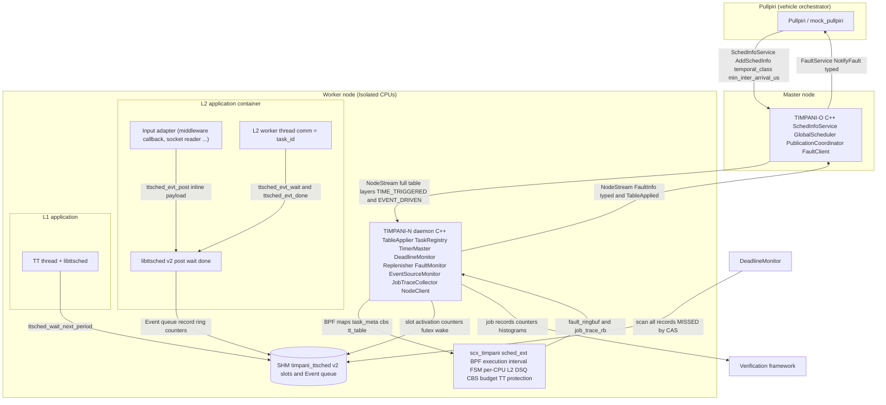

경계 원칙(D-01): `L2 application container` 밖의 어떤 TIMPANI 컴포넌트도 입력 어댑터의 미들웨어 타입을 알지 못한다. 미들웨어 코드는 샘플 앱 영역(`examples/`)에만 존재한다. 워커가 `libttsched`에 넘기는 것은 Event 식별자, 도달 시각, 마감, 인라인 payload뿐이다.

---

## 2. 아키텍처 드라이버 (Architectural Drivers)

| 드라이버 | 요구사항 | 아키텍처 영향 |
|:--|:--|:--|
| 한 Event–한 Job, 명시적 Job 경계 | REQ-008 MOD-009, DET-007, MOD-010 | 워커는 `ttsched_evt_wait()`로 Event 한 건을 받아 Job을 시작하고 `ttsched_evt_done()`으로 끝낸다(D-18). 큐 항목 하나가 Job 하나다 |
| 도달 기준 마감, 완료를 기다리지 않는 감지 | REQ-008 PRT-008, PRT-009, TIM-009, TIM-010 | 절대 마감 $t_{arr} + D$를 수락 때 고정한다. TIMPANI-N DeadlineMonitor가 큐 대기·실행·스로틀 중에도 감지한다(D-20) |
| 큐·통지·복구의 일관성 | REQ-008 IF-007, AC-008-15 | SHM 기록 링, `(gen, seq)` 식별, 상태 전이 CAS, 세대 검사로 다른 Event의 데이터와 시각이 섞이지 않게 한다(D-19) |
| CBS 예산 관리와 Event/Job 관리의 책임 구분 | REQ-008 MOD-011, FR-G-003 | BPF 실행 구간 관측과 명시적 Event 연결은 같은 L2 워커의 서로 다른 책임에 필요한 정보를 제공한다(D-21) |
| L1 보호·FFI | CBS-002/005, ORD-003, TIM-007 | CPU별 L2 DSQ(D-06), TT-first 디스패치 유지, 활성화 순서 FIFO(D-08), 윈도우당 예산 상한(D-04) |
| 보충 결정론 | PRT-001/003, TIM-003 | 활성화 기준 보충 윈도우(D-04), Replenisher 스레드와 커널 kick 경로(D-07), 윈도우 조건 P-a(§4.3) |
| 마감 보장 수용 판정 | CBS-004, ORD-001 | 수용식 한 식(D-09, §3.6): $\delta_{ovr}$, $L_{del}^{max}$, $D_i \le MIT_i$, $T_i \le MIT_i$ |
| 폴트 의미 보존·속도 제한 | PRT-005/006/007, IF-004 | 카운트 경로(무손실)와 상세 경로(최선 노력, 드롭 카운트) 분리(D-10) |
| 검증 가능성·필수 통계 | OBS-001/002, OBS-004 | 슬롯 누적 카운터(트레이스와 무관), Job 로그, 실행 구간 레코드(D-16) |
| 호환성·거버넌스 | NFR-005, C-03 | proto 필드 추가만(D-11, 승인 필요); SHM ABI 단절은 `magic`·`version`으로 식별 |
| 공유 메모리 신뢰(P1) | REQ-008 IF-007 | SHM 쓰기가 가능한 프로세스는 모두 신뢰한다. 객체 격리는 P2(F-14) |
| 단순성(P1) | REQ-008 §0.1 | 전체 테이블 발행 유지(D-17), FIFO, 보수적 수용식, 1 ms 주기 스캔 후보(D-20) |

---

## 3. 컴포넌트 뷰 (Component View)

### 3.0 공통 모델과 3층 대응

| 층 (REQ-008 §2.1) | 담당 | 만들어 내는 것 / 사용하는 것 |
|:--|:--|:--|
| **① 모델** | 문서 계약(REQ-008 §2), 애플리케이션 계약(§8.1), 출력 형식(§6.5) | Event source, Event(`gen`, `seq`, $t_{arr}$, $t_{dl}$), Job, Event 생명주기 상태, 규칙 R1~R4, 불변식 I1 |
| **② 명시적 Event 연결** | `libttsched` v2 Event 큐(§3.4) + SHM v2 슬롯(§6.2) | 수락과 거절, Job 경계(post·wait·done), 도달·마감 기록. Event를 만들 수 있는 경로는 이것뿐이다 |
| **② 커널 실행 관측** | BPF `ops.runnable/running/stopping/quiescent` 실행 구간 FSM(§3.3) | 실행 구간(활성화 $t_{act}$, 최초 실행 $t_{start}$, 수면), 예산 사용량. Job 경계나 Event는 만들지 않는다 |
| **③ 집행** | BPF CBS·CPU 고정·TT 보호(예산 집행), TIMPANI-N DeadlineMonitor·FaultMonitor(마감 감지·보고), TIMPANI-O 수용 판정 | 예산 초과 집행, 마감 실패 감지, 수용식(§3.6) |

공통 용어의 정본은 [REQ-008 §2](REQ-008-event-driven-workload-support.md#2-개념-모델-공통-eventjob-모델-common-eventjob-model)다. **CBS 예산 관리**와 **Event/Job 관리**는 같은 L2 워커의 상호 보완적 책임이지 두 앱·클래스·모드나 앱의 두 부분이 아니다. DDR-001의 L2 분류는 그대로다.

- **CBS 예산 관리**: 서버 윈도우 단위 예산 집행·예산 보충·스로틀을 담당한다. 집행과 보충은 BPF가 배정 CPU에서 수행하며 TIMPANI-N의 Replenisher는 kick만 한다(§3.3, D-04, D-07). CPU 고정과 BPF 실행 구간 관측은 연관된 공통 메커니즘이며 명시적 Event 연결 없이도 유지된다.
- **Event/Job 관리**: 명시적 Event 연결을 통해 Event 수락·식별·큐, 명시적 Job 생명주기, 도달 기준 MIT 계수·마감 감시를 수행한다. 연결 없이는 필요한 Event 도달 시각·Job 기록을 얻지 못하며 BPF 실행 구간에서 추정하지 않는다.

P1은 이 책임 구분을 위한 추가 분류·구성 플래그를 두지 않는다. source에 Event 기록이 없으면 DeadlineMonitor가 감시할 객체가 없는 것이며, 일시적인 게시 침묵이 앱을 재분류하지 않는다. 모든 L2에 같은 수용식을 적용하며 Event 기록이 없을 때 선언 D는 커널 활성화 기준 수용 판정 파라미터이지 감시되는 Job 마감이 아니다(MOD-011, D-21). 선택적 연결의 기존 호환성과 두 개의 Event 원천을 두지 않는 원칙(D-01)은 유지한다. P2의 미들웨어 경계·선행 태스크 완료 등 자동 연결은 ② 경로에 어댑터를 추가하는 것으로 수용한다(§11).

### 3.1 TIMPANI-O

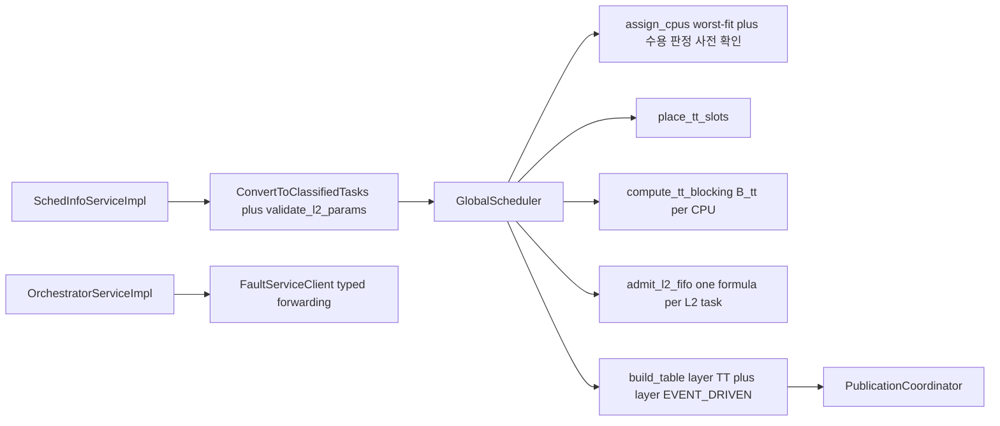

| 컴포넌트 | 변경 | 책임 (P1) | 결정 |
|:--|:--|:--|:--|
| `SchedInfoServiceImpl` | 수정 | `min_inter_arrival_us` 우선, 0이면 `period`로 전환(경고). L2 파라미터 검증: $0 < C \le D \le MIT$, $T \le MIT$, `task_id` 15바이트 이하·노드 내 유일. 거부 시 이전 워크로드 복원 | D-09, D-11 |
| `GlobalScheduler` | 수정 | `ClassifiedTask.mit_us` 분리. CPU별·전역 hyperperiod 일관화. CBS 전용 노드 HP 정의(FR-O-015; CBS 실행은 이 값을 쓰지 않음, D-22). TT 슬롯이 없는 CPU의 L2 배치·수용 판정($B_{tt} = 0$, FR-O-022) | D-09, D-22 |
| `compute_tt_blocking` | 신규 | CPU별 TT 슬롯 병합 → $B_{tt}(k, L)$: 길이 $L$인 임의 윈도우 안의 TT 점유 최댓값 | D-09 |
| `admit_l2_fifo` | 신규(기존 `allocate_cbs_budgets` 확장) | 이용률과 min-gap 거부, CPU $k$의 **모든** L2 태스크 $i$에 대해 §3.6의 한 식 검사. 기존 D-09의 나머지 조건(CPU당 L2 태스크 16 이하 등)은 유지 | D-09 |
| `build_table` | 수정 | `layer_index=1 TIME_TRIGGERED`(TT만) + `layer_index=2 EVENT_DRIVEN`(CBS만: `budget`, `period`, `deadline`, `min_inter_arrival_us`, `cpu`). `table_id` 단조 증가 | D-06, D-11 |
| `OrchestratorServiceImpl::handle_fault_info` | 수정 | 폴트 유형을 같은 의미의 유형으로 매핑(UNKNOWN 축약 제거). 신규 필드 전달 | D-10 |

### 3.2 TIMPANI-N (사용자 공간)

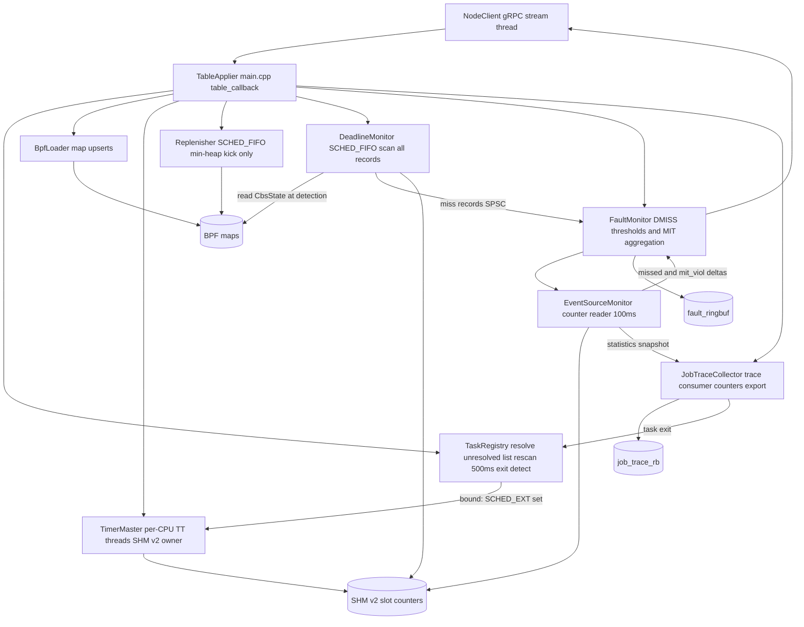

| 컴포넌트 | 변경 | 책임 (P1) | 결정 |
|:--|:--|:--|:--|
| `TableApplier`(main.cpp) | 수정 | 레이어 `model` 분기. EVENT_DRIVEN 엔트리: `cpu` 검사(없거나 Isolated CPU가 아니면 적용 오류, 파티션 cpuset으로 대체하지 않음) → TaskRegistry 해석 요청 → `cbs_map` 설정 → `TaskMeta(CBS, cpu, bind_gen)` → `SCHED_EXT` 전환 → 바인딩 완료를 TimerMaster에 알려 슬롯을 활성화(§4.1). 이미 등록된 엔트리가 그대로면 **아무것도 쓰지 않는다**(BPF가 소유한 실행 구간·예산 상태 보존). 파라미터가 바뀌었으면 제거 후 재등록. Replenisher에 서버 목록 전달. 바인딩 전에 배정 CPU가 워커의 허용 CPU 집합에 있는지 확인(FR-N-033). 없으면 바인딩하지 않고 오류를 기록하며 미해결 목록에 둔다(Isolated CPU 검사의 적용 오류와 구분) | D-06, D-11, D-17, D-24 |
| `TaskRegistry` | 부활·확장 | 이름→TID 해석(프로세스→스레드), 미해결 목록, 500 ms 재스캔, 발견 시 바인딩 콜백(등록), TID 소멸 감지 시 콜백(정리). `bind_gen`을 세어 늦게 도달한 이전 바인딩의 종료 기록을 무시할 수 있게 한다 | D-12, D-17 |
| `TimerMaster` | 수정 | SHM v2 소유. 시작할 때 남아 있는 SHM 객체가 있으면 종료 절차(§6.3 프로토콜 7)를 수행하고 새 객체를 만든다. TT 슬롯 집합이 같으면 TT 스레드를 재시작하지 않는다(`update_evt_slots`). L2 source에는 테이블 적용 때 슬롯을 **고정 배정**하고(이름만 기록, 활성화 전), 바인딩 때 **활성화**한다: `kind = NONE`을 먼저 쓰고 남은 비종료 기록을 닫은 뒤, 설정 기록 → `last_arr_ns = 0` → 새 `gen` → `kind = EVT`, 카운터 기준선 기록. 비활성화·종료 때는 `kind = NONE` → 닫기 쓸기(closing sweep) → `counter` 증가 → 깨움. 지터 샘플은 JobTraceCollector로 | D-03, D-16, D-17 |
| `DeadlineMonitor` | 신규 | SCHED_FIFO 스레드(후보 우선순위 97, Replenisher 98과 TimerMaster 99 아래, 일반 앱 RT 스레드 위). Non-Isolated CPU. 전체 슬롯의 모든 항목을 `DL_SCAN_PERIOD_US`(후보 1000 µs)마다 읽어 QUEUED 또는 RUNNING이고 MISSED가 없으며 $now > t_{dl}$이고 `gen`이 슬롯의 현재 `gen`과 같은 기록에 MISSED CAS와 `missed++`를 수행한다. 다른 세대의 기록은 건너뛰고 상태를 바꾸지 않는다. 탐지 때에만 BPF `CbsState.throttled`를 한 번 읽는다. 미스 기록을 FaultMonitor로 보낸다(SPSC, 넘치면 드롭 카운트). 워커와 L2 스케줄러에 의존하지 않는다. TT 이벤트나 hyperperiod에 의존하지 않는다(FR-N-032, D-22). 힙 할당, 블로킹 I/O, gRPC 금지. Replenisher와 병합 여부는 F-12 | D-20 |
| `Replenisher` | 신규 | L2 서버별 "다음 확인 시각" 힙. 기상 시 `timpani_replenish_kick` 실행(스로틀되고 윈도우가 끝났으며 TT 슬롯이 활성이 아닌 서버의 배정 CPU만 kick; 대체: kicker 스레드). 윈도우가 끝났는데 아직 승격되지 않은 서버는 1 ms 뒤 다시 확인한다. **서버 상태(`cbs_map`)는 쓰지 않는다.** 힙은 테이블 적용 스레드가 만들어 교체. TT 이벤트나 hyperperiod 경계를 실행 조건으로 쓰지 않는다(FR-N-032, D-22) | D-04, D-07 |
| `FaultMonitor` | 수정 | **카운트 경로**(무손실): 주기마다 모든 source의 `missed`와 `mit_viol` 카운터 증분을 활성화 기준선 대비로 집계해 임계 규칙(`max_dmiss`, `current_limit`)과 누적 보고에 넣는다. **상세 경로**(최선 노력, 드롭 카운트): DeadlineMonitor 미스 기록과 Job 로그의 MISSED 항목을 `(task, gen, seq)`로 중복 제거해 보고에 붙인다. 플래그 `NOT_STARTED`, `THROTTLED`, `MIT_RELATED`, `LATE_COMPLETION`, `DETECTED_LATE`(§6.5). `MIT_VIOLATION`은 `mit_viol` 증분에서 만들며 source당 $T_s$ 윈도우에 FaultInfo 하나(개수 포함). 현재 등록의 FaultInfo만 보낸다. 모든 미스는 카운트 경로로 셈하며, FaultInfo는 기존 임계 규칙(`max_dmiss`)이 보내라고 할 때만 보낸다 | D-05, D-10 |
| `JobTraceCollector` | 신규 | `job_trace_rb`의 실행 구간 레코드 소비, 슬롯 Job 로그 소비(드롭 카운트), TIMPANI-N이 닫은 Job 기록 출력, 태스크별 통계·히스토그램·출력, 런타임 토글(`trace_enabled`), 태스크 종료 레코드를 TaskRegistry에 통지. 트레이스 드롭은 마감 판정에 쓰지 않는다 | D-16, D-12 |
| `EventSourceMonitor` | 신규 | FaultMonitor 폴링 스레드에서 슬롯 누적 카운터 전체를 100 ms마다 읽는다. `missed`·`mit_viol` 증분은 FaultMonitor로, 통계 스냅샷(`arrivals`, `accepted`, `overflow`, `revoked`, `started`, `completed`, `discarded`, `cancelled`, `abandoned`, `missed`, `mit_viol`, `resp_max_ns`)은 JobTraceCollector로 보낸다. 트레이스가 꺼져 있어도 카운트 경로와 통계는 동작한다 | D-03, D-16 |
| `BpfLoader` | 수정 | 신규 맵·프로그램 핸들(`job_trace_rb`, `timpani_replenish_kick`, `trace_enabled`), CPU별 DSQ 수 전달 | D-06, D-07, D-16 |

### 3.3 BPF 스케줄러 (`scx_timpani`)

BPF는 예산과 실행 구간을 다룬다. 코드 식별자에는 `job_` 접두사를 남길 수 있다(이름 변경이 이득을 주지 않는 경우). 문서에서는 BPF가 관측하는 단위를 **실행 구간**(execution interval, 커널 활성화 → 최초 실행 → 자발적 수면)이라고 부르고, Job이라고 부르지 않는다.

| 요소 | 변경 | 내용 | 결정 |
|:--|:--|:--|:--|
| `TaskMeta` | 확장·축소 | 추가: `bind_gen`(바인딩 횟수, 종료 레코드에 실린다), 실행 구간 상태, `run_seq`, `t_act`, `t_start`, `last_act`, 실행 구간 플래그(`CARRYOVER`, `THROTTLED`), `queue_key_ns`(L2 큐 순위). 제거: `mit_us`, `mit_viol_count`, 활성화 기준 MIT 검사, L2 DMISS·EARLY 판정 플래그 | D-02, D-05, D-08, D-17 |
| `CbsState` | 의미 유지 | `replenish_at_ns` = 현재 보충 윈도우의 끝. `remaining`과 `replenish_at`은 BPF만 쓴다. 사용자 공간은 `throttled`를 읽기만 한다(탐지 시점) | D-04 |
| DSQ | 유지 | `DSQ_CBS_BASE + cpu`, `DSQ_THROTTLED_BASE + cpu`(Isolated CPU마다 `init`에서 생성) | D-06 |
| `ops.runnable` | 수정 | WAITING→ACTIVE, $t_{act}$ 기록, `run_seq` 증가. 윈도우 검사: 직전 윈도우가 끝났으면(규칙 1) 예산을 채우고 새 윈도우 시작, 끝나지 않았으면 남은 예산으로 실행하고 `CARRYOVER` 표시. 활성화 기준 MIT 검사와 `MIT_VIOLATION` 발행은 삭제 | D-02, D-04 |
| `ops.select_cpu` | 수정 | 활성화 기록 제거. `assigned_cpu` 반환 | D-02, D-06 |
| `ops.enqueue` | 수정 | L2 → 배정 CPU의 L2 DSQ(순위 = `queue_key_ns`) 또는 THROTTLED DSQ(순위 = `replenish_at`). 여기서는 예산을 채우지 않는다 | D-04, D-06, D-08 |
| `ops.dispatch` | 수정 | 자기 CPU의 THROTTLED 중 윈도우가 끝난 서버를 승격(예산 채움, 새 윈도우, 순위 = 승격 시각) → L2 DSQ를 활성화 순서로 소비. TT-first 유지. TT 슬롯이 없는 CPU에서는 TT 활성 판정이 거짓이라 TT 게이트에 막히지 않는다(FR-B-025, D-22) | D-04, D-06, D-08 |
| `ops.running` | 수정 | 최초 실행 시 `t_start` 기록. 슬라이스 캡 유지 | D-02 |
| `ops.stopping` | 수정 | 예산 차감(ns 누산). `BUDGET_EXCEED`는 양수→0 전이에서만 1회. **조기 DMISS 판정 삭제** | D-04, D-10 |
| `ops.quiescent` | 수정 | ACTIVE→WAITING(자발적 수면 = 실행 구간 종료). `t_sleep`, `budget_used_us` 기록, 실행 구간 레코드 발행(`trace_enabled`일 때). **DMISS 판정 삭제** | D-02, D-16 |
| `ops.exit_task` | 신규 | 태스크 종료 레코드(`bind_gen` 포함)를 `job_trace_rb`로 발행(게이트 없음) → JobTraceCollector → TaskRegistry | D-12, D-16 |
| `job_trace_rb` | 수정 | 실행 구간 레코드(256 KiB, `trace_enabled` 게이트). 태스크 종료 레코드는 게이트와 무관하게 발행 | D-16 |
| `timpani_replenish_kick` | 유지(SYSCALL prog) | `cbs_map`을 읽어 서버가 스로틀 상태이고 윈도우가 끝났으며 그 CPU에서 TT 슬롯이 활성이 아닐 때만 `scx_bpf_kick_cpu(cpu, 0)`. 상태를 쓰지 않고 `(throttled, remaining, replenish_at)`을 돌려준다 | D-07 |

BPF는 Event 큐, 마감, MIT를 알지 못한다. 마감 판정은 TIMPANI-N의 DeadlineMonitor와 워커의 종료 전이가 맡는다(§6.3 프로토콜 6).

### 3.4 애플리케이션 라이브러리 (`libttsched` v2)

Event 큐 API는 **제안**이며 Project Leader 승인이 필요하다. 상수와 한계는 빌드 상수로 두는 후보값이다.

```c
#define TTSCHED_EVT_PAYLOAD_MAX  64   /* bytes carried inline per Event (P1 build constant, candidate) */
#define TTSCHED_EVT_QDEPTH        8   /* ring occupancy: QUEUED + RUNNING + closed entries head has not passed (power of two, candidate) */
#define TTSCHED_EVT_E_INACTIVE  (-1)  /* source not active, or the open Job was closed by TIMPANI */
#define TTSCHED_EVT_E_FULL      (-2)  /* queue full: rejected, counted as overflow */
#define TTSCHED_EVT_E_INVAL     (-3)  /* len > PAYLOAD_MAX, t_arr in the future or earlier than the previous arrival; done with an invalid outcome (the Job is ended as DISCARDED) */
#define TTSCHED_EVT_E_STATE     (-4)  /* wait while a Job is open, or done with no open Job */
enum { TTSCHED_EVT_COMPLETED = 0, TTSCHED_EVT_DISCARDED = 1 };

typedef int ttsched_evt_t;
struct ttsched_evt_event { uint64_t gen; uint32_t seq; uint32_t len;
                           uint64_t t_arr_ns; uint64_t t_deadline_ns;
                           uint8_t payload[TTSCHED_EVT_PAYLOAD_MAX]; };

ttsched_evt_t ttsched_evt_open(const char *task_id);   /* non-RT: maps SHM, resolves slot */
int ttsched_evt_post(ttsched_evt_t src, uint64_t t_arr_ns, const void *payload,
                     uint32_t len, struct ttsched_evt_id *id_out);  /* 0 accepted; <0 nothing created */
int ttsched_evt_wait(struct ttsched_evt_event *ev);    /* worker: take exactly one Event, start its Job */
int ttsched_evt_done(int outcome);                     /* worker: end the open Job (mandatory) */
```

| API | 호출 주체 | 동작 |
|:--|:--|:--|
| `ttsched_init()` | TT·L2 공통 | SHM v2 매핑(객체가 바뀐 경우에만 다시 매핑), `magic`과 `version` 검증, comm으로 슬롯 탐색. 비-RT 경로. 여러 번 호출해도 된다. 객체가 바뀌지 않았으면 매핑을 더하지 않는다. 교체된 객체의 이전 매핑은 남는다(P1 한계) |
| `ttsched_wait_next_period()` | L1 TT | 기존 동작 유지 |
| `ttsched_evt_open(task_id)` | 입력 어댑터, 워커 초기화 | 비-RT. 핸들 `ttsched_evt_t`는 `task_id`를 가리킨다. `ttsched_init()` 뒤에도 유효하며 다음 사용 때 슬롯을 다시 찾는다(바운드 스캔, 시스템 호출 없음) |
| `ttsched_evt_post(...)` | 입력 어댑터(source당 한 번에 한 컨텍스트) | 수락 프로토콜(§6.3 프로토콜 2). 0은 Event가 생성되었고 식별자 `(gen, seq)`와 마감 $t_{arr} + D$를 가지며 감시 대상이 되었다는 뜻이다. 음수는 아무것도 만들지 않았다는 뜻이다. `t_arr_ns == 0`이면 호출 시각(CLOCK_MONOTONIC) |
| `ttsched_evt_wait(ev)` | 워커(source당 스레드 하나) | 열린 Job이 없어야 한다. 큐 맨 앞 Event 하나를 `QUEUED → RUNNING`으로 가져와 Job을 시작한다(프로토콜 3). E_INACTIVE이면 짧은 back-off(후보 10 ms) 뒤 반환하며 호출자는 `ttsched_init()` 후 재시도한다 |
| `ttsched_evt_done(outcome)` | 워커 | 열린 Job을 끝낸다(프로토콜 4). `COMPLETED` 또는 `DISCARDED`. `W0`의 seq가 열린 Job의 seq와 다르거나 `W0`가 ABANDONED이면 E_INACTIVE(TIMPANI가 닫았거나 칸이 재사용되었다). 열린 Job 플래그는 E_INACTIVE여도 지운다 |

- **Inline payload만 P1에서 지원한다.** `len > TTSCHED_EVT_PAYLOAD_MAX`이면 E_INVAL. TIMPANI는 payload 바이트가 Event 식별자·시각과 일치함을 보장한다. 앱이 payload에 자기 저장소의 참조를 넣으면 그 저장소의 수명은 계약 밖이다(P1에는 해제 통지가 없다). 큰 payload와 명시적 해제는 P2(F-13). FCW의 `RadarTarget`(16바이트)은 인라인에 들어간다.
- **Posting context는 source당 하나.** 같은 source에 대한 `ttsched_evt_post`는 동시에 호출되지 않아야 한다(어댑터 스레드 하나, 또는 어댑터가 호출을 직렬화). libttsched는 잠금을 쓰지 않으며 위반을 감지하지 않는다. 위반 시 그 source의 큐만 깨질 수 있다. 다중 생산자는 P2(F-13). 포스터는 워커와 같은 프로세스의 스레드이거나, SHM 쓰기 권한이 있는 같은 호스트의 다른 프로세스일 수 있다.
- **워커는 source당 스레드 하나**다. 스레드 이름은 `task_id`(1~15바이트, 테이블 적용 때 검증). 같은 source에 대해 두 번째 스레드가 wait/done을 부르면 계약 위반이다.
- **도달 시각 `t_arr`.** `t_arr_ns == 0`이면 게시 호출이 CLOCK_MONOTONIC을 읽는다. 값을 주면 CLOCK_MONOTONIC이어야 하고, 미래이면 안 되며, 같은 source의 직전 도달보다 빠르면 안 된다(E_INVAL). 현재 시각보다 이른 값은 준 그대로 수락한다. 어댑터가 이미 쓴 시간은 응답 시간의 일부이며 수용식이 덮지 않는다(§3.6 가정 5).
- **비용 한계.** post, wait(블로킹 없는 경우), done은 바운드된 원자 연산 수(호출별 개수는 LLD-008 §6이 준다, 후보), payload 복사 1회(64바이트 이하), 최대 futex 시스템 호출 1회다. 힙, 잠금, 블로킹은 없다. 매핑과 재매핑은 이 한계 밖이며 `ttsched_evt_open()`과 `ttsched_init()`이 비-RT 경로에서 수행한다. 매핑이 쓸 수 없으면 post와 wait는 재매핑하지 않고 E_INACTIVE를 반환한다.
- **종료와 대기 취소:** 9209bc5와 같다. P1에는 wait를 취소하는 API가 없다(LLD-008 L-8).
- **신뢰:** P1에서 SHM 객체에 쓸 수 있는 모든 프로세스는 신뢰한다. 잘못 쓰는 쓰기 주체는 임의의 슬롯을 깨뜨릴 수 있다. 객체의 source별 격리는 P2(F-14).

### 3.5 샘플 앱 어댑터 (코어 외부)

- `examples/someip/radar_based_fcw`: vsomeip 메시지 핸들러는 `RadarTarget`을 인라인으로 `ttsched_evt_post`한다. 워커는 `ttsched_evt_wait()`로 Event 한 건을 받고 `ttsched_evt_done()`으로 끝낸다. 수신 큐, 뮤텍스, 조건 변수, `timpani_evt_*` 호출은 없어진다(§8.4).
- `libtimpani_rt`는 폐기한다(REQ-008 §12). 이 라이브러리가 가졌던 SOME/IP ID 기반 API와 자체 MIT·E2E 판정은 TIMPANI 계약에 들어가지 않는다.
- 두 번째 워크로드 `evttask`는 Unix datagram 원천을 쓰는 비-SOME/IP 샘플이다(§8.5). 같은 계약을 쓴다.

### 3.6 수용식 (TIMPANI-O, D-09)

Event의 마감은 도달부터 센다. CPU $k$의 모든 L2 태스크 $i$에 대해 명시적 Event 연결 여부와 무관하게 다음 한 수용식을 검사한다. CBS 예산 관리와 Event/Job 관리의 책임 구분은 수용식을 나누는 기준이 아니다.

$$C_i + B_{tt}(k, D_i) + L_{del}^{max} + \sum_{j \ne i}(C_j + \delta_{ovr}) \le D_i \quad\text{and}\quad D_i \le MIT_i \quad\text{and}\quad T_i \le MIT_i$$

| 항 | 뜻 | P1 값 (후보, 측정 대상) |
|:--|:--|:--|
| $C_i$ | 태스크 $i$의 예산 `runtime`. 측정한 Job당 최대 CPU 시간보다 크게 선언한다(§8.1 9항) | 선언값 |
| $B_{tt}(k, D_i)$ | 길이 $D_i$인 임의 윈도우 안에서 CPU $k$의 TT 점유 최댓값 | 계산값(TT 테이블에서) |
| $L_{del}^{max}$ | 도달부터 워커의 최초 디스패치까지 상한 = $L_{post}$(TIM-011, post에서 실행 가능까지, 후보 50 µs) + $L_{wake}$(TIM-001, 실행 가능에서 최초 실행까지, 유휴이고 TT가 없는 CPU, 50 µs). TIM-002(TT 점유 중 깨움)는 넣지 않으며 그 대기는 $B_{tt}$ 항이 덮는다 | 후보 100 µs |
| $\delta_{ovr}$ | 다른 서버가 예산을 넘긴 뒤 스로틀될 때까지의 최대 초과. 스케줄러 틱 한 번 (TIM-004/TMG-004) | 후보 1 ms(HZ=1000) |
| $MIT_i$ | `min_inter_arrival_us`, 없으면 주기(D-11 규칙) | 선언값 |
| $T_i$ | CBS 서버 주기(`period`) | 선언값 |

$L_{del}^{max}$의 두 부분은 모두 **측정 목표**이며 증명된 최악값이 아니다. TIM-001/002는 커널 측 정의를 그대로 둔다. $D_i \le MIT_i$와 $T_i \le MIT_i$는 도달 간격 $MIT_i$ 안에 한 Event의 Job이 끝나고 다음 활성화가 윈도우 밖에 놓이게 한다. 그래서 자기 큐잉 항을 따로 두지 않는다.

**가정(이 식이 충분조건이 되는 조건, 문서가 목록으로 가진다)**

1. TT 태스크는 선언한 런타임 안에서 실행된다. TT 초과는 TT DMISS이며 L2 보장 밖이다.
2. $\delta_{ovr}$과 $L_{del}^{max}$은 측정값으로 성립한다.
3. source의 도달은 MIT를 지킨다.
4. Job은 블로킹하지 않는다(§8.1 6항). A-06은 이 식의 적용 조건이며 정확성 전제는 아니다. 블로킹하는 source는 마감을 감시하지만 수용식이 보장하지 않는다.
5. 어댑터는 도달 시점에 게시한다. 준 $t_{arr}$이 현재보다 이르면 그만큼 $D$가 소비된다.
6. 각 Job의 CPU 수요가 선언한 $C_i$를 넘지 않는다(여유 있게 선언한다).
7. 각 Job은 다음 도달 전에 워커가 `ttsched_evt_wait()`에서 잠들 만큼 빨리 끝난다(§4.3의 P-a 경계 사례).
8. `tol`(§4.3)이 측정된 활성화 지터를 덮는다.

**결과와 영향**

- Event 기록이 없어도 같은 수용식을 통과해야 한다. 이 경우 $D$는 커널 활성화 기준의 수용 판정 파라미터이며 감시되는 Job 마감이 아니다. $L_{post}$ 부분은 여유로 남는다.
- MIT를 어긴 도달이 있으면 큐가 최대 QDEPTH까지 쌓이고 뒤의 Job이 늦는다. 이는 막지 않고 보고한다.
- CPU에 L2 태스크가 여러 개면 $\delta_{ovr}$ 항 때문에 수용률이 줄어든다. 이는 R-5와 P2 HRTICK 검토 대상이다.
- 기본 FCW 파라미터로는 같은 CPU에 두 번째 L2 태스크를 둘 수 없다(§8.5 (c)).
- 식은 충분조건이며 증명이 아니다. 항의 값은 측정으로 확인한다.

---
## 4. 런타임 뷰 (Runtime View)

### 4.1 L2 워크로드 등록 → 수용 판정 → 발행 → 적용

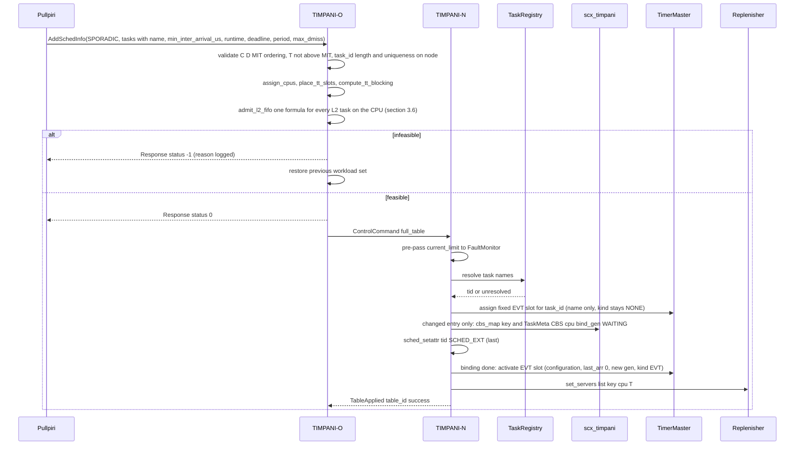

- 테이블 적용 때는 L2 source에 **슬롯 이름만** 배정한다. `kind`는 NONE으로 둔다. 활성화는 워커 스레드가 바인딩되어 `SCHED_EXT`로 전환된 뒤에만 일어난다(프로토콜 1). 그래서 Event 수락은 관리되는 워커가 있다는 뜻이다.
- TT 슬롯 집합이 같으면 TT 스레드를 재시작하지 않고 EVT 슬롯 배정만 갱신한다(`update_evt_slots`). 집합이 바뀌면 SHM v2를 다시 발행한다(`set_schedule_table`).
- 수용 판정에서 거부되면 이전 워크로드 집합을 복원한다. 이 경우 BPF와 SHM에는 아무것도 쓰지 않는다.

### 4.2 정상 Event → Job

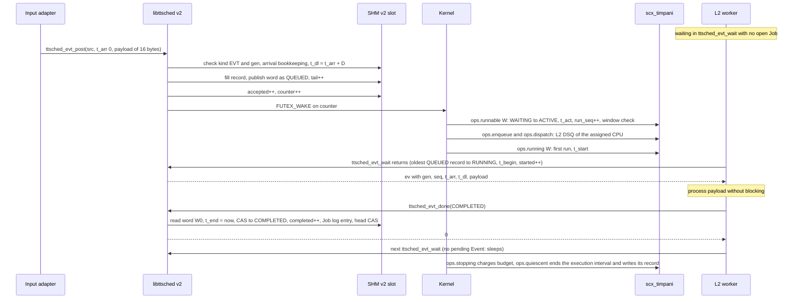

한 Event는 한 Job이다. 워커가 자고 있었다면 Event는 수락 즉시 실행 가능이 된다(R1). 활성화 시각 $t_{act}$와 도달 시각 $t_{arr}$는 다른 값이다. 수용식과 Event 기준 응답 시간은 $t_{arr}$를 쓴다. 실행 구간은 커널 관측이므로 Job 경계로 쓰지 않는다. 워커가 Job을 여는 시점은 `ttsched_evt_wait()`가 Event를 취득하는 시점이며, 끝나는 시점은 `ttsched_evt_done()`이 쓰는 완료 시각 $t_{end}$다.

### 4.3 예산 소진 → 스로틀 → 백업 보충 → 재개

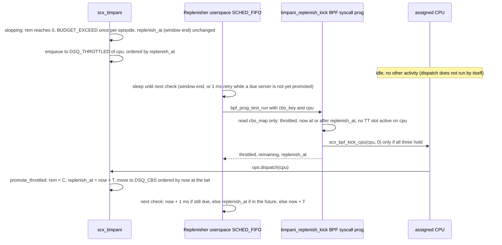

보충 윈도우의 시작은 커널 활성화(runnable 전환)에 묶여 있으며 첫 실행 시각에 묶이지 않는다. 승격과 보충은 BPF가 배정 CPU에서 수행하고 Replenisher는 dispatch를 유발할 뿐이다(D-04 규칙 6, D-07). 실행 구간이 새로 시작해도 예산을 새로 주지 않는다. 같은 윈도우 안에서 시작한 Job(연속 Job이나 블로킹 뒤 재개)은 남은 예산을 나눠 쓴다(D-04). 열린 윈도우 안에서 예산은 늘어나지 않는다. 서버는 다음 커널 활성화(규칙 1)나 승격(규칙 3)에서만 정상 상태로 돌아간다.

**윈도우 조건 P-a(재기술).** Event 도달이 MIT를 지키고, 각 Job의 차감 실행 시간이 $C_s$ 미만이며, Job이 블로킹하지 않으면 다음이 성립한다.

- $T_s \le MIT$($T_s$는 선언된 CBS 주기 `period`, MIT는 `min_inter_arrival_us`이며 없으면 주기다). 이 조건이 없으면 $T_s > MIT$인 서버에서 적합한 도달이 열린 윈도우 안에 떨어져 새 예산을 받지 못한다.
- $D \le MIT$.
- 각 Job은 워커가 다음 도달 전에 `ttsched_evt_wait()`에서 잠들 만큼 빨리 끝난다. 그러면 연속 활성화 간격은 $T_s - tol$ 이상이고 모든 Job이 완전한 예산으로 시작한다(스로틀되지 않는다).

**경계 사례.** Job이 다음 도달과 너무 가깝게 끝나 워커가 아직 잠들지 못하면(R이 MIT에 가까울 때만 가능) 다음 Job은 커널 활성화 없이 시작하고 남은 윈도우 예산으로 실행한다. 그 윈도우는 이전 Job의 활성화 지연 뒤에 끝나고 승격으로 예산이 다시 채워진다. 추가 지연은 작고 바운드되지만 BUDGET_EXCEED가 나올 수 있다. D와 MIT 사이에 여유를 두도록 권장한다.

**위반 후 동작.** Job이 마감을 넘기거나 도달이 MIT를 어기면, 다음 Job은 열린 윈도우 안에서 시작해 남은 예산을 나눠 쓰고, 윈도우가 끝날 때까지 스로틀될 수 있으며(`CARRYOVER`), 마감을 넘길 수 있다. 이는 막지 않고 보고한다. 이 경우 윈도우는 뒤로 밀리지 않으며 승격은 윈도우 끝에서만 일어난다(D-04 "위반 후 동작"은 윈도우 용어로 다시 쓴다).

**`tol`(`CBS_ACT_TOL_US`)**은 윈도우 규칙 1만의 허용 오차다. 후보값은 50 µs($L_{post}$)이며 도달에서 실행 가능까지 지연의 흩어짐보다 커야 한다. MIT 검사에 쓰지 않으며 `L_wake_max`와 묶이지도 않는다. 측정 대상이다.

TT 슬롯이 활성인 CPU에는 kick을 보내지 않는다. TT 태스크가 잠들면 CPU가 다음 태스크를 고르면서 dispatch가 호출되어 승격되고, Replenisher는 승격될 때까지 1 ms마다 확인한다.

대체 경로(D-07 2안): `KP` 대신 CPU별 kicker 스레드를 futex로 깨워 `schedule()`을 유발한다.

### 4.4 Event B 도달 중 Job A 실행과 연속 Job

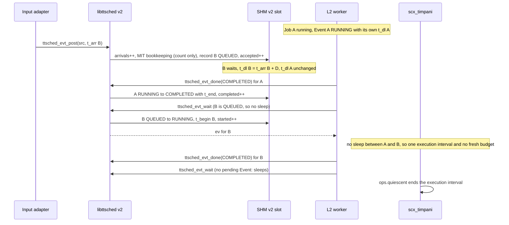

B가 A 처리 중에 도달하면 B는 `QUEUED`로 남는다(R2). A에 합쳐지지 않으며 A의 마감도 바뀌지 않는다. A가 끝나면 워커는 잠들지 않고 B를 가져와 두 번째 Job을 시작한다(R3). 두 Job은 서로 다른 Job이며 각자 기록되고 각자 판정된다(AC-008-13). BPF는 두 Job을 하나의 실행 구간에서 보므로 실행 구간 레코드 하나에 두 Job이 걸쳐 있다. 이 구간에는 새 예산이 주어지지 않는다. 워커가 wait를 부를 때 열린 Job이 있으면 E_STATE이므로 이전 Job은 반드시 done으로 끝나야 한다.

### 4.5 지연 식별 (늦게 생성된 워커 / 재시작)

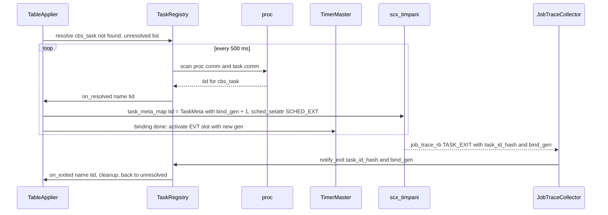

`bind_gen`은 바인딩마다 증가한다. 이전 바인딩의 늦은 종료 레코드는 `bind_gen`이 맞지 않으므로 새 바인딩을 비활성화하지 못한다. 워커 스레드가 나타나 바인딩될 때에만 슬롯이 활성화된다. 그 전에 도달한 Event는 없다. 워커가 아직 바인딩되지 않은 상태에서 post는 E_INACTIVE를 받는다.

### 4.6 STOP(제거)

DDR-011 §3.2/DDR-012 §5.1 경로를 유지한다. 추가되는 단계는 다음과 같다. 먼저 `sched_setattr(SCHED_OTHER)`로 되돌린다. 그다음 TimerMaster가 슬롯을 비활성화한다(§6.3 프로토콜 5): `kind = NONE`을 먼저 쓰고, 슬롯 전체에 닫기 쓸기를 수행해 QUEUED 기록을 CANCELLED로 바꾸고, RUNNING 기록은 워커가 끝난 것을 확인한 뒤 ABANDONED로 바꾼다. 마지막으로 `counter`를 올려 깨운다. 그 뒤 `TaskMeta`, `cbs_map`, Replenisher 힙 항목, 미해결 목록을 지운다. JobTraceCollector 통계는 누적 값으로 남긴다. SHM 슬롯은 지우지 않는다. 슬롯은 `task_id`에 고정 배정된 채 남고, 같은 `task_id`가 다시 등록되면 누적 카운터를 이어서 쓰되 새 `gen`을 받는다.

### 4.7 마감 경과 감지: Event가 큐에서 대기하는 경우

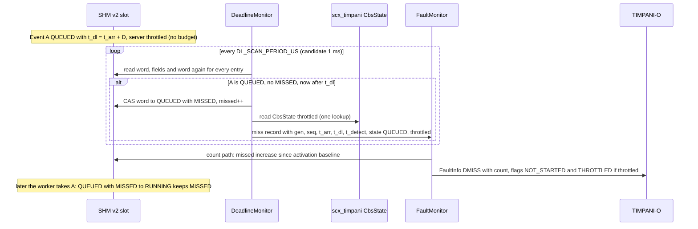

워커가 한 번도 시작하지 못한 Event도 감지된다. 감지는 워커나 L2 스케줄러에 의존하지 않는다. 기록은 `QUEUED`에서 MISSED만 설정되므로 상태는 바뀌지 않는다. 나중에 워커가 가져오거나 닫히면 그때 정리된다. 마감 실패 한 건은 한 번만 셈한다(프로토콜 6).

### 4.8 마감 경과 감지: 스로틀 중 실행하던 Job과 완료 경합

> **깨움 방식 검토:** §4.7~4.8의 기준은 주기 스캔(1 ms 후보)이다. 가장 이른 $t_{dl} = t_{arr} + D$를 힙으로 관리하고 단일 절대 타이머를 설정하는 대안은 [DDR-008 D-20](DDR-008-event-driven-workload-support.md#d-20-완료를-기다리지-않는-마감-감지-도달-기준-절대-마감-deadlinemonitor--p1), F-10과 REQ-008 OI-22에서 검토한다. 더 이른 post의 알림·재설정 경합, 만료 후 실행 지연, 동일 `gen`/`seq` 재확인과 $now > t_{dl}$ 판정, MISSED 1회 CAS 및 늦은 종료 경로를 모두 유지해야 한다. 기존 워커용 counter가 모니터도 깨운다고 가정하지 않는다. 타이머는 완료 경합(OI-20)이나 지터 상한의 해법으로 확정되지 않았으며 설계 검토·타깃 PoC 전에는 기준을 바꾸지 않는다.

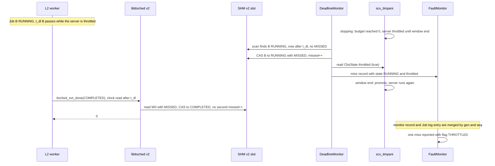

이 Job은 마감 이전에 완료되지 않았으므로 완료 시각이 늦어도 마감 실패는 한 번뿐이다. 완료 기록의 `t_end`는 늦은 값이고, 마감 실패는 감지 시각에 셈한다. 완료가 마감 이전에 게시되었지만 TIMPANI-N이 늦게 수집했다면 그 완료는 실패가 아니다. 판정은 기록된 `t_end`로 한다.

**완료 시각의 정의와 경합 규칙.** $t_{end}$는 워커가 종료 전이를 게시하기 직전 `done()`이 읽는 시계값이다. Job이 정시이려면 $t_{end} \le t_{dl}$이고 모니터가 그 전에 연체 표시를 하지 않았어야 한다. 전이가 모니터의 표시와 겹치면 전이가 실패하고, 워커는 시계를 다시 읽어(이제 $t_{dl}$ 이후) 재시도한다. 따라서 기록된 $t_{end}$와 MISSED 플래그가 어긋나지 않는다. 워커가 시계를 읽은 뒤 전이를 게시하기 전에 선점되면, 정시로 기록된 Job이 실제로는 $t_{dl}$ 뒤에 게시될 수 있다. 이 오차는 허용하며 첫 모니터 검사보다 늦지 않다(§9 R-18).

### 4.9 큐 넘침 (E_FULL)

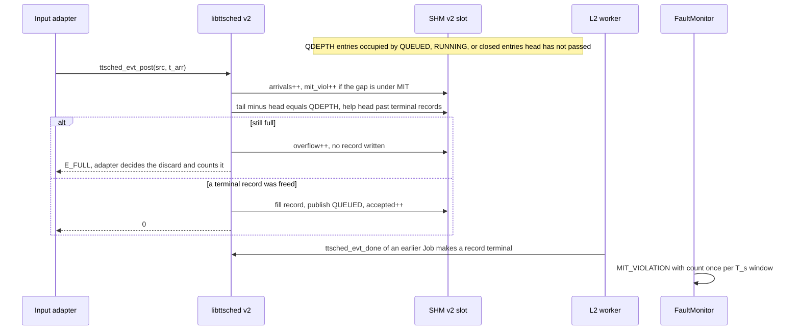

넘침은 수락 전에 일어난다. `QDEPTH`는 링 점유 상한이다. 점유에는 QUEUED와 RUNNING뿐 아니라 `head`가 아직 넘기지 못한 닫힌 칸도 든다. 그래서 살아 있는 Event가 QDEPTH보다 적어도 E_FULL이 날 수 있다. 이는 RUNNING Job이 `head`에 있어 그 뒤의 닫힌 칸을 넘기지 못하는 동안에만 일어난다. 거절된 post는 Event가 아니며 `accepted`를 세지 않고 `overflow`를 센다. MIT 계수는 거절되어도 도달로 센다(`arrivals`, `mit_viol`). 앱은 E_FULL을 받으면 그 Event를 버리고 버린 수를 자기 통계에 넣는다. 큐 밖에 앱 큐를 두지 않으므로 넘침은 SHM 카운터와 앱 통계에 남고 Event 데이터가 다른 Event와 섞이지 않는다. MIT를 어긴 버스트는 큐를 QDEPTH까지 채울 수 있으며 뒤의 Job이 늦는다(§4.4, §8.4 (3)). 이 경우 넘침과 MIT 위반은 보고되지만 막지 않는다(D-19).

### 4.10 비활성화와 재등록

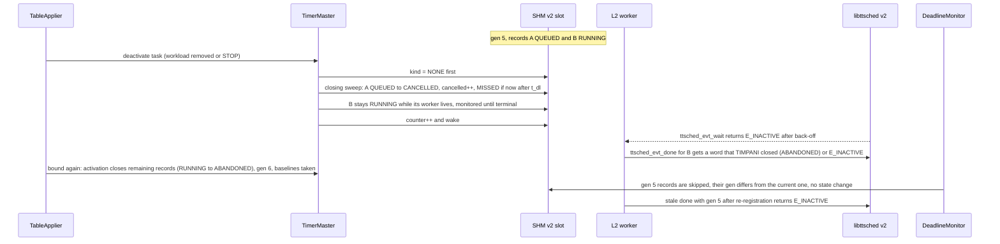

비활성화는 `kind`를 먼저 지우므로 새 post는 E_INACTIVE를 받는다. 닫기 쓸기는 QUEUED를 CANCELLED로 바꾸고, 마감이 이미 지났다면 MISSED를 함께 세운다(취소로 실패를 지우지 않는다). RUNNING 기록은 워커가 살아 있으면 RUNNING으로 남아 마감 감시를 계속 받고, 워커가 끝났을 때 ABANDONED가 된다. 재등록(활성화)은 남은 기록을 모두 닫는다. RUNNING은 무조건 ABANDONED가 되고, 새 `gen`을 받으며, 카운터 기준선을 기록한다. 이전 세대의 늦은 `done`은 ABANDONED를 보고 E_INACTIVE를 받는다. 이전 세대 기록의 상태는 새 등록 상태를 바꾸지 않는다. 마감 감시는 `gen`이 다른 기록을 건너뛴다. 닫기 쓸기는 닫으라고 지정된 기록을 모두 닫는다. 워커가 `kind = NONE`을 쓴 뒤 닫기 쓸기 전에 QUEUED 기록을 가져가면 그 Job은 실행되고 감시되며 정상 기록된다(P1 허용). 이전 세대에서 찾은 미스는 기록과 통계에만 남고 현재 등록의 FaultInfo로 나가지 않는다.

### 4.11 데몬 재시작과 데몬 중단 중 동작

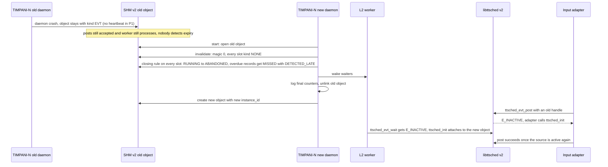

재시작 때 새 데몬은 먼저 `magic`을 0으로 만들고 모든 슬롯을 NONE으로 바꾼다. 그래서 무효화 전에 수락된 post는 닫기 쓸기에 잡히고, 이후의 post는 E_INACTIVE를 받는다(프로토콜 2의 (a) 단계는 `kind`만 검사한다. `magic` 갱신은 post를 막지 않으며 post를 막는 것은 `kind`다). 그다음 닫기 규칙을 모든 슬롯에 수행하여 기한이 지난 기록에 MISSED와 DETECTED_LATE를 붙인다. 그 뒤 새 객체를 `instance_id`와 함께 만든다. 이전 객체에 붙은 프로세스는 E_INACTIVE를 받고 `ttsched_init()`으로 새 객체에 붙는다. `seq`는 새 객체에서 다시 0부터 시작한다. `gen`은 다르므로 `(gen, seq)`는 객체 안에서 유일하다. 재시작을 넘어서는 `instance_id` 기반 `gen` 때문에 실질적으로 유일하지만 보장은 아니다. 트레이스에는 64비트 `instance_id`를 기록해 데몬 실행을 구분한다.

**데몬이 죽어 있는 동안(P1 한계).** 이전 객체는 `kind = EVT`를 그대로 가진다. 그래서 post는 수락되고 워커는 계속 처리한다. 워커의 종료 전이는 늦은 완료를 여전히 판정한다. 그러나 큐 대기 중이나 실행 중에 기한이 지나는 Event를 감지하는 주체는 없다. 그런 미스는 다음 데몬 시작 때 닫기 정리에서 DETECTED_LATE로 찾으며, 실시간 보고가 아니라 최종 통계로 나타난다. P1에는 데몬 하트비트가 없다. 그 구간의 실행은 TIMPANI 관리 밖이며, 그때 수락된 미종료 Event는 재시작 때 닫기 규칙으로 CANCELLED나 ABANDONED가 된다.

---
## 5. 배포 뷰 (Deployment View)

### 5.1 노드 내 스레드 (timpani-n 프로세스)

| 스레드 | 정책/우선순위 | CPU | RT 경로 | 변경 |
|:--|:--|:--|:-:|:--|
| TimerMaster per-CPU | SCHED_FIFO 99 | 각 Isolated CPU(미고정, 현행) | ● | SHM v2 슬롯 활성화·닫기 |
| **DeadlineMonitor** | SCHED_FIFO 97 (후보, PoC에서 확정, Replenisher 98 아래) | Non-Isolated | ● | 신규 |
| Replenisher | SCHED_FIFO 98 (TM−1; 기본값이며 PoC에서 확정, DDR-007 §11) | Non-Isolated | ● | 유지(별도 스레드, F-12) |
| (대체) kicker per-CPU | SCHED_FIFO 97 | 각 Isolated CPU 고정 | ● | D-07 2안 시 |
| FaultMonitor·EventSourceMonitor 폴링 | default | Non-Isolated | — | 카운트 경로와 상세 경로, 통계 읽기 |
| JobTraceCollector | default | Non-Isolated | — | 실행 구간 레코드, Job 로그 소비 |
| TaskRegistry rescan | default | Non-Isolated | — | 유지(바인딩 콜백 포함) |
| NodeClient stream | default | Non-Isolated | — | — |
| main | default | — | — | — |

RT 경로 스레드(TimerMaster, DeadlineMonitor, Replenisher)는 gRPC, 힙 할당, 블로킹 I/O를 하지 않는다(DDR-006 §4). DeadlineMonitor는 탐지한 미스를 고정 크기 SPSC 큐로 FaultMonitor에 넘긴다. 큐가 가득 차면 드롭을 센다. Replenisher의 힙은 테이블 적용 스레드(비-RT)가 잠금 밖에서 새로 만들어 짧은 임계 구역에서 교체하며, RT 루프는 할당하지 않는다. 잠금은 우선순위 상속 뮤텍스다. DeadlineMonitor와 Replenisher를 한 스레드로 합칠지는 F-12이다. P1은 별도 스레드를 가정한다. Replenisher가 DeadlineMonitor의 기능을 대신한다고 가정하지 않는다.

### 5.2 BPF 객체

`scx_timpani` 스켈레톤에 struct_ops(`runnable/quiescent/exit_task` 추가), `job_trace_rb`(실행 구간 레코드), `timpani_replenish_kick`(SEC("syscall")), 전역 `trace_enabled`를 포함한다. 로드 순서·권한은 현행(`CAP_BPF`, `CAP_SYS_NICE`) 유지.

### 5.3 애플리케이션

- **워커 TID 불변조건:** 등록 L2 워커는 배정된 Isolated CPU에서 `SCHED_EXT`/timpani-n 커널 BPF CBS로 실행되며, 배정 CPU가 워커의 허용 집합에 있어야 한다(CBS-008). 컨테이너 전체의 격리 배치를 요구하는 것이 아니다. 앱은 `/dev/shm/timpani_ttsched`에 **쓰기 가능으로** 접근한다. 워커의 wait·done이 기록 상태와 카운터를 바꾸기 때문이다(현행 TT 앱의 읽기 전용 접근과 다르다).
- L2 source마다 워커 스레드가 하나 있다. 스레드의 comm은 `task_id`다. 워커가 아닌 스레드가 wait 또는 done을 부르지 않는다.
- post 컨텍스트는 source당 하나다(§3.4). 같은 프로세스의 스레드이거나, SHM 쓰기 권한이 있는 같은 호스트의 다른 프로세스일 수 있다(OI-15 종결, DDR-008 D-03). 포스터 측이 여러 개면 앱이 직렬화한다.
- **현행과 검토 목표의 구분:** 현행은 시스템·Pullpiri의 컨테이너 cpuset 구성에 따르며 N의 바인딩은 cgroup을 이동하지 않는다. 워커만 Isolated cpuset, 비워커는 Non-Isolated CPU에 두는 목표는 배포 검토 중이다. 공통 threaded domain/`cgroup.threads` 조건, partition 격리와의 차이, 런타임 위임·권한·상속·재시작 및 N의 이동/검증 책임 미결 사항은 [DDR-008 D-24](DDR-008-event-driven-workload-support.md#d-24-애플리케이션-추상화와-실행-환경-전제--p1)를 따른다. 구현·검증 완료로 취급하지 않는다.
- API는 호출 스레드에서 실행되고 SHM 자체는 실행하지 않는다. wait·done의 CPU 실행 비용은 워커 CBS, post 비용은 생산자 문맥에 속한다. 비워커 fair/FIFO/RR 중 선택·관리는 P1 범위 밖이며, 배치·정책·간섭의 환경 검증은 유지한다(D-24).

---

## 6. 데이터 뷰 (Data View)

### 6.1 BPF 맵 (변경·신규만; 전체는 LLD-008)

| 맵 | 키 → 값 | 변경 |
|:--|:--|:--|
| `task_meta_map` | TID → `TaskMeta{bind_gen, exec_state, run_seq, t_act_ns, t_start_ns, last_act_ns, exec_flags, queue_key_ns, ...}` | 확장·축소. `mit_us`, `mit_viol_count`, L2 DMISS 판정 플래그를 제거하고 `bind_gen`을 추가한다(D-02, D-05, D-17) |
| `cbs_map` | `wl_hash ^ task_hash` → `CbsState{..., exec_frac_ns, throttle_episodes}` | 유지. `replenish_at_ns`는 보충 윈도우의 끝이며 `remaining`과 함께 BPF만 쓴다(D-04). 사용자 공간은 태스크가 SCHED_EXT에 들어가기 전(생성)과 나온 뒤(삭제)에만 쓴다. 탐지 때 `throttled`를 읽는다 |
| DSQ | `DSQ_CBS_BASE+cpu`, `DSQ_THROTTLED_BASE+cpu` | 유지(CPU별) |
| `fault_ringbuf` | `FaultEvent{task, kind, activation...}` | 축소. BPF가 내는 L2 유형은 없다. `MIT_VIOLATION`과 L2 `DMISS`는 BPF가 발행하지 않는다. TT DMISS 경로(DDR-012)는 유지 |
| `job_trace_rb` | `ExecRecord{workload_id_hash, task_id_hash, bind_gen, run_seq, cpu, t_act_ns, t_start_ns, t_sleep_ns, budget_used_us, flags}`(정본: LLD-008) | 내용을 실행 구간 레코드로 바꾼다. 이름의 `job_` 접두사는 유지한다(이름 변경이 이득을 주지 않음) |
| `.bss trace_enabled` | u32 | 신규 |

### 6.2 SHM v2 (`/timpani_ttsched`)

헤더는 `{magic(v2), version, n_tasks, generation, instance_id, reserved}`이다. 슬롯은 객체의 수명 동안 `task_id`에 고정된다. 모든 시각은 CLOCK_MONOTONIC ns다. 객체 전체 크기와 필드 배치, 정렬, 정적 검사는 LLD-008이 정한다. 후보값: 슬롯 64개, 객체 256 KiB 이하.

**슬롯 고정 부분.** 아래 필드는 Event source 하나의 상태다. 쓰는 주체는 필드마다 정해져 있다.

| 필드 | 쓰는 주체 | 뜻 |
|:--|:--|:--|
| `name[16]` | TimerMaster (테이블 적용 때) | `task_id`(고정 배정) |
| `counter` (u32) | post(수락 때), TimerMaster(비활성화·닫기 때) | futex 깨움 워드. 값 자체에는 의미가 없다 |
| `kind` (NONE, TT, EVT) | TimerMaster | 슬롯 활성 상태. post가 가장 먼저 확인한다 |
| `mit_us`, `deadline_us` | TimerMaster (활성화 때) | 설정 게시 |
| `gen` (u64) | TimerMaster (활성화 때) | 상위 32비트는 `instance_id`에서 유도, 하위 32비트는 활성화마다 증가하는 바인딩 수 |
| `head`, `tail` (u32) | `head`: 여러 주체가 CAS로 전진. `tail`: post만 | 자유 증가 인덱스. 칸 번호는 값을 QDEPTH로 나눈 나머지다 |
| `last_arr_ns`, `last_viol_ns` | post | 도달 기록. 활성화 때 `last_arr_ns = 0` |
| 카운터(atomic u64) | post, 워커, TimerMaster, DeadlineMonitor | `arrivals`, `accepted`, `overflow`, `revoked`, `started`, `completed`, `discarded`, `cancelled`, `abandoned`, `missed`, `mit_viol`. 최댓값 `resp_max_ns`는 워커만 쓴다. 누적 값이며 세대별이 아니다. TIMPANI-N은 활성화 때 기준선을 잡는다. `pending = accepted − started − cancelled`는 일시적으로 음수일 수 있으며 읽는 쪽이 0으로 자른다. 정지 상태에서만 정확하다 |

**Event 기록 링.** 슬롯마다 QDEPTH(후보 8)칸이다. 칸 하나는 128바이트(후보, 정렬 패딩 포함)이다.

| 필드 | 뜻 |
|:--|:--|
| `word` (u64, atomic) | 상위 32비트 `seq`, 하위 비트에 생명주기 상태와 MISSED 플래그(비트 배치는 LLD-008) |
| `gen` (u64) | 등록 세대. 재등록되면 바뀐다 |
| `t_arr_ns`, `t_dl_ns` | 도달 시각, 절대 마감 $t_{arr} + D$(수락 때 한 번 계산, 바뀌지 않는다) |
| `len`, `payload[PAYLOAD_MAX]` | 인라인 payload(후보 64바이트) |

`t_begin`과 `t_end`는 공유 기록에 두지 않는다. 워커가 사적으로 보관하고 Job 로그에 쓴다.

**Event 상태.** 상태는 `word`의 하위 비트에 있다.

| 상태 | 뜻 | 종료 여부 | 바꾸는 주체 |
|:--|:--|:--|:--|
| FREE | 0으로 채운 객체의 초기값. 게시되지 않았다 | 아님 | — |
| QUEUED | 수락되어 아직 시작하지 않았다 | 아님 | post가 게시, 워커 wait가 RUNNING으로 바꾼다 |
| RUNNING | 워커가 가져갔고 Job이 진행 중이다 | 아님 | 워커(wait) |
| COMPLETED | 워커가 정상 완료했다 | 예 | 워커(done) |
| DISCARDED | 워커가 정책상 포기했다(성공이 아니다) | 예 | 워커(done) |
| CANCELLED | 시작 전에 TIMPANI가 닫았다(비활성화, 재등록, 세대 불일치, 정리) | 예 | TimerMaster, 워커(wait), 게시자(롤백, MISSED가 있을 때) |
| ABANDONED | 실행 중에 TIMPANI가 닫았다(워커 종료, 재등록) | 예 | TimerMaster |
| REVOKED | post 롤백. Event가 아니며 `accepted`에 세지 않는다 | 예 | post(롤백) |

터미널 상태는 최종이다. 모든 상태 전이는 `word` 전체에 대한 CAS다. `word`에 `seq`가 들어 있으므로 같은 칸의 이전 점유자를 보고 온 주체의 CAS는 실패한다.

**Job 로그.** 워커가 Job을 끝낼 때마다 `{gen, seq, t_arr, t_dl, t_begin, t_end, outcome, miss_src}` 한 항목을 쓴다. `flags`와 `missed`는 워커가 쓰지 않으며 FaultMonitor가 `miss_src`와 상태로 계산한다(§6.5). 항목은 워커의 사적 복사본에서 만들며 끝 전이 뒤의 공유 기록을 읽지 않는다. SPSC(워커 → JobTraceCollector), 손실 가능, 드롭 카운트를 둔다. TimerMaster가 닫은 Job의 기록은 TIMPANI-N이 자기 출력에 쓴다. 로그 용량은 LLD-008이 정한다.

**쓰기 규칙.**

- **R-a.** `head`는 칸 `s`가 `(s, 터미널 상태)`일 때만 CAS로 `s+1`로 간다. 칸은 `head`가 지나간 뒤에만 재사용된다. 그래서 QUEUED나 RUNNING 기록은 덮어쓰이지 않는다. 워커는 RUNNING인 동안 payload를 복사한다.
- **R-b.** 포스터만 `tail`과 `tail` 칸의 필드를 쓴다. 순서는 필드 채우기 → `word = (seq = tail, QUEUED)` 게시 → `tail + 1`이다. 칸은 `word.seq`가 기대 `seq`와 같고 상태가 FREE가 아닐 때만 게시된 것이다. 두 마지막 단계 사이에서 죽은 포스터가 남긴 게시 기록은, 다음 post가 `tail`이 그 칸을 가리키는 것을 보고 `tail`을 먼저 전진시켜 복구한다. `tail`은 포스터의 가득 참 검사에만 쓰인다.
- **R-c.** 소유자가 아닌 주체(DeadlineMonitor, TimerMaster, 도우미)는 `word`를 읽고, 필드를 읽고, `word`를 다시 읽는다. 두 값이 다르면 재시도하거나 건너뛴다. 상태는 읽은 값에 대한 CAS로만 바꾼다. 모니터와 닫기 쓸기는 슬롯의 칸 전체(QDEPTH)를 훑고 상태로 고른다. `head`와 `tail`로 범위를 정하지 않는다. QUEUED나 RUNNING인 `word`는 R-a에 따라 항상 살아 있는 기록이다.

**쓰는 주체 요약.**

- 포스터: 기록 필드, `word` 게시, `tail`, 도달 기록, `arrivals`, `accepted`, `overflow`, `revoked`, `mit_viol`, `counter` 증가와 깨움. 롤백 때의 CANCELLED(`cancelled`)와 REVOKED 전이.
- 워커: QUEUED→RUNNING, `t_begin`, 끝 전이와 `t_end`, `started`, `completed`, `discarded`, `resp_max_ns`, Job 로그. 대기 중 stale 세대 기록의 CANCELLED 전이(마감이 지났으면 MISSED 포함).
- DeadlineMonitor: MISSED 플래그(CAS)와 `missed` 증가만.
- TimerMaster: `kind`, `name`, 설정, `gen`, `last_arr_ns = 0`(활성화), 닫기 전이(CANCELLED, ABANDONED, MISSED가 있으면 함께)와 그 카운터, `counter` 증가와 깨움.

**메모리 순서.** `kind`, `gen`, `word`, `head`, `tail`, `counter`는 순차 일관(sequentially consistent) 원자 연산으로 읽고 쓴다. 프로토콜은 저장 뒤 적재(store-then-load) 쌍에 기댄다(포스터: 게시 후 `kind`와 `gen` 읽기; TimerMaster: `kind` 쓰기 후 `word` 읽기). 약한 순서로는 안전하지 않다. LLD-008의 테스트 목록에 각 쌍의 두 스레드 테스트를 둔다.

### 6.3 SHM 프로토콜 (요약; 번호는 여기서 정한다)

세부 단계와 인터리빙 논증은 LLD-008에 있다. 여기서는 목적과 불변식만 적는다.

공개 API 용어는 게시(post)·Event 대기(wait)·종료(done)다(REQ-008 §2). wait는 처리할 Event가 있을 때까지 기다리고, 같은 호출 안에서 Job 시작을 확정·기록한 뒤 Event를 인계하여 반환한다. 이미 QUEUED Event가 있으면 블로킹 없이 반환할 수 있다. 별도 공개 취득 API는 없다. 아래 CAS(compare-and-swap)는 읽은 상태 워드와 현재 값이 같을 때만 갱신하는 원자적 조건부 갱신이며, wait의 `QUEUED → RUNNING`은 **Job 시작 상태 전이(처리 시작 확정)**다. 복사나 추가 큐·스케줄러 연산을 뜻하지 않는다. QUEUED/RUNNING은 SHM Event 레코드의 논리적 생명주기이지 BPF DSQ 소속·현재 CPU 실행 여부가 아니다. 워커가 CPU에서 이전 Job을 처리할 때도 다음 Event는 QUEUED일 수 있고, RUNNING은 선점·스로틀·블로킹 중에도 종료 전까지 유지된다.

1. **활성화**(TimerMaster, 바인딩 때): `kind = NONE`을 먼저 쓴다 → 남은 비종료 기록을 닫는다(RUNNING은 ABANDONED) → 설정을 쓴다 → `last_arr_ns = 0` → 새 `gen` → `kind = EVT`. 카운터 기준선을 잡는다. 인덱스는 리셋하지 않는다.
2. **수락**(post): (a) `kind != EVT`이면 E_INACTIVE, 아무것도 바꾸지 않는다. (b) `gen`을 읽는다. (c) 도달 기록: 값을 검증하고, `arrivals++`, 직전 도달과의 간격이 MIT보다 짧으면 `mit_viol++`와 `last_viol_ns`, `last_arr_ns` 갱신. (d) R-b 복구, `tail - head == QDEPTH`이면 `head`를 돕는다. 그래도 가득 차면 `overflow++`, E_FULL. (e) 칸을 채우고 `word = (tail, QUEUED)`를 게시하고 `tail++`. (f) `kind == EVT`와 `gen`을 다시 확인한다. 맞으면 `accepted++`, `counter++`, FUTEX_WAKE(1), 0을 반환한다. 아니면 현재 `word`로 롤백 루프를 돈다. QUEUED가 아니면(워커나 TIMPANI가 처리함) 수락으로 처리한다. QUEUED이고 MISSED가 있으면 MISSED를 유지하며 CANCELLED로 바꾸고 `accepted++`, `cancelled++`. QUEUED이고 MISSED가 없으면 REVOKED로 바꾸고 `revoked++`, E_INACTIVE. CAS가 실패하면 되풀이한다.
   - P1 한계: 재등록 사이를 걸친 post 한 건은 새 등록의 도달 기록에 셈이 들어갈 수 있다. 재등록마다 많아야 한 건이다.
   - P1 한계(포스터 사망): 게시 뒤 `tail` 전진 전에 포스터가 죽으면 다음 post가 그 기록을 복구해 `accepted`에 셈하고 워커를 깨운다. `tail` 전진 뒤 (f) 이전에 죽으면 `accepted` 한 건이 빠지며 복구되지 않는다. 두 경우 모두 워커는 다음 post나 TimerMaster 깨움 전까지 그 Event 때문에 깨지 않으며, 마감 감시는 받는다. 따라서 '수락 수 + 거절 수 = 게시 시도 수'와 '계수가 Job 기록과 일치한다'는 포스터가 죽지 않은 구간에서만 성립한다.
3. **대기**(wait): 열린 Job이 있으면 E_STATE. 반복한다. `counter`를 먼저 읽고 `kind`를 확인한다. `kind != EVT`이면 back-off 후 E_INACTIVE. `head` 칸의 `word`를 읽는다. 게시되지 않았거나 FREE이면 `FUTEX_WAIT(counter, c)`(EINTR, EAGAIN이면 되풀이, 게시되지 않은 칸을 건너뛰지 않는다). 터미널이면 `head`를 `s+1`로 CAS하고 되풀이. QUEUED이고 기록의 `gen`이 현재 `gen`과 다르면 CANCELLED로 바꾸고(마감이 지났으면 MISSED를 함께 세우고 `missed++`를 한다. 이 미스는 DETECTED_LATE로 표시한다), `cancelled++`, 되풀이. QUEUED이면 RUNNING으로 CAS(MISSED 유지, 실패하면 재시도), 로컬 `t_begin` 기록, `started++`, 기록을 복사하고 0을 반환. RUNNING이면 살아 있지 않은 워커의 기록이므로 `FUTEX_WAIT`(TimerMaster가 닫고 깨운다).
4. **완료**(done, 순서가 중요하다): (i) `word`를 `W0`로 읽는다. `W0`의 `seq`가 열린 Job의 `seq`와 다르거나 `W0`가 ABANDONED이면 열린 플래그를 지우고 E_INACTIVE. ABANDONED는 터미널이므로 `head`가 넘긴 뒤 칸이 다른 Event에 재사용되었을 수 있다. 이 검사가 없으면 done이 그 Event를 덮어쓸 수 있다. (ii) `t_end = now`(`W0`를 읽은 뒤). (iii) 새 `word = (seq, COMPLETED 또는 DISCARDED)`. `W0`에 MISSED가 있으면 유지하고, $t_{end} > t_{dl}$이면 MISSED를 추가한다. (iv) `W0`에서 CAS한다. 실패하면 (i)로 간다. 이때 `W0` 뒤에 들어온 MISSED 표시는 CAS를 실패시키고, 새 시계값은 $t_{dl}$ 이후가 된다. 성공 뒤 MISSED를 이 CAS가 추가했다면 `missed++`, `completed++` 또는 `discarded++`, `resp_max_ns`, Job 로그 항목을 사적 복사본으로 쓰고, `head`를 CAS로 전진시키고, 열린 플래그를 지운다.
   - P1 한계: 이전 바인딩의 마지막 Job의 `missed++`는 다음 등록의 기준선 뒤에 들어올 수 있다. 바인딩마다 많아야 한 건이다. DeadlineMonitor의 `missed++`도 CAS 뒤에 실행되므로 같은 한계를 가진다.
5. **비활성화**(workload 제거, STOP, 워커 종료 감지, 데몬 종료): `kind = NONE`을 먼저 쓴다 → 슬롯 전체 칸에 닫기 쓸기: QUEUED → CANCELLED. RUNNING → ABANDONED는 워커가 끝난 경우에만. 아니면 RUNNING으로 남고 워커가 끝낼 수 있으며 터미널이 될 때까지 마감 감시를 받는다. 같은 CAS에서 `now > t_dl`이고 MISSED가 아직 없으면 MISSED를 붙이고 `missed++`. 카운터를 올리고, `head`를 돕고, `counter++`, 깨움. 기다리던 워커는 E_INACTIVE를 받는다.
   - 닫기 규칙(활성화와 데몬 시작 정리가 쓴다): 위와 같되 RUNNING → ABANDONED를 무조건 적용한다.
6. **마감 결과**(결정): MISSED는 성공한 CAS 한 번으로만 설정된다. 설정 주체는 (a) DeadlineMonitor(QUEUED 또는 RUNNING이고 $now > t_{dl}$), (b) 워커의 끝 전이($t_{end} > t_{dl}$), (c) 닫기 쓸기($now > t_{dl}$), (d) 워커가 대기 중 stale 세대 기록을 CANCELLED로 바꾸는 취소(프로토콜 3, $now > t_{dl}$)다. 포스터의 롤백은 이미 설정된 MISSED를 유지할 뿐 새로 세우지 않는다. 설정한 주체가 `missed++`를 한다. 그래서 미스는 감지 주체와 관계없이 Job당 한 번 세며, $t_{dl}$ 이하에 게시된 완료는 늦게 수집되어도 미스가 아니고, 뒤의 전이가 MISSED를 지우지 않는다.
7. **데몬 재시작**(9209bc5의 객체 수명 유지, LLD-008 시작 절): 객체가 있으면 새 데몬이 열어 `magic = 0`과 모든 슬롯의 `kind = NONE`을 쓰고, 모든 슬롯에 닫기 규칙을 수행한다(연체 기록에 MISSED와 DETECTED_LATE), 대기자를 깨우고, 최종 카운터를 로그에 남긴 뒤 객체를 unlink하고 새 `instance_id`로 새 객체를 만든다. 이전 객체에 붙은 프로세스는 E_INACTIVE를 받고 `ttsched_init()`으로 새 객체에 붙는다. `seq`는 새 객체에서 다시 시작하고, `gen`이 달라서 `(gen, seq)`는 실질적으로 유일하다. 보장은 아니며 트레이스는 `instance_id`를 함께 기록한다. 데몬이 죽어 있는 동안의 P1 한계는 §4.11에 있다.

### 6.4 프로토콜 변경 (protobuf, 승인 필요)

아래 항목은 add-only 변경이며 Project Leader 승인이 필요하다. 승인되지 않으면 보고는 카운트만 싣는다. 승인 전에는 `flags`, `job_seq`, `job_gen`을 싣지 않으며, 이를 검사하는 시험은 승인 뒤에 한다. 큐 깊이와 payload 크기는 P1에서 빌드 상수이므로 proto 변경이 필요 없다. `deadline_us`와 MIT는 테이블에 이미 있고 슬롯에 게시된다.

- `schedinfo.TaskInfo.min_inter_arrival_us`: D-11 제안. 승인 필요.
- `schedinfo.FaultType`: `BUDGET_EXCEED`, `MIT_VIOLATION` 추가. `WATCHDOG`은 예약(P2).
- `schedinfo.FaultInfo`: `timestamp_ns`, `count`, `flags` 추가. 승인 필요.
- `node_control.CbsConfig`: `min_inter_arrival_us`, optional `cpu` 추가. 승인 필요.
- `node_control.LayerConfig`: `model = EVENT_DRIVEN`, `layer_index = 2`(D-11 기존 제안).
- `node_control.FaultType`: `MIT_VIOLATION` 추가. `WAKEUP_LATENCY_EXCEED`는 예약.
- `node_control.FaultInfo`: `count`, `flags`, `job_seq`, `job_gen`(uint64) 추가. `job_gen`은 데몬 재시작을 넘어 `(task, gen, seq)`를 구분하려고 추가한다. 유일성을 보장하지는 않는다. 승인 필요.
- `count`의 뜻: 이 보고가 덮는 발생 횟수다. 기존 누적 검증 필드(`node_control`의 `dmiss_count`, `schedinfo`의 `cumulative_dmiss`)는 재사용하지 않는다. `timestamp_ns`는 `node_control.FaultInfo`에 이미 있고(5번, 현재 미설정), `schedinfo.FaultInfo`에서는 새 필드다.

### 6.5 기록과 플래그

**출력 기록.**

| 기록 | 출처 | 필드 |
|:--|:--|:--|
| Job 기록(워커가 끝냄) | Job 로그 | `node`, `task`, `gen`, `seq`, `t_arr`, `t_dl`, `t_begin`, `t_end`, `outcome`(COMPLETED 또는 DISCARDED), `miss_src` (출력 기록의 `flags`와 `missed`는 FaultMonitor가 계산해 붙인다) |
| Job 기록(TIMPANI가 닫음) | TimerMaster 닫기 쓸기 | 위와 같되 `outcome`은 CANCELLED 또는 ABANDONED, `t_end`는 없고 닫은 시각 `t_close`가 있다. `t_begin`은 시작된 Job(ABANDONED)에만 있고, 시작 전에 닫힌 Job(CANCELLED)에는 없다 |
| 마감 실패 기록 | DeadlineMonitor | `slot`, `gen`, `seq`, `t_arr`, `t_dl`, `t_detect`, `state_at_detect`, `throttled` |
| 실행 구간 레코드 | `job_trace_rb`(BPF) | `workload_id_hash`, `task_id_hash`, `bind_gen`, `run_seq`, `cpu`, `t_act`, `t_start`, `t_sleep`, `budget_used_us`, `flags` |
| Event source 통계 | 슬롯 카운터 스냅샷(100 ms) | `node_id`, `task_id`, `gen`, §6.2의 카운터, `t_sample` |
| TT 지터 | TimerMaster | `cpu`, `slot_idx`, `target`, `actual`, `jitter` |

Job 기록의 `flags`와 `missed`는 워커가 쓰지 않는다. FaultMonitor가 `miss_src`와 상태로 계산해 출력 기록에 붙인다. 승인 전에는 싣지 않는다(§6.4).

출력 줄은 CSV/gpdata 호환이고 시각은 CLOCK_MONOTONIC이다. Job 기록에는 `n_events`가 없다. 각 Job 기록이 자기 `t_arr`를 가지므로 오프라인 쌍 맞춤 규칙은 없어진다. 응답 시간 통계는 $t_{end} - t_{arr}$다. 검증 프레임워크가 Event와 Job을 맞추는 작업은 `(gen, seq)`로 한다. 통계는 슬롯 카운터와 BPF 카운터이며 `trace_enabled`와 무관하게 쌓인다. 추적 장치가 필요한 통계(예: 할당되지 않은 CPU에서의 실행)는 필수 집합 밖이며 그 위치를 함께 적는다.

**FaultInfo 플래그**(한 표이며 모든 문서에서 같다. 값은 LLD-008이 정한다).

| 비트 | 이름 | 뜻 | 설정 주체 |
|:--|:--|:--|:--|
| 0x1 | `MIT_RELATED` | 마지막 MIT 위반 시각 ≥ $t_{arr} - T_s$ | FaultMonitor (`last_viol_ns` 판독으로 계산) |
| 0x2 | `THROTTLED` | 탐지 시점에 서버가 스로틀 상태였다(`CbsState` 읽기). 워커나 닫기 쓸기가 세운 미스에는 없다 | DeadlineMonitor |
| 0x4 | `NOT_STARTED` | 탐지 시점에 QUEUED였다(시작 전). `EARLY`를 대체한다 | DeadlineMonitor |
| 0x8 | `LATE_COMPLETION` | 미스가 워커의 끝 전이에서 설정되었다. `MARKER`를 대체한다 | 워커 |
| 0x10 | `DETECTED_LATE` | 닫기 절차에서 설정되었다. 닫기 쓸기와 데몬 시작 정리, 워커가 대기 중 닫는 stale 세대 기록(close_stale)의 미스를 포함한다 | TimerMaster, 시작 정리, 워커(대기 중 닫기) |

Job 기록은 같은 비트를 같은 뜻으로 쓰고, 자체 `outcome` 필드와 `missed` 표시(MISSED 상태 비트)를 더한다. 실행 구간 레코드는 별도 표를 쓴다. 그 값은 LLD-008이 정하며 `CARRYOVER`(새 예산 없이 시작한 구간, 커널 활성화마다 하나), `THROTTLED`, `TASK_EXIT`가 있다. 폐지된 BPF 비트 `MIT_VIOLATION`, `EARLY_DMISS`, L2 `DMISS`와 `MARKER`(JobTraceCollector)는 어느 표에도 쓰지 않는다. 같은 이름 `THROTTLED`가 실행 구간 표와 FaultInfo 표에 있어도 두 표는 별개다. `CARRYOVER`는 실행 구간 기록의 표시이며 DMISS 보고 플래그가 아니다.

---

## 7. 설계 결정 표

| 결정 | 제목 | 적용 컴포넌트 |
|:--|:--|:--|
| D-01 | 공통 Event/Job 모델과 3층 구조(Event 원천은 명시적 연결 하나) | 전 컴포넌트, 어댑터 |
| D-02 | BPF: 실행 구간 관측과 예산 집행(Job 정의와 L2 DMISS 판정 제거) | BPF, JobTraceCollector |
| D-03 | Event 큐 SHM v2: 슬롯 고정 배정, 수락 프로토콜 | libttsched, TimerMaster, SHM |
| D-04 | 활성화 기준 보충 윈도우, 백업 보충 필수, 윈도우 조건 P-a($T_s \le MIT$) | BPF, Replenisher |
| D-05 | MIT: 도달 기준 계수만(활성화 기준 검사와 BPF 발행 제거) | libttsched, FaultMonitor, EventSourceMonitor |
| D-06 | CPU별 L2 DSQ | BPF, TableApplier |
| D-07 | Replenisher(재스케줄 유발만) + kick 경로 | Replenisher, BPF syscall prog |
| D-08 | 활성화 순서 FIFO(P1) / EDF(P2) | BPF, GlobalScheduler |
| D-09 | 수용식 한 식과 가정 목록(§3.6), $T_i \le MIT_i$ | GlobalScheduler |
| D-10 | 폴트 분류와 보고 경로(카운트 경로와 상세 경로), 속도 제한 | FaultMonitor, OrchestratorService |
| D-11 | proto 필드 추가(add-only, 승인 필요, `job_gen` 포함) | proto, O, N |
| D-12 | TaskRegistry 재스캔, 바인딩 콜백 | TaskRegistry |
| D-13 | TT floor/watchdog 미채택 | — |
| D-14 | DDR-005 정합(L2 워커는 `ttsched_evt_wait`/`ttsched_evt_done`) | 문서 |
| D-15 | C++ 경로 | 전체 |
| D-16 | 트레이스 링과 통계: 실행 구간 레코드, Job 로그, 드롭 카운트, 필수 통계 | BPF, JobTraceCollector, EventSourceMonitor |
| D-17 | 전체 테이블 발행 유지, 슬롯 이름 배정과 바인딩 때 활성화, `bind_gen` | O, TableApplier, TimerMaster |
| D-18 | 한 Event–한 Job, 명시적 Job 경계(post·wait·done) | libttsched, 워커, 문서 |
| D-19 | 공통 Event 큐: 고정 크기 기록 링, 인라인 payload, 수락·넘침·닫기·세대 규칙, 포스트 컨텍스트 하나 | libttsched, SHM |
| D-20 | 도달 기준 마감, DeadlineMonitor, 완료 시각 정의와 경합 규칙, 데몬 중단 중 동작 | TIMPANI-N, libttsched |
| D-21 | 같은 L2 워커의 CBS 예산 관리와 Event/Job 관리의 책임 구분 | 문서, BPF, TIMPANI-O |
| D-22 | TT 없는 CPU의 CBS 실행(TT 독립. 테이블 hyperperiod 표현은 OI-25) | TIMPANI-O 배치·수용 판정(B_tt = 0), TIMPANI-N 보충 kick·감시, BPF 예산 보충·dispatch |
| D-23 | 마감 실패 사실과 원인·복구의 분리(P2. P1 메커니즘 변경 없음) | P1은 감지·계수·보고만. 원인 분류는 P2 |
| D-24 | 앱 추상화와 cpuset 배치 전제 | 어댑터·libttsched, TIMPANI-N 바인딩(허용 CPU 확인) |

폐기된 대안(배치 개수 $n$, 활성화 기준 DMISS, 앱 소유 큐와 invalidate·RESET, 다중 생산자 링, payload 핸들, 묵시적 완료, 경합의 가드 밴드와 잠정 판정)은 DDR-008의 해당 결정 대안 표에 기록한다. 이 문서는 그 대안을 설계 근거로 쓰지 않는다.

---
## 8. 애플리케이션 적용 방법론과 샘플 앱 가이드 (Phase 1)

이 절은 Phase 1 계약 위에서 **여러 종류의 Event를 같은 방법으로 올리는 절차**를 정한다. §8.1은 Event/Job 관리를 위해 명시적 Event 연결을 사용하는 경우의 계약이다. §8.2는 새 종류의 Event를 올리는 7단계 절차다. §8.3은 Event 종류별 적용표이고, §8.4는 FCW 예제(`examples/someip`)의 수정 가이드와 실행별 기대 관측이다. §8.5는 비-SOME/IP 워크로드 `evttask`로 AC-008-16의 수용 판정 산술을 보인다.

전송 계층이나 미들웨어가 달라도 TIMPANI 쪽(TIMPANI-O, TIMPANI-N, BPF, `libttsched`)은 바뀌지 않는다. Event 종류마다 달라지는 것은 앱 안의 **입력 어댑터 위치**(Event가 도달했음을 어디서 알리는가)와 워크로드 선언의 **파라미터 값**뿐이다.

### 8.1 L2 애플리케이션 계약 (전송 계층 무관)

계약은 공통 모델(REQ-008 §2)의 용어로 쓴다. 네 주체의 책임은 다음과 같다(amendment §3).

| 주체 | 책임 |
|:--|:--|
| 입력 어댑터(도달 지점의 스레드) | Event 한 건을 인지하면 `ttsched_evt_post`한다. 도달 시각, 인라인 payload, 결과(수락·거절·넘침)를 처리한다 |
| 공통 Event 경로(libttsched + SHM) | 수락을 확정한다. 수락한 Event의 식별자, 도달 시각, 마감, 데이터가 소비 전에 일관되게 게시되도록 한다. 거절과 넘침을 센다. 워커에 Event를 한 건씩 준다 |
| 워커(source당 스레드 하나) | wait point에서 Event 한 건을 받아 Job을 시작하고, 블로킹 없이 처리하고, COMPLETED 또는 DISCARDED로 Job을 명시적으로 끝낸다 |
| TIMPANI | 발생원·워커·실제 스레드를 연결한다. Job과 Event의 식별·마감을 관리한다. CPU 예산을 집행하고 실행 구간을 관측한다. 마감 실패를 감지해 보고한다 |

앱이 지킬 규칙은 다음과 같다.

1. **식별.** 워커 스레드의 comm을 `task_id`(1~15바이트, 노드 안에서 유일)로 설정한다(`pthread_setname_np`). `source`의 wait와 done을 부르는 스레드는 하나다. 같은 comm의 다른 스레드가 wait 또는 done을 부르면 계약 위반이다. 입력 어댑터가 쓸 source 핸들은 초기화 때 `ttsched_evt_open(task_id)`로 한 번 얻는다.
2. **도달 지점에서 게시한다.** Event가 앱에 처음 보이는 지점(콜백 진입, datagram 읽기 완료 등)에서 바로 게시한다. 나중에 게시하면 도달부터 게시까지의 지연만큼 마감 $D$가 줄어든다. 이 지연은 응답 시간에 포함되고 수용식이 덮지 않는다(§3.6 가정 5).
3. **post 인자.** payload는 64바이트 이하(인라인)다. `t_arr_ns`가 0이면 호출 시각이다. 값을 주면 CLOCK_MONOTONIC이어야 하고, 미래이면 안 되며, 같은 source의 직전 도달보다 빠르면 안 된다(E_INVAL).
4. **post 결과 처리.** 0이면 수락이다. E_FULL이면 넘침이며 TIMPANI가 `overflow`를 세고, 앱은 버린 수를 자기 통계에 넣는다. E_INACTIVE이면 Event는 만들어지지 않았다. 앱이 `ttsched_init()`을 부른 뒤 재시도할지, 버릴지를 정책으로 정한다. 같은 Event를 두 번 수락시키지 않도록 재시도 정책을 명시한다. E_INVAL은 앱 버그이므로 로그에 남긴다.
   - **재바인딩 경계의 재게시.** 재바인딩(워커 재시작, 파라미터가 바뀐 테이블 재적용, 제거 후 재추가, 데몬 재시작) 경계에서 앱이 같은 입력을 다시 post하면, 그 입력은 새 `gen`의 **별개 Event**가 된다. TIMPANI는 payload를 해석하지 않으므로 같은 입력인지 모른다. 이전 `gen`의 Event는 닫기 규칙으로 CANCELLED 또는 ABANDONED가 되고, 그 마감 실패는 기록·통계에만 남는다(D-17, D-19). 중복 처리 방지는 앱이 메시지 고유 ID 등으로 한다.
   - 재게시할 때 `t_arr`로 원래 도달 시각을 쓰면, 새 등록의 D가 같을 때 마감 $t_{arr} + D$가 유지되고 재연결 지연이 응답 시간에 들어간다. D가 바뀌면 새 설정으로 마감을 계산하므로 이전 Event와 같은 마감은 아니다. 재게시 시각을 쓰면 같은 D에서도 마감이 뒤로 밀린다. 어느 쪽을 쓸지는 아직 계약에 정해지지 않았다(§10 H-20). 활성화 때 `last_arr_ns`는 0으로 초기화되므로 새 등록의 첫 유효 게시에는 이전 등록과의 간격 검사가 적용되지 않는다. 다만 새 등록에 이미 더 최근 입력을 게시했다면 원래 시각의 재게시도 E_INVAL이 될 수 있으며, 이후 MIT 검사는 새 등록에서 관측한 도달 시각 순서를 따른다.
5. **post 컨텍스트.** 같은 source에 대한 post는 한 번에 한 스레드가 한다(§3.4). 입력 스레드가 여럿이면 post 호출만 앱이 직렬화한다. 잠금은 포스터 쪽에만 두고 워커는 잠그지 않는다.
6. **wait point와 Job 안의 블로킹.** 워커의 wait point는 `ttsched_evt_wait()` 하나다. Job 안의 블로킹(경합이 있는 뮤텍스 잠금, 블로킹 I/O(가득 찬 파이프나 터미널 출력 포함), `sleep`, 응답을 기다리는 동기 호출)은 허용되며 관측되어 응답 시간에 포함된다. 다만 수용식(§3.6)은 블로킹하지 않는 Job에만 보장하므로, 샘플 앱 가이드는 이를 피하도록 안내한다. 로그 출력도 Job 밖에서 하도록 안내한다. 워커가 명시적 Event 연결 없이 소켓이나 타이머를 직접 읽어도 CBS 예산 관리는 유지되지만 Event/Job 관리의 정보는 얻지 못한다(§8.3).
7. **Job 끝내기.** 처리가 끝나면 `ttsched_evt_done()`을 반드시 부른다. 암묵적 완료는 없다. 처리하지 않기로 한 Event는 DISCARDED로 끝낸다. 이것은 정책상 폐기이며 성공이 아니다. 마감 이전이면 실패도 아니고, 이후이면 실패다. 열린 Job이 있는 채로 wait를 부르면 E_STATE이며 프로그래밍 오류다.
8. **오류 처리.** `ttsched_evt_wait()`가 E_INACTIVE이면 짧은 back-off(후보 10 ms)가 끝난 뒤 반환하므로, 호출자는 `ttsched_init()` 후 다시 wait한다. 워커 쪽에는 앱 큐가 없다. 대기 중인 Event는 공통 경로가 가진다. 재시작을 넘어 남는 워커 쪽 항목은 없다.
9. **예산 선언.** `runtime`(= $C$)은 측정한 Job당 최대 CPU 시간보다 크게 선언한다. 차감에는 wait 복귀 경로와 처리 전부가 든다. 여유가 0이면 한 번의 초과 뒤 회복하지 못한다(§4.3). 측정 방법은 §8.2의 "C와 MIT 측정 절차"를 따른다.
10. **종료.** 워커는 detach하고 프로세스 종료에 맡긴다. P1에는 wait 중인 워커를 Event 없이 깨우는 API가 없다(LLD-008 L-8).
11. 등록 L2 워커의 SCHED_EXT, 우선순위, affinity는 앱이 스스로 설정하지 않는다(DDR-002, REQ-NFR-003). 입력 어댑터·다른 앱 스레드의 정책 선택·관리는 P1 범위 밖이며 배치·환경 검증은 유지한다(DDR-008 D-24).
12. 앱은 자체 MIT 판정과 마감 판정을 두지 않는다. 판정과 보고는 TIMPANI-N이 한다. 로컬 로그는 자유이되 Job 안의 출력은 피하도록 안내한다(rule 6).

**완료 시각의 뜻.** $t_{end}$는 워커가 선언한 처리와 결과 게시를 마친 시각이다. 네트워크 전달이나 장치 반영 완료를 자동으로 뜻하지 않는다(P1 계약 보강 합의 §2). TIMPANI는 IRQ/ISR, 미들웨어 내부 스레드, 네트워크 전체 경로를 자동으로 예산 집행하지 않는다(REQ-008 §7 범위 밖).

워커 루프의 최소 형태는 다음과 같다. 입력 스레드는 같은 source에 `ttsched_evt_post`만 호출한다.

```c
/* worker thread: comm = task_id; one thread per source */
pthread_setname_np(pthread_self(), "cbs_task");
ttsched_init();
for (;;) {
    struct ttsched_evt_event ev;
    if (ttsched_evt_wait(&ev) != 0) {   /* E_INACTIVE: back-off already done inside wait */
        ttsched_init();
        continue;
    }
    process_event(&ev);                 /* no blocking call inside the Job */
    ttsched_evt_done(TTSCHED_EVT_COMPLETED);  /* or TTSCHED_EVT_DISCARDED by policy */
}
```

### 8.2 새로운 종류의 Event를 올리는 절차

어떤 Event든 아래 일곱 단계로 올린다. 각 단계의 산출물이 다음 단계의 입력이다.

| 단계 | 할 일 | 산출물 |
|:--|:--|:--|
| 1. 소스와 경계 선언 | 네 요소를 앱에서 찾는다. **Event source**: 무엇이 Event를 만드는가. **입력 어댑터 경계**: Event가 앱 코드에 처음 보이는 지점(콜백, 읽기 완료). **워커**: Event를 처리하는 스레드 하나(`task_id`). **Job**: wait에서 Event를 받은 때부터 done까지. 한 태스크에 종류가 여럿이면 §8.3의 "P1 처리" 표를 따른다 | `task_id`, 경계 위치(파일과 함수) |
| 2. t_arr를 찍는 지점 정하기 | 도달 시각을 찍는 지점을 정한다. 수신 콜백 진입이나 datagram 읽기 완료 직후가 맞다. 이 지점 이후의 지연(큐잉, 깨움, 처리 전 지연)은 모두 $D$를 쓴다. 지점에서 post하지 못하면 그 시차를 준 `t_arr`에 넣고 그만큼 $D$가 준다 | 지점 코드, `t_arr` 출처 |
| 3. 데이터를 인라인에 맞추기 | payload는 64바이트 이하다. 큰 데이터에 대한 참조를 넣지 않는다. 수명 계약이 없다(P2, F-13). 예: `RadarTarget`은 16바이트다 | 메시지 구조체 크기 |
| 4. post 직렬화 | source당 post 컨텍스트는 하나다. 입력 스레드가 여럿이면 post 호출만 직렬화한다(잠금은 포스터 쪽) | 입력 스레드 수와 직렬화 방법 |
| 5. 워커 루프와 폐기 정책 | wait → process → done 루프를 쓴다. 처리 중 블로킹(잠금 경합, 로그 출력, sleep)을 없앤다. DISCARDED로 끝낼 조건을 정한다 | 수정된 워커 루프 |
| 6. 파라미터와 수용 판정 | MIT, C, D, T를 정하고 $0 < C \le D \le MIT$, $T \le MIT$를 확인한다. §3.6의 수용식으로 판정한다. 거부되면 D를 MIT 안에서 늘리거나, CPU의 다른 L2 태스크를 줄이거나, 다른 CPU로 옮기거나, C를 측정값에 맞춰 낮춘다(측정 최댓값보다 작게 선언하지 않는다) | `SchedInfo` 항목, 수용 판정 결과 |
| 7. 검증 | **정상 구동**: 폴트 0건(MIT_VIOLATION이 나오면 위 파라미터 기준의 MIT가 낙관적이다). Job 기록 수(워커가 끝낸 기록과 TIMPANI가 닫은 기록의 합) = `accepted`(포스터가 죽지 않은 구간), 정지 상태에서 `accepted = started + cancelled-before-start + queued`, 워커가 끝낸 모든 Job 기록에서 $t_{end} - t_{arr} \le D$이고 `missed` 없음, `budget_used_us`(제안 필드, 구현 전에는 쓸 수 없음)의 최댓값이 C보다 작음, `overflow` 0. **이상 주입**: 실행 시간 초과 → BUDGET_EXCEED와 스로틀, 짧은 간격 도달 → MIT_VIOLATION. 두 경우 모두 L1 TT 지터와 다른 L2 태스크가 영향을 받지 않음을 본다 | 검증 기록(AC-008-01~07, 13~16 대응) |

**파라미터를 정하는 기준.**

- **MIT.** 도달 지점에서 본 최소 간격이다. 주기 생산자는 $주기 - (송신 시점 흔들림 + 전달 흔들림)$으로 잡는다. 비주기 생산자는 규격의 최소 간격에서 전달 흔들림을 뺀다. 규격이 없으면 측정한 최소 간격에서 여유를 뺀다. 도달 기준 검사에는 허용 오차가 없으므로(tol_mit 후보 0) 낙관적 MIT는 정상 구동에서도 MIT_VIOLATION을 만든다.
- **C.** 측정한 Job당 최대 CPU 시간보다 크게 선언한다(§8.1 9항).
- **D.** 도달부터 완료까지의 상대 마감이다. $0 < C \le D \le MIT$.
- **T.** CBS 서버 주기다. $T \le MIT$이며, 생산 주기가 있으면 그 주기보다 크지 않게 잡는다. 예: 생산 주기 20 ms와 MIT 18 ms이면 $T = 18$ ms.
- **max_dmiss.** 보고 임계다.

**C와 MIT 측정 절차 (제안, 측정 전).** Event 기반 워크로드라도 C는 실제 Event를 기다려 재지 않는다. C(Job당 CPU 시간)는 주로 입력 내용(처리 경로)과 실행 환경(캐시, 간섭)이 정하고, 도달 시점은 주로 응답 시간 R과 MIT에 영향을 준다. 다만 긴 유휴 뒤의 첫 Job처럼 캐시 상태를 바꾸는 도달 패턴은 C도 바꾸므로 ③에서 따로 잰다. 그래서 C는 **입력을 통제한 자극을 넣어** 재고, MIT는 **실제 송신원**으로 따로 잰다. 자극은 실제 입력 어댑터와 워커 코드를 그대로 거치게 한다. 입력 내용을 통제하고 재생하는 자극은 현재 저장소에 없으며, `evttask`(§8.5, 미구현)나 응용 전용 자극 도구가 필요하다. FCW 예제의 `mock_radar_producer`(§8.4)는 도달 간격(`--burst-ms`)만 바꾸므로 도달 간격 측정에만 쓴다. 비-SOME/IP는 datagram 송신기를 쓴다.

C에 들어가는 것과 들어가지 않는 것은 BPF의 예산 차감 기준과 같다.

| C에 포함 | C에서 제외 (응답 시간 R과 수용식의 다른 항이 덮음) |
|:--|:--|
| 깨어난 뒤 `wait()`의 남은 경로(큐 확인, CAS, payload 복사), 처리 전체, `done()`과 다음 대기 진입까지의 on-CPU 경로(시스템 콜 경로 포함) | 큐 대기, 선점, TT 점유, Job 안의 블로킹으로 잠든 시간, 입력 어댑터의 post 비용(어댑터 스레드 또는 선행 태스크의 WCET 몫, §8.3) |

| 단계 | 조건 | 수집 값 |
|:--|:--|:--|
| ① Job 단위 측정 | C는 §3.6 수용식을 지키는 범위에서 예상 수요보다 크게 등록한다: $C \le D - L_{del}^{max} - B_{tt}(k, D) - \sum_{j \ne i}(C_j + \delta_{ovr})$. 스로틀은 수요가 C를 넘을 때만 생기므로 C를 D 가까이 둘 필요는 없다. 수요가 이 범위도 넘을 수 있으면 측정 전용 구성(그 CPU에 L2 하나, 더 큰 D)에서 재고, 배포 구성이 아님을 기록한다. Event 간격을 Job 시간의 수십 배로 넓혀 **실행 구간 하나에 Job 하나**가 되게 한다. 배포와 같은 하드웨어·커널·격리 CPU를 쓴다 | 실행 구간 레코드의 `budget_used_us`. 보조로 `CLOCK_THREAD_CPUTIME_ID`를 같은 구간에서 재어 대조한다. 구간은 제안 API 기준으로 `ttsched_evt_wait` 복귀 직후에 읽은 값과 다음 `ttsched_evt_wait` 호출 직전에 읽은 값의 차다(`done` 포함). wait 안에서 쓰는 CPU 시간은 이 값에 들어가지 않고 `budget_used_us`에만 들어가므로, 이 값이 그만큼 작게 나온다. 현행 참조 소비자는 바인드와 지연 주입 뒤부터 처리 본체 끝까지만 재므로(`fcw_consumer.cpp`), 예제를 고치기 전에는 이 값이 더 작게 나온다 |
| ② 입력 커버리지 | 입력 의존 워크로드에서 기록한 실제 입력의 재생, 경계값·최악 입력(예: 판단 분기별 입력), 폐기 경로를 타는 비정상 입력. 재생과 입력 내용 통제는 `evttask`(§8.5)나 응용 전용 자극 도구가 필요하다(구현할 도구 작업). FCW 예제는 정상 경로가 입력과 무관한 고정 반복이므로 `--overrun-ms`와 `-be`를 끈 상태로 잰다 | 입력 종류별 `budget_used_us` 최댓값 |
| ③ 환경 스트레스 | 긴 유휴 뒤 첫 Job(캐시·TLB가 식은 상태), 연속 도달(버스트), 다른 코어의 메모리·캐시 부하(예: `stress-ng`), 같은 CPU의 TT·다른 L2 동시 실행. 도달 간격을 무작위로 섞는다 | 조건별 최댓값 |
| ④ 선언 | ①~③의 최댓값에 여유를 더해 `runtime`으로 선언한다. 퍼센타일 기준은 정상 구동에서도 BUDGET_EXCEED를 만들 수 있으므로 쓰지 않는다 | `runtime` |
| ⑤ 검증 | 7단계의 정상 구동(`budget_used_us` 최댓값 < C, BUDGET_EXCEED 0건)과 이상 주입(`-be`, `--overrun-ms`) | 검증 기록 |
| ⑥ 운용 관측 | 배포 뒤에도 실행 구간의 `budget_used_us`와 BUDGET_EXCEED를 추적한다. 예산 초과는 C 설정·도달 간격·연속 Job·보충 상태를 재검토할 신호이지 C 과소 추정만의 증거가 아니다. 처음에는 C를 여유 있게 두고(명시적 Event 연결이 없어도 CBS 예산 관리로 CPU 간섭을 제한하며) 운용 데이터를 모은 뒤 C를 확정할 수 있다. C를 바꾸면 수용 판정을 다시 받는다 | 운용 통계 |

- **주의:** `budget_used_us`는 Job이 아니라 **실행 구간 단위**다. 대기 Event가 있어 한 실행 구간에서 Job 여러 개를 연속 처리하면 합산된다. Job 안에서 잠들면 반대로 한 Job이 여러 실행 구간으로 나뉜다. 따라서 ①에서는 실제로 한 Job과 한 실행 구간이 대응했는지 확인한다. ③의 버스트 등 대응이 깨지는 조건에서는 실행 구간 최댓값을 Job당 C로 직접 쓰지 않고 Job과 구간을 연계하거나 별도 CPU 시간 계측으로 보완한다. Job 로그의 $t_{end} - t_{begin}$은 벽시계 시간이므로 C 측정에 쓰지 않는다.
- **MIT**는 위 "파라미터를 정하는 기준"대로 실제 송신원의 도달 간격을 관측해 후보를 정한다. 최소 간격은 어댑터 경계의 `t_arr` 차(Job 로그 또는 송신원 로그)에서 구한다. `mit_viol`은 등록된 MIT보다 짧은 도달의 누적 개수이므로 최소 간격을 주지 않는다. 후보 MIT를 등록한 뒤 정상 구동에서 0인지 확인하는 데 쓴다. 관측한 최소 간격만으로 미래 입력의 하한을 증명할 수 없으므로 송신원 계약·버스트 조건을 함께 확인한다.
- **한계:** 측정 기반은 상한을 증명하지 못한다. 어떤 입력과 조건까지 확인했는지를 검증 기록에 남긴다. 예산 집행은 C 과소 추정으로 인한 CPU 간섭을 제한하지만, 다른 태스크의 마감 보호는 수용 가정과 초과 실행 상한이 성립하는 범위에 한정된다. 공유 자원·데이터의 영향까지 격리하거나 P2의 TT 초과 보호를 제공한다는 뜻은 아니다. 여유율 규칙과 측정 조건의 합의는 §10 H-19다. `sample-apps/wcet_analyzer.sh`의 "관측 최댓값 + 20%"는 출발점으로 쓸 수 있으나 L2의 `budget_used_us` 기준으로 만든 도구가 아니다.

**경계 판단표(1단계에서 쓴다).** 위에서부터 묻고 처음 "예"가 나오는 행을 따른다.

| 질문 | "예"이면 |
|:--|:--|
| Event를 받는 스레드와 처리하는 워커가 다른가? | post는 수신 스레드에서, 워커는 `ttsched_evt_wait`로 기다린다. **Event 연결** |
| 워커가 블로킹 읽기 한 번으로 Event 한 건을 받는가(소켓, timerfd를 워커가 직접 읽음)? | Event/Job 관리의 정보를 제공하려면 수신 스레드를 따로 두고 읽기 뒤에 게시하도록 바꾼다. 그대로 두어도 CBS 예산 관리는 유지된다(§8.3) |
| 한 스레드가 여러 종류의 Event를 받는가? | 종류별 source로 나눈다(§8.3 "P1 처리" 표) |
| 여러 워커가 같은 source의 Event를 나눠 처리하는가? | P1에서는 지원하지 않는다. source당 워커는 하나다 |

### 8.3 Event 종류별 적용

| Event 종류 | 입력 어댑터 경계 | 게시 위치 | Event/Job 관리 연결 방법 | MIT 산정 | P1 주의 |
|:--|:--|:--|:--|:--|:--|
| 미들웨어 메시지 콜백(SOME/IP event·field, DDS 샘플) | 미들웨어 수신 콜백(미들웨어 스레드) | 콜백에서 메시지 데이터를 인라인으로 게시 | Event 연결 | 송신 주기 − (송신 흔들림 + 전달 흔들림). DDS는 writer 주기 − 흔들림 | FCW가 이 경우다(§8.4). DDS 샘플 한 건은 게시 한 번이다. 샘플을 한꺼번에 꺼내면 샘플마다 게시한다. service·instance·event ID는 앱 안에만 있다 |
| 소켓 datagram(UDP, Unix datagram) | 수신 스레드가 datagram 한 건을 읽은 직후 | 읽은 datagram마다 게시. 워커는 wait | 명시적 Event 연결 | 송신자 규격의 최소 간격. 없으면 측정 | datagram 경계가 Event 경계다. 수신과 처리를 같은 스레드에서 하고 게시가 없으면 Event/Job 관리의 정보를 얻지 못한다(§8.5 샘플은 수신 스레드를 분리한다) |
| 스트림 소켓(TCP 등) | 수신 스레드가 프레이밍을 마친 메시지 | 메시지마다 게시 | Event 연결 | 송신자 규격 | 메시지 경계(프레이밍)는 앱이 정한다. 경계가 없으면 Event를 정의할 수 없다 |
| 타이머(timerfd 등 앱 타이머) | 타이머 만료를 읽은 스레드 | 만료마다 게시. `t_arr`는 만료 시각(타이머 클록) | 타이머 스레드가 명시적으로 게시. 워커가 `read(timerfd)`만 직접 하면 Event/Job 관리의 정보를 얻지 못함 | 타이머의 최소 간격 | 엄격한 주기 작업은 L2가 아니라 L1 TT로 선언한다 |
| pipe, eventfd | 메시지를 읽은 리더 스레드 | 메시지마다 게시. eventfd의 카운터 값 n은 n번 게시한다. 한 건으로 합치면 Event의 정의가 바뀌므로 명시한다 | Event 연결 | 쓰는 쪽의 최소 간격 | 파이프가 가득 차면 쓰는 쪽이 블로킹한다. 쓰는 쪽이 Job 안에 있는지 확인한다 |
| 프로세스 내부 큐(다른 스레드가 만든 작업) | 생산 스레드가 작업을 만드는 지점 | 생산 스레드가 게시한다(공통 큐 사용, 앱 큐 없음) | Event 연결 | 생산 스레드의 작업 생성 최소 간격 | 생산 스레드가 여럿이면 게시 직렬화가 필요하다(다중 생산자는 P2) |
| 선행 태스크의 완료(L1 TT 또는 다른 L2의 출력) | 선행 태스크가 출력을 공유 메모리나 큐에 쓴 직후 | 선행 태스크 스레드(또는 SHM 쓰기 권한이 있는 같은 호스트의 프로세스)가 게시 | Event 연결 | 선행이 TT이면 주기 − 완료 시점 흔들림 | 게시 비용(후보 1–2 µs)은 선행 태스크의 WCET에 넣는다. 선·후행의 자동 연계(어댑터 D)는 P2 |
| 하드웨어 입력(GPIO 에지, UIO, input 장치) | 커널이 넘긴 fd를 읽는 사용자 스레드 | 읽은 이벤트마다 게시 | 사용자 스레드가 명시적으로 게시. 워커가 `read()`만 직접 하면 Event/Job 관리의 정보를 얻지 못함 | 디바운스 간격, 센서의 최대 발생률 | 인터럽트 처리 자체는 대상이 아니다. 대상은 그 뒤의 사용자 스레드다. 커널 시각을 `t_arr`로 쓰려면 측정이 필요하다 |
| 하한이 불분명한 Event(진단 요청, 사용자 입력) | 수신 지점 | 수신마다 게시 | Event 연결 | 설계값: "이 간격까지는 마감을 보장한다" | 선언보다 촘촘한 도달은 MIT_VIOLATION으로 계수되고 뒤의 Job이 늦는다. 큐가 차면 E_FULL로 버리고 두 쪽이 버린 수를 센다 |

**연결 방법과 책임의 관계.** 표준 블로킹만 쓰는 구조(표의 "워커가 직접 읽음" 경우)도 CBS 예산 관리, CPU 고정, 실행 구간 관측은 유지된다. 명시적 Event 연결 없이는 Event 도달 시각·Job 기록·Event 기준 마감 감시·Event 단위 수락과 넘침·MIT 계수를 얻지 못한다. 그런 구조를 Event 기준 마감 지원과 동등하다고 설명하거나 AC-008-14의 대상으로 쓰지 않는다. 앱의 분류는 바뀌지 않으며 같은 수용식에 포함된다(§3.6).

**P1에서 다루는 법**(1단계에서 조건에 맞지 않을 때):

| 상황 | P1에서 다루는 법 | P2 |
|:--|:--|:--|
| 한 태스크가 여러 종류의 Event를 처리 | (a) 종류마다 워커 스레드와 source를 나눈다. 각자 `task_id`, MIT, C, D, T를 가진다. (b) 합쳐서 source 하나로 선언한다. MIT는 합쳐진 흐름에서 연속한 두 도달의 최소 간격, C는 종류별 최댓값. (b)는 MIT가 매우 작아질 수 있다 | 태스크당 다중 source(`ttsched_evt_open`의 source 지정 변형) |
| Event 하나를 여러 태스크가 처리(fan-out) | 수신 스레드가 태스크마다 게시한다. 태스크마다 독립된 source이며 독립된 서버다 | — |
| 처리 도중 응답을 기다려야 함 | 처리를 단계로 나누고, 응답 도달을 새 Event로 게시한다. 단계마다 Job 하나다. 단계 사이의 블로킹은 Job 안의 블로킹이므로 수용 판정의 보장 밖이다. 피하도록 안내한다 | — |
| 여러 워커가 한 source를 나눠 처리(워커 풀) | 지원하지 않는다. source당 워커는 하나다 | 검토 대상 |

### 8.4 FCW 수정 가이드 (`examples/someip`)

FCW 예제는 §8.3의 "미들웨어 메시지 콜백" 행이다. 아래는 §8.2 절차를 현재 코드(HEAD `4201573`)에 적용한 결과다. 변경은 아직 적용되지 않았다. 코드 스케치는 LLD-008에 있다.

**(1) 모델 대응**

| 모델 요소 | FCW에서 |
|:--|:--|
| Event source | 레이더 생산자의 ObstacleAlert 통지(service 0x1024, instance 0x0001, event 0x8001). TIMPANI는 이 ID를 알지 못한다 |
| 도달 지점과 t_arr | `fcw_consumer.cpp`의 `on_obstacle_alert_received()`(vsomeip 수신 스레드). 이 지점에서 `CLOCK_MONOTONIC`을 읽어 `t_arr`로 준다 |
| 입력 어댑터 post | `ttsched_evt_post(g_src, t_arr, &target, sizeof(RadarTarget), NULL)` |
| 워커 | `cbs_worker_loop()` 스레드, comm `cbs_task` |
| Job | 경보 한 건의 충돌 판정. `ttsched_evt_wait`부터 `ttsched_evt_done`까지 |
| MIT | 18 ms(시작값). 생산자 주기 20 ms − 생산자 실행 시간 흔들림 2 ms. 생산자의 깨움 흔들림(목표 한도 1 ms)과 수신 스레드까지 전달 흔들림은 들어 있지 않으므로 §8.2의 MIT 산정 기준대로면 17 ms 이하다. 18 ms는 시작값이다. 7단계 정상 구동에서 도달 간격의 최솟값을 재고 그보다 작게 확정한다. MIT를 낮추면 T도 같은 값 이하로 함께 낮춘다($T \le MIT$). 두 값을 바꾼 뒤 §3.6의 세 조건을 모두 다시 검사한다. 수용식의 좌변은 T를 쓰지 않으므로 식의 값은 같지만, 세 조건 중 하나라도 깨지면 수용되지 않는다 |
| C / D / T | C 2 ms, D 5 ms, T 18 ms(YAML). 기존 `period` 20 ms는 $T \le MIT$를 어기므로 18 ms로 바꾼다(아래 (2) 12번). C는 7단계의 `budget_used_us`로 다시 확인한다 |
| 생산자 | L1 TT 태스크 `tt_task`(주기 20 ms, 슬롯 2 ms) |
| Event/Job 관리 연결 방법 | 명시적 Event 게시(post). 어댑터 경계는 vsomeip 수신 스레드와 워커 스레드의 분리이며 앱 하위 분류가 아님 |

수용 판정 확인(6단계): 같은 CPU 0에서 $C$ 2000 + $B_{tt}(0, 5000)$ 2000 + $L_{del}^{max}$ 100 + 다른 L2 없음 0 = **4100 µs ≤ D 5000 µs**. $D = 5000 \le MIT = 18000$, $T = 18000 \le MIT = 18000$이므로 수용된다. 현재 YAML의 `period: 20000`이면 $T = 20000 > MIT = 18000$이 되어 수용식의 세 번째 조건이 깨진다. 그래서 (2) 12번의 변경이 필요하다.

**(2) 파일별 수정**

| 파일 | 현재 | 변경 |
|:--|:--|:--|
| `examples/someip/include/timpani_rt.h`, `include/timpani_rt_shm.h`, `src/libtimpani_rt.cpp` | SOME/IP ID를 인자로 받는 API 8개, 자체 SHM `/timpani_rt`, 라이브러리 안의 MIT 판정과 E2E 3 ms 판정 | **삭제**한다. TIMPANI-N은 이 SHM을 읽지 않으므로 그 판정은 TIMPANI 보고에 들어가지 않는다 |
| `CMakeLists.txt`(examples/someip), `radar_based_fcw/CMakeLists.txt` | `timpani_rt` 공유 라이브러리(`libtimpani_rt.cpp` + `libttsched.c`)에 링크. `dummy_tasks` 타깃. 지금 없는 `hello_world/`를 언급하는 주석 | `timpani_rt` 타깃을 없애고, `../../sample-apps/src/libttsched.c`만으로 정적 라이브러리 `ttsched`를 만들어 두 실행 파일에 링크한다(`../../sample-apps/src` 경로는 `libttsched.h` 때문에 유지). 이 예제에서 쓰지 않는 `dummy_tasks` 타깃과 `hello_world` 주석을 뺀다 |
| `fcw_consumer.cpp`, `mock_radar_producer.cpp` — include | `<timpani_rt.h>`를 include한다. 생산자는 `<libttsched.h>`도 include한다 | 소비자는 `<timpani_rt.h>`를 `<libttsched.h>`로 바꾸고 `<queue>`, `<mutex>`, `<condition_variable>`을 뺀다. 생산자는 `<timpani_rt.h>` 줄을 지운다 |
| `fcw_consumer.cpp` — 초기화(`main`) | `timpani_rt_init()`, `timpani_evt_register("fcw_workload", "cbs_task", "0x1024", "0x0001", "0x8001", 18000)` | 두 호출을 지운다. 워커 스레드를 만들기 전에 `g_src = ttsched_evt_open("cbs_task")`를 한 번 부른다. MIT 18000은 코드가 아니라 워크로드 선언(YAML)에 둔다. vsomeip 구독 코드는 그대로 둔다 |
| `fcw_consumer.cpp` — 수신(`on_obstacle_alert_received`) | `timpani_evt_mark_arrival(...)`, `cbs_mtx` 잠금, `cbs_queue.push`, `cbs_cv.notify_one()` | 핸들러 첫 문장에서 잠금 앞에 `t_arr`를 재고(잠금 대기가 응답 시간에 들어가게 한다), `RadarTarget`을 읽은 뒤 `ttsched_evt_post(g_src, t_arr, &target, sizeof(target), NULL)`을 부른다. 같은 source의 post가 여러 스레드에서 불리면 `t_arr` 순서가 어긋나 E_INVAL이 날 수 있으므로, 핸들러가 한 스레드에서만 불린다는 H-8 확인을 이 절의 전제로 한다. 확인 전에는 E_INVAL을 앱 통계로 센다. 반환값: 0이면 수락, E_FULL이면 앱 넘침 통계를 올리고 버린다, E_INACTIVE이면 `ttsched_init()` 후 버린다. `timpani_evt_mark_arrival`과 큐·잠금·조건 변수 호출은 지운다. `--wakeup-delay-ms`는 post 전에 넣는다(아래 (3) 참조) |
| `fcw_consumer.cpp` — 큐 | `std::queue` + `std::mutex cbs_mtx` + `std::condition_variable cbs_cv`. 수신과 워커가 같은 잠금을 잡는다 | **삭제**한다. 공통 Event 큐가 그 역할을 맡는다. 포스터 쪽 직렬화는 vsomeip 핸들러가 한 스레드에서만 불리는지에 달려 있다. 여러 스레드에서 불릴 수 있으면 핸들러 쪽에만 잠금을 두고 워커는 잠그지 않는다(열린 질문 H-8) |
| `fcw_consumer.cpp` — 워커(`cbs_worker_loop`) | `cbs_cv.wait`로 대기 → 한 건 처리. 처리 앞뒤로 `timpani_cbs_bind_thread` / `unbind`. 처리 전 `wakeup_delay_ms` 수면 | `pthread_setname_np(…, "cbs_task")`는 유지하고 `ttsched_init()`을 추가한다. 루프는 `ttsched_evt_wait(&ev)` → 처리 → `ttsched_evt_done(COMPLETED)`. E_INACTIVE이면 `ttsched_init()` 후 재시도한다(§8.1 8항). `bind`/`unbind`와 워커 안의 수면은 지운다. Job 경계는 wait가 정하고 바인딩은 TIMPANI가 한다 |
| `fcw_consumer.cpp` — 워커의 프레임 로그 | 처리 중 `std::cout ... << std::endl` | 워커의 프레임 출력(`std::cout`)을 없앤다. 프레임과 Job의 대응은 Job 로그의 `(gen, seq, t_arr)`로 한다(LLD-008 7.2, L-16). 링 버퍼는 새로 두지 않는다(§8.1 6항) |
| `fcw_consumer.cpp` — 로컬 판정 | `OVER_BUDGET`, `DEADLINE_MISS` 문자열(`cpu_ms > 2.0`, `resp_ms > 5.0`) | 보조 로그로만 남긴다. 판정 기준은 TIMPANI-N의 폴트와 Job 기록이다. 앱의 `resp`도 $t_{arr}$부터 재므로 정의는 같지만 읽는 시점이 달라 차이가 난다 |
| `fcw_consumer.cpp` — 종료(`signal_handler`, `main`) | `cbs_cv.notify_all()`, 워커 `join` | `notify_all`을 지운다. 워커 스레드는 detach한다. `main`은 `app->start()`가 돌아오면 끝낸다. wait 중인 워커는 깨우지 않는다(§8.1 10항) |
| `mock_radar_producer.cpp` | `timpani_rt_init()`, `timpani_tt_register("radar_workload", "tt_task")`, 주기 대기 `ttsched_wait_next_period()` | 앞의 둘을 `pthread_setname_np(pthread_self(), "tt_task")`와 `ttsched_init()`으로 바꾼다. `ttsched_wait_next_period()` 루프, `--burst-ms`, `--tt-overrun-ms`는 그대로 둔다 |
| `scripts/mock_pullpiri.yaml` | `verify_wl_cbs` / `cbs_task`: `period: 20000`, `runtime: 2000`, `deadline: 5000`, MIT 필드 없음 | `cbs_task`의 `period`를 `18000`으로 바꾸고(T ≤ MIT), `min_inter_arrival_us: 18000`을 추가한다. `runtime`과 `deadline`은 그대로다. 워크로드 ID는 앱 코드가 쓰지 않으므로 이름 불일치가 없다. proto 승인 전에는 MIT 필드가 읽히지 않으므로 MIT가 `period` 18000으로 정해진다(D-11 규칙). 같은 값이므로 두 경우 모두 맞다 |
| `scripts/mock_pullpiri.py`, `timpani-o/scripts/grpcurl/cbs.json` | `min_inter_arrival_us`를 읽거나 싣지 않는다 | proto 승인 뒤 태스크 항목에 `min_inter_arrival_us: 18000`을 싣는다(§6.4) |
| `examples/someip/README.md` | 본문의 "section 5.3" 참조(존재하지 않는 절), `LD_LIBRARY_PATH=.` 안내, 기대 로그가 코드와 다른 이상 주입 표, "WAKEUP/E2E LATENCY EXCEEDED" 행, `libtimpani_rt` 로그를 확인 위치로 든 부분 | "section 5.3"은 실제 문서 위치로 바꾼다. `LD_LIBRARY_PATH` 안내는 정적 링크이므로 지운다. 이상 주입 표를 §8.4 (3)에 맞추고 "확인 위치"를 TIMPANI-N 폴트 로그와 Job 기록으로 바꾼다. wakeup 행은 "도달에서 post까지의 지연으로 마감이 소진되는 시험"으로 바꾼다. 기동 순서는 TIMPANI-O → TIMPANI-N → 워크로드 등록이다. 앱은 그 앞뒤 어느 때 떠도 된다. 워커가 바인딩되기 전의 post는 E_INACTIVE다 |
| 소스 주석 | `fcw_consumer.cpp`의 "(DDR-008)" 주석(MIT 설명), `radar_based_fcw/CMakeLists.txt`의 `hello_world/` 언급 | 현재 문서 번호(REQ/SRS/DDR/HLD/LLD-008)로 바꾸거나 지운다 |

**(3) 실행별 기대 관측**

아래는 설계상 기대값이며 구현이나 실행으로 확인된 결과가 아니다. 판정은 TIMPANI-N의 폴트 로그, Job 기록, source 통계로 한다. flags(NOT_STARTED, THROTTLED, MIT_RELATED, LATE_COMPLETION, DETECTED_LATE)의 확인은 proto 승인 뒤에 한다. 승인 전에는 카운트만 본다. 예시 시각은 $t_{arr}$를 0으로 두고 활성화가 도달과 같다고 가정한다. 이 가정은 워커가 잠들어 있을 때 성립한다.

| 실행 | 기대 | 수용 기준 |
|:--|:--|:--|
| 옵션 없음(정상) | MIT를 측정으로 확정한 뒤 폴트 0건이다(시작값 18 ms에서 MIT_VIOLATION이 나오면 MIT가 낙관적이므로 (§8.2의 MIT 산정 기준대로 줄인다). Job 기록 수 = 경보 수. 각 Job은 wait 한 번과 done 한 번이다. 모든 Job에서 $t_{end} - t_{arr} \le 5$ ms이고 `missed` 없음. 정지 뒤 `accepted = completed`, `overflow` 0. `budget_used_us`는 C보다 작다. `tt_task`의 지터는 L2 없이 돌렸을 때와 같다 | AC-008-01, 02, 05, 13 |
| `fcw_consumer -be [N]`(N번째 Event의 Job이 3 ms 사용, 예산 2 ms, 윈도우 18 ms) | 그 Job에서 BUDGET_EXCEED 1회. 0~2 ms에 예산을 다 쓰고 스로틀된다. 18 ms 승격 때 새 예산 2 ms로 나머지 1 ms를 쓰고 19 ms에 완료된다. 5 ms에 DeadlineMonitor가 **완료 전에** 마감 경과를 감지해 DMISS(THROTTLED)를 낸다. 완료 기록은 $t_{end}$ = 19 ms이고 `missed`는 한 번만 센다. 다음 Event(20 ms 도달)는 열린 윈도우 [18, 36)의 남은 1 ms를 CARRYOVER로 쓴다. 그 Job의 CPU 사용량 c가 1 ms보다 크면 36 ms까지 스로틀되어 마감을 또 놓친다(THROTTLED, CARRYOVER). c가 1 ms보다 작으면 마감을 지키고, 36 ms 이후의 Job부터 새 예산으로 정상이다. c는 정상 구동의 `budget_used_us`로 확인한다. `tt_task`는 영향 없음 | AC-008-03, 14 |
| `fcw_consumer --overrun-ms 10`(모든 Job이 10 ms 사용) | 모든 Job이 예산을 넘는다. 스로틀 에피소드마다 BUDGET_EXCEED, Job마다 DMISS이며 감지는 큐 대기 중(NOT_STARTED) 또는 실행·스로틀 중(THROTTLED)이다. 서버는 18 ms마다 2 ms만 쓰므로 Job 하나에 여러 윈도우가 필요하고, 도달(20 ms)은 그보다 빨리 쌓인다. 공통 큐가 QDEPTH(후보 8)에 차면 E_FULL이 나고 앱이 버린다(`overflow`와 앱 통계). 수락된 Event는 처리되거나 마감 실패로 기록되며 조용히 사라지지 않는다. `tt_task`는 영향 없음 | AC-008-04, 15 |
| `mock_radar_producer --burst-ms 6`(도달 간격 6 ms, MIT 18 ms) | 간격이 MIT보다 짧은 도달마다 `mit_viol`이 오르고, FaultMonitor가 $T_s$ 윈도우마다 MIT_VIOLATION을 개수와 함께 낸다. 서버는 18 ms마다 2 ms만 쓰므로 Job이 밀리고, 그 DMISS에는 MIT_RELATED가 붙는다. 버스트가 끝나면 큐가 비고 수락 관계식이 성립한다. 이 모드는 TIMPANI의 TT 깨움 대신 로컬 타이머를 쓰므로 L1 보호를 보는 시험이 아니다. MIT 경로만 본다 | AC-008-07 |
| `fcw_consumer --wakeup-delay-ms 5`(수신 스레드가 post 전 5 ms 지연, D 5 ms) | 지연이 $t_{arr}$부터 마감을 소진한다. post는 $t_{arr} + 5$ ms, 즉 마감과 같은 시각에 일어난다. 워커가 바로 가져가면 늦은 완료로 기록되고(LATE_COMPLETION), 더 기다리면 큐 대기 중에 NOT_STARTED로 먼저 감지된다. 이 실험은 도달부터 세는 마감을 보이는 것이며 TIMPANI의 활성화 기준이 아니다 | AC-008-01, 14 |
| `mock_radar_producer --tt-overrun-ms` | L1 TT 폴트(기존 경로). L2 쪽 변화는 없다 | (L1) |

**(4) 적용 시점.** 위 수정은 `libttsched` v2와 proto 필드 추가(§6.4)가 들어간 뒤에 적용한다. 그 전에 할 수 있는 것은 큐 구조 변경, 로그 분리, 옛 초안 주석 정리, 그리고 YAML의 `period` 18000 변경이다. 마지막 것은 구 스크립트와 호환된다. MIT 필드가 읽히지 않으면 MIT가 `period`로 정해지며 값이 같다.

**스레드 배치 (D-24, A-09).** 등록 워커의 정책·affinity는 §8.1 11항을 따르며, vsomeip 수신·라우팅 등 비워커의 정책 선택·관리는 P1에서 정하지 않는다. cgroup·cpuset 배치는 시스템·Pullpiri 책임이다. 워커만 격리하는 검토 목표는 §5.3과 DDR-008 D-24를 따른다. P1에서는 PID/TID, 실제 CPU, 정책, 허용 마스크, cgroup을 기록해 확인한다. 배정 CPU가 워커의 허용 CPU 집합에 없으면 바인딩은 명시적으로 실패해야 한다(CBS-008, AC-008-19). 현행 `timpani-n/src`에는 허용 CPU 집합을 읽는 호출(`sched_getaffinity`)이 없다.

### 8.5 비-SOME/IP 워크로드 `evttask` (신규, `sample-apps/src/evttask.c`)

**목적.** FCW와 다른 전송 계층의 워크로드를 같은 계약 위에 올려 AC-008-16을 시험한다. AC-008-17(TT 없는 CPU의 CBS 실행)은 TT 슬롯이 없는 CPU에 두는 `evttask` 태스크로 시험한다. 원천은 Unix datagram(`AF_UNIX`, `SOCK_DGRAM`)이다. 송신기(센서 시뮬레이터)가 샘플을 보내고, 수신 스레드가 datagram을 읽어 post하며, 워커 `sensor_task`가 임계값을 비교한다. 한 datagram이 Event 한 건이다. SOME/IP 코드는 없다.

**옵션(제안).** `--role recv|send`, `--sock PATH`, `--period-us N`(송신 주기), `--burst N`(MIT보다 짧은 간격으로 N건 송신), `--wcet-us N`(Event당 CPU 시간, nsqrt 부하), `--overrun-us N`(모든 Event에서 N µs 추가 사용, 폭주 시험).

**파라미터 표(예시값).** 아래 값은 예시 테이블 파라미터이며 측정값이 아니다. 두 번째 워크로드의 $D$, $T$, MIT는 (b)가 성립하도록 고른 값이다. (b)에서 두 태스크 모두 $D \ge 5600$이 필요하므로 6000을 고르고, 센서의 MIT는 $D \le MIT$를 지키도록 10000으로 두었다.

| 항목 | FCW (`cbs_task`) | evttask (`sensor_task`) |
|:--|:--|:--|
| 원천 / 입력 어댑터 | ObstacleAlert(vsomeip 핸들러) | Unix datagram(수신 스레드의 `recvfrom` 뒤) |
| C | 2000 µs | 500 µs |
| D (단독 실행) | 5000 µs | 5000 µs |
| D (조합 (b)) | 6000 µs | 6000 µs |
| T | 18000 µs | 10000 µs |
| MIT | 18000 µs | 10000 µs |
| 배정 CPU | (a) CPU 0, (b)(c) CPU 0 | (a) CPU 1, (b)(c) CPU 0 |

**(a) 서로 다른 격리 CPU.** 센서는 CPU 1에 둔다. CPU 1은 Isolated여야 한다(TableApplier 검사). CPU 1에는 TT 슬롯이 없으므로 $B_{tt}(1, \cdot) = 0$이다.

- FCW(CPU 0, 기본값): $2000 + 2000 + 100 + 0 = 4100 \le 5000$. $D = 5000 \le MIT = 18000$, $T = 18000 \le 18000$. 수용.
- 센서(CPU 1): $500 + 0 + 100 + 0 = 600 \le 5000$. $D = 5000 \le MIT = 10000$, $T = 10000 \le 10000$. 수용.

두 검사는 서로 다른 CPU에 대해 독립이다. 시험 기준은 한 앱의 폭주(`--overrun-us`)가 다른 앱의 결과를 바꾸지 않는 것이다(AC-008-16 (a)).

**(b) 같은 CPU 0, 두 파라미터 조합이 수용 판정을 통과.** FCW의 $D$는 6000으로 올린다. $B_{tt}(0, 6000) = 2000$이다. TT 슬롯 2 ms는 주기 20 ms에 한 번이므로 길이 6 ms 윈도우의 최대 점유는 2 ms다.

- FCW: $2000 + 2000 + 100 + (500 + 1000) = 5600 \le 6000$. 여유 400 µs. $D = 6000 \le MIT = 18000$, $T = 18000 \le 18000$.
- 센서: $500 + 2000 + 100 + (2000 + 1000) = 5600 \le 6000$. 여유 400 µs. $D = 6000 \le MIT = 10000$, $T = 10000 \le 10000$.

이 조합의 FCW 파라미터는 조합 실행에서만 $D = 6000$을 쓴다. 단독 실행의 기대값(§8.4 (3))은 $D = 5000$ 기준이다. 시험 기준은 한 앱(센서)을 폭주시킬 때 다른 앱(FCW)의 마감 실패가 0이고 Job 기록이 같은 것이다. 센서 쪽에는 자기 예산 초과(BUDGET_EXCEED)와 자기 마감 실패가 나타나야 한다(AC-008-16 (b)). 이는 기대 조건이며 측정 결과가 아니다.

**(c) 기본 FCW 파라미터 + 같은 CPU의 두 번째 L2 태스크: 거부.** 센서를 $C = 500$, $D = 5000$, $T = 10000$, MIT $= 10000$로 CPU 0에 둔다.

- FCW: $2000 + 2000 + 100 + (500 + 1000) = 5600 > 5000$. 실패.
- 센서: $500 + 2000 + 100 + (2000 + 1000) = 5600 > 5000$. 실패.

두 번째 태스크의 $C_j$가 얼마이든 FCW의 검사는 $5100 + C_j > 5000$이므로 실패한다. 같은 CPU에 기본 FCW 파라미터로 L2 태스크를 하나 더 두는 것은 수용되지 않는다. TIMPANI-O는 응답 `status -1`을 내고 이전 워크로드 집합을 복원한다(§4.1). AC-008-16 (c)의 기대 결과다.

**수용식의 성질.** 이 산술은 §3.6의 충분조건을 쓴다. $\delta_{ovr}$(후보 1 ms)과 $L_{del}^{max}$(후보 100 µs)의 값이 측정으로 확인되지 않으면 조합 (b)의 여유 400 µs도 확정되지 않는다. 측정 결과 없이 이 조합을 검증되었다고 쓰지 않는다.

---
## 9. 리스크 및 기술 부채

| # | 리스크 | 영향 | 완화 |
|:--|:--|:--|:--|
| R-1 | `scx_bpf_kick_cpu`가 SYSCALL 프로그램에서 호출 불가(커널 버전 의존) | 백업 보충 지연 바운드(TIM-003) | D-07 2안(kicker 스레드) 준비. P1 초기 PoC(OI-9) |
| R-2 | `ops.runnable/quiescent` 콜백 경로의 오버헤드 증가(실행 구간 관측용) | TIM-008 | 등록 TID만 맵 조회 1회. 측정으로 확인 |
| R-3 | 슬라이스 만료가 스케줄러 틱에서 평가되어 예산 초과가 최대 1틱(대상 커널 HZ=1000에서 1 ms) | TIM-004 P1. 수용식의 $\delta_{ovr}$ 항 | HZ 가정 문서화(REQ-008 C-01). $\delta_{ovr}$을 수용식에 넣어 반영. P2 HRTICK 검토 |
| R-4 | SHM ABI 단절로 외부 TT 앱 재컴파일 | 배포 | `version` 필드와 `magic` 변경으로 불일치를 즉시 감지(-1 반환) |
| R-5 | 수용식의 $\delta_{ovr}$ 항과 FIFO로 같은 CPU의 L2 태스크 수용이 줄어든다. 기본 FCW 값은 같은 CPU에 두 번째 L2를 허용하지 않는다(§8.5 (c)) | 배치 실패, 구성 제약 | 조합 파라미터를 산술로 미리 확인(§8.5 (b)). P2 정밀 수용 판정(EDF, sbf/dbf) |
| R-6 | Job 안의 블로킹(뮤텍스 경합, 블로킹 I/O, 동기 호출). 블로킹 시간은 Job에 포함되어 관측되지만 수용식은 그런 Job을 보장하지 않는다 | 마감 실패 증가, 수용 판정 가정 4 위반 | §8.1 6항 규칙, 경계 판단표의 Event/Job 관리 연결 방법과 수용 판정 가정으로 문서화. 블로킹 Job의 보장 방법은 P2 검토 |
| R-7 | C++ 경로 CI 부재 | 회귀 미탐 | 로컬 GTest 추가(timpani-n 신규 테스트 타깃 포함), 통합 스크립트. 두 스레드 SHM 테스트(§6.2 메모리 순서) 포함 |
| R-8 | 재스캔(500 ms)의 `/proc` 비용 | Non-Isolated CPU 부하 | 미해결 목록과 추적 목록이 모두 비면 스캔 중지 |
| R-9 | 전체 테이블 재발행 시 TT 스레드 재시작(현행) | TT 활성화 누락 가능(P1 허용) | TT 슬롯 집합이 같으면 재시작 생략(D-17); P2 diff 적용(DDR-011 개정) |
| R-10 | `libttsched` v1로 빌드된 TT 앱은 v2 SHM에서 −1만 받는다 | 배포 순서 | TT 앱을 v2로 다시 빌드한 뒤 timpani-n과 함께 배포(NFR-003의 명시적 예외) |
| R-11 | kick과 TT 슬롯의 경계 | TT 지터 | TT 슬롯이 활성인 CPU에는 kick을 보내지 않는다. kick 직후 슬롯이 시작되는 경계의 영향은 PoC에서 측정(D-07) |
| R-12 | MIT 위반이나 예산 초과 뒤 다음 Job이 열린 윈도우를 나눠 쓰고, CARRYOVER가 이어져 마감 실패가 연쇄한다. 윈도우 자체는 뒤로 밀리지 않는다 | 여유 없이 선언한 서버는 한 번의 초과 뒤 계속 스로틀될 수 있다 | $C$를 여유 있게 선언(§8.1 9항). `CARRYOVER` 표시로 식별. P2에서 재평가(DDR-008 F-9) |
| R-13 | SHM 슬롯의 고정 배정 | 데몬 수명 동안 쓴 `task_id` 종류가 슬롯 수(후보 64)를 넘으면 적용 오류 | 오류를 명시적으로 보고. 데몬 재시작으로 해소 |
| R-14 | 큐가 가득 찬 상태(MIT 위반 버스트, 과실행)에서 수락 거절(E_FULL)이 나고 앱이 그 Event를 버린다 | 데이터 손실(수락되지 않은 Event) | 거절과 넘침을 `overflow`와 앱 통계에 센다. 큐 깊이(후보 8)와 MIT 선언을 함께 정한다. 넘침은 보고 대상이다(§4.9) |
| R-15 | DeadlineMonitor 스캔 비용과 지터: 슬롯 전체 칸(후보 64 × 8 = 512 칸)을 1 ms마다 훑는다. 높은 우선순위 부하가 CPU를 점유하면 탐지가 늦다 | 감지 지연 바운드(TIM-009) | PoC: 1 kHz 스캔의 지터를 Linux 타깃에서 측정(TT 부하 아래 포함). 이벤트 기반 깨움(F-10) 검토. 바운드를 측정 전에 확정하지 않는다 |
| R-16 | 데몬이 죽어 있는 동안 큐 대기나 실행 중 마감 실패가 실시간으로 감지되지 않는다 | 실시간 보고 공백 | 다음 시작 정리에서 DETECTED_LATE로 찾고 최종 통계에 남긴다. 데몬 하트비트(F-14). P1 한계로 문서화(§4.11) |
| R-17 | 완료 시각 정의(done 직전 시계)와 워커·모니터 경합 규칙은 해석이다 | 판정 기준 불일치 | 해석으로 표시하고 확인 항목에 올린다(§10 H-10). 경합 테스트(§6.3 프로토콜 4·6) |
| R-18 | 워커가 시계를 읽은 뒤 전이를 게시하기 전에 선점되면, 정시로 기록된 Job이 실제로는 $t_{dl}$ 뒤에 게시될 수 있다(허용 오차, §4.8) | 정시 판정이 실제 게시보다 빠르게 기록될 수 있다 | 오차의 상한은 첫 모니터 검사 시점이다(게시가 그보다 늦으면 전이가 실패하고 재시계 읽기로 바뀐다). 측정 항목에 선점 구간 길이를 포함한다 |
| R-19 | FCW 기본값을 바꾼다(period 20 → 18 ms). 승인 전에는 MIT 필드가 없어 MIT가 `period`로 정해지므로 값이 같다 | 설정 불일치 시 수용 판정 거부 또는 MIT 낙관 | §8.4 (2) 12번과 (4)에 변경 근거를 적는다. 워크로드 YAML에 T ≤ MIT를 검사하는 항목을 둔다 |
| R-20 | SHM 객체를 쓸 수 있는 모든 프로세스를 신뢰한다(P1). 잘못 쓰는 프로세스는 임의 슬롯을 깨뜨릴 수 있다 | 데이터 무결성, 다른 source의 큐 손상 | 객체 모드 0660과 그룹은 채택하지 않는다(9209bc5의 0666 결정 유지, trust 문서화). 객체 격리는 P2(F-14) |
| R-21 | 같은 source에 post가 동시에 들어온다(posting context 위반). libttsched는 감지하지 않는다 | 그 source의 큐만 손상 | 앱 직렬화 규칙(§3.4, §8.1 5항). 다중 생산자는 P2(F-13) |
| R-22 | DeadlineMonitor와 Replenisher를 한 스레드로 합칠 때 우선순위 역전이나 스캔 지연 증가 | RT 바운드 | P1은 별도 스레드. 병합은 F-12로 PoC 뒤에 검토 |

---

## 10. 오픈 이슈

REQ-008 §11, SRS-008 §9, DDR-008 §3.3을 참조한다. HLD 수준 항목은 다음과 같다. 승인 필요 항목은 **승인**으로, 측정 필요 항목은 **측정**으로, 해석 확인 항목은 **해석**으로 표시한다.

| # | 이슈 |
|:--|:--|
| H-1 | 크로스 프로세스 post의 허용 범위 — **종결**: DDR-008 D-03(OI-15)에서 P1 범위 확정(같은 프로세스가 기본, SHM 쓰기 권한이 있는 같은 호스트 프로세스 허용). 권한 축소 정책은 P2(F-14). |
| H-2 | JobTraceCollector 출력 형식(gpdata 확장 vs 별도 CSV)과 Perfetto 연계(LLD-008 L-5) |
| H-3 | Replenisher를 TimerMaster 스레드와 병합할지(DDR-007 §11) — **종결**: P1은 별도 스레드(§5.1). DeadlineMonitor와의 병합은 F-12로 P2 검토. 우선순위(TM−1 또는 98)는 PoC에서 확정 |
| H-4 | **revised**: 마커 wait point의 커널 식별(REQ-008 OI-17, DDR-008 F-8) — **철회**: 명시적 Job 경계(post·wait·done)가 P1의 Job 경계이므로 wait point 식별은 P1에 필요 없다. 자동 경계 추론은 P2 어댑터 검토 항목으로만 남긴다 |
| H-5 | **승인**: `libttsched` v2 공개 API(§3.4의 `ttsched_evt_open/post/wait/done`, 상수, 오류 코드, `ttsched_init()` 재호출 규칙) |
| H-6 | **승인**: SHM v2 레이아웃(슬롯 고정 부분, Event 기록 링, Job 로그, 카운터)과 프로토콜 1~7(§6.2, §6.3). 세부 정렬과 정적 검사는 LLD-008 |
| H-7 | **승인**: protobuf 필드 추가(§6.4, `job_gen` 포함). 승인되지 않으면 보고는 카운트만 싣는다 |
| H-8 | 열린 질문: vsomeip 메시지 핸들러가 한 스레드에서만 불리는지 확인. 여러 스레드에서 불리면 FCW의 post 직렬화 잠금을 핸들러 쪽에 둔다(§8.4 (2)). `t_arr`를 잠금 앞에서 재는 방식은 이 확인을 전제한다. 스레드 배치 전제는 D-24다(§8.4) |
| H-9 | **측정**: 수치 후보값 — PAYLOAD_MAX 64 B, QDEPTH 8, 슬롯 64, 객체 256 KiB 이하, `DL_SCAN_PERIOD_US` 1000, 감지 지연 2 ms 이하(후보), 보고 지연 200 ms 이하(후보), $L_{post}$ 50 µs, $L_{wake}$ 50 µs(TIM-001 목표), $L_{del}^{max}$ 100 µs, $\delta_{ovr}$ 1 ms, `tol` 50 µs, `tol_mit` 0, DeadlineMonitor 우선순위 97, back-off 10 ms, post 비용 1–2 µs. 모두 Linux 타깃 측정 전에는 후보다 |
| H-10 | **해석**: 완료 시각 $t_{end}$의 정의(done 직전 시계 읽기, 게시 기준)와 경합 규칙(전이 실패 뒤 재시계 읽기). 정시 게시가 늦게 수집되어도 실패가 아니라는 판정 기준. 프로젝트가 이 해석을 확인해야 한다(amendment의 "실제 완료 시각 기준" 문장을 이렇게 읽었다) |
| H-11 | **해석**: TIMPANI가 닫은 Job(CANCELLED, ABANDONED)도 마감 이전에 닫혔으면 실패가 아니라는 규칙. amendment는 마감 전 명시적 폐기·취소를 말하며, TIMPANI 종료에 같은 규칙을 적용하는 것은 해석이다 |
| H-12 | **측정**: DeadlineMonitor 스캔 비용과 지터(1 kHz RT 스레드, TT 부하 아래, 선택한 CPU). 이벤트 기반 깨움(F-10)이 필요한지 판단. PoC 항목 |
| H-13 | **측정**: 보충 kick 경로(R-1, OI-9)와 kick 직후 TT 경계 영향(R-11). 기존 PoC 항목 |
| H-14 | **측정**: 게시 비용과 $L_{post}$, 같은 CPU의 여러 L2 태스크에서 $\delta_{ovr}$, 수용식의 여유(§8.5 (b)의 400 µs)가 측정 값으로 성립하는지 |
| H-15 | 기능 승인: 예제 설정 변경 — FCW `period` 18 ms(T ≤ MIT)과 FCW 조합 시 D 6 ms(§8.4, §8.5). 예제 설정 변경은 Project Leader 판단 |
| H-16 | 데몬 하트비트와 SHM 객체의 source별 격리(F-14). 데몬 중단 중 감지 공백(R-16)을 메울 수단 |
| H-17 | 블로킹 Job(A-06 수용 판정 가정 4)의 보장 방법을 P2에서 검토한다. 현재는 수용식이 보장하지 않는다고만 적으며 별도 앱 분류를 정하지 않는다 |
| H-18 | Job 로그 용량과 Event 기록 칸의 정렬(LLD-008 SHM 절). 객체 크기 상한과의 관계 |
| H-19 | **측정**·**승인**: L2 `runtime`(C) 측정 절차와 여유율 규칙(§8.2 "C와 MIT 측정 절차"). 측정 조건(입력 커버리지, 유휴 뒤 첫 Job, 간섭), `budget_used_us`의 실행 구간 단위 한계, 선언 여유(예: 관측 최댓값 + x%)를 합의한다(REQ-008 OI-23) |
| H-20 | **해석**·**승인**: 재바인딩 경계에서 같은 입력을 재게시할 때의 `t_arr` 기준(원래 도달 시각 유지 vs 재게시 시각)과 중복 처리 방지 책임(§8.1 4항). 마감 판정 결과가 달라지므로 계약으로 정한다(REQ-008 OI-24) |

---

## 11. Phase 2 영향 지점

- BPF: EDF 큐 순위(`scx_bpf_dsq_insert_vtime`, D-08 P2), `WAKEUP_LATENCY_EXCEED`(예약).
- O: $sbf/dbf$ 정밀 수용 판정, 태스크 단위 시간 클래스(기존 Periodic/Sporadic 선언 범위), 거부 사유 코드, epoch 유지와 영향 노드 발행. 명시적 Event 연결 여부는 앱 분류로 쓰지 않는다.
- N: diff 기반 테이블 적용(TT 무교란), NodeStatus 통계, 데몬 하트비트와 중단 중 감지(F-14, R-16), cgroup 기반 식별, DeadlineMonitor와 Replenisher 병합 검토(F-12), 이벤트 기반 모니터 깨움(F-10).
- LIB: P1 시그니처는 유지한다. 추가 후보는 태스크당 다중 source를 위한 `ttsched_evt_open`의 source 지정 변형, 다중 생산자 post와 큰 payload 및 해제 통지(F-13), SHM 객체의 source별 격리(F-14)다. 워크로드 선언의 큐 깊이·payload 크기는 proto가 필요하다(F-11).
- 관측 어댑터: 미들웨어 경계와 선행 태스크 완료의 **자동** 연결(어댑터 D, ②층에 추가)과 노드 간 E2E 측정(송신 시각)은 P2다. ①과 ③은 바뀌지 않는다.

---

## 개정 이력 (Revision History)

| 버전 | 날짜 | 변경 |
|:--|:--|:--|
| v4 | 2026-11-10 | 공통 Event/Job 모델, 독립 검토·검증 반영, 적용 방법론과 FCW 수정 가이드 추가, Phase 1 범위 |
| v5 | 2026-11-11 | P1 Event–Job 계약 보강 합의(Issue #53)에 맞춰 정렬. 한 Event 한 Job, 명시적 연결(게시·Event 대기·종료), 절대 마감 $t_{arr} + D$, 공통 Event 큐(SHM v2), DeadlineMonitor 신설, BPF를 실행 구간 관측과 예산 집행으로 한정(MIT 검사와 L2 DMISS 제거), 수용식 한 식과 가정, §8 계약·절차·Event 종류표·FCW 가이드·비-SOME/IP 산술 재작성, 리스크와 오픈 이슈 갱신. 설계 정렬이며 구현이나 검증이 아니다 |
| v5.1 | 2026-11-16 | 개요(OVERVIEW-008) 리뷰 논의 반영. §8.1 4항에 재바인딩 경계의 재게시 의미(새 `gen`의 별개 Event, `t_arr` 기준 미정) 추가, 9항에서 측정 절차 참조. §8.2에 "C와 MIT 측정 절차"(자극 주입, C 포함·제외 범위, 측정 단계, `budget_used_us` 실행 구간 단위 한계) 추가. §10에 H-19(C 측정·여유율), H-20(재게시 `t_arr`) 추가. 설계 결정 변경은 없음 |
| v5.2 | 2026-11-16 | 리뷰 반영. §3 표에 D-22·D-24를 반영했다(GlobalScheduler: TT 없는 CPU의 L2 배치·수용 판정, FR-O-022, FR-O-015 표현 주석, TableApplier: 바인딩 전 허용 CPU 확인, FR-N-033, Replenisher·DeadlineMonitor·BPF dispatch: TT 이벤트에 의존하지 않음, FR-N-032·FR-B-025). §7에 D-22~D-24 추가. §8.1 4항 하위 목록 들여쓰기 정정. §8.2: C 등록 범위를 §3.6 수용식에 맞춤, 입력 제어와 재생의 도구 한계, MIT 최소 간격의 관측 방법(`t_arr` 차), C 대조 구간, `budget_used_us` 제안 필드 표시. §8.4 스레드 배치(D-24, A-09). §8.5 AC-008-17 시험 구성. §10 H-8·H-19·H-20 참조 추가. API·프로토콜 변경은 없음(구현·검증 전) |
| v5.3 | 2026-11-18 | 3e307da(2026-11-17) 변경을 반영했다. 승인·승인식은 수용 판정·수용식으로, post는 게시로 바꾸는 등 용어를 정식 문서와 맞췄다. 예산 전용 L2 class는 CBS 예산 관리와 Event/Job 관리의 책임 구분으로 바꾸었고 class나 플래그는 두지 않는다(D-21). wait 안에서 Job 시작을 확정하며 별도 공개 취득 API는 없다. P1 정책 경계와 워커 TID 불변조건을 추가했고(D-24), 타이머 깨움 대안 비교(F-10, OI-22)를 넣었다. 이 결정들은 Project Leader(작성자)의 결정이다. 2026-11-18 리뷰 정정: 예산 보충 실행 주체를 BPF로 명시하고 D-22 행, Mermaid 라벨, 게시 표현을 정리했다. 이전 이력 행의 용어도 새 용어로 바꿨다. REQ-008 v5.2, SRS-008 v4.2, DDR-008 v3.3, LLD-008 v5.2와 맞춘다. |
