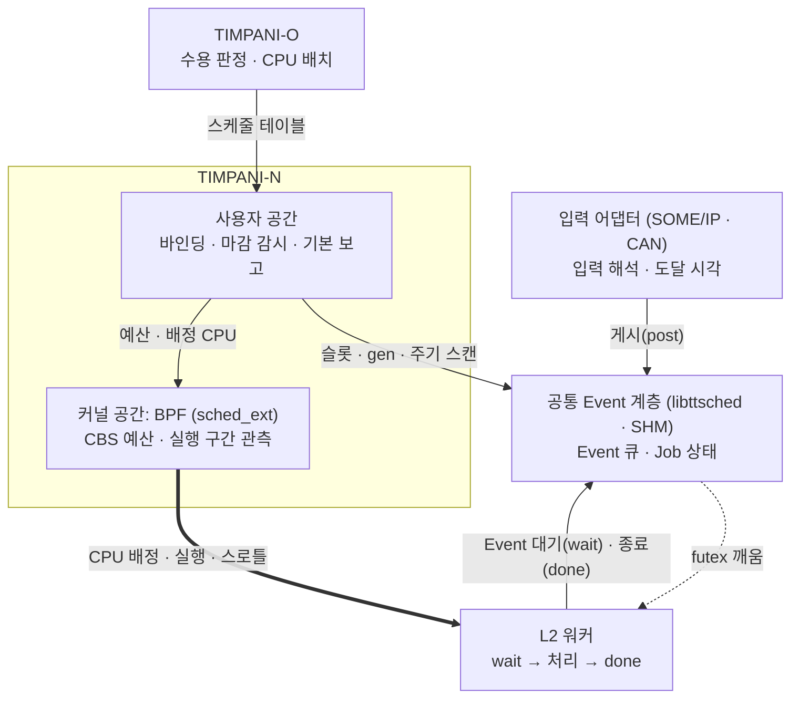
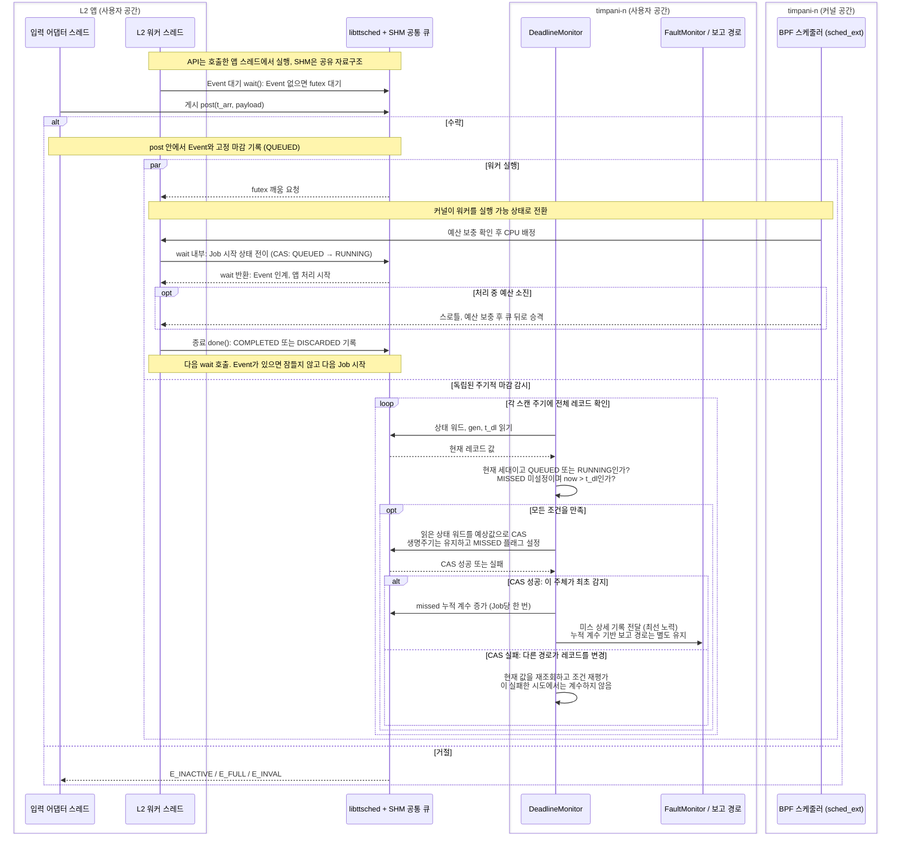

<!--
SPDX-FileCopyrightText: Copyright 2026 LG Electronics Inc.
SPDX-License-Identifier: MIT
-->

# Event-Driven Workload Support — 설계 개요 및 리뷰 가이드

| 항목 | 내용 |
|:--|:--|
| 목적 | 공통 Event/Job 모델, 실행 흐름, P1/P2 범위, 남은 결정을 리뷰에서 확인한다 |
| 독자 | 아키텍처·스케줄러·애플리케이션·검증 담당자 |
| 기준 | 2026-11-18. 008 설계 체인(REQ-008 v5.2, SRS-008 v4.2, DDR-008 v3.3, HLD-008 v5.3, LLD-008 v5.2) |
| 상태 | **Draft / P1 구현 전** |
| 개정 | 2026-11-17 리뷰 진행용으로 간결하게 다시 정리했다. 2026-11-18 용어를 정식 문서와 통일하고 Project Leader(작성자)의 결정(P1/P2 범위, CBS 예산 관리와 Event/Job 관리의 책임 구분, P1 정책 경계)을 반영했다. |

## 리뷰 순서

| 순서 | 절 | 리뷰에서 확인할 것 |
|:--|:--|:--|
| 1 | [1. 목표와 책임 범위](#1-목표와-책임-범위) | P1 목표, 책임 |
| 2 | [2. Event와 Job](#2-event와-job) | 경계, `gen` |
| 3 | [3. 구조와 역할](#3-구조와-역할) | 구성요소 책임 |
| 4 | [4. Event 한 건의 흐름과 마감 감시](#4-event-한-건의-흐름과-마감-감시) | 큐, 거절, 마감 감시 |
| 5 | [5. CPU 예산과 수용 판정](#5-cpu-예산과-수용-판정) | 예산 보충, 수용식, TT 없는 CPU, C·MIT |
| 6 | [6. P1과 P2](#6-p1과-p2) | 경계, 제한 사항 |
| 7 | [7. 예제와 검증 계획](#7-예제와-검증-계획) | 예제, 검증 순서 |
| 8 | [8. 리뷰에서 결정할 것](#8-리뷰에서-결정할-것) | 결정 목록 |

> **이 문서의 위상**
> - 설명용 요약이며 정식 문서가 우선한다.
> - 공개 인터페이스·수치·일부 판정 방식은 제안이며 승인·측정 전이다. 수치에는 *(후보)*를 붙였다.
> - 구현이나 타깃 검증 결과가 아니다. 기존 [FCW HTML 그림](../../../Radar-FCW-P1-event-job-contract.html)은 낡았다.
>
> **리뷰 시작점:** [Issue #53](https://github.com/eclipse-timpani/timpani26/issues/53) · [P1 계약 보강 합의](P1-008-event-job-contract-amendment.md)
>
> [DDR-008 §3.5](DDR-008-event-driven-workload-support.md#35-2026-11-12-weekly-반영-및-phase-판정) · [Discussion #4](https://github.com/eclipse-timpani/timpani26/discussions/4)

## 용어

용어와 정의는 [REQ-008 §2의 공통 정의](REQ-008-event-driven-workload-support.md#2-개념-모델-공통-eventjob-모델-common-eventjob-model)를 따른다. 개요와 상세 문서는 같은 용어를 쓰며, 별도의 번역명이나 앱 분류를 두지 않는다. 수용 판정(admission)은 배치 대상 CPU의 사전 스케줄 가능성 판정이며, 프로젝트의 승인(Project Leader 승인)과 다르다.

- **L1 / L2:** L1은 TT(Time-Triggered) 태스크, L2는 CBS(Constant Bandwidth Server) 태스크다. MIT는 같은 source의 최소 도달 간격이다.
- **P1 / P2:** Event-Job 지원의 단계(다른 DDR의 Phase와 다름). **TIMPANI-O / TIMPANI-N:** 스케줄 계산 / 노드 실행·감시.
- **CBS:** Linux `SCHED_DEADLINE`이 아니며, TIMPANI가 `sched_ext` 안에서 직접 구현한다.
- **그 밖의 약어:** DMISS(마감 실패), IRQ/ISR(인터럽트), CAN, SHM(공유 메모리), futex(잠들기·깨우기), CAS(조건부 원자 연산).
- PoC(시험), FCW(전방 충돌 경고), E2E(시작부터 끝까지), SOME/IP(통신 프로토콜), BPF(커널 내부 프로그램), PID/TID, cgroup, cpuset, HZ(타이머 틱), PREEMPT_RT(실시간 선점).

## 1. 목표와 책임 범위

- **무엇을·어떻게:** 소켓·CAN 입력처럼 **외부 입력이 도달해야 실행되는 앱**을 관리한다. 수락된 입력 한 건은 **Event**, 그 처리 한 건은 **Job**이며, 명시적 Event 연결은 같은 큐와 규칙(게시(post) → Event 대기(wait) → 종료(done))을 쓴다.
- **TIMPANI 경계:** 메시지 뜻(payload)은 해석하지 않는다. CPU 예산을 집행하고 Event별 마감을 감시한다.
- **P1 목표:** 공통 Event/Job과 기본 실행 환경. **P2 목표:** TT 시간 경계 강제와 CBS 마감 실패의 **원인 태스크·피해 태스크 구분**.

| 계층 | 책임 |
|:--|:--|
| **앱 입력 어댑터** | 입력 해석, 도달 시각 기록, Event 게시 |
| **공통 Event 계층** (libttsched + SHM) | 수락/거절, 고정 크기 큐, 데이터·식별자·시각 전달 |
| **TIMPANI** | L2 워커의 CPU 배치·CBS 예산 집행·실행 관측, Event별 마감 감시·기본 보고 |
| **범위 밖** | IRQ/ISR, 미들웨어 내부 스레드, 원격 송신~장치 반영 전체 |

### 같은 L2 워커의 두 책임과 앱 연결

두 책임은 같은 L2 워커에 적용된다. 앱의 유형·클래스·모드나 앱의 두 부분을 뜻하지 않는다. **명시적 Event 연결**은 Event/Job 관리에 필요한 정보를 제공하는 수단이다.

| 책임 | 역할 | 앱 연결 요건 |
|:--|:--|:--|
| **CBS 예산 관리** | 서버 윈도우(예산 적용 시간 구간) 단위 CPU 예산 차감·예산 보충·스로틀(예산 소진에 따른 실행 제한). CPU 고정·실행 구간 관측이 연관된다 | 워커 comm(스레드 이름)을 `task_id`와 맞춘다. Event API 연결은 필수가 아니다 |
| **Event/Job 관리** | Event 수락/거절·식별·큐 관리, 명시적 Job 생명주기, 도달 기준 MIT 계수·마감 감시 | 입력 어댑터에서 게시(post), 같은 워커에서 Event 대기(wait) → 처리 → 종료(done)로 연결한다 |

- **같은 API, 같은 계약:** `ttsched_evt_open/post/wait/done`과 HLD-008 §8.1 규칙을 쓴다. 규칙은 도달 지점에서 게시(post), source당 워커 하나, 종료(done) 필수, 정책·affinity(허용 CPU 집합) 직접 설정 금지다.
- 명시적 Event 연결이 없어도 같은 워커의 CBS 예산 관리·CPU 고정·실행 구간 관측은 유지된다. 다만 Event 도달 시각·Job 기록·MIT 계수 등 입력 메타데이터를 얻지 못하므로 Event/Job 마감을 감시하지 않으며, BPF 관측으로 추정하지 않는다. 연결된 source의 입력이 한동안 없어도 L2를 재분류하지 않는다. 기존 호환성과 선택적 연결은 유지하며 앱 수정 없는 자동 연결은 P1 보장이 아니다.
- **게시(post)는 입력 어댑터가 한다.** 기본은 같은 앱 프로세스이며, 같은 호스트에서 SHM 쓰기 권한이 있는 프로세스도 P1에서 허용된다(HLD-008 H-1).

**Project Leader(작성자)의 P1 범위 결정:** 등록된 L2 워커는 TIMPANI-N 커널 공간의 BPF 스케줄러에서 `SCHED_EXT`/CBS로 실행한다. 입력 어댑터와 기타 앱 스레드의 스케줄링 정책 선택·관리는 P1 범위 밖이다. 이는 워커의 허용 CPU 확인이나 배치 환경 검증을 제외한다는 뜻은 아니다. `post()`는 게시 스레드에서, `wait()`·처리·`done()`은 워커에서 실행하며 SHM은 스케줄링 대상이 아닌 공유 자료구조다.

**cgroup 배치 검토(방식·책임 미확정):** 같은 앱에서 워커만 isolated CPU용 cpuset, 입력 어댑터·기타 스레드는 non-isolated CPU용 cpuset에 두는 방향을 검토한다. cgroup v2는 공통 threaded domain 안에서 TID별 이동을 지원하지만, 일반 domain 두 개 사이의 임의 스레드 분리는 아니다. 프로세스 이동은 모든 스레드를 옮기며 상위 cpuset 밖으로는 나갈 수 없다. 현재 TIMPANI-N에는 이 스레드별 이동 기능이 없다. 계층·권한·컨테이너 연동·생성 및 재시작 시 상속을 검증하고, 기존 시스템·Pullpiri 배치 책임과 TIMPANI-N의 이동/검증 역할을 확정해야 한다([DDR-008 D-24](DDR-008-event-driven-workload-support.md#d-24-애플리케이션-추상화와-실행-환경-전제--p1)). 일반 fair 정책과 FIFO/RR의 공존 가능성은 대상 커널·RT 권한·컨트롤러 제약에 따라 확인하며, 특정 정책 채택을 뜻하지 않는다.

## 2. Event와 Job

| 개념 | 의미 |
|:--|:--|
| **Event source** | 입력 발생원. P1은 L2 태스크당 하나, 소비 워커 하나. `(workload_id, task_id)`로 식별하며 task_id는 노드 안에서 유일한 15바이트 이하 이름 |
| **Event** | **수락된** 입력 한 건. `(gen, seq)`, 도달 시각, 고정 절대 마감, 데이터(payload) |
| **Job** | Event 한 건의 처리. 워커가 시작하고, 워커가 끝내거나 TIMPANI가 닫는다. Event와 1:1 |

```
L2 태스크  = 스케줄 계약 (task_id, C, D, MIT, 배정 CPU, CBS 서버)   ← 테이블에 등록
 └─ L2 워커 = 계약에 바인딩된 실제 스레드 1개                         ← 오래 살아 있음
     └─ Job  = Event 한 건의 처리 (wait → 처리 → done)                ← Event마다 하나

시간 →   깨어남                                                   잠듦
워커      |=== Job #1 (seq=1) ===|=== Job #2 (seq=2) ===|  (대기 Event 없음)
BPF       |<------------------- 실행 구간 1개 ----------------------->|
CPU 예산  |<----------- 같은 CBS 예산에서 계속 차감 (Job마다 새로 주지 않음) ---->|
```

- **한 Event, 한 Job:** Job은 Event 한 건만 처리하고 묶지 않는다. 처리 중 도달한 Event는 대기열에 남고 source 안에서 FIFO(먼저 게시된 순서)로 워커에 인계된다.
- 끝낸 뒤 대기 Event가 있으면 워커는 잠들지 않고 가장 오래된 Event의 Job을 시작한다.
- 수면·선점·블로킹은 Job 경계가 아니다. 블로킹 뒤 재개는 새 Job이 아니며 그 시간은 응답 시간 R에 든다.
- **Job 결과:** `COMPLETED`(완료), `DISCARDED`(앱이 폐기), `CANCELLED`(TIMPANI가 시작 전에 닫음), `ABANDONED`(TIMPANI가 실행 중에 닫음). `MISSED`는 별도로 붙는 마감 결과다.
- $t_{dl}$ 이하의 종료는 실패가 아니고, 그 뒤의 종료는 실패이며 한 번 설정된 실패는 지워지지 않는다. 마감 전 TIMPANI 닫기를 별도 결과로 보는 것만 해석 확인 대상이다([§8](#8-리뷰에서-결정할-것), OI-21).
- **`gen`:** 바인딩 회차 번호(64비트). 상위 32비트는 SHM `instance_id`의 하위 32비트, 하위 32비트는 `bind_gen`이다(DDR-008 D-03, [LLD-008](LLD-008-event-driven-workload-support.md) §5.6).
- 새 `gen`은 워커가 `SCHED_EXT`에 바인딩되어 슬롯을 활성화할 때 생기고, 테이블 적용만으로는 생기지 않는다. 모니터와 폴트 보고는 현재 `gen`만 본다(D-17 (c), D-19).
- 생기는 경우는 워커 재바인딩, 파라미터가 바뀐 테이블 재적용(재등록 뒤 재바인딩), workload 재추가, TIMPANI-N 재시작이고, 생기지 않는 경우는 같은 파라미터의 테이블 재발행, TT만의 재발행, 데몬 중단 중이다.
- 새 `gen`을 만들기 전에 이전 미완료 Event를 닫는다(대기 중이면 CANCELLED, 처리 중이면 ABANDONED).
- Event 하나의 `gen`은 바뀌지 않는다. 재바인딩 경계에서 같은 입력을 다시 게시(post)하면 새 `gen`의 **별개 Event**가 된다.
- 중복 처리 방지는 앱 책임으로 두는 안이며 §8에서 확정한다.

| 기호 | 뜻 |
|:--|:--|
| $t_{arr}$ / $t_{dl}$ | 도달 시각 / 절대 마감 $t_{arr}+D$. 수락할 때 고정하며 늘리지 않는다 |
| $t_{begin}$ / $t_{end}$ | Job 시작 / 워커의 명시적 종료 또는 TIMPANI 닫기 시각(완료 시점은 해석 확인, OI-20) |
| $R=t_{end}-t_{arr}$ | 응답시간(대기·선점·스로틀 포함). 선언 필드 `runtime`과 다름 |
| $C$ / $D$ | Job의 CPU 실행시간 예산 / 도달부터 완료까지의 상대 마감 |
| $MIT$ / $T_s$ | 같은 source의 최소 도달 간격 / CBS 예산 보충 주기. 제안 조건은 $T_s\le MIT$ |

## 3. 구조와 역할



**선 읽는 법:** 실선 = 호출·데이터, 점선 = 깨움, 굵은 선 = BPF 스케줄링 제어.

| 구성요소 | 역할 | 하지 않는 것 |
|:--|:--|:--|
| **Pullpiri / 앱 선언** | 실행 요구·예산·마감·최소 간격·보고 임계, cgroup 배치 | 없음 |
| **TIMPANI-O** | 입력 검증·수용 판정, CPU 배치, CBS 설정·스케줄 테이블 | 없음 |
| **TIMPANI-N 사용자 공간** | 워커 바인딩·세대, BPF 초기 설정, Replenisher 깨우기, 마감 감시·기본 폴트 | 자동 취소 |
| **TIMPANI-N 커널 공간（BPF）** | CBS 예산 차감·예산 보충·스로틀·승격, CPU 고정, TT 보호, 실행 구간 관측 | Job 마감 판정, MIT 검사 |
| **libttsched + SHM** | 고정 크기 큐, 게시(post)·Event 대기(wait)·종료(done), 식별자·시각·데이터, MIT 위반 계수 | CPU 예산 집행·스케줄링 |
| **앱 어댑터·워커** | 도달 경계 선언·입력 해석·게시 / 한 건 처리·명시적 종료 | 스케줄링 정책·affinity 설정 |

- **BPF는 Job을 모른다.** 깨어남·잠듦, CBS 예산, CPU 고정, TT 보호, 실행 순서를 다룬다.
- **TIMPANI-N 사용자 공간**의 DeadlineMonitor가 공통 큐를 직접 감시한다. BPF 스케줄러도 TIMPANI-N 구성요소이지만 별도 사용자 공간 프로세스가 아니라 커널에서 실행되는 프로그램이다.
- 공개 API·SHM v2·protobuf·내부 인터페이스는 **제안이며 승인 대상**이다. 이 개요는 함수 서명을 승인하지 않는다.

## 4. Event 한 건의 흐름과 마감 감시



- **Event 대기(wait)**는 워커가 호출하는 라이브러리 함수다. Event가 없으면 잠들고, 있으면 같은 호출 안에서 Job 시작을 확정하고 Event를 인계한 뒤 반환한다. 이미 Event가 있으면 잠들지 않는다. 별도의 취득 API나 두 번째 큐는 없다.
- **Job 시작 상태 전이(CAS)**는 wait 내부 단계다. 읽어 둔 상태 워드와 현재 값이 같을 때만 `QUEUED → RUNNING`으로 바꾸는 원자적 조건부 갱신이며, 성공 후 식별자·시각과 payload를 반환한다. CPU를 배정하는 연산이 아니다.
- **CAS(compare-and-swap)**는 현재 값이 예상값과 같을 때만 새 값으로 바꾸는 원자적 연산이다. 비교와 변경 사이에 다른 스레드가 끼어들 수 없다. 다르면 변경하지 않고 실패하며, 호출자는 현재 값을 다시 확인한다. Job 시작 CAS와 마감 실패 표시 CAS는 같은 연산을 서로 다른 목적으로 쓰는 것이다. 둘 다 세대·식별·상태·기존 플래그의 일관성을 유지해야 한다(상세 레이아웃은 LLD-008).
- **QUEUED**는 수락되었지만 Job 처리를 아직 시작하지 않은 레코드, **RUNNING**은 워커가 Job 시작을 확정했고 아직 종료하지 않은 레코드다. BPF 실행 큐 소속이나 현재 CPU 실행 상태를 뜻하지 않는다. 선점·스로틀·Job 중 블로킹에도 RUNNING은 유지된다.
- **생명주기와 마감 결과는 별개다.** 미종료 상태는 QUEUED·RUNNING, 종료 상태는 COMPLETED·DISCARDED·CANCELLED·ABANDONED다. MISSED는 종료 상태가 아니라 별도 플래그이므로 `RUNNING + MISSED`, `COMPLETED + MISSED`가 가능하다. 미스 감지만으로 Job을 종료하지 않는다.
- 그림의 두 병렬 흐름은 워커의 실행 단계와 무관하게 감시함을 나타낸다. DeadlineMonitor는 TIMPANI-N 사용자 공간의 별도 스레드이며, QUEUED 상태에서 워커가 한 번도 실행되지 않았어도 마감 경과를 감지한다. CAS 성공은 상세 보고 전달 성공을 뜻하지 않는다. 늦은 종료·정리 경로에서도 MISSED를 설정할 수 있으며, 감시·종료 전이의 상세 경합 규칙은 HLD-008·LLD-008을 따른다.
- 깨움은 사라지지 않는다. 잠들기 직전 Event가 들어와도 깨움 번호(`counter`)가 이미 올라 있다.
- 깨움 번호는 활성화·비활성화·닫기 때도 오르므로, 깨어난 워커는 큐를 다시 확인하고 없으면 다시 잠든다.
- **큐 레코드 128 B, 깊이 8, 인라인 데이터 64 B** *(후보)*. 앱은 `t_arr`, `payload`, `len`을 넘기고, libttsched가 `(gen, seq)`, 절대 마감, QUEUED를 채운다.
- **거절 코드:** `E_INACTIVE`(연결 비활성), `E_FULL`(큐 가득 참), `E_INVAL`(잘못된 입력). 거절된 입력은 Event가 아니다.
- `E_FULL`은 수락 전의 거절이며 넘침으로 계수한다. 가득 찬 큐도 수락된 Event는 버리지 않는다.
- **DeadlineMonitor**는 완료를 기다리지 않고 수락한 순간부터 대기·실행·선점·스로틀·유휴 상태를 모두 감시한다.
- 실패는 Job당 한 번 계수하며 자동 취소하지 않는다. 완료 시각 읽기와 상태 기록의 경합 규칙은 해석 확인 대상이다(DDR-008 D-20 규칙 6, REQ-008 OI-20).

**절대 마감 타이머 대안(미선택):** 위 그림과 현 설계 기준은 주기 스캔이다. 논의한 다른 방식은 고정된 $t_{dl}=t_{arr}+D$에 절대 타이머를 맞추고 만료 처리에서 같은 `(gen, seq)`의 미종료 여부를 확인하는 것이다. 최소 힙과 가장 이른 마감용 타이머 하나로도 구성할 수 있지만, 더 이른 Event 게시 때의 통지·재설정 경합이 추가로 필요하다. 타이머 만료 시각과 감시 스레드가 실제 실행되는 시각은 다르며, 현 경계 조건은 $now>t_{dl}$이다. $t_{dl}$ 이후에 끝난 Job은 만료 확인 전이라도 종료 경로에서 미스로 기록해야 한다. 타이머도 OI-20의 완료 시각·상태 게시 경합을 해결하지 않으므로, 기존 주기 스캔을 대체하는 결정이나 지연 보장으로 취급하지 않는다(DDR-008 D-20·F-10, REQ-008 OI-22).

## 5. CPU 예산과 수용 판정

### 5.1 예산 보충 규칙

기본 조건 *(제안)*: $0<C_i\le D_i\le MIT_i$, $T_s\le MIT_i$

- 활성화할 때 이전 예산 보충 윈도우가 끝났으면 예산을 새로 준다. 실제 CPU 사용을 차감하고 다 쓰면 스로틀하며, 승격된 서버는 대기열 **맨 뒤**로 간다.
- 예산 보충은 CPU를 "더" 주지 않는다. 윈도우가 끝난 뒤 다음 활성화나 승격 때 계약된 $C$를 되돌려 줄 뿐이다. 승격은 스로틀된 서버를 실행 큐로 옮기는 동작이다.
- 스로틀 상태가 아닌 활성 서버는 윈도우 종료만으로 예산 보충되지 않으며, Job이 바뀌는 것도 예산 보충 계기가 아니다.
- 예산 보충은 BPF가 한다. 배정 CPU가 유휴이고 새 Event도 없으면 BPF의 예산 보충 시점이 오지 않는다.
- Replenisher는 예산 값을 쓰지 않고, 예산 보충 시각이 된 서버의 배정 CPU를 깨운다(kick). kick 수단(`scx_bpf_kick_cpu`)은 P1 PoC로 확인하고(OI-9, H-13), 쓸 수 없으면 CPU별 kicker 스레드로 바꾼다(D-07).

### 5.2 수용 판정: 충분조건

수용 판정은 배치 대상 CPU의 모든 L2에 수용식을 적용하는 사전 스케줄 가능성 판정이다. DDR-008 D-09의 제안식은 충분조건이며 증명이 아니다. 만족하면 전제와 측정값이 성립하는 범위에서 마감이 지켜지고, 불만족이 곧 실패는 아니다.
왼쪽 네 항의 합은 $D_i$ 이하여야 하고, 함께 $D_i \le MIT_i$, $T_s \le MIT_i$가 성립해야 한다.

$$
C_i + B_{tt}(k,D_i) + L_{del\_max} + \sum_{j \ne i}\left(C_j + \delta_{ovr}\right) \le D_i
$$

| 항 | 의미 |
|:--|:--|
| $C_i$ | 검사 대상 L2 $i$의 Job당 CPU 예산 |
| $B_{tt}(k,D_i)$ | 배정 CPU $k$에서 길이 $D_i$인 구간 안의 TT 최대 점유 시간 |
| $L_{del\_max}$ | 전달 및 깨움 지연, $L_{post}$와 깨움 지연의 합 *(후보 100 µs = 50 + 50 µs, 측정 목표)* |
| $\sum_{j \ne i}(C_j+\delta_{ovr})$ | 같은 CPU의 다른 L2 $j$가 FIFO에서 먼저 실행할 양의 합 |
| $\delta_{ovr}$ | 예산을 넘겨 실행할 수 있는 양, 틱 해상도 때문 *(후보: HZ=1000 기준 1 ms, nohz_full CPU는 틱 재시작 지연을 더해 측정)* |

가정(D-09): TT는 선언된 범위 안에서 돌고, 도달은 MIT를 지키며, Job은 블로킹하지 않고 대기 진입까지의 CPU 차감 수요가 C 이하이고, δ_ovr·L_del_max는 측정값대로 성립한다.

CPU 이용률·최소 Gap·CPU별 태스크 수 제한도 함께 검사한다(D-09).

새 앱을 추가하면 그 CPU의 모든 L2를 다시 검사한다. P1에서 TT와의 공존은 조건부 보장이며, 슬롯 종료 강제는 P2다.

### 5.3 TT 없는 CPU에서의 CBS 실행: P1 필수

- TT가 없는 CPU에서는 $B_{tt}=0$이고, CBS 실행·서버별 예산 보충·마감 감시가 **TT 슬롯 신호 없이** 동작해야 한다(CBS-007).
- CBS 집행은 hyperperiod 값을 쓰지 않는다(P1 검증 대상). MIT의 최소공배수나 임의 기본값으로 TT hyperperiod를 만들지 않는다(D-22).
- L2 전용 노드의 `hyperperiod_us`는 FR-O-015에 따라 0이 아닌 정의 값이며 CBS 실행 파라미터가 아니다. 현행 코드는 태스크가 있고 TT가 없는 노드에 0을 쓰는데, 이는 선행 버그다.
- 표현·검증 방식(0 허용 여부 포함)과 갱신 시점은 구현 전에 확정한다(OI-25). 보존 계약은 [DDR-011 §1.2](DDR-011-runtime-table-update.md#12-2026-11-12-weekly-연계-검토--제안미구현)에서 다룬다.

### 5.4 C와 MIT 정하기

- C는 측정 최댓값보다 크게 선언하며, 최댓값은 증명이 아니다(DDR-008 §3.4, [HLD-008 §8.2](HLD-008-event-driven-workload-support.md#82-새로운-종류의-event를-올리는-절차)). C에는 wait 복귀부터 처리·done·다음 대기 진입까지의 on-CPU 경로(시스템 콜 포함)가 든다.
- 실제 Event 대신 통제된 자극으로 잰다(`evttask`는 미구현, FCW의 `mock_radar_producer`는 도달 간격과 L1 TT 초과만 바꾼다).
- `budget_used_us`(제안 필드)는 실행 구간당 값이다. 운용 중에도 이 값과 `BUDGET_EXCEED`로 C와 도달 간격을 재검토하고, C를 바꾸면 수용 판정을 다시 받는다.
- 한 실행 구간에 여러 Job이 합산되거나, 블로킹하는 한 Job이 여러 구간으로 나뉠 수 있다. Job별 측정에는 구간 연계 또는 별도 CPU 시간 계측이 필요하다.
- 예산 초과는 C 과소 추정만의 증거가 아니다. 집행은 그로 인한 CPU 간섭만 제한하며, 공유 자원과 데이터는 격리하지 않는다(HLD-008 §8.2).
- MIT는 실제 송신원의 $t_{arr}$ 차로 후보를 정하며, 관측한 최소 간격이 미래 입력의 하한이라는 보장은 없다.

## 6. P1과 P2

> **한 줄 요약:** "마감을 놓쳤는가"를 **관측**하는 것이 P1, "왜 놓쳤고 누구에게 어떤 조치를 할 것인가"를 **강화**하는 것이 P2다.

| P1: 기본 Event-Driven 실행 환경 | P2: 시간 격리·진단 강화 |
|:--|:--|
| 공통 Event/Job 정의, 한 Event당 한 Job | TT 슬롯 범위·종료 강제·미완료 TT 처리, EDF 순서·정밀 수용 판정 |
| 공통 큐·식별자·도달 시각·명시적 시작/종료 | TT 초과 시 다음 TT·CBS 보호 검증 |
| 큐·통지·재등록·재시작의 일관성 | TT/CBS 기록을 엮은 마감 실패 원인 분류 |
| 같은 L2 워커의 CBS 예산 관리와 Event/Job 관리 책임 구분·바운드된 예산 보충·CPU 배치(배정 CPU의 허용 CPU 확인 포함)·TT 없는 CPU 실행 | 피해 태스크와 원인 태스크 구분·원인별 복구 |
| 도달 기준 마감 감지·계수·기본 보고, 최소 폴트 분류(DMISS·BUDGET_EXCEED·MIT_VIOLATION), 기본 관측·트레이스 | 자동 분석·지능형 진단 방식 검토 |

- P1의 예산 소진·미시작 표시는 유지하지만 **원인을 확정한 것**으로 설명하지 않는다. 기존 보고·복구 경로도 바꾸지 않는다.
- TT 종료 강제와 원인 분석 없이도 P1은 완료될 수 있으나, 강한 격리·결정론은 P2 검증 전에는 주장하지 않는다.
- P1/P2 구분은 Project Leader(작성자)가 설계 검토에서 결정한 범위다. 일정·구현 방식의 승인과 타깃 검증은 별도로 수행한다(DDR-008 §3.5).
- EDF·다중 source·큰 데이터 같은 후속 항목의 일정은 이 구분으로 승인된 것이 아니다.

### P1의 제한 사항

| 항목 | 제한 |
|:--|:--|
| 게시자·소비 워커 | source당 하나씩. 다중 게시자는 후속 |
| 데이터 | 인라인 데이터만 제안. 외부 데이터의 수명·해제 계약 없음 |
| 보안 | SHM 쓰기 권한이 있는 프로세스는 신뢰한다. source별 격리 없음 |
| 데몬 중단 | 중단 중 감지 정지. 재시작 뒤 판정은 가능하나 상세 기록 복원은 보장하지 않음 |
| 수명주기 경계 | 게시자 사망·활성화 전 `E_INACTIVE`·재등록 경계 계수는 LLD 제한을 따른다 |
| 타이밍 수치 | 감지 2 ms·보고 200 ms·스캔 1 ms·전달 및 깨움 지연 100 µs·우선순위 97 *(모두 후보)* |

## 7. 예제와 검증 계획

두 예제는 입력 방식만 다르고 **같은 Event/Job 계약**을 쓴다.

| 구분 | FCW (전방 충돌 경고) | 비-SOME/IP 센서 예제 |
|:--|:--|:--|
| 입력 | SOME/IP 레이더 경보 | Unix datagram 등 |
| 연결 | 앱 어댑터에서 공통 게시(post) | 입력 수신 후 같은 공통 게시(post) |

- **FCW 도달 시각:** 콜백 직후, 잠금·메시지 해석 전에 기록한다. 콜백 스레드가 여럿이면 도달 순서를 보장하지 못하므로 하나인지 본다(H-8).
- **FCW 시작값:** C=2 ms, D=5 ms, MIT=18 ms *(후보)*. MIT 18 ms는 시작값이며 HLD-008 §8.2 기준대로면 17 ms 이하다.
- 최종 MIT는 정상 구동에서 잰 도달 간격의 최솟값보다 작게 확정한다(HLD-008 §8.4). MIT를 낮추면 T_s도 낮추고 수용 조건을 다시 본다.
- 주기 20→18 ms 변경은 T_s ≤ MIT에 맞추려는 제안이며 설정 승인은 별도다.
- **배치 구성 3가지** (HLD-008 §8): 격리 CPU별 수용·실행, 같은 CPU의 수용 가능 조합(D 6 ms, 센서 C 500 µs, 계산값 5.6 ms *(검증 전)*), 두 번째 L2의 **거부** 확인.
- Radar L1 → Event → FCW L2는 P1 예제다(TT/CBS 이중 모드 전환 아님). E2E 마감은 DDR-009 대상이며 정본이 없다.
- 표준 블로킹 대기만으로는 Event/Job 관리에 필요한 정보가 제공되지 않는다. 명시적 Event 연결이 없으면 같은 워커의 CBS 예산 관리·실행 구간 관측은 유지되지만 Event별 마감 검증은 할 수 없다(MOD-011).

### 검증 순서

1. P1 계약(수락·게시·종료 경합, 복구, 보고 범위)과 공개 인터페이스를 승인한다.
2. 공통 큐, Event/Job 연결, 수용 판정, 바인딩, BPF 집행, DeadlineMonitor를 구현한다.
3. TT 없는 환경에서 첫 Event, 유휴 뒤 도달, 예산 보충, 마감 감지를 검증한다(AC-008-17). 과실행·폭주·재시작은 AC-008-03·04·14·15로, 버스트 MIT 위반은 AC-008-07로, TT 추가·제거 때 L2 보존은 AC-008-18로 본다.
4. FCW와 비-SOME/IP 앱을 같은 계약으로 연결해 세 배치 구성을 검증한다(AC-008-16). 잘못된 cpuset 배치의 명시적 실패는 AC-008-19로 본다.
5. TT 정상 실행을 가정한 공존을 검증한다(AC-008-02). TT 초과 경계 집행과 원인 분석은 P2로 넘긴다.

### 관측 항목

| 대상 | 기록 내용 |
|:--|:--|
| **source** | 도달·수락·넘침·거절 계수, 시작·완료·폐기·취소·중단·마감 실패·MIT 위반 |
| **Job** | `(gen, seq)`, 도달·마감·시작·종료 시각, 결과. 상세 로그 유실 건수를 따로 센다 |
| **실행 구간** | 실행 가능 전이·첫 실행·자발적 수면, 예산·스로틀·예산 보충 정보. Job 기록과 섞지 않는다 |
| **실행 환경** | 지터, 예산 보충 지연, 실제 CPU, 스레드 정책, 허용 CPU 마스크, cgroup |

### 실행 환경 주의 사항

- 실제 검증에는 Linux, sched_ext/PREEMPT_RT 설정, 권한이 필요하다. 문제 시 PID/TID, 프로세스 구성, cgroup, online CPU, 호스트·컨테이너를 확인하고 배포와 스케줄러 책임을 구분한다.
- 같은 시각 관측만으로 원인을 증명하지 않으며, `dl_server` 등의 간섭은 대상 시스템에서 측정한다.
- 배정 CPU가 허용 집합에 없으면 TIMPANI-N은 바인딩하지 않고 명시적 오류를 기록한다(CBS-008, AC-008-19). 어떤 스레드도 affinity를 `cpuset.cpus.effective` 밖으로 옮길 수 없다(D-24).
- 정정 뒤 바인딩은 TIM-006 `T_bind` 안이며, 측정 시작점은 정정 시각이다.

## 8. 리뷰에서 결정할 것

| 분류 | 항목 | 합의할 내용 |
|:--|:--|:--|
| 승인 | 공개 계약 | libttsched API·SHM v2·protobuf·내부 인터페이스(OI-19, H-5~H-7), period 전환 기간(OI-8) |
| 해석 확인 | 완료 시점과 감시의 경합 | 완료 시각의 제안 정의(완료 게시 직전 시계 값)를 해석 확인한다(OI-20, D-20 규칙 6) |
| 해석 확인 | 취소·중단 | 마감 전 TIMPANI 닫기(CANCELLED, ABANDONED)를 별도 결과로 볼지(OI-21). P1에는 워커 취소 호출이 없다 |
| 해석 확인 | 재게시의 `t_arr` | 재바인딩 때 원래 도달 시각과 재게시 시각 중 무엇을 쓸지, 중복 처리 방지와 함께(H-20, OI-24) |
| 해석 확인·승인 | 앱 적용 | 콜백 스레드가 여럿일 때 도달 순서 보존(H-8), FCW 설정 변경(H-15, 기능 승인), 두 앱 구성과 성공 기준. 게시 주체가 source마다 하나라는 P1 규칙은 정해졌다(D-19) |
| 측정·PoC | 타이밍·수용 판정 | 측정 환경(OI-5), 후보 수치, 스캔 비용, 깨움 방식·Replenisher 병합(OI-22), 예산 보충 kick 가용성(OI-9, H-13), 지터, 틱 상한, 다중 L2 수용률(SRS OI-11, H-14) |
| 측정·PoC | C 측정·여유율 | 측정 조건(입력 커버리지, 유휴 뒤 첫 Job, 간섭), `budget_used_us` 한계, 선언 여유(H-19, OI-23) |
| 정책 | 기본 보고·큐 수명주기 | 마감 실패 계수·임계 기반 보고·보고 지연 기준(P2와 분리). 게시자 사망·재시작·이전 세대·넘침 때의 수락/거절 |
| 정책 | 마감 실패 Job 후속 처리 | 계속할지 취소할지(D-20 규칙 8, DDR-008 §3.4) |
| 정책 | 블로킹 Job 보장 방법 | P2에서 검토한다. 별도 앱 분류는 정하지 않는다. 현재 수용식은 블로킹 Job을 보장하지 않는다(H-17) |
| 정책 | TT 없는 테이블 | `hyperperiod_us`의 0 허용 여부와 TT 추가·제거 때의 갱신 경계를 구현 전에 합의한다(OI-25) |
| 정책 | 문서 정합 | DDR-007 §4.5 주기 격자 보충 서술을 D-04·D-07에 맞춘다(DDR-008 §3.3 F-2) |

정본의 나머지 미결 항목(LLD L-2·L-20·L-23, HLD H-2·H-18)도 확인한다.

**P1 완료 조건에 새로 넣지 않는 것:** TT 슬롯 종료 집행, TT/CBS 상관 원인 분석, 피해 태스크별 자동 복구(P2 항목).

## 9. 상세 문서

| 문서 | 찾아볼 내용 |
|:--|:--|
| [REQ-008](REQ-008-event-driven-workload-support.md) · [SRS-008](SRS-008-event-driven-workload-support.md) · [LLD-008](LLD-008-event-driven-workload-support.md) | 요구사항, 기능, 자료구조·시험 |
| [DDR-008](DDR-008-event-driven-workload-support.md) | Event/Job 설계 결정. D-22 TT 없는 CBS 실행, D-23 P2 원인 분석, D-24 앱 추상화와 실행 환경 전제, §3.5 |
| [HLD-008](HLD-008-event-driven-workload-support.md) | 구조, §8 앱 적용·예제 |
| [DDR-007 §4.3.1](DDR-007-tt-cbs-integrated-scheduling.md#431-tt-슬롯-종료-강제--2026-11-12-weekly-후속-설계) | P2 TT 시간 경계 설계 |
| [DDR-005](DDR-005-sched-ext-bpf-scheduler.md) · [DDR-011 §1.2](DDR-011-runtime-table-update.md#12-2026-11-12-weekly-연계-검토--제안미구현) · [DDR-012 §4.4](DDR-012-fault-management.md#44-2026-11-12-weekly-후속--피해-태스크와-원인-태스크-분리-검토용) | BPF 집행, TT 없는 테이블 전환, 원인·피해 구분 |
