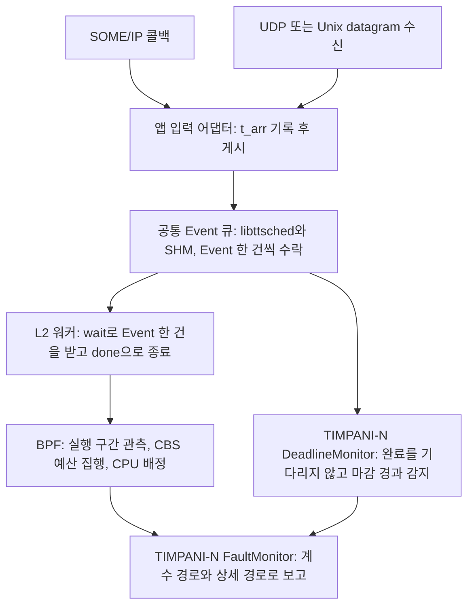
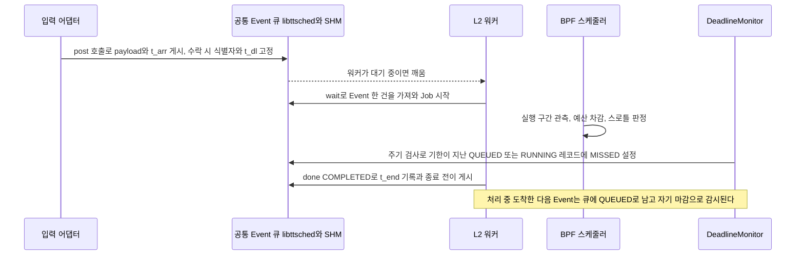

<!--
SPDX-FileCopyrightText: Copyright 2026 LG Electronics Inc.
SPDX-License-Identifier: MIT
-->

# Event-Driven Workload Support — 설계 설명 및 리뷰 가이드

| 항목 | 내용 |
|:--|:--|
| 목적 | 상세 설계 문서를 읽기 전에 핵심 개념·동작·범위·리뷰 쟁점을 공유한다 |
| 독자 | 아키텍처·스케줄러·애플리케이션·검증 담당자 |
| 기준 | 2026-11-11, P1 계약 보강 합의를 반영한 REQ-008 v5, SRS-008 v4, DDR·HLD·LLD-008 (기준선(9209bc5) 대비 개정) |
| 상태 | **Proposal / P1 설계 단계**. 설계 수준의 정렬이며 구현·실기 검증 완료를 의미하지 않는다 |
| 문서 성격 | 설명용 요약이다. 정본의 결정을 대체하지 않으며, 본문의 수치는 모두 후보값이다 |

> **상태 (2026-11-11):** 정식 설계 체인(REQ·SRS·DDR·HLD·LLD-008)은 [P1 계약 보강 합의](P1-008-event-job-contract-amendment.md)에 맞춰 개정되었다. 정본 반영 위치와 남은 쟁점은 합의 문서의 "정식 문서 반영 상태" 절에 정리한다. 이 개요는 개정된 체인을 요약하며, 구현되었거나 검증되었다는 뜻이 아니다.

> **한 문장 요약:** 앱은 수신 경계에서 Event 한 건을 게시하고, 워커는 Event 한 건을 Job 한 건으로 처리한다. TIMPANI는 Event마다 도달 시각 기준의 절대 마감을 고정해 감시하고, CPU 예산과 실행 구간을 커널 수준에서 집행·관측한다.

**리뷰 시작점:** [기능 지원 Issue #53](https://github.com/eclipse-timpani/timpani26/issues/53) → [P1 계약 보강 합의](P1-008-event-job-contract-amendment.md) → [새 계약 기준 FCW 그림](../../../Radar-FCW-P1-event-job-contract.html). 그림은 수정 방향을 설명하며, 구체 API 이름과 타이머 구현은 확정하지 않는다.

---

## 읽기 전에: 약자와 용어

### 실행·스케줄링

| 표기 | Full name / 원어 | 이 문서에서의 뜻 |
|:--|:--|:--|
| P1 / P2 | Phase 1 / Phase 2 | 1차 구현 범위 / 후속 확장 범위 |
| L1 / L2 | Level 1 / Level 2 | TIMPANI 계층형 스케줄링의 1계층(TT) / 2계층(이벤트 기반 CBS) |
| TT | Time-Triggered | 미리 정한 시간표에 따라 실행하는 방식 |
| CBS | Constant Bandwidth Server | 태스크의 CPU 사용량을 예산과 보충 규칙으로 제한하는 서버. P1 정책은 §8 참고 |
| MIT | Minimum Inter-arrival Time | 같은 Event source에서 연속한 도달 사이에 요구되는 최소 간격 |
| CPU | Central Processing Unit | 중앙 처리 장치. 이 문서의 CPU 배치는 논리 CPU 단위 |
| FIFO | First In, First Out | 먼저 활성화된 서버 우선. 승격 시에는 새 순위를 받는다 |
| EDF | Earliest Deadline First | 절대 마감이 가장 이른 작업부터 실행하는 방식. P2 검토 대상 |
| DSQ | Dispatch Queue | sched_ext가 실행할 태스크를 보관·선택하는 디스패치 큐 |
| DMISS | Deadline Miss | 마감 실패. Job당 한 번만 식별한다 |
| RT | Real-Time | 실시간. 처리 결과뿐 아니라 완료 시점도 중요하다는 의미 |
| E2E | End-to-End | 전체 처리 경로의 시작부터 끝까지. P1 워커 구간의 마감과 구분 |

### 구현·통신

| 표기 | Full name / 원어 | 이 문서에서의 뜻 |
|:--|:--|:--|
| FCW | Forward Collision Warning | 전방 충돌 경고 애플리케이션 예제 |
| SOME/IP | Scalable service-Oriented MiddlewarE over IP | 차량 서비스 간 통신에 사용하는 미들웨어 프로토콜 |
| UDP | User Datagram Protocol | 데이터그램 단위 통신을 제공하는 전송 프로토콜 |
| CAN | Controller Area Network | 차량 제어기 간 통신에 사용하는 네트워크 |
| BPF / eBPF | Berkeley Packet Filter / extended Berkeley Packet Filter | Linux 커널에서 검증된 프로그램을 실행하는 기술. 여기서는 스케줄러 구현에 사용 |
| SHM | Shared Memory | 프로세스·스레드가 함께 접근하는 공유 메모리 |
| futex | Fast Userspace Mutex | 사용자 공간의 메모리 값을 기반으로 커널 대기·깨움을 수행하는 Linux 기능 |
| CAS | Compare-And-Swap | 기대한 값과 같을 때만 새 값으로 바꾸는 원자적 연산 |
| IRQ / ISR | Interrupt Request / Interrupt Service Routine | 인터럽트 요청 / 인터럽트 처리 루틴. 사용자 공간 L2 워커와 구분 |
| API / ABI | Application Programming Interface / Application Binary Interface | 소스 수준 호출 계약 / 바이너리 수준 호환 계약 |
| ID | Identifier | 식별자 |
| PoC | Proof of Concept | 기술적으로 가능한지 확인하는 사전 실험. 구현 완료나 성능 보장과는 다름 |
| Hz | Hertz | 초당 횟수의 단위. Linux `HZ`는 스케줄러 틱 빈도를 나타내는 설정 |

다음 표기는 일반 약자를 임의로 풀어 쓰지 않고 프로젝트·제품 이름으로 읽는다.

- **TIMPANI-O / TIMPANI-N:** 스케줄링·오케스트레이션 구성요소 / 노드 실행 구성요소. 이후 O / N으로 줄여 쓴다.
- **어댑터 K/M 표기의 폐기:** 기준선(9209bc5)의 "커널 관측 K"와 "앱 마커 M"은 같은 자격의 두 Event 원천이 아니다. 커널 관측은 실행 구간을 관측할 뿐이며, Event를 얻는 경로는 명시적 게시 경로 하나다.
- **sched_ext:** Linux의 확장형 스케줄링 기능. BPF로 스케줄링 정책을 구현한다.
- **PREEMPT_RT:** Linux의 실시간 선점 지원 구성 이름이다.
- **gRPC:** 원격 프로시저 호출(Remote Procedure Call, RPC) 프레임워크 이름이다.
- **vsomeip:** SOME/IP 구현 라이브러리 이름이다.

본문의 영문 동작 용어: **payload**는 Event에 담기는 불투명 데이터, **QUEUED**는 수락되어 대기 중인 상태, **Runnable**은 실행 가능 상태, **dispatch**는 CPU에 실행할 태스크를 넘기는 동작, **throttling(스로틀)**은 예산 소진에 따른 실행 보류다. **Mid-job blocking**은 Job 처리 도중 잠드는 것이며, **back-to-back**은 수면 없이 Job이 연속되는 것이다.

## 1. 무엇을 해결하려는가

차량 서비스는 정해진 주기에만 실행되지 않는다. SOME/IP 통지, CAN 프레임, 소켓 메시지, 하드웨어 입력처럼 **외부 도달을 계기로 실행되는 작업**도 있다.

기존 CBS 경로에 예산 차감 기능이 있다는 것만으로는 다음 질문에 일관되게 답할 수 없다.

- 이벤트가 도착한 것과 워커가 깨어난 것은 같은가?
- 처리 중 다른 이벤트가 도착하면 유실되는가, 다음 작업으로 남는가? 두 이벤트의 마감은 어떻게 되는가?
- 작업 한 건은 어디서 시작하고 끝나는가?
- 작업이 큐에서 대기하거나 예산 소진으로 멈춰도 마감 실패를 알 수 있는가?
- 이벤트가 폭주하거나 처리가 길어져도 다른 L2와 L1 TT를 보호할 수 있는가?

이번 설계의 목표는 **FCW 전용 기능이 아니라 여러 이벤트 기반 앱이 재사용하는 공통 실행 프레임워크**다. FCW는 이 프레임워크를 검증하는 첫 적용 사례다.

### 관리 대상의 경계

- **대상:** 명시적으로 Event를 연결한 L2 워커의 Event 수락·Job 경계·마감, 그리고 등록된 L2 태스크의 CPU 예산과 실행 구간.
- **앱의 책임:** 메시지 해석, 수신 경계에서의 도달 시각 기록과 게시, 처리 로직. Event를 담는 큐는 앱이 소유하지 않으며 공통 경로(libttsched + SHM)가 소유한다.
- **자동으로 포함되지 않는 것:** IRQ/ISR, 커널 worker, vsomeip 내부 스레드, 네트워크 전달 경로 전체, 응답의 실제 전달·장치 반영 완료.
- **의미:** 워커의 CBS 예산을 선언했다고 수신 경로 전체가 실시간으로 보장되는 것은 아니다.

## 2. 핵심 개념: Event와 Job은 다르다

| 개념 | 의미 | FCW 예 |
|:--|:--|:--|
| Event source (S) | Event가 도달하는 선언된 발생원. P1에서는 L2 태스크 하나와 1:1이며 `task_id`로 식별한다 | 레이더 경보를 받는 입력 흐름 |
| Event (e) | 입력 어댑터 경계에서 수락된 도달 한 건. 식별자 `(gen, seq)`, 도달 시각 `t_arr`, 절대 마감 `t_dl`, 불투명 payload를 가진다 | 경보 메시지 한 건 |
| L2 워커 | Event를 소비하는 실행 주체. 워커 스레드 하나가 Event source 하나를 담당한다 | FCW 처리 워커 |
| Job (j(e)) | Event 한 건의 처리. 워커가 `wait`로 Event를 가져가 시작하고 `done`으로 명시적으로 끝낸다. 묶거나 나누지 않는다 | 한 건의 경보 판단 |

**식별자:** `seq`는 Event source마다 게시 순서로 부여하는 u32 번호(감싸짐 허용)이고, `gen`은 source가 다시 활성화될 때마다 바뀌는 u64 등록 세대다. 한 SHM 객체 안에서 `(gen, seq)`는 `seq`가 한 바퀴 돌기 전(수락 2^32회 이내)까지 유일하다. 데몬 재시작 후의 유일성은 인스턴스 값에 기대는 실질적 보장이며, 법적·절대적 보장이 아니다.

**시간 속성:** `t_arr`는 CLOCK_MONOTONIC 기준이며 어댑터가 넘기거나 게시 호출 시점에 읽는다. `t_dl = t_arr + D`는 수락 시 한 번 계산되어 저장되며 이후 바뀌지 않는다.

### Event 생명주기와 결과

| 상태 | 의미 | 종료 상태 여부 |
|:--|:--|:--|
| QUEUED | 수락되어 대기 중 | 아니오 |
| RUNNING | 워커가 가져가 Job을 처리 중 | 아니오 |
| COMPLETED | 워커가 완료로 끝냄. 유일한 성공 종료 | 예 |
| DISCARDED | 워커가 정책상 포기함. 성공이 아님 | 예 |
| CANCELLED | TIMPANI가 시작 전에 닫음(소스 비활성, 재등록, 정리) | 예 |
| ABANDONED | TIMPANI가 실행 중에 닫음(워커 종료, 재등록) | 예 |
| REVOKED (내부) | 게시 도중 소스가 비활성화·재등록되어 롤백된 게시. Event가 아니며 수락으로 계수하지 않음 | 예 |

게시 거절은 Event를 만들지 않는다. `E_INACTIVE`(소스 비활성, 워커 미바인딩, 데몬 중단, Job이 TIMPANI에 의해 닫힘), `E_FULL`(큐 가득 참, 넘침으로 계수), `E_INVAL`(길이 초과, 미래 시각, 직전 도달보다 이른 시각)이 있다.

**불변식 I1:** 수락된 모든 Event는 정확히 하나의 종료 상태에 도달하며, Job과 수락된 Event는 1:1로 대응한다.

**MIT는 도달 제약이다.** MIT 검사 대상이 되는 모든 게시(수락, 가득 참 거절, 롤백)는 도달로 계수한다. 소스가 비활성이어서 첫 검사에서 거절된 게시는 도달이 아니다. MIT를 위반한 도달도 수락해 큐에 넣고, 위반은 계수하여 보고한다.

### 마감 결과 규칙

마감 결과는 생명주기와 별도의 결과다.

- **MISSED 플래그:** Job당 최대 한 번 설정되며 지워지지 않는다. 설정 주체는 DeadlineMonitor, 워커의 종료 전이, 닫기 sweep, 워커가 대기 중 수행하는 stale 세대 취소 중 하나이며 한 번의 성공한 CAS로만 설정된다.
- **실패 조건:** Job이 `t_dl` 이후에도 QUEUED 또는 RUNNING이면 실패다. 비교는 항상 엄격한 `t > t_dl`이다. 실행 여부, 스로틀 여부, CPU 유휴 여부와 무관하다.
- **종료 시점:** `t_dl` 이전 종료(COMPLETED, DISCARDED, TIMPANI가 닫은 CANCELLED·ABANDONED)는 실패가 아니다. `t_dl` 이후의 어떤 종료도 실패다. 이미 설정된 실패는 이후 종료로 지우지 않는다.
- **완료 시각 `t_end`:** 워커가 `done()`에서 종료 전이를 게시하기 직전에 읽는 시각이다. `t_end ≤ t_dl`이고 모니터가 그 전에 Job을 연체로 표시하지 않았으면 정시 완료다. 경합하면 전이가 실패하고 워커가 시각을 다시 읽어 재시도하므로, 기록된 `t_end`와 MISSED 플래그는 서로 어긋나지 않는다. (해석 항목 1, §11)
- **수집 지연:** 정시에 게시된 완료가 TIMPANI-N에서 늦게 수집되어도 기록된 `t_end`로 판정하며, 실패가 되지 않는다.
- **응답시간과 성공:** `R = t_end − t_arr`. 마감 충족은 COMPLETED이고 `t_end ≤ t_dl`인 경우다.

### 처리 규칙 R1~R4

1. **대기 중 도달:** 워커가 기다리는 중에 도착한 Event는 즉시 Job 대상이 된다.
2. **처리 중 도달:** 실행 중인 Job에 합치지 않고 QUEUED로 남긴다. 그 Event의 마감도 자기 도달 시각으로 감시한다.
3. **완료 후 대기 존재:** Job이 끝나고 QUEUED Event가 있으면, 워커가 잠들지 않고 가장 오래된 Event로 다음 Job을 시작한다. 연속된 Job은 서로 다른 Job이다.
4. **1 Event = 1 Job, FIFO:** Job 하나는 Event 하나만 소비한다. source 안에서 FIFO 순서를 지킨다.

### 시간 기호

| 기호 | 의미 | 선언·측정 기준 |
|:--|:--|:--|
| $R$ | 응답시간 | Event 도달부터 Job 완료까지의 경과시간. CPU 대기·선점 시간을 포함 |
| $C$ | CPU 실행시간 예산 | Job에 예약하는 CPU 사용시간. 워크로드의 `runtime`에 대응하며, 실제 차감 최댓값보다 여유 있게 선언 |
| $D$ | 상대 마감시간 | Event 도달 후 완료까지 허용되는 경과시간 |
| $MIT$ | 최소 도달 간격 | `min_inter_arrival_us`. 없으면 주기(period)로 본다 (D-11 규칙) |
| $T_s$ | CBS 서버 주기 | 선언된 CBS period. P1에서는 $T_s \le MIT$를 요구한다. 어떤 문서도 $T_s$를 MIT로 정의하지 않는다 |
| $t_{arr}$ / $t_{dl}$ | 도달 시각 / 절대 마감 | $t_{dl} = t_{arr} + D$, 수락 시 고정 |
| $t_{begin}$ / $t_{end}$ | 워커의 Job 시작 / 종료 시각 | 워커가 기록. Job을 TIMPANI가 닫으면 종료 시각 대신 닫힌 시각을 기록 |

**R은 runtime이 아니다.** 예를 들어 C=2 ms, D=5 ms, MIT=18 ms로 선언한 워커가 도달 후 CPU를 1.5 ms 쓰고 대기·선점에 1 ms를 쓰면 R=2.5 ms다. 예산 2 ms와 응답시간 2.5 ms는 서로 다른 값이다.

**정상 조건**(MIT 준수, 각 Job이 D 안에 끝남, Job이 블로킹하지 않음, D ≤ MIT)에서는 Event 한 건과 Job 한 건이 1:1이며, 이전 Job이 끝나기 전에 다음 Event가 도착하지 않는다. 조건을 벗어나면 큐에 Event가 쌓이고 뒤의 Job이 늦을 수 있으며, 이는 방지하지 않고 계수·보고한다.

## 3. 왜 공통 프레임워크인가: 모델 / 연결·관측 / 집행 분리



| 층 | 책임 | 전송 방식 변경 시 |
|:--|:--|:--|
| ① 모델 | Event·Job의 정의, 식별자, 생명주기, 마감 결과 규칙 | 유지 |
| ② 연결·관측 | 명시적 Event 연결(공통 큐, Job 경계)과 커널 실행 구간 관측 | 앱 어댑터의 연결 지점만 달라짐 |
| ③ 집행 | 예산·CPU 배정·TT 보호(BPF), 마감 감시·결함 보고(TIMPANI-N), 승인(TIMPANI-O) | 유지 |

P1에는 두 종류의 L2 태스크가 있다.

- **명시적 Event 연결 태스크:** 앱이 `ttsched_evt_post`로 Event를 게시하고 `wait`·`done`으로 Job 경계를 준다. Event 식별, Event별 절대 마감, 마감 실패 감지와 Job 기록을 모두 제공한다.
- **예산 전용 L2 태스크(budget-only):** 앱이 Event를 게시하지 않는다. CBS 예산 집행, CPU 배정, BUDGET_EXCEED, 실행 구간 기록만 제공한다. Event·MIT 검사·DMISS 판정은 없고, 선언된 D는 승인 계산의 파라미터일 뿐이다.

**구분 방식:** 별도 설정 플래그는 두지 않는다. 소스는 Event가 게시되는 순간부터 Event 연결 소스가 되며, Event 기록이 없으면 DeadlineMonitor가 판정할 것이 없다. 승인식은 두 종류 모두에 같은 식을 쓴다(§8). 커널 관측만으로 등록한 기존 워커를 "Event별 도달 기준 마감을 지원한다"고 설명하지 않는다.

## 4. 누가 무엇을 하는가

| 구성요소 | 역할 | 하지 않는 일 |
|:--|:--|:--|
| Pullpiri / 앱 선언 | MIT, C, D, CBS 주기, 보고 임계 등 워크로드 요구 전달 | 이벤트마다 CPU 실행을 지시하지 않음 |
| 입력 어댑터 (앱) | 수신 경계에서 `t_arr`를 읽고 `ttsched_evt_post`로 payload를 게시 | payload 의미를 TIMPANI가 해석하도록 하지 않음 |
| 공통 Event 큐 (libttsched + SHM) | 수락·거절 확정, `(gen, seq)`와 `t_dl` 고정, 상한 QDEPTH 적용, 생명주기 상태 기록 | 앱 소유 큐를 따로 두지 않음 |
| L2 워커 (앱) | `wait`로 Event 한 건을 받아 Job을 시작하고 `done`으로 명시적으로 끝냄 | Job을 수면으로 대신 끝내지 않음 |
| TIMPANI-N TimerMaster | 워커 바인딩 시 활성화, 비활성화·재등록·데몬 시작 시 닫기 sweep, 세대 관리 | 기존 public 메서드를 제거하거나 이름을 바꾸지 않음 |
| TIMPANI-N DeadlineMonitor | 큐 대기·실행·스로틀·유휴 CPU와 무관하게 마감 경과를 주기적으로 검사해 MISSED 설정 | 워커나 L2 스케줄러에 의존하지 않음 |
| TIMPANI-N FaultMonitor | 계수 경로(무손실)로 횟수를, 상세 경로(best effort)로 Event 세부를 보고 | Job 경계를 정하지 않음 |
| BPF 스케줄러 | CBS 예산 차감·보충, CPU별 DSQ, TT 우선 집행, 실행 구간 관측 | Job을 정의하거나 MIT·L2 DMISS를 판정하지 않음 |
| TIMPANI-O | 승인(단일 식과 가정 목록), CPU 배치, 정적 CBS 설정과 테이블 | 런타임 예산 차감·보충 |

제어 경로는 **Pullpiri → O → N → BPF 설정**이다. 이벤트 경로는 **수신 → 어댑터 게시 → 공통 큐 → 워커 wait → BPF 실행 → 워커 done**이며, gRPC를 거치지 않는다.

## 5. 이벤트 한 건은 어떻게 실행되는가



SHM에는 payload와 함께 Event 레코드(식별자, 시각, 상태 워드)를 링 형태로 둔다. 워커가 깨어났을 때 처리할 데이터가 이미 공유 메모리에 있으므로, 통지와 데이터가 어긋날 여지가 없다. 큐가 가득 차면 거절하고 넘침을 계수한다. 유실 없는 계수 전달은 무한 큐를 뜻하지 않는다.

## 6. 애플리케이션 인터페이스 (libttsched v2) — 제안, 승인 필요

```c
int ttsched_evt_open(const char *task_id);                    /* init, non-RT */
int ttsched_evt_post(ttsched_evt_t src, uint64_t t_arr_ns,
                     const void *payload, uint32_t len,
                     struct ttsched_evt_id *id_out);          /* 0: accepted, <0: nothing created */
int ttsched_evt_wait(struct ttsched_evt_event *ev);           /* 0: one Event taken, Job started */
int ttsched_evt_done(int outcome);                            /* COMPLETED or DISCARDED, mandatory */
void ttsched_init(void);                                      /* the one re-attach call */
```

워커의 기본 루프는 다음과 같다.

```c
for (;;) {
    if (ttsched_evt_wait(&ev) < 0) { ttsched_init(); continue; }
    process(&ev);
    ttsched_evt_done(TTSCHED_EVT_COMPLETED);
}
```

- **`t_arr_ns == 0`:** 게시 호출 시점의 CLOCK_MONOTONIC을 쓴다. 명시한 값은 과거여도 수락하며, 그 지연은 마감에 포함된다.
- **payload:** P1은 인라인 payload만 허용한다(후보 64바이트). 더 긴 데이터나 외부 참조는 계약 밖이다.
- **게시자:** source마다 게시 맥락은 한 번에 하나다. 여러 생산자 동시 게시는 P2다. 게시자는 워커 프로세스의 스레드이거나 SHM에 쓰기 권한이 있는 다른 프로세스일 수 있다.
- **워커:** source마다 워커 스레드는 하나다. `done`은 모든 Job에 필수이며, 다음 `wait`에서 암묵 완료되지 않는다.
- **비용:** post·wait(블로킹 없음)·done은 제한된 수의 원자 연산, 최대 64바이트 복사, 최대 futex 호출 한 번으로 끝나며 힙·락·블로킹이 없다. 매핑과 재매핑은 `open`과 `init`이 비RT 경로에서 하고, RT 호출은 매핑이 쓸 수 없으면 재매핑하지 않고 `E_INACTIVE`를 돌려준다.

| 반환 코드 | 의미 | 호출자의 조치 |
|:--|:--|:--|
| `E_INACTIVE` (−1) | 소스가 비활성이거나 워커 미바인딩, 데몬 중단, 또는 Job이 TIMPANI에 의해 닫힘 | 대기: 짧은 백오프 후 `ttsched_init` 재시도. 게시: 비RT 경로에서 `ttsched_init` 후 재시도 |
| `E_FULL` (−2) | 큐 가득 참. 거절되며 넘침으로 계수 | 앱 정책으로 처리(버리거나 지연) |
| `E_INVAL` (−3) | 길이 초과, 미래 시각, 직전 도달보다 이른 시각 | 호출 오류 수정 |
| `E_STATE` (−4) | Job이 열린 상태에서 `wait`, 또는 Job 없이 `done` | 호출 순서 수정 |

## 7. 마감 감시와 수명주기 (TIMPANI-N)

### 마감 감시

- **DeadlineMonitor:** TIMPANI-N의 전용 SCHED_FIFO 스레드다. 후보 우선순위는 97이며 TimerMaster(99)보다 낮고 Replenisher(98)와 같은 계열이다. 두 스레드의 병합은 열린 항목이다(F-12).
- **주기 검사:** 후보 1 ms마다 시각을 한 번 읽고, 모든 슬롯의 모든 Event 레코드를 `kind`와 무관하게 상태로 골라 검사한다. QUEUED 또는 RUNNING이고 MISSED가 없으며 `now > t_dl`이면 CAS로 MISSED를 설정하고 `missed`를 올린 뒤 상세 기록을 FaultMonitor에 넘긴다. 대상 레코드의 `gen`이 현재 세대와 다르면 상태를 바꾸지 않는다.
- **스로틀 판정:** 실패가 감지된 경우에만 서버 상태를 한 번 읽어 THROTTLED 플래그를 채운다.
- **지연 목표(후보, 합의·측정 전):** 마감 경과부터 MISSED 설정까지 2 ms 이하, MISSED 설정부터 TIMPANI-O 보고까지 200 ms 이하. 목표가 합의되기 전에는 "후보"로만 쓰며, 보장으로 쓰지 않는다.

### 수명주기 닫기

- **활성화(바인딩):** 워커 스레드가 바인딩되어 SCHED_EXT로 전환된 뒤 TimerMaster가 남은 비종료 레코드를 닫고(RUNNING은 ABANDONED), 설정과 세대를 쓰고, 기준 계수(baseline)를 잡고, `kind = EVT`로 바꾼다. 활성화는 테이블 적용 시점이 아니라 바인딩 시점에 한다. 그래서 수락된 Event가 있으면 관리되는 워커가 있다.
- **비활성화(제거, STOP, 워커 종료):** `kind = NONE`을 먼저 쓰고 슬롯 전체를 닫는다. QUEUED는 CANCELLED, RUNNING은 워커가 끝났을 때만 ABANDONED로 닫는다. 워커가 살아 있으면 RUNNING 레코드는 그대로 두고 종료될 때까지 감시한다.
- **데몬 시작 정리:** 이전 객체가 남아 있으면 magic을 0으로 바꾸고 모든 슬롯을 `kind = NONE`으로 만든 뒤, 모든 비종료 레코드를 닫고 연체된 것은 DETECTED_LATE 실패로 기록한다. 그 뒤 객체를 지우고 새 `instance_id`로 다시 만든다.
- **데몬 중단 중:** 크래시로 데몬이 없는 동안에도 남은 객체는 `kind = EVT`이므로 게시는 수락되고 워커는 계속 처리한다. 워커의 종료 전이는 늦은 완료를 계속 판정하지만, 큐에서 기한이 지난 Event를 감지할 주체가 없다. 그런 실패는 다음 시작 때 정리에서 늦게 발견되며 실시간 결함 보고가 아니라 최종 통계에만 나타난다. P1에는 데몬 하트비트가 없다.

### 세대와 계수

- **세대 `gen`:** 상위 32비트는 객체의 `instance_id`에서, 하위 32비트는 슬롯의 바인딩 횟수에서 얻는다. 모든 레코드, 실패 기록, 로그 항목은 `(gen, seq)`를 가진다. TIMPANI-N은 현재 세대와 다른 항목으로 상태를 바꾸지 않는다.
- **BPF 종료 레코드:** `bind_gen`을 담아, 이전 바인딩의 늦은 종료 레코드가 새 바인딩을 비활성화하지 못하게 한다.
- **필수 계수:** 슬롯 계수 `arrivals`, `accepted`, `overflow`, `revoked`, `started`, `completed`, `discarded`, `cancelled`, `abandoned`, `missed`, `mit_viol`, `resp_max_ns`는 원자적으로 증가하며 누적이다. TIMPANI-N은 활성화 시점에 기준값을 잡아 등록별 값을 계산한다. 계수 사이의 관계는 정지 상태에서만 정확하고, 읽는 쪽은 음수를 0으로 자른다.

## 8. 실행 제한: CBS·TT·승인식

### 8.1 CBS 집행 (BPF)

1. 활성화 시 이전 보충 윈도우가 끝났으면 새 예산을 준다. 윈도우 경계의 허용 오차 `tol`은 활성화 지터 측정으로 정하며, 후보는 50 µs다.
2. 윈도우가 아직 끝나지 않았으면 남은 예산만 쓴다. 이 경우 실행 구간 기록에 `CARRYOVER`를 표시한다.
3. 실제 on-CPU 실행시간을 차감하고, 예산을 다 쓰면 스로틀한다. 같은 스로틀 기간에는 BUDGET_EXCEED를 한 번만 낸다.
4. 스로틀된 서버는 윈도우가 끝나고 dispatch될 때 보충되며 큐 뒤로 간다.
5. 윈도우 안에서 예산은 늘어나지 않는다. 새 Job 자체가 예산을 주지 않는다. 윈도우 안에서 시작한 Job은 남은 예산을 나눠 쓴다.

**P-a(조건부 성질):** 도달이 MIT를 지키고 `T_s ≤ MIT`이며 Job이 블로킹하지 않고 D 안에 끝나면, 연속된 활성화는 `T_s − tol` 이상 떨어지고 매 Job은 완전한 예산으로 시작하며 스로틀되지 않는다. 한 Job이 워커가 잠들기 전에 다음 도달과 겹칠 만큼 늦게 끝나면, 다음 Job은 활성화 없이 남은 윈도우에서 실행되고 BUDGET_EXCEED가 날 수 있다. 그래서 D와 MIT 사이에 여유를 두도록 권고한다.

**Replenisher**는 예산을 쓰는 주체가 아니다. CPU가 유휴여도 보충이 진행되도록 재스케줄을 유발하며, 실제 예산 갱신은 BPF가 한다. syscall로 BPF 재스케줄을 유발할 수 있는지는 PoC 항목이다.

### 8.2 TT와의 공존

- L2 태스크는 배정 CPU의 전용 DSQ에서만 실행한다.
- 실행 가능한 TT가 있으면 L2를 dispatch하지 않으며, 실행 slice도 다음 TT 시작을 고려해 제한한다.
- 새 앱을 추가하면 해당 CPU의 **모든 L2**를 다시 검사한다.

### 8.3 승인식 (TIMPANI-O)

모든 L2 태스크 i에 대해 배정 CPU k에서 다음을 만족해야 한다. 기존 태스크도 다시 검사한다.

$$
C_i + B_{tt}(k, D_i) + L_{del}^{max} + \sum_{j \ne i}\left(C_j + \delta_{ovr}\right) \le D_i
\qquad\text{그리고}\qquad
D_i \le MIT_i,\quad T_i \le MIT_i
$$

| 항목 | 의미 | 후보값 |
|:--|:--|:--|
| $B_{tt}(k, D_i)$ | 길이 $D_i$인 구간에 들어갈 수 있는 TT 점유의 최댓값 | 기존 TT 테이블에서 계산 |
| $L_{del}^{max}$ | 도달부터 유휴, TT가 없는 CPU에서 워커가 처음 실행되기까지의 지연 상한 = $L_{post}$(게시→실행 가능) + $L_{wake}$(실행 가능→최초 실행) | $L_{post}$ 50 µs(TIM-011, 측정 대상) + $L_{wake}$ 50 µs(TIM-001) = 100 µs |
| $\delta_{ovr}$ | 다른 서버가 예산을 넘겨 실행할 수 있는 최대 시간(틱 overrun) | 1 틱, HZ=1000이면 1 ms. nohz_full CPU와 틱 재시작 지연은 측정 대상 |
| $MIT_i$ | 승인 계산에 쓰는 최소 도달 간격 | `min_inter_arrival_us`, 없으면 주기 |

- **TT 블로킹이 승인 계산에 들어가는 방식**과 기존 D-09의 나머지 조건(이용률 조건, CPU당 태스크 제한 등)은 그대로 둔다.
- $D_i \le MIT_i$는 정상 도달이고 각 Job이 마감 안에 끝나는 경우에 한해 같은 source의 Event가 동시에 두 개 살아 있지 않음을 보장하므로, 자기 큐잉 항을 따로 두지 않는다.
- 이 식은 아래 **가정 아래의 충분조건**이다. 가정이 깨지면 식의 결론을 쓰지 않는다.
  1. TT 태스크는 선언된 runtime을 지킨다(TT overrun은 TT DMISS이며 L2 보장 밖).
  2. $\delta_{ovr}$와 $L_{del}^{max}$는 측정으로 확인된 값이다.
  3. source의 도달이 MIT를 지킨다.
  4. Job은 블로킹하지 않는다. 블로킹하는 source는 마감을 감시하지만 승인이 보장하지 않는다.
  5. 어댑터는 실제 도달 시점에 게시한다. 과거 `t_arr`를 넘기면 그만큼 D를 쓴다.
  6. 각 Job의 CPU 수요는 선언된 $C_i$ 아래다. 예산에 여유를 둔다.
  7. 각 Job은 다음 도달 전에 워커가 잠들 만큼 빨리 끝난다(P-a 경계 사례).
  8. `tol`은 측정된 활성화 지터를 덮는다.
- **예산 전용 태스크**도 같은 식을 쓴다. 그 경우 D는 커널 활성화 기준의 승인 파라미터이며 감시되는 마감이 아니다. $L_{post}$ 항은 그만큼 여유가 된다.
- **틱 overrun의 대가:** $\delta_{ovr}$를 넣으면 같은 CPU에 L2가 여럿 있을 때 승인 가능 범위가 줄어든다. 이는 위험으로 명시하며, 정밀 타이머(HRTICK)는 P2 검토 대상이다.

### 8.4 FCW 승인 예

FCW 기본값(C=2 ms, D=5 ms, MIT=18 ms, CBS 주기 18 ms)을 쓰고 같은 CPU에 다른 L2가 없으면, TT 블로킹 예시값 $B_{tt}=2000$ µs를 가정할 때 `2000 + 2000 + 100 + 0 = 4100 µs ≤ 5000 µs`를 만족한다. 같은 CPU에 C=500 µs인 다른 L2를 더하면 `2000 + 2000 + 100 + (500 + 1000) = 5600 µs > 5000 µs`가 되어 거절된다. 이 식이 AC-008-16 (c)이다. B_tt 예시값은 타깃 TT 테이블로 확인한다. 정확한 산술은 HLD §8.5에 둔다. 이 예의 CBS 주기 18 ms는 `T_s ≤ MIT` 조건을 맞추기 위한 예시 설정 변경이며, 확인 대상이다.

## 9. 관측과 보고

### 기록 종류

1. **Job 기록:** `{node, task, gen, seq, t_arr, t_dl, t_begin, t_end, outcome, flags}`. 워커가 끝낸 Job은 워커의 Job 로그에서 오고, 실패 기록과 TIMPANI-N의 닫기 sweep에서도 온다. 시작과 종료 시각이 없는 경우 해당 필드는 비운다. 각 기록이 자기 `t_arr`를 가지므로 오프라인 쌍짓기 규칙이 필요 없다.
2. **실행 구간 기록(BPF):** `{…, run_seq, t_act, t_start, t_sleep, budget_used_us, flags(CARRYOVER, THROTTLED)}`. 커널이 본 활성화, 최초 실행, 수면을 나타내며 Job 경계가 아니다. 코드 식별자에 `job_` 접두어가 남는 곳은 이름을 바꿀 이득이 없어서이며, 그곳에서도 Job이 아닌 실행 구간을 가리킨다.
3. **Event source 통계:** 슬롯의 필수 계수와 BPF 계수. 트레이스 설정(`trace_enabled`)과 독립이다. 트레이스포인트가 필요한 통계(배정 외 CPU 실행 등)는 필수 집합 밖이며, 계수 위치는 후속 설계에서 정한다.

Job 로그는 워커가 쓰는 단일 생산자의 손실 가능 피드이며 드롭 계수를 가진다. 트레이스가 꺼져도 필수 계수는 유지된다.

### 결함 보고와 플래그

| 결함 | 원천 | 비고 |
|:--|:--|:--|
| DMISS | DeadlineMonitor 또는 워커 종료 전이 또는 닫기 sweep | 횟수는 계수 경로로 무손실 보고. 상세는 상세 경로(best effort) |
| BUDGET_EXCEED | BPF, 스로틀 기간당 한 번 | 기존 D-10 규칙 유지 |
| MIT_VIOLATION | 슬롯의 `mit_viol` 증가분 | BPF가 더 이상 내지 않는다. FaultInfo는 소스당 `T_s` 창마다 최대 한 건이며 창 안의 위반 수를 담는다 |

**FaultInfo 플래그 표(하나의 표, LLD가 값을 정함):**

| 플래그 | 값 | 의미 |
|:--|:--|:--|
| MIT_RELATED | 0x1 | 마지막 MIT 위반 시각이 도달 시각 기준 `T_s` 이내에 있었다 |
| THROTTLED | 0x2 | 감지 시점에 서버가 스로틀 상태였다 (감지 시에만 설정되며, 워커나 정리 sweep이 설정한 실패에는 없다) |
| NOT_STARTED | 0x4 | 감지 시점에 Job이 아직 QUEUED였다 |
| LATE_COMPLETION | 0x8 | 워커의 종료 전이가 실패를 설정했다 |
| DETECTED_LATE | 0x10 | 닫기 절차에서 설정했다(데몬 시작 정리, 비활성화·활성화 닫기 규칙, 워커가 대기 중 수행하는 stale 세대 취소) |

BPF 실행 구간 기록은 별도 플래그 표(CARRYOVER, THROTTLED, TASK_EXIT 등)를 쓰며, 폐기된 비트(MIT 위반, 조기 DMISS, DMISS)는 LLD가 명시해 두 표가 섞이지 않게 한다. CARRYOVER는 DMISS 보고 플래그가 아니다.

**보고 규칙:** FaultInfo는 현재 등록에 대해서만 보낸다. 이전 세대의 실패는 기록과 통계에만 남는다. 기존 `max_dmiss` 임계 규칙은 그대로 적용하며, 모든 실패는 필수 통계에 들어가고 보고 지연 상한은 실제로 보내진 보고에 적용한다. 새 protobuf 필드 승인 전에는 보고에 횟수만 담는다.

## 10. 리뷰 쟁점의 반영 상태

기준 설계에 대해 제기된 여덟 가지 검토 사항과 개정이 어떻게 답하는지를 정리한다. "열림"은 설계로 해소되지 않아 승인·측정·결정이 남은 항목이다.

| 우선 검토 | 기준 설계의 질문 | 개정의 답 | 상태 |
|:--|:--|:--|:--|
| 승인과 실제 집행의 정합 | 다른 서버의 C에 틱 overrun과 스케줄링 비용을 반영하는가? 백분위 목표와 최악시간 보장의 경계는? | 승인식에 $\delta_{ovr}$ 항(후보 1 틱)을 넣었다. $L_{del}^{max}$는 측정 목표이며 증명된 최악시간이 아니다. 같은 CPU에 L2가 여럿이면 승인 용량이 줄어든다는 위험을 명시했다 | 반영. 수치는 측정·승인 대기 |
| reset의 원자적 경계 | 계수 스냅샷과 큐 clear 사이의 경합 | reset 프로토콜과 `TTSCHED_EVT_RESET`를 없앴다. 인덱스는 계속 증가하고, 상태 전이는 `(seq, 상태)` 워드에 대한 CAS이며, 활성화는 인덱스를 쓰지 않는다. 재시작은 magic 무효화와 닫기 sweep 뒤에 새 객체를 만든다 | 설계로 해소. 구현 검증 대기 |
| 바인딩 세대 식별 | 지연된 이전 종료 레코드가 새 바인딩을 정리하지 않게 하려면 | `gen`은 인스턴스 값과 바인딩 횟수의 조합이다. 모든 레코드와 로그에 `(gen, seq)`를 두고 상태 변경 전에 세대를 검사한다. BPF 종료 레코드에 `bind_gen`을 담는다 | 반영 |
| 필수 통계와 선택 트레이스 | trace OFF에서도 필수 계수를 유지하는가? 배정 외 CPU 실행은 어디서 계수하는가? | 필수 통계는 SHM 슬롯 계수와 BPF 계수이며 트레이스와 독립이다. 트레이스 피드는 손실 가능하다. 트레이스포인트 통계는 필수 집합 밖이며 계수 위치는 후속 확정이다 | 필수 집합은 반영. 계수 위치 열림 (LLD 트레이싱 절 확인 필요) |
| RT fast path 범위 | 초기 매핑·재매핑·잠금을 RT 비용 보장과 어떻게 분리하는가? | `open`과 `init`은 비RT 경로에 둔다. post·wait·done은 제한된 원자 연산과 최대 64바이트 복사, 최대 futex 한 번이며 힙·락이 없다. 매핑이 불가하면 재매핑 없이 `E_INACTIVE`를 돌려준다 | 반영. 호출당 연산 수는 LLD §6 스케치 기준이며 측정 대기 |
| 커널 PoC | syscall 프로그램으로 BPF 재스케줄(kick)이 가능한가? 유휴 CPU의 보충 지연, TT 경계 영향, 런큐 직렬화 전제가 타깃에서 성립하는가? | 설계로 해소되지 않는다. PoC 항목으로 유지하며(§11), 결과에 따라 DeadlineMonitor의 이벤트 기반 깨움(F-10)을 검토한다 | 열림 |
| P1 적용성 | 블로킹 금지, back-to-back 병합, 활성화 기준 DMISS를 첫 적용 앱이 받아들이는가? | 명시적 Job 경계로 병합 문제를 없앴고, 마감은 도달 기준으로 바꿨다. 블로킹은 금지하지 않고 관측하되 승인 보장에서 제외했다(기준선의 A-06 전제 해제). 첫 적용 앱의 수용은 아직 정하지 않았다 | 기술적 답 반영. 수용 열림 |
| 데모 범위 | FCW와 비-SOME/IP 앱을 P1 검증 목표로 채택하는가? 파라미터·부하·성공 기준은? | AC-008-16으로 수용 기준을 두고 HLD §8.4–8.5에 FCW 가이드와 비-SOME/IP 예제를 둔다. 성공 기준은 §12에 있다. 채택 여부와 부하 수치는 승인 대기 | 열림 (채택 결정) |

## 11. P1 한계, 승인 필요 항목, 확인할 해석, PoC

### P1 한계

- **범위:** 명시적 연결 태스크 하나당 Event source 하나이며 워커 스레드는 하나다. 다중 source와 다중 생산자 게시는 P2다.
- **Job 경계:** 워커가 명시한다. 그러나 Job 안의 블로킹은 허용하고 관측만 한다. 승인 보장은 블로킹하지 않는 Job에만 적용된다.
- **시각의 의미:** `t_end`는 워커가 처리 결과를 게시한 시각이며, 네트워크 전달이나 장치 반영 완료가 아니다. IRQ/ISR, 미들웨어 내부 스레드, 전체 네트워크 경로의 예산은 자동으로 포함되지 않는다.
- **비활성화 경합:** 워커가 `kind` 검사를 통과한 뒤 닫기 sweep이 도달하기 전에 QUEUED 레코드를 가져가면, 그 Job은 끝까지 실행되며 감시되고 정상 기록된다.
- **큐 상한:** `QDEPTH`는 살아 있는 Event와 아직 `head`가 넘기지 못한 닫힌 항목을 함께 센다. 따라서 살아 있는 Event가 QDEPTH보다 적어도 E_FULL이 날 수 있다.
- **세대 경계:** 재등록을 가로지르는 게시는 새 등록의 도달 계수에 최대 한 건 섞일 수 있다. 이전 바인딩의 마지막 Job의 `missed` 증가는 다음 기준값 이후에 반영될 수 있다. 두 경우 모두 바인딩당 최대 한 건이다.
- **데몬 중단:** 중단 중 기한이 지난 Event는 다음 시작 때 발견된다. 데몬 하트비트가 없다.
- **신뢰 경계:** SHM에 쓸 수 있는 모든 프로세스를 신뢰한다. 잘못된 쓰기는 어떤 슬롯도 망가뜨릴 수 있다. source별 격리는 P2다.
- **ABI:** 공유 메모리 v2와 libttsched v2 도입으로 기존 TT 앱도 재빌드가 필요하다. 기준선 초안의 `ttsched_evt_notify`, 배치 count, `TTSCHED_EVT_RESET`은 구현된 적이 없으며 이 개정에서 설계에서 뺐다.
- **P1 검증 범위:** 설계 단계이며, Linux 타깃에서 측정하기 전까지 어떤 수치도 검증된 것이 아니다.

### 승인이 필요한 항목

| 항목 | 내용 | 승인 주체 |
|:--|:--|:--|
| 공개 API | libttsched v2의 `open`·`post`·`wait`·`done`·`init`, 상수 `PAYLOAD_MAX`·`QDEPTH`, 반환 코드, v1 ABI 깨짐 | 프로젝트 리더 |
| SHM v2 레이아웃 | 슬롯 구조, 128바이트 Event 레코드 링, 후보 64 슬롯, 256 KiB 이하, 정적 검사 | 프로젝트 리더 |
| protobuf | `FaultInfo`에 `count`, `flags`, `job_gen` 추가(add-only). `timestamp_ns`는 기존 필드 사용 | 프로젝트 리더. 미승인 시 보고는 횟수만 |
| 수치 후보 | payload 64 B, QDEPTH 8, DeadlineMonitor 주기 1 ms, 우선순위 97·98, 감지 2 ms, 보고 200 ms, $L_{post}$ 50 µs, $L_{del}^{max}$ 100 µs, `tol` 50 µs, `tol_mit` 0, $\delta_{ovr}$ 1 틱, 백오프 10 ms | 측정 후 합의 |

### 확인할 해석 두 가지

1. **완료 시각과 경합 규칙:** 완료 시각을 워커가 종료 전이 직전에 읽은 시각으로 정의하고, 모니터와 경합하면 재읽기로 판정한다. 수집이 늦어도 기록된 `t_end`로 판정한다. 합의 문서의 "실제 완료 시각을 기준으로 판정"을 이렇게 읽는다.
2. **TIMPANI가 닫은 Job의 마감 처리:** 합의 문서는 "마감 전에 명시적으로 폐기·취소한 항목은 성공이 아니다"라고 쓴다. 이 개요는 TIMPANI가 시작 전이나 실행 중에 닫은 CANCELLED·ABANDONED도 `t_dl` 이전이면 실패가 아니라고 읽는다. 기록과 사유는 남긴다.

### PoC와 Linux 타깃 측정

- DeadlineMonitor의 주기 검사 비용과 1 kHz RT 스레드의 지터(TT 부하와 배정 CPU 조건 포함). 이벤트 기반 깨움이 필요한지 판단.
- syscall로 BPF 재스케줄을 일으킬 수 있는지, 유휴 CPU의 보충 지연, 런큐 직렬화 전제.
- $L_{post}$(게시→실행 가능), `tol`(활성화 지터), $\delta_{ovr}$(HZ와 nohz_full, 틱 재시작 지연).
- post·wait·done의 호출당 실행 비용과 SHM 매핑 이후의 RT 경로 지연.
- DeadlineMonitor와 Replenisher 스레드 병합 가능성(F-12), 다중 생산자와 큰 payload(F-13), source별 SHM 격리와 데몬 하트비트(F-14).

## 12. FCW와 비-SOME/IP 앱으로 무엇을 보여줄 것인가

### 두 앱 구성 제안

FCW 적용은 HLD의 대상이다. 아래 비-SOME/IP 데모 구성은 공유·검증을 위한 **제안**이며, 아직 승인된 추가 요구사항이 아니다.

| 구분 | 앱 A: FCW | 앱 B: 센서 임계치 판단 예제 |
|:--|:--|:--|
| 입력 | SOME/IP 레이더 경보 | Unix datagram. 후속으로 UDP도 가능 |
| 도달 지점 | vsomeip 콜백. `t_arr`를 콜백 진입 직후 읽는다 | 소켓 리더 스레드 |
| 앱 측 연결 | 어댑터가 `ttsched_evt_post` 호출 | 어댑터가 `ttsched_evt_post` 호출 |
| 워커 | FCW 판단 | 센서값 임계치 판단 |
| 공통 대기·종료 | `ttsched_evt_wait` / `ttsched_evt_done` | 같은 호출 |
| 집행 | 독립 CBS 서버 | 독립 CBS 서버 |
| 코어 변경 | 전송별 분기 없음 | 전송별 분기 없음 |

두 앱은 별도 프로세스, 고유 `task_id`, 독립 C·MIT·D를 쓴다. 먼저 각각 구동하고, 같은 L2 CPU에 배치해 서버 간 격리를 확인하며, TT와도 공존시킨다. CPU 번호와 승인 가능한 파라미터는 타깃의 TT 테이블과 측정으로 정한다. 기존 FCW 값(MIT 18 ms, C 2 ms, D 5 ms)은 출발점이지 검증된 값이 아니다.

### 합격 기준

| 시나리오 | 확인할 것 |
|:--|:--|
| 각 앱 정상 실행 | 게시 계약 준수, 실제 차감 실행시간이 C 아래, 정상 구간에서 Event와 Job이 1:1이고 마감을 충족 |
| 두 앱 동시 실행 | 같은 CPU에서 독립 서버로 동작하고, 배정 CPU 밖 실행이 없음. 기본 FCW 값에 두 번째 L2를 더하면 승인에서 거절됨 |
| 앱 A 입력 버스트 | MIT 위반 계수, QUEUED 증가와 해소, 넘침은 별도 계수, 앱 B의 응답시간 |
| 앱 A 과실행 | 스로틀 기간마다 BUDGET_EXCEED 한 번, 보충과 큐 순서, 앱 B 보호 |
| 실패 감지 | 큐 대기 중·스로틀 중 마감 경과가 감지 지연 후보 안에 기록되고, 늦은 완료는 중복 없이 연결됨 |
| TT 공존 | L2 없음·정상·폭주를 비교해 TT 지터와 마감 영향을 측정 |
| 제거·재등록·재시작 | 이전 세대의 기록이 상태를 바꾸지 않음, 재시작 경계에서 다른 Event의 데이터를 처리하지 않음 |

"영향 없음"은 실행시간이 완전히 같다는 뜻이 아니다. **확정된 간섭·집행 오차·타이밍 기준 안에 있음**을 뜻한다.

### 승인 기준 산술

- 기본 FCW(C 2000 µs, D 5000 µs)만 있을 때, 예시 B_tt 2000 µs를 가정하면 `2000 + 2000 + 100 + 0 = 4100 µs ≤ 5000 µs`.
- 같은 CPU에 C 500 µs인 비-SOME/IP 앱을 추가하면, 기본 FCW 값으로는 FCW 쪽 식이 `2000 + 2000 + 100 + (500 + 1000) = 5600 µs > 5000 µs`가 되어 거절된다. 이것이 AC-008-16 (c)다.
- 같은 CPU에서 둘 다 통과하게 하려면 FCW의 D를 6000 µs로 올리고 두 번째 앱의 D를 승인식이 통과하도록 정한다. 산술은 HLD §8.5에 둔다. 이것이 AC-008-16 (b)다.

## 13. 상세 문서 안내

| 문서 | 찾아볼 내용 |
|:--|:--|
| [P1 계약 보강 합의](P1-008-event-job-contract-amendment.md) | 합의된 계약 본문, 정식 문서 반영 상태 |
| [REQ-008 — Requirements](REQ-008-event-driven-workload-support.md) | 요구사항: 문제·목표, 공통 Event/Job 모델, 상위 요구사항, 수용 기준(AC-008-13~16) |
| [SRS-008 — Software Requirements Specification](SRS-008-event-driven-workload-support.md) | 기능·인터페이스·정량 타이밍 요구사항(FR-L-009~012, FR-N-027~031, TMG-014~016) |
| [DDR-008 — Design Decision Record](DDR-008-event-driven-workload-support.md) | 결정 기록: D-18~D-21(Job 경계, 공통 큐, 마감 감지, 예산 전용 클래스), 대안, 열린 이슈 |
| [HLD-008 — High-Level Design](HLD-008-event-driven-workload-support.md) | 구성요소, 런타임 시퀀스, 데이터 뷰, §8 적용 방법과 FCW·비-SOME/IP 가이드 |
| [LLD-008 — Low-Level Design](LLD-008-event-driven-workload-support.md) | 프로토콜 세부, SHM 레이아웃, libttsched 구현 스케치, DeadlineMonitor, 테스트 목록 |

**추천 설명 순서:** 문제와 경계(§1) → Event/Job과 생명주기·마감 규칙(§2) → 3층 구조와 역할(§3~4) → 한 건의 실행과 인터페이스(§5~6) → 마감 감시와 수명주기(§7) → CBS·TT·승인(§8) → 관측(§9) → 리뷰 쟁점 대응(§10) → 한계·승인·해석·PoC(§11) → 데모(§12).
