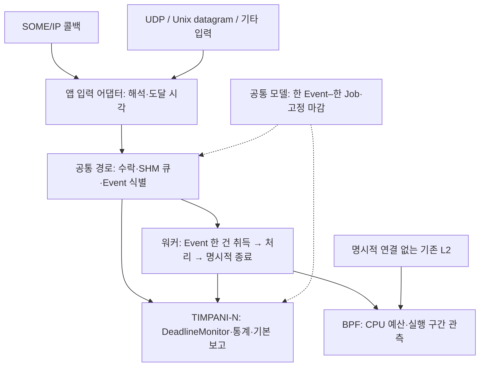
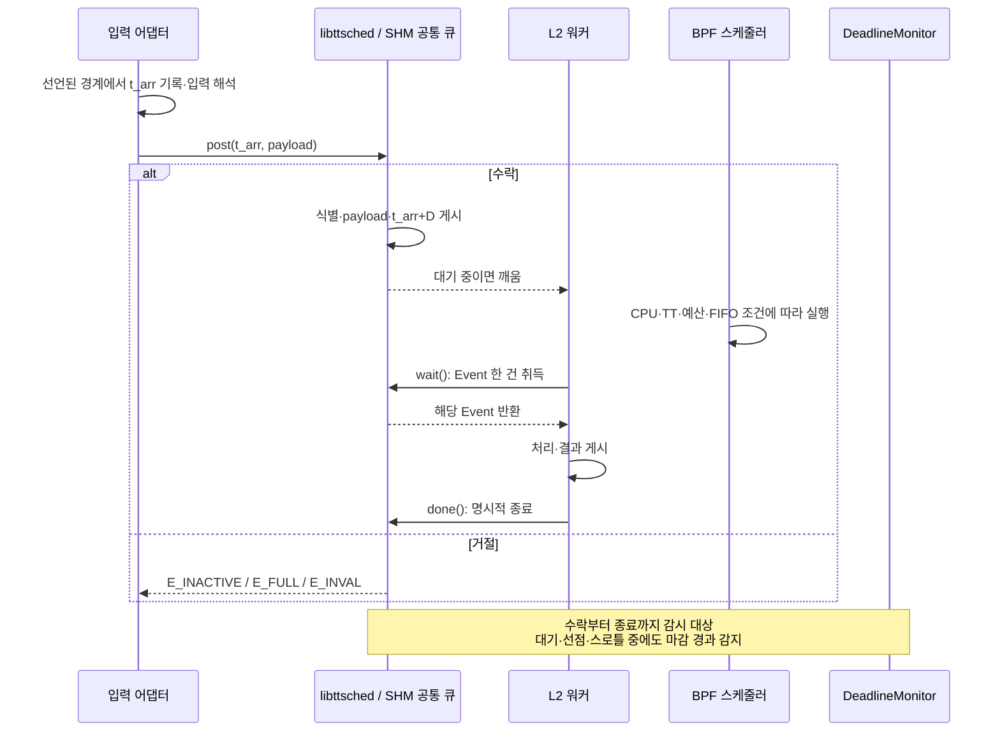

<!--
SPDX-FileCopyrightText: Copyright 2026 LG Electronics Inc.
SPDX-License-Identifier: MIT
-->

# Event-Driven Workload Support — 설계 설명 및 리뷰 가이드

| 항목 | 내용 |
|:--|:--|
| 목적 | 공통 Event/Job 모델, 실행 흐름, P1/P2 범위와 구현 전 쟁점을 공유한다 |
| 독자 | 아키텍처·스케줄러·애플리케이션·검증 담당자 |
| 기준 | 2026-11-13. 로컬 적용 커밋 `9918ef3`의 008 설계 체인과 이후 작업 트리의 DDR-008 D-22~D-24·§3.5 단계 정리 |
| 상태 | **Draft / P1 구현 전**. 공개 인터페이스·수치·일부 판정 방식은 미승인·미확정이며, 구현·타깃 검증 결과가 아니다 |
| 문서 성격 | 설명용 요약. 요구사항·상세 설계를 대체하지 않으며, 문서 사이의 미해결 사항을 확정하지 않는다 |

> **P1 목표:** Event와 Job을 공통으로 정의하고, TIMPANI가 이를 수락·전달·처리·종료·마감 감시할 수 있는 **Event-Driven Workload의 기본 환경**을 구현한다.
>
> **P2 목표:** TT 슬롯 경계·종료 집행을 구체화하고, CBS 마감 실패의 원인과 피해 태스크를 구분하여 원인별 대응을 강화한다.

**리뷰 시작점:** [기능 Issue #53](https://github.com/eclipse-timpani/timpani26/issues/53) → [P1 계약 보강 합의](P1-008-event-job-contract-amendment.md) → [DDR-008 단계 판정](DDR-008-event-driven-workload-support.md#35-2026-11-12-weekly-반영-및-phase-판정). [Weekly 2026-11-12와 후속 답변](https://github.com/eclipse-timpani/timpani26/discussions/4)을 바탕으로 단계 범위를 정리했다.

**자료 상태 주의:** 기존 [FCW HTML 그림](../../../Radar-FCW-P1-event-job-contract.html)은 아직 갱신하지 않았다. 도달 시각의 경계, 넘침의 의미, 정식 문서 반영 상태에 차이가 있으므로 이 개요와 상세 문서를 우선한다. 기존 정본의 P1 계약 정렬과 이번 DDR 단계 보충은 문서 반영이지 구현 완료가 아니다. 신규 단계 결정의 REQ/SRS·HLD/LLD 정합은 후속 검토 대상이다.

## 읽기 전에: 약자와 용어

| 표기 | Full name / 뜻 |
|:--|:--|
| P1 / P2 | Phase 1 / Phase 2 — 기본 Event/Job 실행 환경 / 시간 경계·원인 분석 강화. 다른 DDR의 과거 개발 Phase 번호와 구분 |
| L1 / L2 | Level 1 / Level 2 — TT 태스크 / 이벤트 기반 CBS 태스크 |
| TT | Time-Triggered — 정해진 시간표에 따라 실행 |
| CBS | Constant Bandwidth Server — CPU 사용을 예산과 보충 규칙으로 제한 |
| MIT | Minimum Inter-arrival Time — 같은 발생원의 최소 도달 간격 |
| CPU | Central Processing Unit — 중앙 처리 장치. 배정은 논리 CPU 단위 |
| FIFO / EDF | First In, First Out / Earliest Deadline First — 먼저 들어온 순서 / 빠른 절대 마감 우선 |
| DSQ | Dispatch Queue — sched_ext가 실행할 태스크를 보관·선택하는 큐 |
| DMISS | Deadline Miss — 마감 실패 |
| RT / E2E | Real-Time / End-to-End — 실시간 / 전체 처리 경로의 시작부터 끝까지 |
| FCW | Forward Collision Warning — 전방 충돌 경고 예제 |
| SOME/IP | Scalable service-Oriented MiddlewarE over IP — 서비스 간 통신 프로토콜 |
| UDP / CAN | User Datagram Protocol / Controller Area Network — 데이터그램 전송 / 차량 통신 네트워크 |
| BPF / eBPF | Berkeley Packet Filter / extended Berkeley Packet Filter — 여기서는 Linux 커널 스케줄러 구현 기술 |
| SHM / futex | Shared Memory / Fast Userspace Mutex — 공유 메모리 / 메모리 값 기반 대기·깨움 기능 |
| API / ABI | Application Programming Interface / Application Binary Interface — 소스 호출 / 바이너리 호환 계약 |
| IRQ / ISR | Interrupt Request / Interrupt Service Routine — 인터럽트 요청 / 처리 루틴 |
| I/O / ID / PoC / Hz | Input/Output / Identifier / Proof of Concept / Hertz — 입출력 / 식별자 / 타당성 실험 / 초당 횟수 |

- **TIMPANI-O / TIMPANI-N:** 스케줄 계산·오케스트레이션 / 노드 실행 구성요소.
- **sched_ext:** Linux의 확장형 스케줄링 기능. TIMPANI CBS는 SCHED_EXT 안에서 구현하며 Linux SCHED_DEADLINE을 사용하는 것이 아니다.
- **PREEMPT_RT:** Linux 실시간 선점 지원 구성. **vsomeip**는 SOME/IP 구현 라이브러리다.
- **gRPC:** 원격 프로시저 호출(Remote Procedure Call, RPC) 프레임워크. Event별 실시간 처리 경로에는 두지 않는다.
- **payload / pending / throttling:** 실제 처리 데이터 / 대기 중 항목 / 예산 소진에 따른 실행 보류.
- **R·C·D는 시간 기호**다. 응답시간 R과 선언의 `runtime`은 다르다(§2).

## 1. 무엇을 해결하고 어디까지 관리하는가

FCW뿐 아니라 소켓 메시지·CAN 입력·다른 태스크의 출력처럼 외부 도달로 실행되는 앱이 같은 계약을 사용하게 한다. 코어가 SOME/IP 메시지나 임의의 `recv()` 의미를 추론하는 구조는 아니다.

| 구분 | 책임·범위 |
|:--|:--|
| 앱 입력 어댑터 | 입력 해석, 선언된 경계의 도달 시각 기록, payload 게시, 거절 대응 |
| 공통 경로 | Event 수락, 상한 있는 큐, 데이터·식별·시각의 일관된 전달, Job 취득·종료 계약 |
| TIMPANI | 등록된 L2 워커의 CPU 배치·CBS 예산·실행 관측, Event별 마감 감시·기본 보고 |
| 자동 포함되지 않음 | IRQ/ISR, 커널 worker, vsomeip 내부 스레드, 원격 송신부터 실제 장치 반영까지의 전체 시간 보장 |

**앱이 payload 큐를 별도로 소유하고 통지 개수만 맞추는 이전 모델은 사용하지 않는다.** 현재 제안은 libttsched와 SHM 슬롯의 공통 큐다. 메시지 의미와 게시 실패에 대한 앱 정책은 여전히 앱에 남는다.

## 2. 공통 Event/Job 모델과 시간

| 개념 | 의미 |
|:--|:--|
| Event source | 선언된 발생원. P1은 L2 태스크당 source 하나, 소비 워커 하나 |
| Event | **수락된** 도달 한 건. `(gen, seq)`, 도달 시각, 고정된 절대 마감, payload를 가짐 |
| Job | Event 한 건의 처리. 워커가 명시적으로 시작·종료하며 Event와 1:1 |
| 실행 구간 | BPF가 관측하는 활성화부터 자발적 수면까지의 구간. Job과 다름 |
| budget-only L2 | 명시적 Event 연결 없이 CPU 예산 집행·실행 관측만 받는 태스크. Event별 마감 지원과 동등하지 않음 |

`gen`은 등록 세대, `seq`는 게시 순번이다. source 식별은 `(workload_id, task_id)`이며 `task_id`는 노드에서 유일한 15바이트 이하 이름이다. 상세 식별자의 순환·재시작 제한은 LLD를 따른다.

### 처리 규칙

1. 대기 중 Event가 수락되면 해당 Job을 취득할 수 있다.
2. Job A 처리 중 Event B가 수락되면 별도 대기 항목으로 남는다. A의 마감을 바꾸지 않는다.
3. A를 명시적으로 끝낸 뒤 대기 항목이 있으면 잠들지 않고 다음 Job을 시작할 수 있다.
4. Job마다 Event 하나만 FIFO로 소비한다. 폭주해도 배치·병합으로 바꾸지 않는다.

종료 결과는 `COMPLETED`, `DISCARDED`, `CANCELLED`, `ABANDONED`로 구분하며, `MISSED`는 종료 상태와 별도의 마감 결과다. 거절된 게시는 Event가 아니다. 취소·중단의 마감 판정 정책은 §10의 확인 대상이며 성공 완료와 혼동하지 않는다.

| 기호 | 뜻 |
|:--|:--|
| $t_{arr}$ | 선언된 입력 어댑터 경계의 도달 시각 |
| $t_{dl}=t_{arr}+D$ | 수락 시 고정하는 절대 마감. 수락·활성화·보충·재개 때문에 연장하지 않음 |
| $t_{begin}$ / $t_{end}$ | 앱 Job의 취득·시작 / 명시적 종료 시각. 완료 게시·경합의 정확한 정의는 미해결 |
| $t_{act}$ / $t_{start}$ | 커널 실행 구간의 활성화 / 최초 CPU 실행. 앱 Job 시작과 동일시하지 않음 |
| $R=t_{end}-t_{arr}$ | Response time — 응답시간. 대기·선점·실행 보류도 포함 |
| $C$ / $D$ | CPU 실행시간 예산 / 도달부터 완료까지 허용되는 상대 마감시간 |
| $MIT$ / $T_s$ | 최소 도달 간격 / CBS 서버 보충 주기. 다른 개념이며 현재 승인 제안은 $T_s\le MIT$ |

예를 들어 C=2ms, D=5ms에서 CPU 사용 1.5ms와 대기·선점 1ms가 발생하면 R=2.5ms다. **새 Job이 생겼다고 새 CPU 예산을 주지는 않는다.**

## 3. 모델 / 연결·관측 / 집행·판정 분리

- 명시적 Event 연결만이 Event별 도달 시각·Job 경계·마감 정보를 제공한다.
- BPF는 실행 구간과 CPU 예산을 관측·집행한다. L2 Job 마감 판정과 MIT 검사는 맡지 않는다.
- 도달 기준 MIT 계수는 게시 경로, 완료를 기다리지 않는 마감 감시는 TIMPANI-N이 담당한다.
- 워커가 수면 없이 연속 Job을 처리해도 앱 Job은 분리된다. 하나의 BPF 실행 구간에 여러 Job이 포함될 수 있다.

## 4. 누가 무엇을 하는가

| 구성요소 | 역할 |
|:--|:--|
| Pullpiri / 앱 선언 | 실행 요구·예산·마감·최소 간격·기존 보고 임계 전달. 시스템과 함께 cgroup 배치 구성 |
| TIMPANI-O | 입력·수용 판정, CPU 배치, CBS 설정·테이블 생성 |
| TIMPANI-N | 실제 워커 바인딩·세대 관리, 초기 BPF 설정, 백업 보충 유발, 마감 감시·기본 폴트·통계 |
| BPF | 실제 CPU 실행시간 차감, 스로틀·승격, 배정 CPU·큐, 실행 구간 관측 |
| libttsched + SHM | 상한 있는 공통 큐, 게시·취득·종료, 식별·시각·payload 전달 |
| 앱 어댑터·워커 | 도달 경계 선언·입력 해석·게시, 한 건 처리·결과 게시·명시적 종료 |

API 후보는 `ttsched_evt_open/post/wait/done`이다. 공개 API·SHM v2·protobuf·내부 인터페이스는 **제안 및 승인 대상**이며 이 개요가 새 서명을 승인하지 않는다.

## 5. 이벤트 한 건의 실행과 마감 감시

SHM 레코드는 payload와 Event 식별·도달 시각·마감을 함께 전달한다. 후보는 **깊이 8, 인라인 payload 64바이트**이며 미확정이다. `E_FULL`은 수락 전 거절·넘침 계수이지, 수락한 Event의 정책 폐기와 같지 않다. 데이터 유실이 전혀 없거나 무한 큐를 제공한다는 뜻은 아니다.

DeadlineMonitor는 완료를 기다리지 않고 미완료 Job의 마감 경과를 감지한다. 실패는 Job당 한 번 계수하고, 늦은 완료는 같은 Job에 연결한다. 감지가 자동 취소를 뜻하지 않는다. **늦은 수집과 늦은 완료를 구분해야 하며, 완료 시계 읽기와 상태 게시 사이의 경합은 아직 확정된 해결책이 아니다.**

## 6. CBS 집행·수용 판정·TT 없는 실행

### 6.1 예산과 보충

- 기본 제안은 $0<C_i\le D_i\le MIT_i$, $T_i\le MIT_i$다. $T_i$는 CBS 주기다.
- 커널 활성화 시 이전 보충 윈도우가 끝났으면 예산을 준다. 열린 윈도우 안에서는 기존 잔여 예산을 쓴다.
- 실제 CPU 사용시간을 차감하고 소진 시 실행을 보류한다. 윈도우 종료 후 승격한 서버는 큐 뒤로 간다.
- 실행 중인 비스로틀 서버를 윈도우 종료만으로 자동 보충하지 않는다. Job 경계도 보충 계기가 아니다.
- Replenisher는 유휴 CPU의 재스케줄을 유발할 뿐이다. 런타임 예산 갱신은 BPF가 소유한다.

Job 내 블로킹은 Job을 닫지 않고 응답시간에 포함된다. 다만 현재 수용 판정의 마감 보장은 블로킹하지 않는 Job 등 전제에 한정하므로, 샘플 워커는 경합 잠금·로그·블로킹 I/O를 피한다.

### 6.2 수용 판정은 전제하의 충분조건

현재 DDR-008 D-09의 제안은 다음과 같다.

$$
C_i+B_{tt}(k,D_i)+L_{del\_max}+\sum_{j\ne i}(C_j+\delta_{ovr})\le D_i
$$

| 기호 | 뜻 |
|:--|:--|
| $i$ / $j$ / $k$ | 검사 대상 L2 / 같은 CPU의 다른 L2 / 배정 CPU |
| $B_{tt}(k,D_i)$ | 길이 $D_i$인 구간의 최대 TT 점유 합 |
| $L_{del\_max}$ | TT 없는 유휴 CPU에서 도달부터 첫 dispatch까지의 전달·깨움 지연 상한 |
| $\delta_{ovr}$ | 다른 서버의 예산 초과 실행 상한. 현재 후보는 HZ=1000 기준 1ms |

CPU 이용률·최소 Gap·태스크 수 제한도 함께 검사하며, 새 앱 추가 시 기존 앱을 포함해 해당 CPU의 모든 L2를 재검사한다. 도달 간격 준수, 충분한 C, 블로킹 없음, Job 사이 재대기·활성화 지터 등의 전제는 상세 DDR을 따른다. 후보 수치를 넣은 식은 타깃 검증 결과가 아니다.

**P1의 TT 공존은 TT가 선언된 실행 범위를 지킨다는 조건부 보장이다.** 초과 TT의 슬롯 종료 강제는 P2다. 기존 식이 TT overrun까지 막는다고 설명하지 않는다.

### 6.3 CBS-only는 P1 필수

TT 없는 CPU에서는 $B_{tt}=0$이고, CBS dispatch·서버별 보충·마감 감시는 TT 발화 없이 동작해야 한다. CBS 실행 자체에는 공통 TT hyperperiod가 필요하지 않다. MIT의 LCM이나 임의 기본 hyperperiod를 강제하지 않는다.

다만 TT 없는 테이블의 `hyperperiod_us` 표현·검증·갱신 적용 경계는 구현 전 확정해야 한다. 최초 TT 추가·마지막 TT 제거 시 유지 CBS의 예산과 Job을 보존하는 계약은 DDR-011 §1.2에서 추적한다.

## 7. P1과 P2의 경계

| P1 — 기본 Event-Driven 실행 환경 | P2 — 시간 격리·진단 강화 |
|:--|:--|
| 공통 Event/Job 정의, 한 Event–한 Job | TT 슬롯 범위·종료 강제·미완료 TT 처리 |
| 공통 큐·식별·도달 시각·명시적 시작/종료 | TT 초과 시 다음 TT·CBS 보호 검증 |
| 큐·통지·재등록·재시작 일관성 | TT/CBS 기록을 연계한 마감 실패 원인 분류 |
| CBS 예산 집행·CPU 배치·CBS-only | 피해 태스크와 원인 태스크 구분·원인별 복구 |
| 도달 기준 마감 감지·계수·기본 보고 | 자동 분석·지능형 진단의 구체 방식 검토 |

**“마감을 놓쳤는가”를 관측하는 것은 P1이고, “왜 놓쳤으며 누구에게 어떤 조치를 해야 하는가”를 강화하는 것은 P2다.** 기본 예산 소진·미시작 표식은 유지하지만 이를 원인 확정으로 설명하지 않는다. 기존 보고·복구 경로를 이번 단계 분리로 임의 변경하지 않는다.

TT 종료 강제와 원인 분석은 P1 완료를 막지 않는다. 다만 TT 초과까지 포함한 강한 시간 격리·결정론은 P2 집행 검증 전 주장하지 않는다. EDF·다중 source·큰 payload·파이프라인 E2E 등 기존 후속 항목의 구체 일정까지 이 구분으로 승인한 것은 아니다.

### P1 제한과 확인 사항

- source당 게시 주체·소비 워커는 각각 하나다. 다중 게시자 지원은 후속이다.
- payload는 인라인만 제안한다. 외부 데이터 핸들의 수명·해제 계약은 포함하지 않는다.
- SHM 쓰기 권한을 가진 프로세스는 신뢰 대상이다. source별 보안 격리는 제공하지 않는다.
- 데몬 중단 중에는 독립 마감 감지가 멈춘다. 워커의 늦은 종료 판정과 재시작 시 남은 레코드 정리는 가능하지만 모든 과거 상세 기록 복원을 보장하지 않는다.
- 게시자 사망의 계수·깨움 한계, 활성화 전 `E_INACTIVE`, 재등록 경계의 계수 귀속 등은 LLD의 제한을 검토한다.
- 감지 2ms·보고 200ms·스캔 1ms·전달 100µs·우선순위 97 등은 모두 후보이며 승인·측정 전이다. 지연 평가에는 스캔 비용·깨움 지터·상위 부하를 포함해야 한다.

## 8. FCW와 비-SOME/IP 예제로 검증하기

| 구분 | FCW | 비-SOME/IP 센서 예제 |
|:--|:--|:--|
| 입력 | SOME/IP 레이더 경보 | Unix datagram 등 |
| 연결 | 앱 어댑터에서 공통 post | 입력 수신 후 같은 공통 post |
| 워커 | Event 한 건 → FCW 판단 → done | Event 한 건 → 임계치 판단 → done |
| 런타임 | 독립 CBS 서버·동일 Event/Job 계약 | 독립 CBS 서버·동일 Event/Job 계약 |

FCW는 콜백 진입 직후 **잠금·메시지 해석 이전**에 도달 시각을 기록하는 방향이다. 여러 콜백 스레드가 있다면 post 잠금만으로 도달 시각 순서를 보장하지 못한다. 단일 콜백 여부나 순서 보존 방식을 확인해야 한다. t0 이전 미들웨어·네트워크 지연은 이 Job 응답시간 밖이다.

FCW 후보값 C=2ms, D=5ms, MIT=18ms에서 CBS 주기는 T≤MIT에 맞춰 20→18ms 변경을 제안한다. 설정 승인은 별도다. 동시 구동은 HLD §8의 세 구성으로 나눈다.

1. **서로 다른 격리 CPU:** 기본 FCW와 센서 각각의 수용·실행 확인.
2. **같은 CPU의 승인 가능한 조합:** FCW와 센서 D를 각각 6ms, 센서 C를 500µs로 조정한 후보. 현재 가정의 계산값은 각각 5.6ms이며 검증 완료 값이 아니다.
3. **기본 FCW + 같은 CPU의 두 번째 L2:** 현재 후보식에서는 거부되는지 확인.

Radar L1→Event→FCW L2 연결은 P1 예제가 될 수 있다. 이것은 단일 태스크를 TT/CBS 이중 모드로 바꾸는 것이 아니다. 전체 파이프라인 E2E 마감·노드 간 관측은 별도 설계이며 현재 체크아웃에는 DDR-009 정본이 없다.

기존 앱이 직접 `recv()`로 기다리는 비교 구성은 budget-only다. 동일한 Event별 마감 검증을 통과한 것으로 취급하지 않는다.

## 9. 관측과 구현 진행 순서

### 기본 관측

- **source:** 도달·수락·넘침·거절 관련 계수, 시작·완료·폐기·취소·중단·마감 실패·MIT 위반.
- **Job:** `(gen, seq)`, 도달·마감·시작·종료, 결과와 마감 실패. 상세 로그는 손실 가능하며 드롭을 별도 계수한다.
- **BPF 실행 구간:** 활성화·CPU 실행·수면, 예산·스로틀·보충 관련 정보. Job 레코드와 혼동하지 않는다.
- **환경:** 제어 스레드 지터·보충 지연·실제 CPU·스레드 정책·허용 마스크·cgroup. 단순 동시 관측은 원인의 증명이 아니다.

### 권장 순서

1. P1 계약의 수락·게시·종료 경합·복구·보고 범위와 공개 인터페이스를 검토·승인한다.
2. 공통 큐·Event/Job 연결과 O 승인·N 바인딩·BPF 집행·DeadlineMonitor를 구현한다.
3. TT 없는 환경에서 정상·버스트·과실행·대기 중 마감·재시작을 검증한다.
4. FCW와 비-SOME/IP 앱을 같은 계약으로 연결하고 세 배치 구성을 검증한다.
5. TT 정상 실행 가정하의 공존을 검증한다. TT 초과 경계 집행·원인 분석은 P2 검증으로 분리한다.

실제 BPF·실시간 검증에는 Linux와 적합한 sched_ext/PREEMPT_RT·커널 설정·권한이 필요하다. Timer Master의 SCHED_FIFO는 DEADLINE 계층·대상 커널의 fair server(`dl_server`) 간섭을 자동 차단하지 않는다. 시스템에서 이를 측정해야 하며 SCHED_DEADLINE 전환을 승인한 것은 아니다.

미관리 스레드의 CPU 이동은 effective cpuset 범위를 벗어날 수 없다. root 권한·FIFO 승격으로 해결된다고 가정하지 않는다. PID/TID·동일 프로세스 여부·cgroup·online CPU·호스트/컨테이너 설정을 확인하고 배포 책임과 스케줄러 책임을 구분한다.

## 10. 구현 전에 남은 결정

| 항목 | 필요한 합의 |
|:--|:--|
| 완료와 감시 경합 | 실제 결과 완료와 종료 게시를 어떻게 정의할 것인가? 시계 재읽기로 기록 일관성을 맞추는 것과 실제 완료의 정확한 판정은 다르며, 현 done CAS 스케치는 확정 해법이 아님 |
| 취소·중단 | 마감 전 정책 취소와 워커 사망을 어떻게 구분할 것인가? 성공 완료·마감 실패·별도 실행 결함을 혼동하지 않도록 결정 |
| 기본 보고 | 모든 miss 계수, 기존 임계 기반 보고, 보고 지연의 적용 범위·기준점 합의. P2 원인별 복구와 분리 |
| 공개 계약 | libttsched API·SHM v2·protobuf·내부 바인딩 세대 인터페이스 승인. 미승인 신규 count 필드를 기존 검증용 누적 필드와 혼용하지 않음 |
| 큐·수명주기 | 게시자 사망·재시작·stale 세대·넘침·활성화 틈의 수락·거절·계수와 데이터 일관성 검증 |
| 타이밍·수용 판정 | 후보 수치·스캔 비용·제어 지터·틱 초과 상한·CBS-only 테이블 표현을 확정 |
| 앱 적용 | 단일 게시자와 도달 순서, FCW 설정 변경, 두 앱 구성·성공 기준 승인 |

**P1 완료 조건에 새로 넣지 않는 것:** TT 슬롯 종료 집행, TT/CBS 상관 원인 분석, 피해 태스크별 자동 복구. 이들은 P2의 설계·검증 항목이다. 기존 P1의 마감 감지·기본 보고 및 복구 일관성 계약은 여전히 필요하다.

## 11. 상세 문서와 TT 제어의 담당 위치

| 문서 | 찾아볼 내용 |
|:--|:--|
| [REQ-008](REQ-008-event-driven-workload-support.md) | 공통 모델·요구사항·수용 기준 |
| [SRS-008](SRS-008-event-driven-workload-support.md) | 컴포넌트 기능·인터페이스·타이밍 요구 |
| [DDR-008](DDR-008-event-driven-workload-support.md) | Event/Job 설계 결정, D-22 CBS-only·D-23 P2 원인 분석·D-24 추상화, §3.5 단계 판정 |
| [HLD-008](HLD-008-event-driven-workload-support.md) | 구조·흐름·§8 온보딩·FCW/비-SOME/IP 적용 |
| [LLD-008](LLD-008-event-driven-workload-support.md) | 자료구조·동시성·API 후보·코드 스케치·시험 목록 |
| [P1 계약 보강 합의](P1-008-event-job-contract-amendment.md) | 기존 합의 기록. 완료·취소 해석과 후속 결정은 정본의 열린 항목과 함께 확인 |
| [DDR-007 §4.3.1](DDR-007-tt-cbs-integrated-scheduling.md#431-tt-슬롯-종료-강제--2026-11-12-weekly-후속-설계) | **P2 TT 시간 경계 계약의 주관**. 종료·초과 TT·다음 TT/CBS 보호 |
| [DDR-005](DDR-005-sched-ext-bpf-scheduler.md) | P2 TT 경계의 실제 BPF 집행·제어 스레드 환경 조사 |
| [DDR-011 §1.2](DDR-011-runtime-table-update.md#12-2026-11-12-weekly-연계-검토--제안미구현) | P1 CBS-only 테이블 전환, P2 지연된 TT 종료와 새 테이블의 정합 |
| [DDR-012 §4.4](DDR-012-fault-management.md#44-2026-11-12-weekly-후속--피해-태스크와-원인-태스크-분리-검토용) | P2 원인·피해 태스크와 복구 정책 |

**추천 설명 순서:** P1 목표·관리 경계 → 공통 Event/Job → 역할·실행·마감 감시 → 예산·CBS-only → P1/P2 → 앱 적용·미해결 결정.