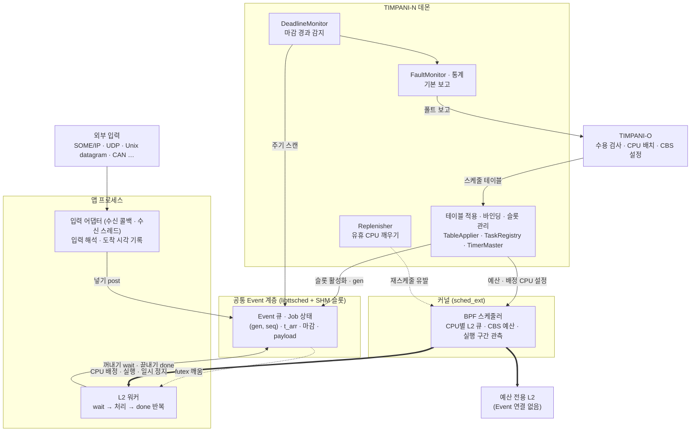
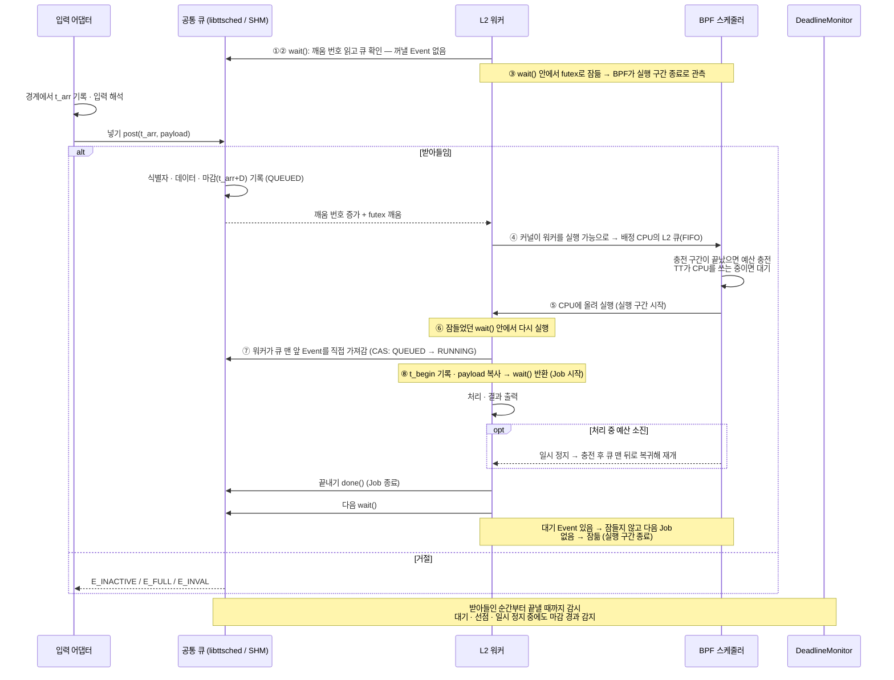

<!--
SPDX-FileCopyrightText: Copyright 2026 LG Electronics Inc.
SPDX-License-Identifier: MIT
-->

# Event-Driven Workload Support — 설계 개요 및 리뷰 가이드

| 항목 | 내용 |
|:--|:--|
| 목적 | 공통 Event/Job 모델, 실행 흐름, P1/P2 범위, 구현 전 남은 쟁점을 한 번에 공유한다 |
| 독자 | 아키텍처·스케줄러·애플리케이션·검증 담당자 |
| 기준 | 2026-11-16. 008 설계 체인(REQ-008 v5.1, SRS-008 v4.1, DDR-008 v3.2, HLD-008 v5.2, LLD-008 v5.1). DDR-008 D-22~D-24와 §3.5 단계 정리, HLD-008 §8 적용 절차 보강을 반영 |
| 상태 | **Draft / P1 구현 전** |
| 개정 | 2026-11-16 가독성 개정 — 용어 정리·구성 변경. 리뷰 Q&A 반영: 앱 수정 범위(§1), 태스크·워커·Job 관계와 `gen`(§2), 구조도·흐름도 재작성(§3, §5), 큐 레코드 구성(§5), Replenisher 역할(§6.1), C 측정(§6.4), 남은 결정 2건(§10). 설계 결정은 바꾸지 않음. 리뷰 반영: 마감 실패 정의(§2), 보충 재스케줄 수단·블로킹 Job·period 전환 등 남은 결정 추가(§10), gen 설명(§2), TT 없는 CPU의 hyperperiod 서술(§6.3), 측정 한계와 FCW 시작값 표시(§6.4, §8) |

## 한눈에 보기

- **무엇을:** 소켓 메시지·CAN 입력·다른 태스크 출력처럼 **외부 입력이 도착해야 실행되는 앱**(Event-Driven Workload)을 TIMPANI가 관리하게 한다.
- **어떻게:** 입력 한 건을 **Event**, 그 처리 한 건을 **Job**으로 정의하고, 모든 앱이 같은 큐와 같은 규칙(넣기 → 꺼내기 → 끝내기)을 쓴다. TIMPANI는 CPU 예산을 집행하고 Event별 마감을 감시한다.
- **P1 목표:** Event와 Job을 공통으로 정의하고, TIMPANI가 이를 **받고·전달하고·처리하고·종료하고·마감을 감시**하는 기본 실행 환경을 만든다.
- **P2 목표:** TT 슬롯의 시간 경계를 강제하고, CBS 마감 실패의 **원인 태스크와 피해 태스크를 구분**해 원인별로 대응한다.

> **이 문서의 위상**
> - 설명용 요약이다. 요구사항·상세 설계를 대체하지 않으며 문서 간 미해결 사항을 확정하지 않는다.
> - 공개 인터페이스(API·SHM·protobuf), 본문의 모든 수치, 일부 판정 방식은 **제안 단계이며 승인·측정 전**이다. 수치에는 *(후보)* 를 붙였다.
> - 구현이나 타깃 검증 결과가 아니다. 정본에 P1 계약을 맞추고 단계를 보충한 것은 **문서 반영**일 뿐 구현 완료가 아니다.
> - 새 단계 결정과 REQ/SRS·HLD/LLD의 정합은 후속 검토 대상이다.
> - 기존 [FCW HTML 그림](../../../Radar-FCW-P1-event-job-contract.html)은 아직 갱신되지 않았다. 도착 시각의 기준점, 넘침의 의미가 다르므로 **이 개요와 상세 문서를 우선**한다.

**리뷰 시작점:** [기능 Issue #53](https://github.com/eclipse-timpani/timpani26/issues/53) → [P1 계약 보강 합의](P1-008-event-job-contract-amendment.md) → [DDR-008 단계 판정](DDR-008-event-driven-workload-support.md#35-2026-11-12-weekly-반영-및-phase-판정). 단계 범위는 [Weekly 2026-11-12와 후속 답변](https://github.com/eclipse-timpani/timpani26/discussions/4)을 바탕으로 정리했다.

### 핵심 용어

이 문서는 설명하기 쉬운 표현을 쓴다. 상세 문서(REQ/SRS/DDR/HLD/LLD)의 표기와 대응은 다음과 같다. 전체 약어는 [부록](#부록-약어)에 있다.

| 이 문서의 표현 | 상세 문서 표기 | 뜻 |
|:--|:--|:--|
| **도착** (arrival) | 도달 | 입력이 앱의 입력 어댑터 경계에 들어온 사건 |
| **받아들임 / 거절** | 수락 / 거절 | 큐에 넣기(post) 성공 / 실패. 거절된 입력은 Event가 아니다 |
| **넣기 · 꺼내기 · 끝내기** | post · wait(취득) · done | 공통 큐 API 후보 `ttsched_evt_post/wait/done` |
| **예산 충전** | 보충 (replenish) | CBS 서버의 CPU 예산을 다시 채우는 것 |
| **일시 정지** | 스로틀 (throttling) | 예산을 다 써서 다음 충전까지 실행을 멈추는 것 |
| **실행 대기열 복귀** | 승격 | 충전 후 일시 정지에서 풀려 큐 뒤에 다시 서는 것 |
| **수용 검사** | 수용 판정 / 승인 조건 (admission) | 새 L2를 CPU에 올려도 모두 마감을 지키는지 계산으로 확인. 프로젝트 차원의 "승인(approval)"과 다르다 |
| **커널 실행 구간** | 실행 구간 | BPF가 보는 "깨어남 → 잠듦" 구간. 앱의 Job과 다르다 |
| **예산 전용 L2** | budget-only L2 | Event 연결 없이 CPU 예산만 관리받는 L2. Event별 마감 감시는 없다 |
| **마감 실패** | DMISS / `MISSED` | 정해진 절대 마감 `t_dl`을 넘긴 시점에 Job이 열려 있거나(QUEUED·RUNNING), `t_dl` 이후에 완료·폐기·취소·중단으로 끝남 |

- **L1 / L2:** L1 = TT(시간표 기반) 태스크, L2 = 이벤트 기반 CBS 태스크.
- **P1 / P2:** Event-Job 지원의 단계다. 다른 DDR의 과거 개발 Phase 번호와 다르다.
- **TIMPANI-O / TIMPANI-N:** 스케줄 계산·오케스트레이션 / 노드에서 실행·감시하는 구성요소.
- **CBS는 Linux `SCHED_DEADLINE`이 아니다.** TIMPANI가 `sched_ext`(Linux 확장형 스케줄러) 안에서 직접 구현한다.

---

## 1. 왜 필요하고, 어디까지 책임지나

FCW뿐 아니라 입력이 도착해야 실행되는 모든 앱이 **같은 계약**을 쓰게 하는 것이 목표다. TIMPANI 코어가 SOME/IP 메시지나 임의의 `recv()` 의미를 추측하지 않는다. 입력의 의미는 앱이 해석하고, TIMPANI는 "언제 도착했고, 언제까지 끝나야 하며, 실제로 끝났는가"만 다룬다.

| 계층 | 책임 |
|:--|:--|
| **앱 입력 어댑터** | 입력 해석, 정해진 경계에서 도착 시각 기록, Event 넣기, 거절 시 대응 |
| **공통 Event 계층** (libttsched + SHM) | 받아들임, 크기가 정해진 큐, 데이터·식별자·시각의 일관된 전달, Job 꺼내기·끝내기 계약 |
| **TIMPANI** | 등록된 L2 워커의 CPU 배치·CBS 예산 집행·실행 관측, Event별 마감 감시·기본 보고 |
| **책임 범위 밖** | IRQ/ISR, 커널 worker, vsomeip 내부 스레드, 원격 송신부터 실제 장치 반영까지의 전체 시간 |

> **바뀐 점:** 앱이 데이터 큐를 따로 갖고 통지 개수만 TIMPANI와 맞추던 이전 모델은 쓰지 않는다. 이제 libttsched와 SHM 슬롯의 **공통 큐**에 데이터를 함께 넣는다. 메시지 의미와 넣기 실패 시 정책은 여전히 앱의 몫이다.

### L2로 쓰려면 앱은 무엇을 바꾸나

Event의 의미와 도착 시점은 앱만 안다. 커널의 깨움만으로는 스레드가 왜 깨어났는지 알 수 없고, 메시지 경계(TCP 프레이밍, eventfd 카운트 등)도 앱이 정한다. 그래서 **post는 앱 프로세스 안의 입력 어댑터**가 한다. 입력 어댑터는 입력이 앱에 처음 보이는 스레드다. 예를 들면 미들웨어 수신 콜백 스레드(vsomeip 등)나 datagram 수신 스레드다(DDR-008 D-24, HLD-008 §8.1).

앱 수정 범위는 원하는 보장에 따라 두 단계다.

| | 예산 전용 L2 | Event 연결 L2 |
|:--|:--|:--|
| 코드 수정 | 거의 없음. 워커 스레드 이름(comm)을 `task_id`와 맞춘다 | 입력 어댑터에서 `post`, 워커에서 `wait → 처리 → done` 루프 |
| 받는 것 | CBS 예산 집행, CPU 고정, `BUDGET_EXCEED`, 실행 구간 관측 | 위의 것 + Event별 도착 기준 마감 감시, 받아들임·넘침·MIT 계수 |
| 받지 못하는 것 | Event, MIT 검사, 마감 실패 감시 | — |

- **모든 Event 연결 앱은 같은 API를 라이브러리처럼 쓴다:** `ttsched_evt_open / post / wait / done`. 앱마다 달라지는 것은 어댑터 위치와 파라미터 값(MIT, C, D, T)뿐이고, TIMPANI 쪽은 바뀌지 않는다.
- API 호출만으로 끝나지 않는다. 수신 지점에서 바로 post하기, source당 워커 하나, Job 안에서 블로킹하지 않기, `done()` 필수 호출, 스케줄링 정책·우선순위·affinity를 직접 설정하지 않기 같은 계약 규칙을 지켜야 보장이 성립한다(HLD-008 §8.1).
- 기존 앱을 먼저 예산 전용 L2로 올려 격리부터 확보하고, 나중에 Event 연결로 넘어가는 **단계적 도입**이 가능하다.
- 전송 방식별 공통 어댑터 라이브러리로 앱 수정을 줄일 수 있다. 앱 수정이 전혀 없는 자동 연결(미들웨어 훅 등)은 P1 보장이 아니며 후속 조사 대상이다.

## 2. 핵심 개념: Event, Job, 커널 실행 구간

| 개념 | 의미 |
|:--|:--|
| **Event source** | 선언된 입력 발생원. P1은 L2 태스크당 source 하나, 소비 워커 하나 |
| **Event** | **받아들여진** 입력 한 건. 식별자 `(gen, seq)`, 도착 시각, 고정된 절대 마감, 데이터(payload)를 가진다 |
| **Job** | Event 한 건의 처리. 워커가 명시적으로 시작·종료하며 Event와 1:1 |
| **커널 실행 구간** | BPF가 관측하는 깨어남부터 잠듦까지. 한 구간에 여러 Job이 들어갈 수 있어 Job과 같지 않다 |

### 태스크 · 워커 · Job · 실행 구간의 관계

```
L2 태스크  = 스케줄 계약 (task_id, C, D, MIT, 배정 CPU, CBS 서버)   ← 선언, 테이블에 등록
 └─ L2 워커 = 계약에 바인딩된 실제 스레드 1개                         ← 오래 살아 있음
     └─ Job  = Event 한 건의 처리 (wait → 처리 → done)                ← Event마다 하나

Event      = 식별자 (gen, seq) + 도착 시각 + 절대 마감 + payload(데이터)
             payload는 Event에 실린 데이터일 뿐, Job(처리 작업)이 아니다

시간 →   깨어남                                                   잠듦
워커      |=== Job #1 (seq=1) ===|=== Job #2 (seq=2) ===|  (대기 Event 없음)
BPF       |<------------------- 커널 실행 구간 1개 ------------------->|
CPU 예산  |<----------- 같은 CBS 예산에서 계속 차감 (Job마다 새로 주지 않음) ---->|
```

| 구분 | 무엇인가 | 수명 | 개수 (P1) |
|:--|:--|:--|:--|
| L2 태스크 | 스케줄 계약 | 테이블에 등록된 동안 | source당 하나 |
| L2 워커 | 실제 스레드 | 바인딩부터 종료까지 | 태스크당 하나 |
| Job | 일 한 건 | `wait()`부터 `done()`까지 | Event마다 하나 |
| 커널 실행 구간 | 워커의 깨어남 → 잠듦 | 다음 자발적 수면까지(Job 안의 블로킹 수면 포함) | 여러 Job을 포함하거나 한 Job의 일부만 포함할 수 있음 |

- 워커 코드의 반복문 한 바퀴(`wait → 처리 → done`)가 Job 하나다.
- 대기 중인 Event가 있으면 워커는 잠들지 않고 다음 Job을 이어서 처리한다. 그래서 BPF가 보는 실행 구간 하나에 Job이 여러 개 들어갈 수 있다.
- 워커가 처리 중에 죽으면 그 Job은 `ABANDONED`로 닫힌다. 워커가 다시 바인딩되면 `gen`이 바뀌어 이전 등록의 Event와 구분된다.

- **식별자:** `gen`은 등록 세대(재등록하면 바뀜), `seq`는 넣은 순번이다. source는 `(workload_id, task_id)`로 식별하고, `task_id`는 노드에서 유일한 15바이트 이하 이름이다. 순번 순환·재시작 제한은 LLD를 따른다.

### `gen`: 재바인딩 경계를 나누는 번호

`gen`은 "이 Event가 어느 바인딩 회차에 만들어졌는가"를 나타낸다. 64비트 값으로, 상위 32비트는 SHM 객체 `instance_id`의 하위 32비트(객체를 만든 시각에서 정해짐), 하위 32비트는 바인딩 횟수(`bind_gen`, 바인딩마다 +1)다. 재시작을 넘는 `gen` 유일성은 확률적이며 보장이 아니다(DDR-008 D-19, 확률성의 근거는 [LLD-008](LLD-008-event-driven-workload-support.md) §5.6).

| 새 `gen`이 생기는 경우 | 생기지 않는 경우 |
|:--|:--|
| 워커가 죽었다가 재시작되어 다시 바인딩됨 | 해당 L2의 파라미터가 같은 테이블 재발행 |
| 해당 L2의 파라미터가 바뀐 테이블 재적용 (해제 후 재활성화) | TT만 다시 발행됨 |
| workload 제거 후 재추가 | 데몬이 내려가 있는 동안 |
| TIMPANI-N 데몬 재시작 (SHM 객체 재생성 후 재바인딩, `seq`도 다시 시작) | |

- 바인딩 시점은 테이블 적용 시점이 아니다. 워커 스레드를 찾아 `SCHED_EXT`로 전환한 **뒤에** 슬롯이 활성화되고 새 `gen`이 생긴다.
- 새 `gen`을 만들기 전에 이전 등록의 미완료 Event를 닫는다(대기 중이면 `CANCELLED`, 처리 중이면 `ABANDONED`). DeadlineMonitor와 폴트 보고는 현재 `gen`만 대상으로 하고, 이전 `gen`의 마감 실패는 기록·통계에만 남는다.
- **Event 하나의 `gen`은 바뀌지 않는다.** 다만 경계에서 앱이 같은 입력을 다시 post하면 그 입력은 새 `gen`의 **별개 Event**가 된다. 중복 처리 방지는 앱의 몫이며, 이때 `t_arr`를 무엇으로 할지는 미정이다(§10).

### 처리 규칙 — "한 Event, 한 Job"

1. 대기 중인 Event가 있으면 워커가 꺼내 Job을 시작한다.
2. Job A를 처리하는 동안 Event B가 오면 B는 대기열에 남는다. A의 마감은 바뀌지 않는다.
3. A를 명시적으로 끝낸 뒤 대기 중인 Event가 있으면 잠들지 않고 바로 다음 Job을 시작할 수 있다.
4. Job은 Event 하나만 FIFO 순서로 처리한다. 입력이 몰려도 여러 건을 묶거나 합치지 않는다.

**Job 결과:** 종료 상태는 `COMPLETED`(완료)·`DISCARDED`(앱이 폐기)·`CANCELLED`(취소)·`ABANDONED`(워커 사망 등으로 중단)다. **`MISSED`는 종료 상태와 별도로 붙는 마감 결과**다. `t_dl` 이하에서 끝난 종료는 실패가 아니다. `t_dl`을 넘긴 뒤의 어떤 종료(완료, 폐기, 취소, 중단)도 실패이며, 한 번 설정된 실패는 나중의 종료가 지우지 않는다. 마감 전에 TIMPANI가 닫은 경우(CANCELLED, ABANDONED)를 실패가 아닌 별도 결과로 보는 것만 해석 확인 대상이다([§10](#10-구현-전에-남은-결정)).

### 시간 기호

| 기호 | 뜻 |
|:--|:--|
| $t_{arr}$ | 도착 시각. 앱이 선언한 입력 어댑터 경계에서 기록 |
| $t_{dl}=t_{arr}+D$ | 절대 마감. 받아들일 때 고정하며 이후 어떤 이유로도 늘리지 않는다 |
| $t_{begin}$ / $t_{end}$ | 앱 Job의 시작 / 명시적 종료 시각. 완료 시점의 정확한 정의는 미결 |
| $t_{act}$ / $t_{start}$ | 커널 실행 구간의 깨어남 / 첫 CPU 실행. 앱 Job 시작과 같지 않다 |
| $R=t_{end}-t_{arr}$ | 응답시간. 대기·선점·일시 정지 시간까지 포함. 선언 필드 `runtime`과 다른 개념 |
| $C$ | 한 Job의 CPU 실행시간 예산 |
| $D$ | 도착부터 완료까지 허용되는 상대 마감시간 |
| $MIT$ | 같은 source에서 Event가 올 수 있는 최소 간격 |
| $T_s$ | CBS 예산 충전 주기. MIT와 다른 개념이며, 제안 조건은 $T_s\le MIT$ |

> **예:** C=2ms, D=5ms인 Job이 CPU를 1.5ms 쓰고 대기·선점으로 1ms를 보냈다면 R=2.5ms로 마감 안이다. **Job이 새로 생겼다고 CPU 예산을 새로 주지는 않는다.** 예산은 충전 규칙(§6.1)으로만 채워진다.

## 3. 전체 구조

구성요소는 네 층으로 나뉜다. **앱**은 입력을 넣고 처리하고, **공통 Event 계층**은 Event와 Job 상태를 담고, **TIMPANI-N**은 그 상태를 관리·감시하며, **BPF**는 워커가 CPU에서 언제 얼마나 실행될지를 정한다.



**선 읽는 법:** 실선 = 호출·데이터 전달, 점선 = 깨움 신호, 굵은 선 = BPF의 스케줄링 제어.

**핵심 포인트**
- **워커의 CPU 배정과 실행 순서는 BPF(sched_ext)가 정한다.** 워커 스레드를 실행하는 것은 커널이며, 워커는 공통 큐에 `wait/done`만 호출한다.
- **TIMPANI-N은 공통 큐를 직접 보고 감시한다.** 워커의 완료를 기다리지 않고 DeadlineMonitor가 주기적으로 마감 경과를 확인한다.
- **BPF는 Job을 모른다.** 워커의 깨어남·잠듦(실행 구간)과 CPU 예산만 다룬다. Job 경계와 마감은 공통 Event 계층에 있다.
- **예산 전용 L2**는 공통 큐를 쓰지 않으므로 BPF의 예산 집행만 받고, Event별 마감 감시는 받지 않는다.

| 역할 | 담당 | 하지 않는 것 |
|:--|:--|:--|
| **Event별 정보 제공** — 도착 시각·Job 경계·마감 | 명시적 Event 연결(공통 Event 계층) | 연결이 없으면 이 정보도 없다 |
| **CPU 예산 집행·실행 관측** | BPF | Job 마감 판정, MIT 검사 |
| **MIT 위반 계수** | 넣기 경로(도착 기준) | — |
| **마감 감시** — 완료를 기다리지 않음 | TIMPANI-N DeadlineMonitor | 자동 취소 |

## 4. 구성요소별 역할

| 구성요소 | 역할 |
|:--|:--|
| **Pullpiri / 앱 선언** | 실행 요구·예산·마감·최소 간격·보고 임계 전달. 시스템과 함께 cgroup 배치 구성 |
| **TIMPANI-O** | 입력 검증·수용 검사, CPU 배치, CBS 설정·스케줄 테이블 생성 |
| **TIMPANI-N** | 실제 워커 연결(바인딩)·세대 관리, 초기 BPF 설정, 유휴 CPU 깨우기(Replenisher), 마감 감시·기본 폴트·통계 |
| **BPF** | 실제 CPU 사용시간 차감, 일시 정지·대기열 복귀, 배정 CPU·큐 관리, 실행 구간 관측 |
| **libttsched + SHM** | 크기가 정해진 공통 큐, 넣기·꺼내기·끝내기, 식별자·시각·데이터 전달 |
| **앱 어댑터·워커** | 도착 경계 선언·입력 해석·넣기 / 한 건 처리·결과 출력·명시적 끝내기 |

API 후보는 `ttsched_evt_open/post/wait/done`이다. 공개 API·SHM v2·protobuf·내부 인터페이스는 모두 **제안이며 승인 대상**이다. 이 개요가 새 함수 서명을 승인하지 않는다.

## 5. Event 한 건의 흐름과 마감 감시



**워커와 BPF 스케줄러의 관계**
- 워커는 평범한 스레드이고, **언제 어느 CPU에서 얼마나 실행할지는 BPF가 정한다.** 워커 코드는 `wait → 처리 → done`만 반복한다.
- 깨어난 워커는 배정 CPU의 L2 큐에 FIFO로 들어간다. TT가 그 CPU를 쓰는 동안은 기다리고, TT가 비면 실행된다.
- BPF는 워커의 실제 CPU 사용시간을 예산에서 차감한다. 예산이 바닥나면 Job 중간이라도 일시 정지시키고, 충전되면 큐 맨 뒤에서 다시 실행한다.
- BPF는 워커가 **깨어나고 잠드는 것(실행 구간)**만 보고 Job 경계는 모른다. Job 경계는 `wait`/`done`으로 공통 큐가 기록한다.

**깨움부터 `wait()` 반환까지의 순서**

`wait()`는 큐가 보내 주는 응답이 아니라 **워커 스레드 안에서 실행되는 라이브러리 함수**다. 공통 큐는 SHM에 놓인 데이터일 뿐이며, 워커가 CPU를 받은 뒤 직접 읽어 Event를 가져간다. 그래서 순서는 항상 **CPU 실행 → `wait()` 반환**이다.

| 단계 | 일어나는 일 | 주체 | 기록 |
|:--|:--|:--|:--|
| ①② | 깨움 번호(`counter`)를 **먼저** 읽고 큐 맨 앞을 확인 | 워커 (`wait()` 안) | — |
| ③ | 꺼낼 Event가 없으면 `futex_wait`로 잠듦 | 워커 → 커널 | 실행 구간 종료 |
| — | post가 레코드를 쓰고 `counter`를 올린 뒤 futex로 깨움 | 입력 어댑터 | $t_{arr}$, 마감 |
| ④ | 워커가 실행 가능 상태가 되어 배정 CPU의 L2 큐에 들어감 | 커널 / BPF | $t_{act}$ |
| ⑤ | 예산·TT 조건이 맞으면 CPU에 올림 | BPF | $t_{start}$ |
| ⑥ | futex 시스템 콜에서 돌아와 `wait()` 안의 코드를 다시 실행 | 워커 | — |
| ⑦ | 큐 맨 앞 Event를 CAS로 가져감 (QUEUED → RUNNING) | 워커 | — |
| ⑧ | 시작 시각 기록, payload 복사, `wait()` 반환 | 워커 | $t_{begin}$ (Job 시작) |

- 위의 실제 수면·깨움 경로에서는 $t_{act}\le t_{start}\le t_{begin}$ 순서다. 시계 해상도에 따라 같은 값일 수 있으며, 커널 실행 구간의 시작과 Job 시작은 의미상 다른 경계다(§2). 잠들지 않고 다음 Job을 취득하면 새로운 $t_{act}$·$t_{start}$는 생기지 않는다.
- ④와 ⑤ 사이에는 TT 점유, 같은 CPU의 다른 L2, 예산 소진 때문에 기다릴 수 있다. 이 시간은 응답시간 R에 포함되고, 그동안에도 DeadlineMonitor가 마감을 감시한다.
- **깨움이 사라지지 않는다.** ②와 ③ 사이에 Event가 들어와도 post가 이미 `counter`를 올렸으므로 ③의 `futex_wait`는 잠들지 않고 바로 돌아온다.
- **깨어나도 가져갈 Event가 없을 수 있다.** `counter`는 활성화·비활성화·닫기 때도 오른다. 그래서 ⑥에서 큐를 다시 확인하고, 없으면 다시 잠들고, 슬롯이 비활성화됐으면 `E_INACTIVE`를 반환한다. ⑦의 CAS가 마감 감시나 닫기 절차와 겹쳐 실패해도 다시 확인한다.
- **이미 대기 중인 Event가 있으면** ②에서 바로 가져가 반환한다. futex 잠듦도 BPF 깨움도 없이 워커가 CPU 위에서 다음 Job을 이어서 처리한다.

**큐**
- 큐에 들어가는 것은 payload만이 아니라 **Event 레코드 한 건**(128B)이다. 크기는 **깊이 8, 인라인 데이터 64바이트** *(후보)*.

  | 레코드 필드 | 누가 정하나 |
  |:--|:--|
  | `t_arr`, `payload`, `len` | **앱(입력 어댑터)**이 `post(src, t_arr, payload, len)`로 넘김 |
    | `(gen, seq)`, 절대 마감 `t_arr + D`, 상태(QUEUED) | **libttsched**가 채움. D는 수용 검사된 슬롯 설정값이므로 정상 API 호출로 임의 변경하지 않음(SHM 쓰기 프로세스는 신뢰 대상) |

  데이터와 식별자·시각을 한 레코드에 묶으므로, 워커는 `wait()`로 이 모두를 한 번에 받는다. payload가 비어 있어도 된다(`len = 0`).
- 거절 코드: `E_INACTIVE`(연결 비활성), `E_FULL`(큐 가득 참), `E_INVAL`(잘못된 입력). 거절된 입력은 Event가 아니다.
- `E_FULL`은 **받아들이기 전의 거절**이며 넘침으로 계수한다. 받아들인 Event를 정책상 폐기하는 것과 다르다.
- 데이터 유실이 전혀 없다거나 큐가 무한하다는 뜻은 아니다.

**마감 감시 (DeadlineMonitor)**
- 완료를 기다리지 않고, 아직 끝나지 않은 Job의 마감 경과를 스스로 감지한다.
- 실패는 Job당 한 번만 계수하고, 늦게 끝난 경우는 같은 Job에 연결한다.
- 감지했다고 Job을 자동 취소하지는 않는다.
- ⚠️ **미해결:** "감시가 늦게 수집한 것"과 "Job이 늦게 끝난 것"을 구분해야 한다. 완료 시각 읽기와 상태 기록 사이의 경합은 아직 확정된 해법이 없다.

## 6. CPU 예산 관리 (CBS)

### 6.1 예산 충전 규칙

- 기본 조건 *(제안)*: $0<C_i\le D_i\le MIT_i$, $T_s\le MIT_i$
- 깨어날 때 이전 충전 주기 구간이 끝났으면 예산을 새로 준다. 아직 구간 안이면 남은 예산을 그대로 쓴다.
- 실제 CPU 사용시간을 차감하고, 다 쓰면 일시 정지한다. 충전 후 복귀한 서버는 대기열 **맨 뒤**로 간다.
- 실행 중이고 일시 정지 상태가 아닌 서버는 구간이 끝났다는 이유만으로 충전되지 않는다. Job이 바뀌는 것도 충전 계기가 아니다.
- **예산 충전은 BPF가 한다.** Replenisher 스레드는 예산 값을 쓰지 않는다(`cbs_map` 미기록). BPF는 깨어남이나 dispatch 같은 스케줄링 시점에만 충전하는데, 일시 정지된 워커의 CPU가 유휴이고 새 Event도 없으면 그 시점이 오지 않는다. Replenisher는 충전 시각이 된 서버의 배정 CPU를 깨워(kick) 재스케줄을 일으키고, 그때 BPF가 충전과 큐 복귀를 처리한다. 다만 이 재스케줄 유발 수단(BPF SYSCALL 프로그램에서 `scx_bpf_kick_cpu` 호출)을 쓸 수 있는지는 P1 PoC로 확인해야 하며(OI-9), 쓸 수 없으면 CPU별 kicker 스레드로 바꾼다([DDR-008](DDR-008-event-driven-workload-support.md) D-07).
- 충전은 CPU를 "더" 주는 것이 아니다. $T_s$마다 계약된 예산 $C$를 되돌려 줄 뿐이며, 이 상한 덕분에 같은 CPU의 다른 L2와 TT가 보호된다.

**Job 안에서의 블로킹:** 블로킹해도 Job은 닫히지 않고 그 시간은 응답시간에 포함된다. 다만 현재 수용 검사의 마감 보장은 블로킹하지 않는 Job을 전제로 한다. 그래서 샘플 워커는 경합 잠금·로그·블로킹 I/O를 피한다.

### 6.2 수용 검사 — "만족하면 마감을 지킨다"는 충분조건

DDR-008 D-09의 제안식이다. **이 식을 만족하면 전제 조건 아래에서 마감이 보장된다.** 만족하지 않는다고 반드시 마감을 놓치는 것은 아니다.

$$
C_i + B_{tt}(k,D_i) + L_{del\_max} + \sum_{j \ne i}\left(C_j + \delta_{ovr}\right) \le D_i
$$

왼쪽의 네 항을 더한 값이 마감 $D_i$ 이하여야 한다.

| 항 | 의미 | 설명 |
|:--|:--|:--|
| $C_i$ | 자기 실행 | 검사 대상 L2 $i$의 Job당 CPU 예산 |
| $B_{tt}(k,D_i)$ | TT 점유 | 배정 CPU $k$에서 길이 $D_i$인 어떤 구간에서도 TT가 차지할 수 있는 최대 시간 |
| $L_{del\_max}$ | 전달 및 깨움 지연 | TT가 없는 유휴 CPU에서 도착부터 첫 실행까지의 지연 상한 *(후보 100µs)* |
| $\sum_{j \ne i}(C_j+\delta_{ovr})$ | 앞선 다른 L2 | 같은 CPU의 다른 L2 $j$가 FIFO에서 먼저 실행할 수 있는 양의 합 |
| $\delta_{ovr}$ | 예산 초과 실행 | 다른 서버가 예산을 넘겨 실행할 수 있는 양. 타이머 틱 해상도 때문에 생김 *(후보: HZ=1000 기준 1ms)* |

- CPU 이용률, 최소 Gap, CPU별 태스크 수 제한도 함께 검사한다.
- 새 앱을 추가하면 기존 앱을 포함해 **그 CPU의 모든 L2를 다시 검사**한다.
- 전제 조건(도착 간격 준수, 충분한 C, 블로킹 없음, Job 사이의 재대기·깨어남 지터 등)은 상세 DDR을 따른다. 후보 수치를 넣어 계산한 값은 타깃 검증 결과가 아니다.

> **P1에서 TT와의 공존은 조건부 보장이다.** TT가 선언된 실행 범위를 지킨다는 가정이 깔려 있다. TT가 slot을 넘겨 실행되는 것(TT overrun)을 막는 슬롯 종료 강제는 P2다. 이 식이 TT overrun까지 막는다고 설명하지 않는다.

### 6.3 TT 없는 CPU에서의 CBS 실행 — P1 필수

- TT가 없는 CPU에서는 $B_{tt}=0$이다. CBS 실행, 서버별 충전, 마감 감시가 **TT 슬롯 신호 없이** 동작해야 한다.
- CBS 집행(BPF 실행, 보충, 마감 감시)은 hyperperiod 값을 쓰지 않는다(설계 속성, P1 검증 대상). 승인 검사는 Gap 계산의 기준 구간으로만 테이블 값을 쓰며, TT가 없는 CPU에서는 구간 전체가 Gap이다. MIT의 최소공배수나 임의 기본값으로 TT hyperperiod를 만들지 않는다.
- TT가 없는 노드의 테이블 `hyperperiod_us`는 SRS-008 FR-O-015 기준으로 0이 아닌 정의된 값이다. 이 값은 테이블 형식 값이며 CBS 실행 파라미터가 아니다. 현행 코드는 TT가 없고 태스크가 있는 노드의 테이블에 0을 쓰며, 이는 선행 버그다.
- **구현 전 확정 필요:** TT 없는 테이블의 `hyperperiod_us` 표현·검증 방식(0 허용 여부 포함, OI-25), 테이블 갱신을 언제 적용할지.
- 처음 TT가 추가되거나 마지막 TT가 제거될 때 기존 CBS의 예산과 진행 중인 Job을 보존하는 계약은 [DDR-011 §1.2](DDR-011-runtime-table-update.md#12-2026-11-12-weekly-연계-검토--제안미구현)에서 다룬다.

### 6.4 L2의 `runtime`(C)은 어떻게 정하나

C는 **측정으로 구하고 측정 최댓값보다 크게 선언**한다. 현재 근거는 측정이다. 측정 최댓값은 최악 실행 시간의 증명이 아니다(DDR-008 §3.4, HLD-008 §8.2). 상세 절차는 [HLD-008 §8.2 "C와 MIT 측정 절차"](HLD-008-event-driven-workload-support.md#82-새로운-종류의-event를-올리는-절차)에 제안되어 있다.

- **C는 CPU 실행시간 예산이다.** 측정은 BPF의 예산 차감 기준에 맞춘다. 깨어난 뒤 `wait()`의 남은 경로, 처리 전체, `done()`과 다음 대기 진입까지의 on-CPU 경로(시스템 콜 포함)가 들어간다. 큐 대기·선점·TT 점유·블로킹으로 잠든 시간은 CPU 사용량이 아니라 응답시간 R에 들어간다.
- **Event 기반이라도 실제 Event를 기다려 재지 않는다.** C는 주로 입력 내용과 실행 환경이 정하므로, 입력을 통제한 자극으로 넣는다. 입력 내용 지정과 재생은 구현할 도구(`evttask` 등)가 필요하며, FCW의 `mock_radar_producer`는 도달 간격(`--burst-ms`)만 바꾼다. 측정은 세 갈래로 한다. ① Event 간격을 넓혀 실행 구간 하나에 Job 하나가 되게 하고 `budget_used_us`(제안 필드, 구현 전에는 쓸 수 없음)를 모은다. ② 실제 입력 재생과 최악 입력으로 처리 경로를 덮는다. ③ 긴 유휴 뒤 첫 Job, 버스트, 다른 코어 간섭을 더한다.
- **측정 단위를 확인한다.** `budget_used_us`는 Job당 값이 아니라 실행 구간당 값이다. 버스트에서는 여러 Job이 합산될 수 있고, Job 안에서 잠들면 한 Job이 여러 구간으로 나뉜다. 이런 조건에서는 Job·구간 연계나 별도 CPU 시간 계측이 필요하다.
- **MIT는 따로 검토한다.** 실제 송신원의 `t_arr` 차로 후보를 정하되, 관측한 최소 간격이 미래 입력의 하한이라는 보장은 없다. 송신원 계약과 버스트 조건도 확인한다.
- **운용 중에도 확인한다.** 실행 구간의 `budget_used_us`와 `BUDGET_EXCEED`를 관측해 C 설정·도착 간격·연속 Job·보충 상태를 재검토한다. 예산 초과를 C 과소 추정만의 증거로 단정하지 않으며, C 변경 시 수용 검사를 다시 받는다.
- 예산 집행은 C 과소 추정의 CPU 간섭을 제한한다. 다른 태스크의 마감 보호는 수용 가정과 초과 실행 상한에 조건부이며, 공유 자원·데이터의 영향까지 격리하는 것은 아니다. 여유율 규칙은 미정이다(§10).

## 7. P1과 P2의 경계

> **한 줄 요약:** "마감을 놓쳤는가"를 **관측**하는 것이 P1, "왜 놓쳤고 누구에게 어떤 조치를 할 것인가"를 **강화**하는 것이 P2다.

| P1 — 기본 Event-Driven 실행 환경 | P2 — 시간 격리·진단 강화 |
|:--|:--|
| 공통 Event/Job 정의, 한 Event–한 Job | TT 슬롯 범위·종료 강제·미완료 TT 처리 |
| 공통 큐·식별자·도착 시각·명시적 시작/종료 | TT 초과 시 다음 TT·CBS 보호 검증 |
| 큐·통지·재등록·재시작의 일관성 | TT/CBS 기록을 엮은 마감 실패 원인 분류 |
| CBS 예산 집행·CPU 배치·TT 없는 CPU 실행 | 피해 태스크와 원인 태스크 구분·원인별 복구 |
| 도착 기준 마감 감지·계수·기본 보고 | 자동 분석·지능형 진단 방식 검토 |

- P1의 예산 소진·미시작 표시는 유지하지만, 이를 **원인을 확정한 것**으로 설명하지 않는다.
- 기존 보고·복구 경로는 이번 단계 분리로 바꾸지 않는다.
- TT 종료 강제와 원인 분석이 없어도 P1은 완료될 수 있다. 다만 TT 초과까지 포함한 강한 시간 격리·결정론은 P2 검증 전에는 주장하지 않는다.
- EDF·다중 source·큰 데이터·파이프라인 E2E 같은 기존 후속 항목의 일정은 이 구분으로 승인된 것이 아니다.

### P1의 제한 사항

| 항목 | 제한 |
|:--|:--|
| 넣는 쪽·처리하는 쪽 | source당 하나씩. 다중 게시자는 후속 |
| 데이터 | 인라인 데이터만 제안. 외부 데이터 핸들의 수명·해제 계약은 없음 |
| 보안 | SHM 쓰기 권한이 있는 프로세스는 신뢰한다. source별 격리는 없음 |
| 데몬 중단 | 중단 중에는 독립 마감 감지가 멈춘다. 재시작 후 늦은 종료 판정과 남은 레코드 정리는 가능하나 과거 상세 기록의 완전 복원은 보장하지 않음 |
| 수명주기 경계 | 게시자 사망 시 계수·깨움 한계, 활성화 전 `E_INACTIVE`, 재등록 경계의 계수 귀속 — LLD의 제한 참조 |
| 타이밍 수치 | 감지 2ms·보고 200ms·스캔 1ms·전달 100µs·우선순위 97 *(모두 후보)*. 지연 평가에는 스캔 비용·깨움 지터·상위 부하를 포함해야 함 |

## 8. 예제로 검증하기: FCW와 비-SOME/IP 센서

두 예제는 입력 방식만 다르고 **같은 Event/Job 계약**을 쓴다. 공통 계약이 전송 방식과 무관하게 동작하는지 확인하는 것이 목적이다.

| 구분 | FCW | 비-SOME/IP 센서 예제 |
|:--|:--|:--|
| 입력 | SOME/IP 레이더 경보 | Unix datagram 등 |
| 연결 | 앱 어댑터에서 공통 post | 입력 수신 후 같은 공통 post |
| 워커 | Event 한 건 → FCW 판단 → done | Event 한 건 → 임계치 판단 → done |
| 런타임 | 독립 CBS 서버 | 독립 CBS 서버 |

**FCW 도착 시각:** 콜백에 들어온 직후, **잠금·메시지 해석 전에** 기록하는 방향이다.
- 콜백 스레드가 여럿이면 post 잠금만으로 도착 순서를 보장하지 못한다. 콜백이 하나인지, 순서를 어떻게 보존하는지 확인해야 한다.
- 도착 시각 이전의 미들웨어·네트워크 지연은 이 Job의 응답시간에 포함되지 않는다.

**FCW 설정 시작값:** C=2ms, D=5ms, MIT=18ms. MIT 18 ms는 시작값이며 측정 뒤 17 ms 이하로 낮출 수 있다(HLD-008 §8.4). MIT를 낮추면 T도 같은 값 이하로 낮추고 승인 조건을 다시 검사한다. $T_s\le MIT$ 조건에 맞추려고 CBS 주기를 20ms → 18ms로 바꾸는 것을 제안한다(설정 승인은 별도).

**동시 실행 구성** (HLD §8):

| # | 구성 | 확인할 것 |
|:--|:--|:--|
| 1 | 서로 다른 격리 CPU | 기본 FCW와 센서 각각의 수용·실행 |
| 2 | 같은 CPU, 수용 가능한 조합 | FCW·센서 D를 각각 6ms, 센서 C를 500µs로 조정. 현재 가정의 계산값은 각각 5.6ms *(검증 전)* |
| 3 | 기본 FCW + 같은 CPU의 두 번째 L2 | 현재 후보식에서 **거부되는지** |

- **Radar L1 → Event → FCW L2 연결**은 P1 예제로 쓸 수 있다. 단일 태스크를 TT/CBS 이중 모드로 바꾸는 것이 아니다.
- 파이프라인 전체의 E2E 마감과 노드 간 관측은 별도 설계(DDR-009) 대상이다. 현재 체크아웃에는 DDR-009 정본이 없다.
- 앱이 직접 `recv()`로 기다리는 비교 구성은 예산 전용 L2다. Event별 마감 검증을 통과한 것으로 보지 않는다.

## 9. 관측 항목과 구현 순서

### 관측 항목

| 대상 | 기록 내용 |
|:--|:--|
| **source** | 도착·받아들임·넘침·거절 계수, 시작·완료·폐기·취소·중단·마감 실패·MIT 위반 |
| **Job** | `(gen, seq)`, 도착·마감·시작·종료 시각, 결과와 마감 실패. 상세 로그는 유실될 수 있으며 유실 건수를 따로 센다 |
| **커널 실행 구간** | 깨어남·CPU 실행·잠듦, 예산·일시 정지·충전 정보. Job 기록과 섞지 않는다 |
| **실행 환경** | 제어 스레드 지터, 충전 지연, 실제 CPU, 스레드 정책, 허용 CPU 마스크, cgroup |

> 같은 시각에 함께 관측되었다는 사실만으로 원인을 증명하지 않는다.

### 권장 구현 순서

1. P1 계약(받아들임·넣기·끝내기 경합·복구·보고 범위)과 공개 인터페이스를 검토·승인한다.
2. 공통 큐·Event/Job 연결, TIMPANI-O 수용 검사, TIMPANI-N 바인딩, BPF 집행, DeadlineMonitor를 구현한다.
3. TT 없는 환경에서 정상·입력 폭주·과실행·대기 중 마감 경과·재시작을 검증한다. 관련 수용 기준은 AC-008-17(TT 없는 CPU), AC-008-18(TT 추가·제거 시 L2 보존), AC-008-19(잘못된 cpuset 배치의 명시적 실패)다.
4. FCW와 비-SOME/IP 앱을 같은 계약으로 연결하고 세 가지 배치 구성을 검증한다.
5. TT 정상 실행을 가정한 공존을 검증한다. TT 초과 경계 집행과 원인 분석은 P2 검증으로 넘긴다.

### 실행 환경 주의 사항

- 실제 BPF·실시간 검증에는 Linux, 적합한 sched_ext/PREEMPT_RT 커널 설정, 권한이 필요하다.
- Timer Master를 `SCHED_FIFO`로 돌려도 상위 DEADLINE 계층이나 커널 fair server(`dl_server`)의 간섭은 자동으로 막히지 않는다. 대상 시스템에서 측정해야 한다. `SCHED_DEADLINE`으로 바꾸기로 결정한 것도 아니다.
- TIMPANI가 관리하지 않는 스레드는 effective cpuset 밖으로 옮길 수 없다. root 권한이나 FIFO 승격으로 해결된다고 가정하지 않는다.
- 문제가 생기면 PID/TID, 같은 프로세스 여부, cgroup, online CPU, 호스트·컨테이너 설정을 확인하고 **배포 책임과 스케줄러 책임을 구분**한다.

## 10. 구현 전에 남은 결정

| 항목 | 합의할 내용 |
|:--|:--|
| **완료 시점과 감시의 경합** | 실제 처리 완료와 끝내기 기록을 어떻게 정의할 것인가. 시계를 다시 읽어 기록을 맞추는 것과 실제 완료를 정확히 판정하는 것은 다르다. 현재의 done CAS 스케치는 확정 해법이 아니다 |
| **취소·중단** | 마감 전에 TIMPANI가 닫은 Job(CANCELLED, ABANDONED)을 실패가 아닌 별도 결과로 볼지(REQ-008 OI-21). 마감 전의 정책 취소와 워커 사망을 어떻게 구분할 것인가. 성공 완료·마감 실패·별도 실행 결함을 섞지 않도록 정한다 |
| **기본 보고** | 모든 마감 실패의 계수, 기존 임계 기반 보고, 보고 지연의 범위와 기준점. P2의 원인별 복구와 분리 |
| **공개 계약** | libttsched API·SHM v2·protobuf·내부 바인딩 세대 인터페이스 승인. 승인 전의 신규 count 필드를 기존 검증용 누적 필드와 섞지 않는다 |
| **큐·수명주기** | 게시자 사망·재시작·이전 세대·넘침·활성화 틈에서의 받아들임/거절·계수와 데이터 일관성 |
| **타이밍·수용 검사** | 후보 수치, 스캔 비용, 제어 지터, 틱 초과 상한, TT 없는 테이블 표현(OI-25) |
| **앱 적용** | 단일 게시자와 도착 순서, FCW 설정 변경, 두 앱 구성과 성공 기준 |
| **C 측정·여유율** | 측정 조건(입력 커버리지, 유휴 뒤 첫 Job, 간섭), `budget_used_us`가 실행 구간 단위라는 한계, 선언 여유 규칙(HLD-008 H-19) |
| **재게시의 `t_arr`** | 재바인딩 경계에서 같은 입력을 다시 넣을 때 원래 도착 시각을 유지할지, 재게시 시각을 쓸지. 중복 처리 방지 책임과 함께 정한다(HLD-008 H-20) |
| **보충 재스케줄 수단** | `scx_bpf_kick_cpu`를 SYSCALL 프로그램에서 호출할 수 있는지 P1 PoC로 확인하고, 불가하면 CPU별 kicker 스레드로 바꾼다 (OI-9, HLD-008 H-13) |
| **마감 실패 Job의 후속 처리** | 마감 실패 뒤 Job을 계속할지 취소할지(D-20 규칙 8, DDR-008 §3.4) |
| **블로킹 Job 전용 class** | 블로킹하는 워커를 별도 class로 둘지. 현재 승인식은 블로킹 Job을 보장하지 않는다(HLD-008 H-17) |
| **period 호환 전환** | period 재사용 하위 호환 전환 기간(REQ-008 OI-8)과 FCW period 20→18 적용 시점(HLD-008 H-15) |

**P1 완료 조건에 새로 넣지 않는 것:** TT 슬롯 종료 집행, TT/CBS 상관 원인 분석, 피해 태스크별 자동 복구. 이들은 P2 항목이다. 기존 P1의 마감 감지·기본 보고·복구 일관성 계약은 그대로 필요하다.

## 11. 상세 문서 안내

| 문서 | 찾아볼 내용 |
|:--|:--|
| [REQ-008](REQ-008-event-driven-workload-support.md) | 공통 모델·요구사항·수용 기준 |
| [SRS-008](SRS-008-event-driven-workload-support.md) | 컴포넌트 기능·인터페이스·타이밍 요구 |
| [DDR-008](DDR-008-event-driven-workload-support.md) | Event/Job 설계 결정. D-22 TT 없는 CBS 실행, D-23 P2 원인 분석, D-24 앱 추상화, §3.5 단계 판정 |
| [HLD-008](HLD-008-event-driven-workload-support.md) | 구조·흐름, §8 앱 적용 절차·FCW/비-SOME/IP 예제 |
| [LLD-008](LLD-008-event-driven-workload-support.md) | 자료구조·동시성·API 후보·코드 스케치·시험 목록 |
| [P1 계약 보강 합의](P1-008-event-job-contract-amendment.md) | 기존 합의 기록. 완료·취소 해석과 후속 결정은 정본의 미결 항목과 함께 확인 |

**P2 TT 시간 경계 관련 문서**

| 문서 | 담당 |
|:--|:--|
| [DDR-007 §4.3.1](DDR-007-tt-cbs-integrated-scheduling.md#431-tt-슬롯-종료-강제--2026-11-12-weekly-후속-설계) | **P2 TT 시간 경계 계약의 주관.** 슬롯 종료·초과 TT·다음 TT/CBS 보호 |
| [DDR-005](DDR-005-sched-ext-bpf-scheduler.md) | TT 경계의 실제 BPF 집행·제어 스레드 실행 환경 조사 |
| [DDR-011 §1.2](DDR-011-runtime-table-update.md#12-2026-11-12-weekly-연계-검토--제안미구현) | P1 TT 없는 테이블 전환, P2 지연된 TT 종료와 새 테이블의 정합 |
| [DDR-012 §4.4](DDR-012-fault-management.md#44-2026-11-12-weekly-후속--피해-태스크와-원인-태스크-분리-검토용) | P2 원인·피해 태스크 구분과 복구 정책 |

**리뷰 때 추천하는 설명 순서:** 한눈에 보기 → §1 책임 범위 → §2 Event/Job → §3~5 구조·역할·흐름 → §6 예산·TT 없는 실행 → §7 P1/P2 → §8 예제 → §10 남은 결정

---

## 부록: 약어

| 약어 | 풀이 — 뜻 |
|:--|:--|
| TT | Time-Triggered — 정해진 시간표에 따라 실행 |
| CBS | Constant Bandwidth Server — CPU 사용을 예산과 충전 규칙으로 제한 |
| MIT | Minimum Inter-arrival Time — 같은 source의 최소 도착 간격 |
| FIFO / EDF | First In, First Out / Earliest Deadline First — 먼저 온 순서 / 절대 마감이 빠른 순서 |
| DSQ | Dispatch Queue — sched_ext가 실행할 태스크를 담아 두는 큐 |
| DMISS | Deadline Miss — 마감 실패 |
| E2E | End-to-End — 처리 경로의 시작부터 끝까지 |
| FCW | Forward Collision Warning — 전방 충돌 경고 예제 |
| SOME/IP | Scalable service-Oriented MiddlewarE over IP — 서비스 간 통신 프로토콜. **vsomeip**는 그 구현 라이브러리 |
| UDP / CAN | User Datagram Protocol / Controller Area Network |
| BPF / eBPF | (extended) Berkeley Packet Filter — 여기서는 Linux 커널 스케줄러 구현 기술 |
| sched_ext | Linux 확장형 스케줄링 기능. TIMPANI의 TT/CBS는 이 안에서 구현 |
| PREEMPT_RT | Linux 실시간 선점 지원 구성 |
| SHM / futex | Shared Memory / Fast Userspace Mutex — 공유 메모리 / 메모리 값 기반 대기·깨움 |
| API / ABI | 소스 수준 호출 계약 / 바이너리 호환 계약 |
| IRQ / ISR | Interrupt Request / Interrupt Service Routine |
| gRPC | 원격 프로시저 호출 프레임워크. Event별 실시간 처리 경로에는 쓰지 않는다 |
| payload | Event에 실려 전달되는 실제 처리 데이터 |
