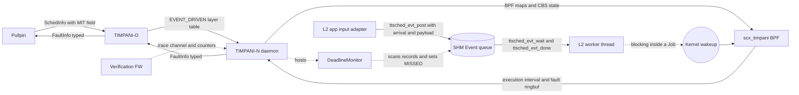

<!--
SPDX-FileCopyrightText: Copyright 2026 LG Electronics Inc.
SPDX-License-Identifier: MIT
-->

# SRS-008: Event-Driven Workload Support 소프트웨어 요구사항 명세 (SRS)

**날짜:** 2026-11-11 (최초 작성 2026-11-09, Last Updated: 2026-11-18)
**상태:** Draft (v4.2 — P1 Event-Job 계약 보강 반영, Issue #53)
**작성:** Human + AI
**상위 문서:** [REQ-008](REQ-008-event-driven-workload-support.md), [SRS-000](SRS-000-timpani-system.md)
**관련 문서:** [P1 계약 보강 합의](P1-008-event-job-contract-amendment.md), [DDR-001](DDR-001-workload-model.md), [DDR-003](DDR-003-interface-protocol.md), [DDR-004](DDR-004-resource-allocation.md), [DDR-005](DDR-005-sched-ext-bpf-scheduler.md), [DDR-006](DDR-006-communication-architecture.md), [DDR-007](DDR-007-tt-cbs-integrated-scheduling.md), [DDR-011](DDR-011-runtime-table-update.md), [DDR-012](DDR-012-fault-management.md)
**하위 문서:** DDR-008 (설계 결정), HLD-008, LLD-008

> 본 문서는 [REQ-008](REQ-008-event-driven-workload-support.md)의 상위 요구사항을 **소프트웨어 컴포넌트에 할당 가능하고 검증 가능한 수준**으로 구체화한다. SRS-000 §1의 규약대로 기능별 SRS(`SRS-008`)는 특정 결정 기록(`DDR-008`)의 요구사항을 구체화한다.
> 설계 선택(알고리즘, 자료구조, 스레드 모델)은 본 문서에서 **결정하지 않으며** DDR-008이 결정한다. 다만 검증 가능성을 위해 "관측 가능한 동작"은 구체적으로 기술한다. 메모리 순서, 링 규칙, 바이트 레이아웃은 LLD-008의 범위다.
> REQ-008의 두 원칙(**전송 계층 중립**, **Phase 1/2 분할**)을 계승한다. 각 요구사항에 Phase를 표시하며, `P1*`는 Phase 1에서 단순화된 형태로 충족하고 Phase 2에서 강화됨을 뜻한다.
>
> **키워드 규약**: **SHALL** = 필수, **SHOULD** = 권장, **MAY** = 선택.
> **검증 방법 약어**: A = 분석(Analysis), T = 테스트(Test, 단위/통합), M = 측정(Measurement, 타이밍 벤치), D = 시연(Demonstration, PoC).
> **제안 표기**: 공개 API, SHM 레이아웃, protobuf 필드, 수치 상한을 도입하는 항목은 "(제안, 승인 필요)"로 표시한다. 합의·측정되지 않은 수치는 "(후보)"로 표시한다. 본 문서의 어떤 항목도 구현 또는 Linux 타깃 검증이 끝났음을 뜻하지 않는다.

---

## 요약 (Korean Summary)

- 목적: L2(Sporadic + SafetyCritical) Event-Driven 워크로드에 대해 TIMPANI가 **수락한 Event 한 건마다 독립 Job 한 건**을 만들고, Event 도달 시각 기준 절대 마감을 감시·보고하기 위한 소프트웨어 요구사항을 컴포넌트(proto, TIMPANI-O, TIMPANI-N 사용자 공간, BPF 스케줄러, 애플리케이션 라이브러리, 검증 프레임워크)별로 정의한다.
- 구조: REQ-008 §2의 **공통 Event/Job 모델**을 기준으로 (①) 모델, (②) 명시적 Event 연결(libttsched Event 큐)과 커널 실행 관측(BPF), (③) 집행과 판정(CBS·CPU 고정, DeadlineMonitor, 수용 판정)으로 나누어 컴포넌트에 할당한다(FR-G-002). 만들어진 Event와 Job은 명시적 Event 연결에서만 나온다. 커널 실행 관측은 실행 구간과 예산을 관측할 뿐 Event를 만들지 않는다.
- 핵심(P1): (1) 어댑터·워커의 게시(post)·Event 대기(wait)·종료(done) 호출로 Event 게시, wait 내부의 Job 시작, Job 종료를 명시하고, 식별자 `(gen, seq)`, 생명주기 상태, 마감 결과(MISSED)를 서로 분리한다(FR-L-009~012). (2) 절대 마감은 도달 시각 + D로 수락 시 고정된다. TIMPANI-N의 DeadlineMonitor가 완료를 기다리지 않고, 큐 대기·실행·선점·스로틀 중에도 마감 경과를 감지하며 Job당 한 번 판정한다(FR-N-027, FR-N-028). (3) BPF는 CBS 예산 집행, CPU 고정, TT 보호, 실행 구간 관측만 담당하며 L2 마감과 MIT를 판정하지 않는다(FR-B-024). (4) 수용 판정은 한 식을 모든 L2 태스크에 적용하며, 식의 가정을 명시한다(FR-O-013). (5) CBS 예산 관리와 Event/Job 관리는 같은 L2 워커의 상호 보완적 책임이다. 명시적 Event 연결 없이도 CBS 예산 관리·CPU 고정·실행 구간 관측은 유지되지만 Event/Job 관리의 정보는 얻지 못한다(FR-G-003). (6) 감지·보고·전달 지연(TMG-014~016)은 후보값이며 측정으로 확정하고, 필수 통계는 트레이싱과 무관하게 유지한다(FR-N-030).
- 승인 대상: 공개 API(libttsched Event 연결 API), SHM 레이아웃, proto 필드 추가(FaultInfo 카운트·표식·세대), 빌드 상수(큐 깊이, 페이로드 상한)는 프로젝트 리더 승인이 필요한 제안이다.
- P2로 미룬 것: 다중 생산자 게시와 큰 페이로드, SHM의 소스별 격리와 데몬 하트비트, 감시의 이벤트 구동 깨움, 감시 스레드와 Replenisher의 병합, EDF 순서, 태스크 단위 시간 클래스, 거부 사유 코드, NodeStatus 통계, watchdog·깨움 지연 폴트, HRTICK.
- 상태: Draft v4.2(P1 계약 보강 반영, 하위 체인 정합 반영). 설계 단계이며 구현이나 검증이 끝났다는 뜻이 아니다. 수치는 후보값이다.

---

## 1. 서론 (Introduction)

### 1.1 목적
REQ-008의 각 요구사항을 구현·테스트 담당자가 직접 사용할 수 있는 소프트웨어 요구사항으로 분해하고, 각 요구사항에 **담당 컴포넌트, 검증 방법, 상위 추적성, Phase**를 부여한다.

### 1.2 범위
- 포함: TIMPANI-O(수용 판정·테이블 생성·발행), TIMPANI-N 사용자 공간 데몬(Event source 수명 관리, 마감 감시, 폴트 집계), `scx_timpani` BPF 스케줄러(실행 구간 관측, CBS 집행), 애플리케이션 라이브러리(`libttsched` 확장 — 명시적 Event 연결 API), Pullpiri↔O / O↔N 프로토콜, 검증 프레임워크가 요구하는 관측점.
- 제외: REQ-008 §7의 범위 외 항목(Aperiodic, D > MIT, 노드 간 체인, 미들웨어 고유 의미론, watchdog, QNX 포팅, Pullpiri YAML), 다중 생산자 게시, 페이로드 상한을 넘는 데이터의 해제 규약(P2).
- 범위 밖(예산 집행 대상 아님): IRQ/ISR, 미들웨어 내부 스레드, 네트워크 전체 경로. TIMPANI는 이들의 예산을 자동으로 잡지 않는다(A21). 완료 시각 $t_{end}$는 선언한 처리와 결과 게시의 완료이며 네트워크 전달이나 장치 반영 완료를 뜻하지 않는다(FR-L-011(c)).

### 1.3 용어 정의 (본 문서에서의 정확한 의미)

공통 용어의 정본은 [REQ-008 §2](REQ-008-event-driven-workload-support.md#2-개념-모델-공통-eventjob-모델-common-eventjob-model)다. **CBS 예산 관리**와 **Event/Job 관리**는 같은 L2 워커의 상호 보완적 책임이며 앱의 클래스·모드가 아니다. 아래 표는 그 정의를 컴포넌트에 대응시킨다. DDR-001의 L2 분류와 선택적 Event 연결의 호환성은 유지한다.

| 용어 | 정의 |
|:--|:--|
| **L2 태스크** | `Sporadic + SafetyCritical` 워크로드에 속한 커널 스케줄링 단위(스레드). CBS 서버 1개에 1:1 대응 |
| **CBS 서버** | 예산 $C_s$, 보충 주기 $T_s$, 잔여 예산, 보충 시각, 상대 마감 $D$를 갖는 대역폭 서버 |
| **Event source** | L2 태스크에 Event를 전달하는 선언된 발생원. P1: 태스크당 1개, 식별자는 소비 태스크의 `task_id`(워커 스레드 이름, 1~15바이트). Event 큐와 MIT 설정을 가진다 |
| **입력 어댑터** | 앱 안에서 외부 도달(네트워크 수신, 센서 인터럽트 등)을 받아 Event source에 Event를 게시하는 앱 코드. 도달 시각을 공급할 수 있다 |
| **Event** | 입력 어댑터가 게시하여 **수락된** 도달 1건. 식별자 `(gen, seq)`, 도달 시각 $t_{arr}$, 절대 마감 $t_{dl} = t_{arr} + D$, 불투명 페이로드를 가진다. 거절된 게시는 Event가 아니다 |
| **seq** | Event source 안의 순번(u32, 래핑). 게시가 발행될 때 부여된다 |
| **등록 세대 (gen)** | Event source가 다시 활성화될 때마다 바뀌는 값(u64). 워커 재바인딩, 워크로드 재추가, 데몬 재시작에서 바뀐다 |
| **게시 (post)** | 입력 어댑터가 Event 한 건을 Event source에 넣는 호출. 수락 또는 거절을 반환한다 |
| **Job** | Event 한 건을 처리하는 단위. 워커가 Event를 취하는 시점(`t_begin`)에 시작하고, 워커의 명시적 종료 호출(`done`)이나 TIMPANI의 닫기 결정으로 끝난다. 여러 Event를 합치지 않는다 |
| **Event 생명주기 상태** | `QUEUED`(Job 시작 전 대기), `RUNNING`(Job 시작 확정 후 종료 전), `COMPLETED`(완료), `DISCARDED`(워커의 정책적 폐기), `CANCELLED`(Job 시작 전 TIMPANI가 닫음), `ABANDONED`(실행 중 TIMPANI가 닫음), `REVOKED`(게시 도중 되돌린 내부 상태이며 Event가 아님). SHM Event 레코드의 논리적 생명주기이며 BPF DSQ 소속·현재 CPU 실행 여부가 아니다. 워커가 CPU에서 이전 Job을 처리할 때도 다음 Event는 QUEUED일 수 있고, RUNNING은 선점·스로틀·블로킹 중에도 종료 전까지 유지된다 |
| **Job 시작 상태 전이 / 처리 시작 확정** | wait 내부의 `QUEUED → RUNNING` 전이. CAS(compare-and-swap)는 읽은 상태 워드와 현재 값이 같을 때만 새 값으로 바꾸는 원자적 조건부 갱신이다. Event 데이터 복사나 추가 큐·공개 API·스케줄러 연산이 아니다(REQ-008 §2, LLD-008 §6.2) |
| **마감 실패 (MISSED)** | Job이 $t_{dl}$ 이후에도 열려 있거나 $t_{dl}$ 이후에 종료된 상태. Job당 최대 1회 설정되며 지워지지 않는다. 생명주기 상태와 별도의 결과다 |
| **DeadlineMonitor** | TIMPANI-N 안의 전용 스레드. 열린 Event의 절대 마감 경과를 주기적으로 감지한다(FR-N-027) |
| **실행 구간** | 커널 관점의 실행 단위. 태스크가 자발적 수면에서 깨어나 실행 가능해진 시점(활성화, $t_{act}$)부터 다음 자발적 수면까지. 선점이나 슬라이스 만료 뒤의 재개는 같은 구간이다. BPF가 관측하며 Job 경계가 아니다 |
| **활성화 (Activation)** | 태스크가 자발적 수면에서 깨어나 실행 가능해지는 사건(`WAITING → ACTIVE`). BPF가 $t_{act}$를 기록한다 |
| **도달 (Arrival)** | 입력 어댑터가 Event source에 게시 요청을 보낸 사건. 도달 시각 $t_{arr}$을 가진다. MIT 계수 단계에 도달한 게시는 수락·거절(가득 참)·되돌림과 무관하게 도달로 센다(FR-L-009) |
| **절대 마감** | $t_{dl} = t_{arr} + D$. 수락 시 한 번 정해지며 활성화·보충·재개로 바뀌지 않는다 |
| **깨움 지연** | $L_{wake} = t_{start} - t_{act}$ ($t_{start}$ = 실행 구간의 최초 실행 개시) |
| **전달 지연** | $L_{del} = L_{post} + L_{wake}$. $L_{post}$는 Event에 기록된 도달 시각 $t_{arr}$부터 워커가 실행 가능해질 때까지다 |
| **응답 시간** | $R = t_{end} - t_{arr}$ (Job 기준). 마감 충족은 COMPLETED이고 $t_{end} \le t_{dl}$인 경우다 |
| **Gap** | 배정 CPU에서 L1 TT 슬롯이 활성이 아닌 시간 구간 |
| **$B_{tt}(k)$** | CPU $k$에서 길이 $L$인 임의 윈도우 내 TT 점유 시간의 최댓값 $B_{tt}(k, L)$(병합 슬롯 기준, hyperperiod 경계 wrap 포함). P1 수용식은 $L = D_i$를 사용한다. 윈도우가 여러 TT 블록을 덮으면 그 합이다 |
| **MIT 위반** | 같은 Event source의 연속 **도달** 간격이 `min_inter_arrival_us` 미만인 사건. 도달 기준으로만 계수하며 활성화 간격으로 근사하지 않는다 |
| **보충 윈도우** | 서버 예산 $C_s$가 유효한 길이 $T_s$의 구간. 실행 구간 활성화 시(직전 윈도우가 끝난 경우) 또는 스로틀 후 승격 시에 시작한다. 격자에 정렬되지 않는다. Job의 시작만으로는 시작하지 않는다 |
| **예산 소진** | 차감 뒤 잔여 예산이 0인 상태. 그 자체로는 스로틀이 아니다(FR-B-013) |
| **Throttle 에피소드** | 잔여 예산이 0인 실행 가능 태스크의 추가 실행을 BPF가 차단한 시점부터 예산 보충으로 그 제한을 해제할 때까지의 구간. 해당 태스크가 잠든 상태의 예산 소진만으로는 시작하지 않는다 |
| **정격 부하** | 수용된 모든 L1/L2 워크로드가 활성이고 L2 Event가 MIT 간격으로 도달하는 조건 |
| **명시적 Event 연결** | 입력 어댑터가 Event를 게시하고 워커가 `wait`·`done`으로 Job 경계를 알리는 경로. Event별 도달 기준 마감을 제공하는 유일한 경로다 |
| **커널 실행 관측** | BPF가 L2 태스크의 실행 구간과 CPU 예산을 관측하는 경로. 모든 L2 태스크에 적용되며 Event를 만들지 않는다 |
| **CBS 예산 관리 / Event/Job 관리** | REQ-008 §2의 책임 구분을 따른다. 명시적 Event 연결이 없어도 CBS 예산 관리·CPU 고정·실행 구간 관측은 유지되며, Event 기록 없이는 Event/Job 관리의 감시 객체가 없다(FR-G-003) |
| **필수 통계** | 트레이싱 설정과 무관하게 항상 유지되는 누적 카운터(FR-N-030) |

### 1.4 참조
REQ-008, SRS-000, DDR-001~007/011/012, P1 계약 보강 합의(`P1-008-event-job-contract-amendment.md`, Issue #53), `timpani26` 소스(9209bc5 이후 기준), Linux sched_ext 문서(`Documentation/scheduler/sched-ext.rst`).

### 1.5 Phase 매핑 요약

| Phase | 포함 SRS-008 ID |
|:--|:--|
| **P1** | FR-G-001~003; FR-O-001, 003, 004(P1: 사유 로그), 005, 010, 011, 012(P1 범위), 013(P1 단일식), 014, 015, 016, 020; FR-N-002~007, 010~015, 020~022, 024, 026, 027~031; FR-B-001~005, 010~017, 022, 023, 024; FR-L-001~012; TMG-001~004, 006~016(측정 시작; TMG-005는 철회); IF-PO-001, 004, 005, 006; IF-ON-001~004, 006; IF-L-001~004; IF-V-001~004; NFR-001, 002, 003, 005, 006, 007; FR-O-022; FR-N-032, FR-N-033; FR-B-025 |
| **P2** | FR-O-002, 004(응답 사유 필드), 017, 018, 021; FR-N-001(증분 적용), 023, 025; FR-B-016(EDF), 022(예약 유형 활성화); IF-PO-002, 003; IF-ON-005; NFR-004. 철회 항목(FR-B-006, FR-B-020, FR-B-021, TMG-005)은 P1·P2 요구가 아니다. TT 슬롯 종료 강제와 마감 실패 원인 분석·원인별 복구는 P2이며 SRS ID는 P2 개정에서 정한다(DDR-008 D-23, DDR-007 §4.3.1). |

> 주: FR-N-001(증분 적용)과 FR-N-023(NodeStatus 보고)은 P2 항목이다.

---

## 2. 시스템 컨텍스트 및 컴포넌트 할당

### 2.1 컨텍스트



### 2.2 할당 매트릭스

| 컴포넌트 | 약어 | 책임 (본 기능 관점) |
|:--|:--|:--|
| 공통 | **G** | 전송 계층 중립 원칙, 공통 Event/Job 모델과 3층 분리, CBS 예산 관리와 Event/Job 관리의 책임 구분 |
| Pullpiri↔O 프로토콜 (`schedinfo.proto`) | **IF-PO** | MIT 전용 필드, 폴트 유형 확장 (P2: 태스크 단위 시간 클래스, 거부 사유 코드) |
| O↔N 프로토콜 (`node_control.proto`) | **IF-ON** | EVENT_DRIVEN 레이어, CBS 엔트리 확장(MIT, CPU), 폴트 정보 확장(카운트, 표식, 세대) (P2: 통계 보고) |
| TIMPANI-O | **O** | 파라미터 검증, 배치, 수용 판정(단일 식), 테이블 생성·발행, 폴트 전달 |
| TIMPANI-N 사용자 공간 | **N** | 테이블 적용, 태스크 식별·바인딩, Event source 활성화·닫기·세대 관리, 백업 보충, 마감 감시(DeadlineMonitor), 폴트 집계·보고, 필수 통계·트레이스 노출 |
| BPF 스케줄러 (`scx_timpani`) | **BPF** | 커널 실행 관측(실행 구간 상태 머신), CBS 예산 집행, CPU 고정, 서버 순서, BUDGET_EXCEED 발생 |
| 애플리케이션 라이브러리 (`libttsched`) | **LIB** | 명시적 Event 연결: Event 큐 API(open, post, wait, done), 워커 측 Job 경계, 도달 기준 MIT 계수 |
| 검증 프레임워크 | **VF** | 트레이스 수집, 히스토그램, 합부 판정(본 문서는 요구 관측점만 정의) |

---

## 3. 기능 요구사항 (Functional Requirements)

> ID 형식: `SRS-008-FR-<컴포넌트>-NNN`. 각 항목: 명세 / 상위 REQ / 검증 / Phase.
> 철회된 항목은 ID를 유지하고 "철회"와 대체 항목을 적는다. ID는 재사용하지 않는다.

### 3.0 공통 (G)

| ID | 요구사항 | 상위 | 검증 | Phase |
|:--|:--|:--|:-:|:-:|
| **SRS-008-FR-G-001** | TIMPANI-O, TIMPANI-N, BPF, `libttsched`의 소스·proto·공개 헤더는 특정 미들웨어/전송 계층의 식별자·타입·헤더(예: SOME/IP service/instance/event ID, vsomeip, DDS 토픽)를 참조하지 않아야 한다(SHALL). Event는 소비 태스크의 Event source 안에서 `(gen, seq)`로 식별하며, P1에서 Event source의 식별자는 소비 태스크의 `(workload_id, task_id)`이다. | MOD-006 | A(코드 리뷰, grep) | P1 |
| **SRS-008-FR-G-002** | 구현은 REQ-008 §2.1의 3층을 분리해야 한다(SHALL). (①) **모델**: Event와 Job의 식별, 생명주기 상태, 결과, 규칙 R1~R4, 절대 마감의 정의(MOD-009, MOD-010, PRT-008)는 OS·스케줄러·라이브러리 수단과 무관하게 정의한다. (②) **연결과 관측**: 명시적 Event 연결(libttsched Event 큐와 워커가 Event 대기(wait) 호출 내부에서 알리는 Job 시작 경계 및 종료(done) 경계)만이 Event와 Job을 만들며, 커널 실행 관측(BPF)은 실행 구간과 예산을 관측하고 Event를 만들지 않는다. (③) **집행과 판정**: CBS 예산·CPU 고정·TT 보호(BPF), 마감 감시와 MISSED 설정(TIMPANI-N DeadlineMonitor), 수용 판정(TIMPANI-O)만 집행 결과를 낸다. 연결 수단을 추가(P2)해도 ①과 ③의 인터페이스가 바뀌지 않아야 한다(SHALL). | MOD-008, MOD-009, MOD-010 | A | P1 |
| **SRS-008-FR-G-003** | 같은 L2 워커의 **CBS 예산 관리**와 **Event/Job 관리**를 상호 보완적 책임으로 구분하고 명시적 Event 연결 여부로 앱을 재분류하지 않아야 한다(SHALL). 연결이 없어도 CBS 예산 관리, CPU 고정, BUDGET_EXCEED 보고, 실행 구간 기록은 유지된다. 연결 없이는 Event 식별·도달 시각·Job 기록·Event 기준 마감 감시(MISSED)·MIT 위반 계수를 얻지 못한다. P1은 이 구분을 위한 추가 분류·구성 플래그를 두지 않는다. source에 Event 기록이 없으면 DeadlineMonitor가 판정할 객체가 없는 것이며, 일시적인 게시 침묵이 앱을 재분류하지 않는다. 모든 L2에 같은 수용식(FR-O-013)을 쓴다. Event 기록이 없을 때 선언 D는 커널 활성화 기준 수용 판정 파라미터이지 감시되는 Job 마감이 아니다. BPF 실행 구간에서 Event나 Job 마감을 추정하거나 Event별 도달 기준 마감 지원과 동등하다고 기술하지 않아야 한다(SHALL). | MOD-011, DET-003 | A, T | P1 |

### 3.1 워크로드 모델 및 검증 (O)

| ID | 요구사항 | 상위 | 검증 | Phase |
|:--|:--|:--|:-:|:-:|
| **SRS-008-FR-O-001** | TIMPANI-O는 L2 태스크 명세에서 `min_inter_arrival_us`(MIT), `wcet_us`, `deadline_us`, `max_dmiss`를 읽어야 하며(SHALL), MIT 전용 필드가 0이고 `period`가 설정된 Sporadic 입력은 **전환 기간 동안** `period`를 MIT로 해석하되 경고를 기록해야 한다(SHOULD). | MOD-001, IF-001 | T | P1 |
| **SRS-008-FR-O-002** | TIMPANI-O는 태스크 단위 시간 클래스를 지원해야 한다(SHALL). 태스크 클래스가 미지정(0)이면 워크로드 클래스를 상속한다. 한 워크로드 내에 Periodic(TT)과 Sporadic(CBS) 태스크가 공존할 수 있어야 한다. | IF-002 | T | P2 |
| **SRS-008-FR-O-003** | TIMPANI-O는 L2 태스크에 대해 `0 < wcet_us ≤ deadline_us ≤ min_inter_arrival_us`, `min_inter_arrival_us > 0`, `max_dmiss ≥ 0`, 그리고 `task_id` 길이 ≤ 15바이트(Linux comm 제한)와 같은 노드 안에서의 `task_id` 유일성을 검증하고 위반 시 워크로드 전체를 거부해야 한다(SHALL). `deadline_us = 0`은 `min_inter_arrival_us`로 기본 설정한다. | MOD-004/005, A-03 | T | P1 |
| **SRS-008-FR-O-004** | TIMPANI-O는 수용 판정에서 거부 시 구조화된 사유 코드(최소: `PARAM_INVALID`, `UTIL_EXCEEDED`, `DEADLINE_INFEASIBLE`, `NO_CPU`, `NODE_UNKNOWN`, `NON_HARMONIC`)와 메시지를 응답에 포함해야 한다(SHOULD, P2 — REQ-008 IF-006). P1에서는 동일 사유를 로그에 기록해야 한다(SHALL). 구현 내부 사유와의 대응은 LLD-008의 표를 따른다. | IF-006 | T | P2 (로그는 P1) |
| **SRS-008-FR-O-005** | 수용 판정에서 거부 시 TIMPANI-O는 **거부 이전의 유효한 워크로드 집합과 테이블을 보존**해야 하며(SHALL), 동일 `workload_id`의 갱신이 거부되면 이전 버전을 복원해야 한다. | RTU-001, AC-08 | T | P1 |

### 3.2 배치 및 수용 판정 (O)

| ID | 요구사항 | 상위 | 검증 | Phase |
|:--|:--|:--|:-:|:-:|
| **SRS-008-FR-O-010** | TIMPANI-O는 L2 태스크별 CBS 파라미터를 $C_s = \text{wcet\_us}$, $T_s$ = 선언된 CBS 주기 `period`(주기가 없으면 `min_inter_arrival_us`를 쓴다), $D = \text{deadline\_us}$로 산출해야 한다(SHALL). $C_s$는 Job당 CPU 요구의 상한으로 선언한다(FR-O-013 가정 (6)). 식 (3) $T_s \le MIT$는 FR-O-013이 검사한다(A15). | CBS-001 | T | P1 |
| **SRS-008-FR-O-011** | TIMPANI-O는 CPU $k$별로 $U_{tt}(k) + \sum_j C_{s,j}/T_{s,j} + U_{overhead} \le U_{bound}$ 를 검증해야 한다(SHALL). $U_{bound}$, $U_{overhead}$는 DDR-004/007 값(0.80, 0.02)을 설정 가능 상수로 사용한다. TT 이용률 $U_{tt}(k) \le U_{bound}$ 도 함께 검증해야 한다(SHALL, 현행 미검사 보완). | CBS-001 | T | P1 |
| **SRS-008-FR-O-012** | TIMPANI-O는 CPU $k$의 TT 테이블로부터 길이 $L$ 윈도우 내 최대 TT 점유 $B_{tt}(k, L)$(병합 슬롯 기준, hyperperiod 경계 wrap 포함)를 계산할 수 있어야 한다(SHALL, P1; 수용식에서 $L = D_i$를 쓴다). P2에서는 Gap 공급 함수 $sbf_k(L)$ 기반 정밀식으로 확장한다(SHALL). | CBS-004, ORD-001 | T | P1* |
| **SRS-008-FR-O-013** | TIMPANI-O는 CPU $k$에 배치된 **모든** L2 태스크 $i$(새로 추가되는 태스크와 기존 태스크)에 대해 다음 단일 식을 검증하고, 하나라도 불충족이면 `DEADLINE_INFEASIBLE`로 거부해야 한다(SHALL). 이 수용식은 명시적 Event 연결 여부와 무관하게 적용한다(SHALL). 식은 다음 세 조건이다. $C_{s,i} + B_{tt}(k, D_i) + L_{del}^{max} + \sum_{j \ne i} (C_{s,j} + \delta_{ovr}) \le D_i$ (식 1), $D_i \le MIT_i$ (식 2), $T_{s,i} \le MIT_i$ (식 3). 여기서 $MIT_i$는 `min_inter_arrival_us`이고 그 값이 없으면 주기(D-11 규칙)이다. $L_{del}^{max}$는 전달 지연 상한(TMG-016의 $L_{post}$ 후보 + TMG-001의 $L_{wake}$ 목표(유휴이고 TT가 없는 배정 CPU), 합 후보 100 µs. TMG-002는 포함하지 않으며 TT 점유는 $B_{tt}$ 항이다)이고, $\delta_{ovr}$는 다른 서버가 스로틀되기 전까지 예산을 넘겨 실행할 수 있는 양의 상한(TMG-004, P1: 1 스케줄러 틱, 후보)이다. 식의 가정은 아래 목록을 따르며, 이 식은 가정이 성립할 때의 **충분 조건**이다. $C_{s,i}$는 Job당 CPU 요구 상한(앱 선언, HLD-008 §8)이다. **P2 조건**: EDF 순서 전제의 윈도우 수요·공급 함수식(DDR-008 후속). | CBS-004, MOD-011 | T, A | P1* |
| **SRS-008-FR-O-014** | TIMPANI-O의 L2 CPU 배치는 FR-O-011과 FR-O-013을 모두 만족하는 CPU만 후보로 삼아야 하며(SHALL), 최소 Gap 길이가 `CBS_MIN_EXEC_US` 미만인 CPU는 후보에서 제외해야 한다(SHALL, 현행 경고→거부). 배치 시 CPU당 L2 태스크 수는 FR-B-015의 승격 스캔 상한(16) 이하여야 한다(SHALL). 후보 중 선택 규칙(worst-fit 등)은 DDR-008에서 결정한다. | ORD-001, ORD-002 | T | P1 |
| **SRS-008-FR-O-015** | TIMPANI-O는 TT 슬롯 반복 주기와 테이블 `hyperperiod_us`의 불일치(CPU별 LCM vs 전역 LCM)를 제거해야 하며(SHALL), L2 전용 노드의 `hyperperiod_us`는 0이 아닌 정의된 값이어야 한다(SHALL). 이 값은 테이블 형식 값이며 CBS 실행은 이를 쓰지 않는다(DDR-008 D-22). 표현 변경(0 허용 등)은 REQ-008 OI-25의 결정에 따른다. | §10-16 (선행 버그) | T | P1 |
| **SRS-008-FR-O-016** | TIMPANI-O는 L2 엔트리를 `LayerConfig.model = EVENT_DRIVEN`인 별도 레이어로 발행해야 하며(SHALL), 각 엔트리에 $C_s$, $T_s$, MIT, $D$, `current_limit`, 배정 CPU를 포함해야 한다. | IF-003 | T | P1 |
| **SRS-008-FR-O-017** | L2 워크로드만 변경된 테이블 발행에서 TIMPANI-O는 `epoch_ns`를 갱신하지 않아야 한다(SHALL). TT 슬롯 집합이 변경된 경우에만 epoch 갱신이 허용된다. | RTU-002/003 | T | P2 |
| **SRS-008-FR-O-018** | TIMPANI-O는 L2 워크로드 추가·제거 시 영향을 받는 노드에만 테이블을 발행해야 한다(SHOULD). | RTU-002 | T | P2 |
| **SRS-008-FR-O-022** | TIMPANI-O는 TT 슬롯이 없는 CPU(TT 태스크가 하나도 없는 노드 포함)에도 L2 태스크를 배치·수용하고 테이블을 발행해야 한다(SHALL). 이 CPU에서는 $B_{tt}(k, D) = 0$이고 Gap은 전체 구간이다. L2 수 제한, 이용률 검사, FR-O-013은 그대로 적용한다. | CBS-007, CBS-004 | T | P1 |

**FR-O-013 수용 판정 가정 목록** (식의 결과는 다음 가정이 모두 성립할 때만 보장된다. 가정 위반은 거부가 아니라 보장 밖이다)

1. TT 태스크는 선언된 실행 시간 안에서 실행한다. TT 초과 실행은 TT 마감 실패이며 L2 보장 밖이다.
2. $\delta_{ovr}$와 $L_{del}^{max}$는 측정으로 확인된 값을 쓴다(TMG-004, TMG-016). 측정 전에는 후보값이다. $L_{post}$ 상한은 기준 생산자 구성(도달 시각 기록부터 게시 호출 반환까지 생산자 스레드가 다른 스레드에 선점되지 않는 구성)에서 성립한다(TMG-016, A-10).
3. 소스의 도달은 MIT를 지킨다.
4. Job은 블로킹하지 않는다. 블로킹하는 소스는 마감을 감시하지만 수용 판정으로 보장되지 않는다(§7 개정 가정).
5. 어댑터는 도달 시점에 게시한다. 공급된 과거 $t_{arr}$은 $D$의 일부를 소비하며 수용식이 덮지 않는다.
6. 활성화부터 워커가 실제로 다시 잠들 때까지의 차감 실행 시간(대기 진입 비용 포함)은 선언된 $C_s$ 이하이다. 실행 시간 산포에 대비한 예산 여유를 권고한다.
7. 각 Job은 다음 도달 전에 끝나 워커가 수면에 들어간다(FR-B-017의 경계 조건 참조).
8. `tol`(CBS_ACT_TOL_US)은 측정된 활성화 지터를 덮는다(FR-B-014).

- 명시적 Event 연결 여부와 무관하게 모든 L2에 같은 수용식을 쓴다. Event 기록이 없을 때 $D$는 커널 활성화 기준 수용 판정 파라미터이지 감시되는 Job 마감이 아니며, $L_{post}$ 부분은 추가 여유로만 작용한다.
- 식의 결과로 같은 CPU의 L2 태스크가 많을수록 수용률이 떨어진다. 이는 위험으로 기록하며 P2의 HRTICK 및 다중 L2 수용 개선에서 다룬다.
- 기존 태스크도 매 수용 판정에서 재검사한다(FR-O-013 "모든 L2 태스크 $i$").

### 3.3 폴트 전달 (O)

| ID | 요구사항 | 상위 | 검증 | Phase |
|:--|:--|:--|:-:|:-:|
| **SRS-008-FR-O-020** | TIMPANI-O는 TIMPANI-N으로부터 수신한 폴트 유형(`DMISS`, `BUDGET_EXCEED`, `MIT_VIOLATION`; 예약 유형 `WATCHDOG`은 P2에 활성화)을 **동일 의미의 유형**으로 Pullpiri에 전달해야 하며(SHALL), `UNKNOWN`으로 축약하지 않아야 한다. L2 `DMISS`는 TIMPANI-N의 마감 감시 결과(FR-N-031)에서 온다. | PRT-005, IF-004 | T | P1 |
| **SRS-008-FR-O-021** | TIMPANI-O는 폴트 전달 실패 시 재시도 큐에 적재하되, 폴트 전달이 노드 스트림 수신 처리를 블로킹하지 않도록 해야 한다(SHOULD). | TIM-005, OI-7 | T | P2 |

### 3.4 테이블 적용 및 태스크 식별 (N)

| ID | 요구사항 | 상위 | 검증 | Phase |
|:--|:--|:--|:-:|:-:|
| **SRS-008-FR-N-001** | TIMPANI-N은 수신 테이블을 현재 적용 테이블과 비교하여 **변경된 엔트리만** 적용해야 한다(SHALL). (TT 테이블이 동일할 때 Timer Master 재시작을 생략하는 P1* SHOULD는 FR-N-006.) | RTU-002, RTU-003 | T, M | P2 |
| **SRS-008-FR-N-002** | TIMPANI-N은 EVENT_DRIVEN 레이어의 각 엔트리에 대해 CBS 상태(예산 $C_s$, 주기 $T_s$, MIT, $D$, 잔여 = $C_s$, 보충 시각)를 BPF에 등록하고, 해당 태스크를 `SCHED_EXT`로 전환하며, 엔트리에 명시된 배정 CPU를 기록해야 한다(SHALL). 활성화에 따른 Event source 설정은 FR-N-029(a)를 따른다. | CBS-001/005 | T | P1 |
| **SRS-008-FR-N-003** | TIMPANI-N은 테이블 적용 시 식별되지 않은 L2 태스크 이름을 **미해결 목록**에 보관하고, `T_bind`(REQ-008 TIM-006) 이내 주기로 재식별을 시도하여 발견 즉시 **바인딩 세대 `bind_gen`을 1 증가**시켜 TaskMeta에 기록한 뒤 FR-N-002와 FR-N-029(a)를 수행해야 한다(SHALL). 재식별은 프로세스 및 스레드(`/proc/<pid>/task/<tid>/comm`) 모두를 대상으로 한다. | DET-006 | T, M | P1 |
| **SRS-008-FR-N-004** | TIMPANI-N은 식별된 L2 태스크의 종료(TID 소멸)를 감지하여 BPF 상태를 정리하고 해당 이름을 미해결 목록으로 되돌려야 한다(SHALL). 태스크 종료 기록은 `bind_gen`을 실어야 하며, 현재 바인딩과 다른 `bind_gen`의 기록은 상태를 바꾸지 않고 무시해야 한다(SHALL). 정리 시 해당 Event source는 FR-N-029(b)의 닫기 규칙으로 닫힌다. | DET-006, RTU-004 | T | P1 |
| **SRS-008-FR-N-005** | 워크로드 제거(STOP 또는 테이블에서 소멸) 시 TIMPANI-N은 해당 L2 태스크의 CBS 상태·태스크 메타·통계·미해결 항목을 모두 제거하고 스케줄링 클래스를 `SCHED_OTHER`로 원복해야 한다(SHALL). 테이블을 다시 적용할 때 변하지 않은 L2 엔트리의 BPF 상태(실행 구간 상태, 예산, 카운터)는 건드리지 않아야 하고(SHALL), 파라미터가 바뀐 엔트리는 제거 후 재등록으로 처리한다(P1). 이때 진행 중인 Event는 FR-N-029(b)에 따라 CANCELLED 또는 ABANDONED로 닫힌다. | RTU-001, RTU-004 | T | P1 |
| **SRS-008-FR-N-006** | 테이블 적용 과정은 gRPC 수신 스레드를 1 hyperperiod 이상 블로킹하지 않아야 하며(SHOULD), TT 슬롯 집합·오프셋·hyperperiod·epoch가 동일한 테이블(L2 엔트리만 변경)에서는 Timer Master 스레드를 재시작하지 않아야 한다(SHOULD, DDR-008 D-17(b)). | RTU-002, TIM-007 | M | P1* |
| **SRS-008-FR-N-025** | 테이블 적용 과정은 실행 중인 L1 TT 활성화를 누락시키지 않아야 한다(SHALL). FR-N-001의 증분 적용과 함께 구현한다. | RTU-002, TIM-007 | M | P2 |
| **SRS-008-FR-N-007** | TIMPANI-N은 L2 태스크의 식별 수단으로 P1에서는 comm 이름(15바이트 이하, 노드 내 유일 — FR-O-003)을 사용하되, 식별 로직을 교체 가능한 단일 모듈(TaskRegistry)에 격리해야 한다(SHALL). | A-03, REQ-008 NFR-004 | A | P1 |
| **SRS-008-FR-N-029** | TIMPANI-N은 Event source의 활성화, 닫기, 세대 관리를 다음과 같이 수행해야 한다(SHALL). **(a) 활성화**: 워커 스레드가 식별되어 SCHED_EXT로 바인딩된 시점에 수행한다(테이블 적용 시점이 아니다). 활성화는 남은 미종결 레코드를 닫고(RUNNING은 ABANDONED, 새 등록이 시작되므로), 설정(MIT, D)을 게시하고, 새 `gen`을 부여한 뒤 슬롯 종류를 Event 연결로 바꾸며, 카운터 기준값을 잡는다. **(b) 닫기**: 워크로드 제거, STOP, 워커 종료 감지, 데몬 종료 때 Event 연결 종류를 먼저 끄고, QUEUED는 CANCELLED로, RUNNING은 워커 종료가 확인된 경우에만 ABANDONED로 닫는다. 확인되지 않은 RUNNING은 워커가 끝낼 수 있으므로 마감 감시를 계속하며 종료될 때까지 남긴다. P1 허용 동작: 종류를 끈 뒤 닫기 sweep이 도달하기 전에 워커가 종류 검사를 통과해 QUEUED 항목을 취한 Job은 실행되고 감시되며 정상 기록된다(A12). 닫는 시점에 $t_{dl}$이 지났고 MISSED가 없으면 MISSED를 설정한다(FR-N-028). **(c) 데몬 시작 정리**: 이전 객체가 남아 있으면 데몬이 magic을 무효화하고 모든 슬롯 종류를 끈 뒤 모든 레코드를 닫고(RUNNING은 무조건 ABANDONED), 최종 카운터를 로그에 남기고, 객체를 제거하고, 새 인스턴스 식별자로 객체를 만든다. 게시는 슬롯 종류로만 막히므로(magic을 보지 않는다, A2) 종류를 끈 뒤의 게시는 E_INACTIVE가 되고, 그 전에 수락된 게시는 정리 과정에서 닫힌다. **(d) 세대 검사**: 모든 레코드, 감시 기록, 로그 항목은 `(gen, seq)`를 가진다. 감시 스레드는 현재 세대와 다른 레코드의 상태를 바꾸지 않는다(SHALL). 닫기 과정(활성화, 닫기, 데몬 시작 정리)은 닫으라고 지정된 미종결 레코드를 세대와 무관하게 닫는다(A9). 워커의 세대 불일치 취소는 FR-L-010(g)에서 정한다. 이전 세대의 상태 변경은 현재 등록의 FaultInfo를 만들지 않는다(FR-N-031(d)). **(e) 데몬 부재 동작(P1 한계)**: 데몬이 죽어 있는 동안 이전 객체는 Event 연결 종류를 유지하므로 게시는 수락되고 워커는 계속 처리한다. 워커의 `done`은 자신의 완료를 판정하지만, 큐에서 또는 실행 중에 만료된 Event를 감지하는 주체가 없다. 그런 Event는 다음 데몬 시작의 정리 과정에서 DETECTED_LATE 표식으로 기록되어 최종 통계에 나타나며, 실시간 폴트 보고가 아니다. P1에는 데몬 하트비트가 없다(후속 항목 F-14). | DET-006, IF-007, RTU-004, PRT-009 | T, M | P1 |
| **SRS-008-FR-N-033** | TIMPANI-N은 L2 태스크를 바인딩하기 전에(FR-N-002, FR-N-003) 배정 CPU가 워커 스레드의 허용 CPU 집합(`sched_getaffinity` 결과)에 있는지 확인해야 한다(SHALL). 없으면 SCHED_EXT 전환과 BPF 상태 등록을 하지 않고, 태스크 이름·배정 CPU·허용 집합을 담은 오류를 기록하며(같은 원인의 반복 기록은 제한한다), 태스크를 미해결 목록에 두어 FR-N-003의 재식별 주기에 다시 확인해야 한다(SHALL). L2 바인딩 경로는 스레드의 affinity나 cgroup을 바꾸지 않는다(SHALL). 이 검사는 배정 CPU가 Isolated CPU가 아닐 때의 테이블 적용 오류와 구분한다. TT 경로와 복구 경로의 기존 affinity 동작은 이 요구의 범위가 아니다. | CBS-008, CBS-005, A-09 | T | P1 |

### 3.5 마감 감시 및 폴트 집계 (N)

| ID | 요구사항 | 상위 | 검증 | Phase |
|:--|:--|:--|:-:|:-:|
| **SRS-008-FR-N-010** | TIMPANI-N은 스로틀된 L2 서버가 보충 윈도우의 끝(`replenish_at_ns`)에 도달했을 때, BPF 경로의 다른 활동과 무관하게 배정 CPU의 재스케줄을 유발하여 BPF가 그 서버를 승격하게 하는 **백업 보충 경로**를 제공해야 한다(SHALL). 백업 경로는 서버 상태(잔여 예산, 윈도우)를 직접 쓰지 않으며(SHALL), 상태 변경은 BPF가 배정 CPU의 런큐 잠금 아래에서만 수행한다. 불필요한 재스케줄 유발은 무해해야 한다(멱등). | PRT-003 | T, M | P1 |
| **SRS-008-FR-N-011** | 백업 보충 경로는 RT 임계 경로 규칙(gRPC·힙 할당·블로킹 I/O 금지)을 준수해야 하며(SHALL), 실행 우선순위는 Timer Master보다 낮아야 한다(SHALL, 후보 98 = TimerMaster 99 − 1; A1). | NFR-002 | A | P1 |
| **SRS-008-FR-N-027** | TIMPANI-N은 L2 Event의 절대 마감 감시를 **DeadlineMonitor**(전용 스레드)로 수행해야 한다(SHALL). **(a) 실행**: SCHED_FIFO 전용 스레드, 우선순위 후보 97(Timer Master 99보다 낮고 일반 RT 애플리케이션 스레드보다 높다. Replenisher는 98이다. 두 값은 PoC에서 확정한다, A1), 비격리 CPU에 배정한다. 힙 할당, 블로킹 I/O, gRPC를 쓰지 않는다. 시계는 CLOCK_MONOTONIC을 쓴다. 감시 스레드와 Replenisher의 병합은 열린 항목이다(F-12). **(b) 주기 스캔**: 주기 `DL_SCAN_PERIOD_US`(후보 1000 µs)마다 시계를 한 번 읽고, 모든 슬롯의 모든 항목(QDEPTH 전체)을 슬롯 종류와 무관하게 상태로 선택하여 훑는다. head와 tail은 쓰지 않는다. 닫힌 Event source의 RUNNING 레코드도 종료될 때까지 감시한다. **(c) 판정**: QUEUED 또는 RUNNING이고 MISSED가 없으며 $now > t_{dl}$인 레코드를 찾으면(읽기 규칙 R-c 적용) FR-N-028에 따라 MISSED를 CAS로 설정하고 `missed`를 1 증가시킨다. 레코드의 `gen`이 슬롯의 현재 `gen`과 다르면 상태를 바꾸지 않고 건너뛴다(A9). **(d) 미스 기록**: 설정에 성공하면 고정 크기 기록 `{slot, gen, seq, t_arr, t_dl, t_detect, state_at_detect, throttled}`을 낮은 지연 SPSC 큐로 FaultMonitor에 넘긴다. 큐가 가득 차면 넘친 수를 계수한다(FR-N-031(b)). **(e) 스로틀 표식**: 감지 시점에만 서버의 CbsState를 비블로킹 맵 조회 한 번으로 읽어 `throttled`를 채운다. 조회 키는 활성화 때 슬롯 테이블에 보관한 BPF 키다. **(f) 독립성**: 감시는 워커와 L2 스케줄러에 의존하지 않으므로 큐 대기, 실행, 선점, 스로틀, CPU 유휴 상태에서도 동작해야 한다(SHALL). **(g) 지연**: 감지 지연(TMG-014)은 스캔 주기와 깨움 지터의 합으로 본다. 보고 지연(TMG-015)은 별도 경계다. | PRT-009, TIM-009 | T, M | P1 |
| **SRS-008-FR-N-028** | Job의 마감 결과는 Job당 한 번만 정해져야 한다(SHALL). MISSED는 다음 넷 중 **정확히 한 CAS 성공**으로만 설정된다: 감시 스레드(QUEUED 또는 RUNNING, $now > t_{dl}$), 워커의 종료 전이($t_{end} > t_{dl}$), 닫기 과정($now > t_{dl}$), 워커가 wait에서 세대가 다른 QUEUED 항목을 CANCELLED로 닫는 과정($now > t_{dl}$, FR-L-010(g)). 게시 되돌림 과정은 기존 MISSED를 유지하며 새로 설정하지 않는다(A11). MISSED를 설정한 주체가 `missed`를 1 증가시킨다. 따라서 한 Job의 실패는 누가 발견하든 한 번만 계수되며, $t_{dl}$ 이전에 게시된 완료는 늦게 수집되어도 실패가 되지 않고, 이후 어떤 전이도 MISSED를 지우지 않는다(SHALL). 판정은 **전이가 게시된 실제 완료 시각**으로 하며 수집 시각으로 하지 않는다(SHALL). 워커의 종료 전이가 감시 설정과 부딪히면 전이 CAS가 실패하고 워커가 시각을 다시 읽어 재시도한다(FR-L-011(d)). TIMPANI가 마감 이전에 닫은 Job(CANCELLED, ABANDONED)은 실패가 아니고, 마감 이후에 닫힌 Job은 실패다. 이 해석과 완료 시각 판정 규칙은 확인이 필요한 해석이다(§9). | PRT-009, MOD-010 | T, A | P1 |
| **SRS-008-FR-N-012** | TIMPANI-N은 L2 마감 실패를 Event source별로 계수하고(FR-N-031(a)), 현재 등록의 누적 횟수가 `current_limit`을 넘을 때 보고해야 한다(SHALL, DDR-012 규칙 유지). 모든 실패는 필수 통계에 계수하고, FaultInfo는 이 규칙이 정할 때만 보낸다. TMG-015 보고 지연 경계는 실제로 보낸 보고에 적용한다(A4). 계수의 원천은 슬롯의 `missed` 카운터에서 활성화 때 잡은 기준값을 뺀 증가분이다. 이전 등록의 실패는 현재 한계 계수에 넣지 않는다(FR-N-031(d)). TT 마감 실패 경로(DDR-012)는 바뀌지 않는다. 마감 실패 보고에는 MIT 위반 연관 표식(REQ-008 PRT-007: 해당 Job의 도달 시각 − $T_s$ 이후 같은 source의 도달 기준 MIT 위반 관측)과 THROTTLED 표식(감지 시점 CbsState)을 포함해야 한다(SHALL, 제안 필드 승인 후; 승인 전에는 카운트만 전달한다, FR-N-031(e)). CARRYOVER는 BPF 구간 기록의 표식이며 P1에서 마감 실패 보고 표식이 아니다. | PRT-002, PRT-007 | T | P1 |
| **SRS-008-FR-N-013** | TIMPANI-N은 `BUDGET_EXCEED`를 서버당 Throttle 에피소드별 최대 1건으로 집계하여 보고해야 한다(SHALL). 동일 에피소드 내 중복 이벤트는 카운터만 증가시킨다. | PRT-006 | T | P1 |
| **SRS-008-FR-N-014** | TIMPANI-N은 MIT 위반을 Event source별로 계수하고, source당 $T_s$ 윈도우마다 최대 1건의 집계 보고(위반 횟수 포함)를 TIMPANI-O로 전송해야 한다(SHALL). 계수의 원천은 **도달 기준 카운터** `mit_viol`(FR-L-007)이다. 활성화 간격 근사는 쓰지 않으며, BPF는 `MIT_VIOLATION`을 발생시키지 않는다(FR-B-024). 집계의 기준값은 활성화 때 잡는다(FR-N-029(a)). 보고 윈도우 안의 `mit_viol` 증가분이 그 윈도우의 집계 횟수다. 재등록 경계에서 최대 한 건의 차이가 있을 수 있다(FR-L-009 한계). | PRT-004, PRT-005 | T | P1 |
| **SRS-008-FR-N-031** | TIMPANI-N은 L2 폴트를 두 경로로 보고해야 한다(SHALL). **(a) count 경로(필수, 무손실)**: 각 FaultMonitor 주기(후보 100 ms, 기존 주기)마다 모든 Event source의 `missed`와 `mit_viol` 카운터를 읽고, 기준값 이후의 증가분을 현재 등록의 계수로 쓴다. 이 계수는 현재 한계 규칙(`max_dmiss`/`current_limit`)과 보고의 누적 값에 들어간다. 카운터는 누적이므로 주기 사이의 증가가 유실되지 않는다. **(b) detail 경로(최선 노력, 드롭 계수)**: 감시 스레드의 미스 기록과 워커의 MISSED 로그 항목이 `(gen, seq)`, 시각, 표식을 제공한다. 중복은 `(task, gen, seq)`로 제거하며, 가능할 때 보고에 붙인다. 드롭은 계수한다. **(c) 표식**: NOT_STARTED(감지 시점에 QUEUED), THROTTLED(감지 시점 CbsState; 워커나 닫기 과정이 설정한 실패에는 없다), MIT_RELATED(`last_viol_ns ≥ t_arr − T_s`), LATE_COMPLETION(워커 종료 전이가 설정), DETECTED_LATE(닫기 과정이 설정). 표식 값은 LLD-008이 정한다. **(d) 현재 등록만 보고**: FaultInfo는 태스크의 현재 등록에 대해서만 보낸다. 이전 세대의 실패(오래된 레코드를 닫을 때 발견된 것)는 기록과 통계에만 남긴다(SHALL). **(e) 제안 필드**: 카운트, 표식, `job_seq`, `job_gen`을 FaultInfo에 싣는 필드 추가는 프로젝트 리더 승인이 필요하다. 승인되지 않으면 보고는 카운트만 전달한다. `count`는 보고가 덮는 발생 횟수이며, 기존 누적 검증 필드(`dmiss_count`, `cumulative_dmiss`)와 재사용하지 않는다(A19). | PRT-002, PRT-007, IF-004 | T | P1 |
| **SRS-008-FR-N-032** | TIMPANI-N의 백업 보충(Replenisher), 마감 감시(DeadlineMonitor), 늦은 스레드의 재식별·바인딩(FR-N-003)은 Timer Master에 TT 슬롯이 있는지와 무관하게 동작해야 한다(SHALL). TT_START/TT_END 이벤트나 hyperperiod 경계를 이들의 실행 조건으로 삼지 않는다. 테이블 갱신의 적용 시점은 이 요구의 범위가 아니다(REQ-008 RTU-003, OI-25). | CBS-007, PRT-003, PRT-009 | T | P1 |
| **SRS-008-FR-N-015** | TIMPANI-N은 폴트 보고 시 `task_id`, `node_id`, `timestamp_ns`를 채워야 한다(SHALL, 현행 미설정 보완). `timestamp_ns`는 node_control FaultInfo의 기존 필드(5번, 현재 미설정)를 쓰고, schedinfo FaultInfo에서는 신규 필드다(A19). | IF-004 | T | P1 |

### 3.6 관측성 (N)

| ID | 요구사항 | 상위 | 검증 | Phase |
|:--|:--|:--|:-:|:-:|
| **SRS-008-FR-N-020** | TIMPANI-N은 L2 태스크별로 다음을 유지해야 한다(SHALL): Event source 카운터(FR-N-030(a))와 실행 구간 카운터(FR-N-030(b)), 마감 실패 수, BUDGET_EXCEED 에피소드 수, MIT 위반 수, 보충 수, 실행 구간당 예산 사용량의 최근값과 최댓값. 배정 외 CPU 실행 수는 이 필수 집합에 두지 않는다(FR-N-030(f)). | OBS-001, CBS-005, MOD-007 | T | P1 |
| **SRS-008-FR-N-021** | TIMPANI-N은 L2 태스크별 응답 시간 $R = t_{end} - t_{arr}$(Job 기록, COMPLETED Job에 대해서만)과 깨움 지연 $L_{wake} = t_{start} - t_{act}$(실행 구간 기록)의 히스토그램(최소 10 µs 해상도, p50/p99/p99.9/p99.99 산출 가능)을 유지해야 한다(SHALL). 닫힌 Job과 마감 실패는 히스토그램에 넣지 않고 별도 카운터로 센다. | OBS-001, TIM-001, TIM-002 | T | P1 |
| **SRS-008-FR-N-022** | TIMPANI-N은 **Job 기록**(워커가 끝낸 Job의 로그, TIMPANI-N이 닫은 Job의 기록)과 **실행 구간 기록**(BPF)을 검증 프레임워크가 구독할 수 있는 트레이스 채널로 노출해야 한다(SHALL). 레코드 형식은 IF-V-001을 따른다. 트레이스 비활성 시 추가 비용은 0에 가까워야 하며, 활성 시에도 REQ-008 TIM-008 내여야 한다. 트레이스 드롭은 계수한다. | OBS-002, TIM-008 | T, M | P1 |
| **SRS-008-FR-N-023** | TIMPANI-N은 FR-N-020/021의 요약을 `NodeStatus`로 주기 보고해야 한다(SHOULD). 보고 주기는 설정 가능하며 기본 1 s이다. | OBS-003 | T | P2 |
| **SRS-008-FR-N-024** | Timer Master 지터 통계는 stdout 외에 FR-N-022 트레이스 채널로도 노출되어야 한다(SHOULD, TIM-007 A/B 비교용). | TIM-007 | T | P1 |
| **SRS-008-FR-N-026** | TIMPANI-N은 Event source 통계 스냅샷(FR-N-030(a)의 누적 카운터와 `last_arr_ns`, `last_viol_ns`)을 주기적으로(기본 100 ms, 후보) 수집하여 FR-N-022 트레이스 채널로 노출해야 한다(SHALL, IF-V-004). 누적 카운터이므로 수집 주기 사이의 변화가 유실되지 않아야 한다. 수집이 실패해도 필수 카운터의 값에는 영향이 없어야 한다. | OBS-001, OBS-002, MOD-007 | T | P1 |
| **SRS-008-FR-N-030** | TIMPANI-N과 BPF는 다음 통계를 **트레이싱 설정과 무관하게** 유지해야 한다(SHALL, 필수 통계). **(a) Event source 카운터**(슬롯에 있고 원자적으로 증가하며 세대를 넘어 누적): `arrivals`, `accepted`, `overflow`, `revoked`, `started`, `completed`, `discarded`, `cancelled`, `abandoned`, `missed`, `mit_viol`, `resp_max_ns`(워커만 쓰는 최댓값), `last_arr_ns`, `last_viol_ns`. **(b) 실행 구간 카운터**(BPF): 구간 수, 실제 스로틀 에피소드 수, 보충 수, CARRYOVER 구간 수, 누적 실행 시간. **(c) 기준값**: 활성화 때 TIMPANI-N이 `missed`, `mit_viol` 등의 기준값을 잡는다. 현재 등록의 값은 현재 값에서 기준값을 뺀 것이다. **(d) 관계**: 누적 카운터 사이의 관계(예: accepted = started + 시작 전 취소 + 대기 중)는 정지 상태에서 성립하며, 진행 중인 연산 때문에 일시적으로 어긋날 수 있다. 대기 중 값(`pending` = accepted − started − 시작 전 취소)은 일시적으로 음수일 수 있으며 읽는 쪽은 0으로 자른다(A10). **(e) 한계(P1)**: 기준값 이후 이전 바인딩 마지막 Job의 `missed` 증가가 새 등록의 기준값 뒤에 올 수 있다(바인딩당 최대 1건). 감시 스레드의 `missed` 증가도 CAS 뒤에 실행되므로 같은 한계를 가진다(A9). **(f) 배정 외 CPU 실행**: 추적 지점(tracepoint)이 필요하므로 필수 통계가 아니다. FR-N-022의 트레이스 경로에서 계수하며 TMG-010으로 측정한다. | OBS-004, OBS-001, OBS-002 | T | P1 |

### 3.7 실행 구간 상태 및 활성화 관측 (BPF)

| ID | 요구사항 | 상위 | 검증 | Phase |
|:--|:--|:--|:-:|:-:|
| **SRS-008-FR-B-001** | BPF는 L2 태스크별 실행 구간 상태 `{WAITING, ACTIVE}`를 유지해야 한다(SHALL). `WAITING`은 열린 실행 구간이 없는 상태(자발적 수면 중)이고, `ACTIVE`는 실행 구간이 열린 상태(활성화부터 다음 자발적 수면까지)다. 초기 상태는 `WAITING`이다. 이 상태는 Event나 Job의 상태가 아니다. 코드 식별자에 `job_` 접두사가 남아 있으면 개명 이익이 없으므로 그대로 둘 수 있다. | MOD-002, MOD-003 | T | P1 |
| **SRS-008-FR-B-002** | BPF는 `WAITING` 상태 태스크의 깨움(자발적 수면 뒤 실행 가능 전이)에서만 `activation_ns`를 기록하고 상태를 `ACTIVE`로 바꿔야 한다(SHALL). `ACTIVE` 상태의 재깨움(선점 후 재개, 슬라이스 만료 후 재개)은 새 실행 구간을 만들지 않으며 `activation_ns`를 바꾸지 않아야 한다(SHALL). Job 처리 중 뮤텍스나 I/O 블로킹 뒤의 깨움은 자발적 수면 뒤의 활성화이므로 새 실행 구간이다. 이 구간은 Job 경계가 아니고, 보충 윈도우에서 새 예산을 받지 않는다(FR-B-017). | DET-001, DET-005 | T | P1 |
| **SRS-008-FR-B-003** | BPF는 `ACTIVE` 태스크가 자발적 수면(`ops.quiescent`, `SCX_DEQ_SLEEP`)에 들어갈 때 실행 구간을 닫고 종료 시각 $t_{sleep}$을 기록한 뒤 상태를 `WAITING`으로 바꿔야 한다(SHALL). 이 사건은 Job의 완료가 아니며 Job 완료나 마감 판정에 쓰지 않는다. Job의 경계는 워커의 `wait`와 `done` 호출이 알린다(FR-L-010, FR-L-011). 수면 없이 이어지는 Job은 한 실행 구간 안에 들어갈 수 있으므로, 실행 구간과 Job의 대응은 태스크와 시각으로 맞춘다(IF-V-001). 선점·슬라이스 만료(`ops.stopping(runnable=true)`)는 구간을 닫지 않으며, `ops.stopping(runnable=false)`는 예산 차감만 수행한다(SHALL). | DET-002, DET-007 | T | P1 |
| **SRS-008-FR-B-004** | 실행 구간의 경계는 결정적이어야 하며 휴리스틱이나 난수를 포함하지 않아야 한다(SHALL). 경계는 커널 관측 사건(활성화, 최초 실행, 자발적 수면, 선점·슬라이스 만료)만으로 정하며, 블로킹 호출의 종류를 분류하여 Job 경계로 삼지 않아야 한다(SHALL). Job 경계는 FR-L-010과 FR-L-011의 명시적 호출이 정한다(DDR-008 D-18). 블로킹 시스템 콜 분류, 지속 시간 임계에 의한 사후 재분류 등 이전 P2 규칙은 철회된다(OI-10). | DET-005, DET-007 | T | P1 |
| **SRS-008-FR-B-005** | BPF는 실행 구간의 최초 실행 개시 시각 $t_{start}$를 `ACTIVE` 전이 뒤 첫 `running` 콜백에서 기록해야 한다(SHALL). $t_{start} - t_{act}$는 깨움 지연 $L_{wake}$이다(TMG-001, TMG-002). 워커가 기록하는 Job의 처리 시작 시각 $t_{begin}$은 BPF 값과 다를 수 있다. | TIM-001, TIM-002, MOD-002 | T | P1 |
| **SRS-008-FR-B-006** | **철회.** BPF는 MIT를 검사하지 않으며 MIT 위반 폴트를 발생시키지 않는다. MIT 위반은 도달 기준으로 계수한다(FR-L-007, FR-N-014). 대체 항목: FR-B-024. 활성화 간격 근사 방식은 쓰지 않는다. | PRT-004 | — | P1 (철회) |
| **SRS-008-FR-B-024** | BPF는 실행 구간의 관측과 CPU 예산 집행만 수행해야 한다(SHALL). BPF는 L2 태스크의 Event 마감 실패를 판정하지 않으며(완료 시점 판정과 조기 판정을 모두 포함), MIT를 검사하거나 MIT 위반 폴트를 발생시키지 않아야 한다(SHALL). 각 실행 구간의 기록 `{t_act, t_start, t_sleep, budget_used_us, flags}`를 트레이스 버퍼에 남긴다(SHALL). TT 마감 실패 경로(DDR-012)는 이 요구의 범위가 아니며 바꾸지 않는다. | OBS-002, PRT-002, PRT-004, MOD-008 | T | P1 |

### 3.8 CBS 집행 (BPF)

| ID | 요구사항 | 상위 | 검증 | Phase |
|:--|:--|:--|:-:|:-:|
| **SRS-008-FR-B-010** | BPF는 L2 태스크를 배정 CPU의 L2 큐에만 삽입하고, CPU $k$의 dispatch는 CPU $k$의 L2 큐만 소비해야 한다(SHALL). L2 태스크가 비배정 CPU에서 실행되면 안 된다(SHALL). | CBS-005 | T, M | P1 |
| **SRS-008-FR-B-011** | BPF는 배정 CPU에서 TT가 활성(runnable TT 태스크 존재 또는 TT 슬롯 진행 중)인 동안 L2를 디스패치하지 않아야 하며(SHALL), L2 실행 중 슬라이스를 `min(잔여 예산, 다음 TT 시작까지 남은 시간)`으로 제한해야 한다(SHALL). | CBS-002 | T, M | P1 |
| **SRS-008-FR-B-012** | BPF는 L2 태스크의 매 실행 구간(`running`→`stopping`)의 실제 실행 시간을 1 µs 해상도로 잔여 예산에서 차감해야 한다(SHALL). 절사 오차의 누적을 방지하기 위해 ns 단위 누산 후 µs 변환해야 한다(SHOULD). 틱 해상도에 의한 overrun 한계는 TMG-004(P2에 강화). | CBS-003, CBS-006 | T | P1* |
| **SRS-008-FR-B-013** | 잔여 예산 0은 **예산 소진**을 뜻하며 그 자체가 스로틀 전이는 아니다. 차감 후 잔여 예산이 0이고 태스크가 계속 runnable이거나, 다시 깨어났을 때 FR-B-014의 보충 규칙을 적용한 뒤에도 잔여 예산이 0이면, BPF는 추가 실행을 허용하기 전에 해당 태스크를 Throttled 큐로 이동시키고 기존 윈도우의 보충 시각을 유지해야 한다(SHALL). 예산을 정확히 소진하고 자발적 수면에 들어간 태스크는 소진만으로는 Throttled 큐로 이동시키거나 `BUDGET_EXCEED`를 발생시키지 않아야 한다(SHALL). BPF는 실제 스로틀 전이에서 `BUDGET_EXCEED` 이벤트를 **에피소드당 1회** 발생시켜야 하며(SHALL), 보충 전까지 스로틀된 태스크를 디스패치하지 않아야 한다(SHALL). | PRT-001, PRT-006 | T | P1 |
| **SRS-008-FR-B-014** | BPF는 **활성화 기준 보충 윈도우**를 적용해야 한다(SHALL, DDR-008 D-04). (a) 실행 구간 활성화 시 직전 윈도우가 끝났으면(허용 오차 `CBS_ACT_TOL_US` 이내 포함) 잔여 예산을 $C_s$로 채우고 윈도우를 $[t_{act}, t_{act} + T_s)$로 다시 잡는다. 윈도우가 아직 끝나지 않았으면 잔여 예산을 유지한다. (b) 스로틀된 서버는 윈도우가 끝난 뒤 배정 CPU의 첫 dispatch에서(그 시각 $now \ge replenish\_at$) 잔여 예산을 $C_s$로 채우고 $[now, now + T_s)$를 새 윈도우로 잡는다. (c) 활성 상태이고 스로틀되지 않은 서버는 윈도우가 끝나도 예산을 다시 채우지 않는다. 그 결과 다른 서버가 어떤 실행 구간보다 앞서 실행할 수 있는 양은 서버당 $C_s$ 이하이고(FR-O-013의 전제), 길이 $L$인 임의 구간에서 서버의 소비는 $(\lceil L/(T_s - tol) \rceil + 1) \cdot C_s$ 이하다. 여기서 $tol$ = `CBS_ACT_TOL_US`는 규칙 (a)의 허용 오차이며, 후보값은 50 µs로 측정으로 확정한다(활성화 지터의 산포 이상이어야 한다). `tol`은 도달 기준 MIT 검사의 허용 오차(`tol_mit`)와 다른 값이다. 전제: $T_s \le MIT$. | ORD-003, CBS-006, PRT-001 | A, M | P1 |
| **SRS-008-FR-B-015** | BPF는 윈도우가 끝난 스로틀 상태의 태스크를 L2 큐로 승격하는 경로를 배정 CPU의 dispatch 진입점에 가져야 하며(SHALL), 사용자 공간 백업 경로(FR-N-010)는 그 dispatch를 유발하기만 한다. 승격 스캔은 반복 상한(16)을 가지며, CPU당 L2 태스크 수가 그 상한 이하로 수용되므로(FR-O-014) 윈도우가 끝난 태스크가 스캔에서 누락되지 않는다(SHALL). | PRT-001, PRT-003 | T | P1 |
| **SRS-008-FR-B-016** | 동일 CPU에 둘 이상의 L2 태스크의 실행 구간이 실행 가능할 때 BPF는 결정적으로 선택해야 한다(SHALL). **P1**: 활성화 시각 순서(FIFO). 선점 후 재삽입되는 구간은 자신의 활성화 시각 순위를 유지하고, 스로틀 후 승격되는 태스크는 승격 시각을 순위로 받아 큐의 뒤로 들어간다(SHALL). BPF 순서는 Job 순서를 정하지 않는다. Job의 순서는 Event source의 FIFO(FR-L-010)가 정한다. **P2**: 절대 마감 오름차순(EDF, DDR-008 후속). | ORD-002, MOD-009 | T | P1* |
| **SRS-008-FR-B-017** | BPF는 직전 윈도우가 끝나기 전에 활성화된 실행 구간에 FR-B-014(a)의 허용 오차를 적용해도 보충 조건을 충족하지 않으면 새 예산을 주지 않고 **예산 이월 표식(CARRYOVER)**을 남겨야 한다(SHALL, P1 잔여 예산 내 흡수). 새 Job이 같은 실행 구간에서 시작해도 예산은 보충되지 않는다. 잔여 예산 소진 이후의 스로틀 및 승격은 FR-B-013과 FR-B-014(b)를 따른다. 윈도우당 CPU 소비는 $C_s$와 TMG-004의 초과 실행 허용치의 합을 넘지 않아야 한다(SHALL). **P-a 조건**을 지키는 서버의 활성화는 온전한 $C_s$로 시작해야 한다(SHALL). P-a는 도달의 MIT 준수, $T_s \le MIT$, $D \le MIT$, Job 내부 블로킹 없음, 다음 도달 전 실제 수면, 활성화부터 그 수면까지의 차감 실행 시간 $\le C_s$, 활성화 지터를 덮는 `tol`을 전제로 한다. 다음 도달 전에 잠들지 않으면 다음 Job은 새 활성화 없이 남은 예산을 공유하며 스로틀되거나 마감을 놓칠 수 있다. 이를 피하도록 $D$와 MIT 사이에 여유를 권고한다. 위반 후에는 적격 활성화 또는 승격에서 온전한 예산으로 돌아간다(DDR-008 D-04, A16). | PRT-001, PRT-004, PRT-007, ORD-003 | T, M | P1 |
| **SRS-008-FR-B-025** | BPF 스케줄러는 TT 슬롯이 없는 CPU에서 TT 슬롯 상태 전이 없이 L2 태스크를 dispatch하고 lazy 보충을 적용해야 한다(SHALL). 이 CPU에서는 TT 활성 판정이 항상 거짓이므로 dispatch가 TT 게이트에 막히지 않으며, 실행 슬라이스의 상한은 다음 TT 슬롯이 없으므로 잔여 예산만으로 정한다. | CBS-007 | T | P1 |

### 3.9 폴트 감지 (BPF)

| ID | 요구사항 | 상위 | 검증 | Phase |
|:--|:--|:--|:-:|:-:|
| **SRS-008-FR-B-020** | **철회.** BPF는 L2 태스크의 마감 실패(`DMISS`)를 완료 시점에 판정하지 않는다. 마감 판정은 TIMPANI-N의 DeadlineMonitor와 워커 종료 전이가 맡으며(FR-N-027, FR-N-028), 기록 형식은 FR-N-031이다. TT 마감 실패 경로(DDR-012)는 바꾸지 않는다. | PRT-002, PRT-007 | — | P1 (철회) |
| **SRS-008-FR-B-021** | **철회.** BPF의 조기 마감 실패 판정(활성 상태에서 마감 경과를 관측하는 방식)을 쓰지 않는다. 마감 경과 감지는 FR-N-027이 담당한다. | PRT-002 | — | P1 (철회) |
| **SRS-008-FR-B-022** | BPF 폴트 이벤트 구조는 유형 필드에 `BUDGET_EXCEED`를 구분 표현해야 하며(SHALL), 예약 값으로 `WAKEUP_LATENCY_EXCEED`, `WATCHDOG`을 둘 수 있다(SHOULD, 활성화는 P2). TT 마감 실패(DDR-012)의 값은 TT 경로에만 쓴다. L2 마감 실패와 MIT 위반의 BPF 발생은 제거된다. L2 DMISS와 MIT 위반의 보고는 TIMPANI-N이 생성하고, BPF의 `BUDGET_EXCEED`는 FR-B-013과 FR-N-013을 따른다. LLD-008은 폐기되는 BPF 비트(MIT 위반, L2 조기 마감 실패, L2 마감 실패)를 명시하여 두 표가 섞이지 않게 한다. | PRT-005 | T | P1 (예약 활성화는 P2) |
| **SRS-008-FR-B-023** | BPF 폴트 이벤트는 ringbuf 공간 부족 시 드롭 카운터를 증가시켜야 하며(SHALL), 드롭이 발생해도 스케줄링 동작에 영향을 주지 않아야 한다(SHALL). | NFR-002 | T | P1 |

### 3.10 애플리케이션 Event 연결 인터페이스 (LIB)

| ID | 요구사항 | 상위 | 검증 | Phase |
|:--|:--|:--|:-:|:-:|
| **SRS-008-FR-L-001** | `libttsched`는 L2 태스크용 **명시적 Event 연결 API** 세트(`ttsched_evt_open`, `ttsched_evt_post`, `ttsched_evt_wait`, `ttsched_evt_done`)를 제공해야 한다(SHALL, 공개 API 제안 — 프로젝트 리더 승인 필요). 이 API는 Event 입력(post)과 Job 경계(wait, done)를 전달하는 유일한 수단이다. 각 호출의 의미는 FR-L-009~012, 시그니처와 반환 코드는 IF-L-003에서 정한다. API는 미들웨어 식별자를 인자로 받지 않는다(FR-G-001). | DET-004, MOD-007, DET-007 | T | P1 |
| **SRS-008-FR-L-002** | `libttsched`는 Event source에 Event를 게시하는 API(post)를 제공해야 한다(SHALL, FR-L-009). 게시 호출자는 같은 프로세스의 임의 스레드, 또는 SHM 쓰기 권한을 가진 같은 호스트의 프로세스다(OI-15). Payload는 TIMPANI가 해석하지 않는 불투명 바이트로 받는다(SHALL). 이 계약은 깨움 신호만 전하고 데이터는 호출자가 따로 보관하는 방식을 쓰지 않는다. 데이터와 식별자를 게시에 함께 담아, 두 저장 위치를 맞추는 문제를 없앤다. API는 미들웨어 식별자를 인자로 받지 않는다(SHALL). | DET-004, MOD-006, MOD-007 | T | P1 |
| **SRS-008-FR-L-003** | L2 태스크는 명시적 Event 연결 없이 표준 블로킹 호출(소켓, epoll, futex 등)을 그대로 사용할 수 있어야 하며, CBS 예산 관리·CPU 고정·실행 구간 관측은 유지되어야 한다(SHALL, FR-G-003). 연결 없이는 Event별 도달 기준 마감과 Event 통계를 얻지 못하며 이 한계는 앱 재분류를 뜻하지 않는다. 명시적 Event 연결의 사용은 선택이어야 한다(SHALL). | DET-003, MOD-011 | T, D | P1 |
| **SRS-008-FR-L-004** | Event 연결 API(post, wait의 대기를 제외한 부분, done)는 C ABI, 스레드 안전, 힙 할당 없음, 뮤텍스와 블로킹 없음을 만족해야 한다(SHALL). 호출 비용은 (a) 바운드된 수의 atomic 연산(호출별 개수는 LLD-008 §6의 후보값), (b) 페이로드 복사 최대 `PAYLOAD_MAX` 바이트, (c) futex 시스템 콜 최대 1회로 상한을 가져야 한다(SHALL). atomic 연산 수의 호출별 개수(post 성공 경로, wait, done)는 LLD-008 §6이 준다. 그 개수는 후보이며 측정 전에는 확정하지 않는다(A25). 호출당 비용은 REQ-008 TIM-008 내여야 한다(TMG-011). `ttsched_evt_open()`과 `ttsched_init()`은 RT 경로 밖의 호출이며, post와 wait와 done에서 재매핑을 하지 않는다(SHALL). | IF-005, TIM-008 | M | P1 |
| **SRS-008-FR-L-005** | Event 연결 API는 기존 TT API(`ttsched_init`, `ttsched_wait_next_period`)와 같은 SHM 객체와 초기화 경로를 공유해야 한다(SHALL). 오류는 음수 반환 코드(IF-L-003 표)로 알리며, 연결 불가 반환(E_INACTIVE)은 `ttsched_init()` 재초기화 후 재시도로 복귀한다(SHALL). 재시도 전에는 짧은 백오프(후보 10 ms)를 두어 데몬 부재 시 빈 루프가 CPU를 쓰지 않게 해야 한다(SHALL). 데몬 재시작 뒤 이전 객체의 Event는 FR-L-012의 닫기 규칙으로 종료되며, 재설정 전용 반환 코드는 두지 않는다. 같은 객체에 대해 `ttsched_init()`을 되풀이해 호출해도 매핑이 늘지 않아야 한다. 대체된 객체의 매핑은 남는다(P1 한계, A7). 테이블 재발행으로 등록이 바뀌지 않은 source의 Event는 유지된다. 파라미터가 바뀌어 재등록된 source의 Event는 FR-N-029(b)로 닫힌다(SHALL). | NFR-003, MOD-007, IF-007 | T | P1 |
| **SRS-008-FR-L-006** | `examples/someip/libtimpani_rt`의 L2 관련 기능(`timpani_evt_*`, `timpani_cbs_*`)은 FR-L-001/002의 **앱 측 어댑터**로 축소되거나 제거되어야 하며(SHALL), TIMPANI 코어와 별도의 SHM, 폴트 판정, 서버 키 해시를 갖지 않아야 한다(SHALL). 샘플 앱의 적용 절차와 파일별 안내는 HLD-008 §8과 LLD-008의 샘플 절에서 다룬다. | §10-15, §12 | T | P1 |
| **SRS-008-FR-L-007** | `libttsched`는 post 시 직전 도달과의 간격이 해당 source의 MIT(TIMPANI-N이 SHM에 게시) 미만이면 **도달 기준 MIT 위반 카운터** `mit_viol`을 증가시키고 `last_viol_ns`를 갱신해야 한다(SHALL). 허용 오차는 `tol_mit`(후보 0; 도달 시각은 깨움 지터의 영향을 받지 않는다)이다. 도달 계수는 수락 여부와 무관하게 도달 1건마다 수행한다(FR-L-009(f)). MIT 위반인 도달도 Event로 수락되어 큐에 들어간다. 라이브러리는 누적 카운터와 최근 시각을 슬롯에 두고 TIMPANI-N이 읽게 한다(SHALL, IF-L-002). 라이브러리는 폴트를 판정하거나 보고하지 않으며 계수만 한다. | PRT-004, OBS-001 | T | P1 |
| **SRS-008-FR-L-008** | `libttsched`는 태스크 식별자로 Event source 핸들을 얻는 API(`ttsched_evt_open`)를 제공해야 한다(SHALL). open은 SHM을 매핑하고 슬롯을 찾는 비RT 호출이다. 핸들은 `task_id`를 가리키며, 테이블 갱신과 TIMPANI-N 재시작 뒤에도 재획득 없이 유효하다. 핸들을 다음에 쓸 때 슬롯 테이블을 한정된 범위에서 다시 찾는다(시스템 콜 없음). 대상 source가 아직 등록되지 않았으면 post가 E_INACTIVE를 반환하고, 등록된 뒤에는 자동으로 동작한다(SHALL). | DET-004 | T | P1 |
| **SRS-008-FR-L-009** | Event 게시(post)는 다음 규칙을 따라야 한다(SHALL, 공개 API 제안 — 승인 필요). **(a) 수락**: 0을 반환하면 Event가 존재하고, 식별자 `(gen, seq)`를 갖고, 절대 마감 $t_{dl} = t_{arr} + D$를 가지며, 감시 대상이다. 음수를 반환하면 어떤 Event도 생성되지 않는다. **(b) 거절**: source가 활성 상태가 아니면 E_INACTIVE, 링이 가득 차면 E_FULL(overflow 계수. QUEUED와 RUNNING 항목에 더해 head가 아직 넘지 못한 닫힌 항목을 센다. 살아 있는 Event가 QDEPTH보다 적어도 발생할 수 있다, A13), 인자가 잘못되면 E_INVAL(페이로드 길이가 상한 초과, 미래 도달 시각, 직전 도달보다 이른 도달 시각)이다. 거절된 게시는 Event가 아니다. **(c) 도달 시각**: `t_arr = 0`이면 게시 호출이 CLOCK_MONOTONIC을 읽는다. 공급된 값은 CLOCK_MONOTONIC이어야 한다. 현재보다 이른 공급값은 그대로 수락되며, 그 지연은 응답 시간에 포함되고 수용식이 덮지 않는다(FR-O-013 가정 5). **(d) 페이로드**: 인라인 바이트만 허용한다(P1). 길이는 `PAYLOAD_MAX`(후보 64 바이트) 이하이다. 페이로드 안에 앱 저장소의 참조를 넣으면 그 수명은 계약 밖이며 해제 통지가 없다. 페이로드, 식별자, 시각의 일관성은 TIMPANI 공통 경로가 보장한다(SHALL). **(e) 게시 문맥**: 한 Event source에 대한 게시는 동시에 호출되지 않아야 한다(한 입력 어댑터 스레드, 또는 어댑터가 호출을 직렬화). 라이브러리는 잠금을 두지 않고 위반을 검출하지 않으며, 위반은 그 source의 큐만 손상시킬 수 있다. 다중 생산자 게시는 P2다(F-13). **(f) 도달 계수**: 게시가 MIT 계수 단계에 이르면 수락, 거절(가득 참), 되돌림 여부와 무관하게 도달 1건으로 센다. 활성 상태가 아니어서 첫 검사에서 거절된 게시는 도달이 아니다. 되돌림(REVOKED) 과정을 거친 게시는 Event가 아니고 수락으로 세지 않는다. **(g) 재등록 한계(P1)**: 게시 도중 재등록이 일어나면 그 게시는 E_INACTIVE로 되돌려지거나 Event로 수락될 수 있다. 이 게시는 새 등록의 도달 계수에 재등록마다 최대 1건 들어갈 수 있다. **게시자 중단 한계(P1)**: 게시자가 `tail`을 전진시킨 뒤 (f) 이전에 죽으면 그 Event는 처리되고 감시되지만 `accepted` 계수 1건이 빠지며 이후 게시가 복구하지 않는다. `tail`을 전진시키기 전에 죽으면(공개 뒤) 다음 게시가 그 레코드를 복구하여 `accepted`로 계수하고 워커를 깨운다. 두 경우 모두 워커는 다음 게시나 TimerMaster의 깨움 전까지 그 Event를 깨우지 않으며, 그 Event는 마감 감시 대상으로 남는다(A8). 따라서 "수락 + 거절 = 시도" 관계는 게시자가 죽지 않은 구간에서 성립한다. **(h) 비용**: 힙 할당, 잠금, 블로킹 없이 FR-L-004의 상한 안에서 끝난다. | IF-007, PRT-008, MOD-010, DET-004 | T, M | P1 |
| **SRS-008-FR-L-010** | Event 대기(`ttsched_evt_wait`)는 다음을 따라야 한다(SHALL). **(a) 정확히 하나의 Event**: 처리할 Event가 있을 때까지 기다리고, 같은 호출 안에서 FIFO의 가장 오래된 QUEUED Event 하나의 Job 시작을 확정·기록한 뒤 0을 반환한다. 별도 공개 취득 API는 없다. Job은 Event 한 건만 소비하며 Event를 합치지 않는다(R4). **(b) 블로킹**: QUEUED Event가 없으면 다음 게시까지 블로킹한다. 이 대기는 실행 구간을 닫는다(FR-B-003). 게시가 대기 중인 워커를 깨우면 그 Event의 Job은 즉시 실행 가능해진다(R1). **(c) 블로킹 없는 복귀**: QUEUED Event가 있으면 블로킹 없이 복귀한다(R3). 연속된 Job은 서로 다른 Job이며 각각 `t_begin`을 가진다. **(d) 상태 규칙**: 열린 Job이 있을 때 호출하면 E_STATE이다. 같은 source에 대해 wait와 done을 호출할 수 있는 스레드는 하나뿐이다(워커 스레드 이름 = `task_id`, 1~15바이트). 다른 스레드의 호출은 계약 위반이다. **(e) 반환**: Event 인계는 이 호출의 반환으로 이루어지며 `gen`, `seq`, `t_arr`, `t_dl`과 페이로드 사본을 제공한다. 사본은 워커 전용이며 공유 레코드를 가리키지 않는다. **(f) 연결 끊김**: 대기를 계속할 수 없으면(데몬 종료, source 비활성화, 매핑 불가) E_INACTIVE를 반환하고, 백오프 뒤 `ttsched_init()` 재초기화 후 재시도한다. 열린 Job이 없으므로 이 경로에서 Event 데이터가 잘못 소비되지 않는다. **(g) 취소**: 대기 중에 CANCELLED로 닫힌 Event는 워커에게 전달되지 않으며, 결과는 통계에만 남는다(FR-L-012). wait는 세대가 슬롯의 현재 세대와 다른 QUEUED 항목을 취하지 않고 CANCELLED로 닫는다(마감이 지났으면 MISSED를 함께 설정한다, FR-N-028, A11). | DET-007, MOD-009, IF-007 | T | P1 |
| **SRS-008-FR-L-011** | 종료(`ttsched_evt_done(outcome)`)는 열린 Job을 반드시 끝내야 한다(SHALL). **(a) 필수 호출**: 모든 Job은 done으로 끝나야 한다. 다음 wait에서 완료로 간주하는 암묵 완료는 허용하지 않는다. 실패한 처리를 성공으로 기록하지 않기 위해서다. **(b) 결과**: outcome은 `COMPLETED`(처리와 결과 게시를 마침) 또는 `DISCARDED`(워커가 정책적으로 포기함)다. 폐기는 성공이 아니다. **(c) 완료 시각**: $t_{end}$는 done이 종료 전이를 게시하기 직전에 워커가 읽는 시각이다. 완료는 선언한 처리와 결과 게시를 마친 것이며, 네트워크 전달이나 장치 반영 완료를 자동으로 뜻하지 않는다(A21). **(d) 경합**: 종료 전이는 CAS로 게시한다. 전이 전에 감시 스레드가 MISSED를 설정했으면 CAS가 실패하고, 워커는 시각을 다시 읽어 재시도한다. 따라서 기록된 $t_{end}$와 MISSED 표식은 서로 모순되지 않는다. 이 재시도 규칙에서 정시로 기록된 Job이 실제로는 $t_{dl}$ 직후에 게시되는 경우가 있을 수 있다(P1 한계). 이 경우에도 게시는 첫 감시 스캔 이전에 끝난다. **(e) 수집 지연**: 게시된 완료는 TIMPANI-N이 늦게 수집해도 기록된 $t_{end}$로 판정하며, 정시 완료를 마감 실패로 바꾸지 않는다(FR-N-028). **(f) 이미 닫힌 Job**: done은 먼저 워드 W0을 읽는다. W0의 seq가 열린 Job의 seq와 다르거나 W0이 ABANDONED이면 E_INACTIVE를 반환하고 열린 상태만 지운다. 항목은 ABANDONED 뒤에 재사용될 수 있으므로 seq 확인이 필요하다(A6). **(g) 반환**: 0은 기록 완료다. E_STATE는 열린 Job이 없다는 뜻이다. | DET-002, DET-007, PRT-009 | T | P1 |
| **SRS-008-FR-L-012** | 앱이 보는 Event와 Job의 식별과 종료는 다음과 같아야 한다(SHALL). **(a) 식별자**: Event는 `(gen, seq)`로 식별한다. `seq`는 source별 순번(u32, 래핑), `gen`은 등록 세대(u64, 같은 source에서 재활성화될 때마다 변경)다. 한 SHM 객체 안에서 `(gen, seq)`는 `seq`가 한 바퀴 돌기 전(수락 2^32회 이내)까지 유일하다. 데몬 재시작 뒤에는 `seq`가 0부터 다시 시작하지만 `gen`의 상위 32비트(인스턴스 식별자에서 유도)가 달라 실질적으로 구분된다. 이는 보장이 아니며, 추적 기록은 64비트 `instance_id`를 함께 남겨 데몬 실행을 구분한다(A14). **(b) 생명주기**: `QUEUED → RUNNING → COMPLETED` 또는 `DISCARDED`, `QUEUED → CANCELLED`, `RUNNING → ABANDONED`. 종료 상태는 최종이다. 수락된 Event는 정확히 한 종료 상태에 도달한다(불변식 I1). REVOKED는 내부 상태이며 앱에 노출되지 않는다. **(c) 결과**: 마감 실패(MISSED)는 생명주기와 별도 결과다. Job당 최대 한 번 설정되며 지워지지 않는다. 마감 이전의 종료(COMPLETED, DISCARDED, 또는 TIMPANI가 닫은 CANCELLED와 ABANDONED)는 실패가 아니다. 마감 이후에 어떤 방식으로 끝나도(완료, 폐기, 취소, 중단) 실패다. **(d) 닫기 신호**: 앱이 보는 닫기 신호는 wait의 E_INACTIVE(연결 끊김)와 done의 E_INACTIVE(이미 ABANDONED로 닫힘)다. 앱은 CANCELLED된 Event를 받지 않으며, 그 사실은 필수 통계로 확인한다. **(e) 세대**: 같은 `task_id`의 새 등록(워커 재바인딩, 워크로드 재추가, 데몬 재시작)은 새 `gen`을 낳는다. 이전 세대의 Event, 완료, 종료 정보는 새 등록의 상태를 바꾸지 않는다(SHALL). **(f) 데이터 일관성**: 수락된 Event의 페이로드, 식별자, 도달 시각, 마감은 소비 전에 일관되게 게시되며, 워커는 다른 Event의 데이터를 보지 않는다(SHALL). | MOD-010, IF-007, DET-006, AC-008-15 | T, M | P1 |

---

## 4. 타이밍 및 결정론 요구사항 (Timing & Determinism)

> REQ-008 §4.6의 후보값을 계승한다. 모든 항목은 **Isolated CPU, PREEMPT_RT, 정격 부하, 1시간 연속 관측**을 기본 조건으로 하며, 측정은 FR-N-022 트레이스 채널을 통해 검증 프레임워크가 수행한다. 목표값 확정 전까지 "(후보)"로 표기한다. 모든 항목은 P1에서 측정을 시작한다. 본 절의 수치는 합의된 값이 아니며, 측정 환경과 절차는 테스트 전략에서 정한다.

| ID | 요구사항 | 목표 | 조건 | 측정 |
|:--|:--|:--|:--|:--|
| **SRS-008-TMG-001** | Gap·유휴 상태 깨움 지연 $L_{wake} = t_{start} - t_{act}$ (실행 구간 기준) | ≤ 50 µs @ p99.99 (후보) | 배정 CPU에 runnable TT 없음, 타 L2 없음 | 실행 구간 기록 히스토그램 |
| **SRS-008-TMG-002** | TT 점유 중 도달 시 깨움 지연 | ≤ $B_{tt}(k) + 50$ µs @ p99.99 (후보) | 도달 시 TT 활성 | 실행 구간 기록 + 테이블의 $B_{tt}$ |
| **SRS-008-TMG-003** | 백업 보충 지연: 스로틀된 서버의 `replenish_at_ns` → 태스크 실행 가능(L2 큐 승격 + CPU 재스케줄) | ≤ 100 µs @ p99.99 (후보) | 배정 CPU가 유휴이고 보충 시각 이후 어떠한 enqueue/dispatch도 발생하지 않는 조건 포함 | Replenisher 발화 시각 vs BPF 승격 시각 |
| **SRS-008-TMG-004** | 서버당 $T_s$ 윈도우 내 예산 초과(overrun). FR-O-013의 $\delta_{ovr}$로 쓴다 | P1: ≤ 1 scheduler tick (HZ=1000 기준 1 ms, 후보; 실제 nohz_full 및 틱 재시작 지연은 측정 필요); P2: ≤ 50 µs (HRTICK 채택 시, 후보) | 연속 CPU 소모 실행 구간 | BPF exec 누산 vs $C_s$ |
| **SRS-008-TMG-005** | **철회.** L2 마감 실패의 커널 측 감지 시점(완료 시점 판정). 대체: TMG-014(감지 지연), TMG-015(보고 지연) | — | — | — |
| **SRS-008-TMG-006** | TT 마감 실패의 TIMPANI-O 도달 지연. L2 마감 실패의 보고 지연은 TMG-015에서 다룬다 | ≤ 커널 감지 + 200 ms (후보, 기존 값) | TT 마감 실패 경로(DDR-012), FaultMonitor 폴링 100 ms 포함 | O 수신 로그 시각 |
| **SRS-008-TMG-007** | 지연 식별 `T_bind` | ≤ 1 s (후보) | 테이블 적용 후 스레드 생성 | 스레드 생성 시각 vs BPF 등록 시각 |
| **SRS-008-TMG-008** | L1 무간섭: L2 유/무 A/B에서 TT 활성화 지터 p99.99 차이 | ≤ 10 µs (후보) | 동일 TT 테이블, L2 정격·폭주(MIT/3) 양 조건 | Timer Master 지터 트레이스 |
| **SRS-008-TMG-009** | Event·Job 계수 정확성. 100,000회 게시에 대해 (a) `arrivals` 계수의 누락·중복, (b) 수락된 Event 중 정확히 한 종료 상태에 도달하지 않은 건(불변식 I1 위반), (c) 정격 구간(MIT 준수, overflow 없음, 마감 충족 가능 부하)에서 Job 기록 수(모든 종료 결과 포함) ≠ 수락 Event 수 | 각 0건 | 명시적 Event 연결 사용. 생성기가 게시 기록을 남긴다 | 필수 통계 + Job 기록 vs 생성기 기록 대조 |
| **SRS-008-TMG-010** | 배정 외 CPU 실행 | 0회 / 1시간 | 정격 + 폭주 | `sched_switch` 트레이스(추적 지점 기반이며 필수 통계가 아님, FR-N-030(f)) |
| **SRS-008-TMG-011** | Event 연결 호출 오버헤드(post, done, wait의 비블로킹 부분 호출당 추가 CPU 시간) + BPF 실행 구간 관측 오버헤드 | ≤ 2 µs (후보) | 정격 | `bpf_prog` run_time_ns / run_cnt, 호출당 마이크로벤치 |
| **SRS-008-TMG-012** | 폴트 보고 속도: `BUDGET_EXCEED` 보고 건수 | ≤ 1건 / 서버 / Throttle 에피소드 | 지속 폭주 | O 수신 카운트 |
| **SRS-008-TMG-013** | 런타임 L2 추가·제거 중 기존 L1/L2 활성화 누락 | 0건 / 10회 반복 (P2); P1: 데몬 재시작 0, 잔존 상태 0 | UC-04 | 실행 구간·TT 기록 연속성 |
| **SRS-008-TMG-014** | **마감 감지 지연**: 절대 마감 $t_{dl}$부터 MISSED 설정 시각 $t_{detect}$까지의 차 $t_{detect} - t_{dl}$ | ≤ 2 ms (후보: 스캔 주기 1 ms + 깨움 지터 1 ms; 합의·측정 필요) | 정격 부하. 대기, 실행, 선점, 스로틀, CPU 유휴 상태의 Job을 각각 주입. 감시 스레드 SCHED_FIFO 97(후보, A1) | 미스 기록 $t_{detect} - t_{dl}$ 히스토그램, 시나리오별 주입 |
| **SRS-008-TMG-015** | **마감 실패 보고 지연**: MISSED 설정 $t_{detect}$부터 TIMPANI-O 수신까지(보내진 보고에 한한다. 임계 규칙상 보고하지 않는 실패는 계수만 한다) | ≤ 200 ms (후보; FaultMonitor 100 ms 주기 포함; 합의·측정 필요) | 정격 부하 + 마감 실패 주입 | N 기록 `t_detect`와 O 수신 로그 시각(같은 호스트 시계로 비교) |
| **SRS-008-TMG-016** | **전달 지연**: Event에 기록된 도달 시각 $t_{arr}$(공급값 또는 게시 호출 시각)부터 워커 최초 실행까지. 구성: $L_{post}$(도달 시각 → 실행 가능, 후보 ≤ 50 µs @ p99.99) + $L_{wake}$(TMG-001, 유휴이고 TT가 없는 배정 CPU). 합계 $L_{del}$ 후보 ≤ 100 µs. $L_{post}$ 상한은 기준 생산자 구성(REQ-008 A-10)에서 성립하며 TIMPANI가 시험으로 판정한다(REQ-008 TIM-011). | $L_{post}$ ≤ 50 µs @ p99.99 (후보); $L_{del}$ ≤ 100 µs (후보) | 유휴이고 TT가 없는 배정 CPU, 생산자 스레드는 기준 생산자 구성. 측정 대상이며 최악 경우를 증명하지 않는다 | 기록된 $t_{arr}$와 실행 구간 $t_{act}$ 차($L_{post}$), $t_{start}$ 차($L_{del}$) |

---

## 5. 인터페이스 요구사항 (Interface Requirements)

> 필드 번호·타입의 최종 확정은 DDR-008/LLD-008에서 하며, 본 절은 **필수 정보 요소**와 호환 규칙을 정의한다. 공개 API, SHM 레이아웃, protobuf 필드의 추가는 모두 프로젝트 리더 승인 대상이다.

### 5.1 Pullpiri → TIMPANI-O (`schedinfo.proto`) — IF-PO

| ID | 요구사항 | 상위 | 검증 | Phase |
|:--|:--|:--|:-:|:-:|
| **SRS-008-IF-PO-001** | `TaskInfo`에 MIT 전용 정보 요소(`min_inter_arrival_us`, µs, 32비트 이상)를 **신규 필드 번호**로 추가해야 한다(SHALL). 기존 필드 1~10의 번호·타입은 변경하지 않는다(SHALL). | IF-001, NFR-005 | T | P1 |
| **SRS-008-IF-PO-002** | `TaskInfo`에 태스크 단위 시간 클래스 정보 요소를 추가해야 하며(SHALL), 값 0은 "워크로드 클래스 상속"이어야 한다(SHALL, proto3 기본값 호환). | IF-002 | T | P2 |
| **SRS-008-IF-PO-003** | `Response`에 거부 사유 코드(enum) 및 메시지 정보 요소를 추가해야 한다(SHOULD, REQ-008 IF-006). `status` 필드 의미(0 성공 / 비0 실패)는 유지한다. | IF-006 | T | P2 |
| **SRS-008-IF-PO-004** | `schedinfo.FaultType`에 `BUDGET_EXCEED`, `MIT_VIOLATION`을 추가하고 `WATCHDOG`을 예약해야 하며(SHALL; `WATCHDOG`의 사용은 P2), 값은 `node_control.FaultType`의 같은 유형과 동일 번호를 사용해야 한다(SHOULD). `node_control`에만 있는 예약 유형(`WAKEUP_LATENCY_EXCEED`)은 P2에 추가한다. | IF-004 | T | P1 |
| **SRS-008-IF-PO-005** | `FaultInfo`(schedinfo)에 `timestamp_ns`, 집계 카운트(`count`), 표식(`flags`) 정보 요소를 추가해야 한다(SHOULD, 제안 — 프로젝트 리더 승인 필요). `job_seq`와 `job_gen`은 node_control의 `FaultInfo`에만 추가한다(IF-ON-004, DDR-008 D-11). `job_gen`은 데몬 재시작을 넘어 `(task, gen, seq)`를 유일하게 한다. | PRT-007, PRT-002 | T | P1 |
| **SRS-008-IF-PO-006** | 기존 클라이언트(필드 1~10만 사용, `temporal_class` 워크로드 단위)의 요청은 변경 없이 수용되어야 한다(SHALL). | NFR-005 | T | P1 |

### 5.2 TIMPANI-O → TIMPANI-N (`node_control.proto`) — IF-ON

| ID | 요구사항 | 상위 | 검증 | Phase |
|:--|:--|:--|:-:|:-:|
| **SRS-008-IF-ON-001** | L2 엔트리는 `LayerConfig.model = EVENT_DRIVEN`인 레이어에 실려야 하며(SHALL), TT 레이어(`TIME_TRIGGERED`)에는 `cbs_entries`가 비어 있어야 한다(SHALL). TIMPANI-N은 레이어 모델 값을 읽어 처리 경로를 분기해야 한다(SHALL). | IF-003 | T | P1 |
| **SRS-008-IF-ON-002** | `CbsConfig`(또는 후속 명칭)에 MIT 정보 요소를 $T_s$(`period_us`)와 **별도 필드**로 추가해야 한다(SHALL). 전환 기간 동안 MIT 필드가 0이면 $T_s$를 MIT로 해석한다(SHOULD). | IF-003 | T | P1 |
| **SRS-008-IF-ON-003** | `CbsConfig`에 배정 CPU 정보 요소를 명시해야 한다(SHALL, 현행 파티션 cpuset 첫 원소 암묵 사용 제거). CPU 0을 "미지정"과 구분할 수 있도록 필드 존재 여부를 표현해야 한다(SHALL). TIMPANI-N은 필드가 없거나 Isolated CPU가 아닌 엔트리를 적용 오류로 처리한다(SHALL). | CBS-005 | T | P1 |
| **SRS-008-IF-ON-004** | `node_control.FaultType`에 `MIT_VIOLATION`을 추가해야 하며(SHALL), `WAKEUP_LATENCY_EXCEED`를 예약해야 한다(SHOULD). 기존 `WATCHDOG` 값은 유지하며 P2까지 사용하지 않는다. `FaultInfo`에 집계 카운트, 표식(flags), `job_seq`, `job_gen` 정보 요소를 추가해야 한다(SHALL, PRT-007 — 제안, 프로젝트 리더 승인 필요). 승인되지 않으면 보고는 카운트만 전달한다(FR-N-031(e)). | PRT-005, PRT-007 | T | P1 |
| **SRS-008-IF-ON-005** | `NodeStatus`에 L2 태스크별 통계 요약(FR-N-020/021) 정보 요소를 추가해야 한다(SHOULD). | OBS-003 | T | P2 |
| **SRS-008-IF-ON-006** | `HierarchicalScheduleTable.table_id`는 발행마다 단조 증가하는 식별자여야 한다(SHOULD, 현행 고정 `"table_v1"` 개선; `TableApplied` 상관을 위함). | RTU-002 | T | P1 |

### 5.3 TIMPANI-N ↔ 애플리케이션 (SHM / `libttsched`) — LIB

| ID | 요구사항 | 상위 | 검증 | Phase |
|:--|:--|:--|:-:|:-:|
| **SRS-008-IF-L-001** | L2 태스크도 SHM 태스크 슬롯을 할당받아야 하며(SHALL, 현행 TT 전용 해제), 한 번 L2 `task_id`에 배정된 슬롯은 데몬이 살아 있는 동안 다른 `task_id`에 재사용하지 않아야 한다(SHALL). 같은 `task_id`가 다시 등록되면 같은 슬롯과 누적 카운터를 이어 쓴다. 테이블을 다시 발행해도 유지되는 태스크의 슬롯 인덱스와 누적 값은 바뀌지 않아야 한다(SHALL). 최대 태스크 수는 REQ-008 NFR-001(노드당 ≥ 32 L2 + 기존 TT)을 수용해야 한다(SHALL). 신뢰 가정(P1): SHM 객체에 쓸 수 있는 모든 프로세스는 신뢰된다. 신뢰되지 않는 쓰기 주체는 임의 슬롯을 손상시킬 수 있으며, source별 격리는 P2다(F-14). | DET-004, NFR-001 | T | P1 |
| **SRS-008-IF-L-002** | SHM 슬롯 고정부는 다음 정보 요소를 가져야 한다(SHALL, 크기·정렬·바이트 배치는 LLD-008). `task_id`(이름); 워커 깨움용 카운터 워드(futex 대상, Event 상태 워드와 분리); 슬롯 종류(미사용, TT, Event 연결); 활성화 때 게시되는 설정(MIT, D, 세대 `gen`); 링 인덱스 `head`, `tail`(자유 증가, 항목 선택은 값을 QDEPTH로 나눈 나머지); 도달 기록(`last_arr_ns`, `last_viol_ns`); 누적 카운터(FR-N-030(a)). `gen`의 상위 32비트는 인스턴스 식별자에서 유도하고, 하위 32비트는 활성화마다 증가하는 바인딩 횟수다. 헤더는 `magic`, 버전, 태스크 수, 인스턴스 식별자(데몬이 객체를 만들 때마다 다른 값)를 가져야 한다(SHALL). 레이아웃 변경과 데몬 재시작은 이 값으로 식별한다. 게시 후의 상태 워드 변경과 `head`는 CAS로만 바꾼다(SHALL). `magic`은 `ttsched_init()`이 매핑할 때 검사하며, 게시와 대기의 가능 여부는 슬롯 종류(`kind`)로만 정한다(A2). 메모리 순서와 주체별 쓰기 규칙은 LLD-008이 정한다. | DET-004, MOD-007, IF-007 | T | P1 |
| **SRS-008-IF-L-003** | Event 연결 API의 시그니처와 반환 코드는 아래 목록을 따른다(제안, 프로젝트 리더 승인 필요). `ttsched_evt_open`은 Event source 핸들을 얻는다(0 이상, 실패 시 음수). `ttsched_evt_post`는 Event 한 건을 게시한다(0 수락, 음수 거절). `ttsched_evt_wait`는 처리할 Event가 있을 때까지 기다리고, 같은 호출 안에서 Job 시작을 확정·기록한 뒤 Event 한 건을 인계하여 반환한다(이미 QUEUED Event가 있으면 블로킹 없이 반환). `ttsched_evt_done`은 열린 Job을 끝낸다. 반환 코드 값과 의미는 아래 표를 따른다. | FR-L-001, FR-L-002, FR-L-008 | T | P1 |
| **SRS-008-IF-L-004** | Event 레코드(source당 QDEPTH 항목 링, 후보 8)와 Job 로그의 정보 요소는 다음과 같다(SHALL). **Event 레코드**: (a) 상태 워드 — 순번 `seq`, 생명주기 상태(FREE, QUEUED, RUNNING, COMPLETED, DISCARDED, CANCELLED, ABANDONED, REVOKED), MISSED 표식을 한 원자 값에 담는다. FREE는 게시되지 않은 항목이며 종료 상태가 아니다. (b) `gen`, 도달 시각 `t_arr`, 절대 마감 `t_dl`, 길이 `len`, 인라인 페이로드(최대 `PAYLOAD_MAX`, 후보 64 바이트). 워커의 `t_begin`과 `t_end`는 레코드에 두지 않는다. 워커 전용 사본에 두고 Job 로그에 쓴다. 게시 후의 상태 변경은 모두 CAS로 한다(SHALL). 게시(FREE에서 QUEUED로)는 저장으로 하며 R-b 순서를 따른다. **Job 로그 항목**(워커가 생산하는 SPSC 큐, 손실 가능, 드롭 계수): `gen`, `seq`, `t_arr`, `t_dl`, `t_begin`, `t_end`, `outcome`(COMPLETED 또는 DISCARDED), 표식(LATE_COMPLETION 등, FR-N-031(c)). 로그 항목은 워커의 사본으로 만들며 공유 레코드를 나중에 읽어 만들지 않는다(SHALL). TIMPANI-N이 닫은 Job의 기록은 로그가 아니라 TIMPANI-N의 추적 출력에 쓴다(SHALL). | IF-007, MOD-010, AC-008-15 | T | P1 |

**IF-L-003 시그니처 및 반환 코드 (제안, 승인 필요)**

```c
#define TTSCHED_EVT_PAYLOAD_MAX 64   /* candidate: P1 build constant, to be measured */
#define TTSCHED_EVT_QDEPTH       8   /* candidate: ring entries per source (QUEUED + RUNNING + closed entries not yet passed by head, A13), P1 build constant */

ttsched_evt_t ttsched_evt_open(const char *task_id);
int ttsched_evt_post(ttsched_evt_t src, uint64_t t_arr_ns,
                     const void *payload, uint32_t len,
                     struct ttsched_evt_id *id_out);
int ttsched_evt_wait(struct ttsched_evt_event *ev);
int ttsched_evt_done(int outcome);   /* TTSCHED_EVT_COMPLETED = 0, TTSCHED_EVT_DISCARDED = 1 */
```

| 코드 | 값 | 의미 |
|:--|:-:|:--|
| `TTSCHED_EVT_E_INACTIVE` | −1 | source가 활성이 아님(미등록, 워커 미바인딩, 데몬 부재), 또는 done 시점에 Job이 TIMPANI에 의해 닫혔거나 그 항목이 재사용됨(A6). 재초기화 후 재시도 |
| `TTSCHED_EVT_E_FULL` | −2 | 링이 가득 참(QUEUED, RUNNING, head가 넘지 못한 닫힌 항목 포함, A13). 게시 거절, overflow 계수 |
| `TTSCHED_EVT_E_INVAL` | −3 | 인자 오류: 페이로드 길이 초과, 미래 도달 시각, 직전 도달보다 이른 도달 시각(post). done의 outcome이 COMPLETED·DISCARDED가 아니면 Job을 DISCARDED로 끝내고 이 값을 돌려준다 |
| `TTSCHED_EVT_E_STATE` | −4 | wait 시 열린 Job이 있음, 또는 done 시 열린 Job이 없음 |

### 5.4 TIMPANI-N ↔ 검증 프레임워크 — VF

| ID | 요구사항 | 상위 | 검증 | Phase |
|:--|:--|:--|:-:|:-:|
| **SRS-008-IF-V-001** | 트레이스 채널은 두 종류의 기록을 제공해야 한다(SHALL). **(a) Job 기록**: `{node_id, task, gen, seq, instance_id, t_arr, t_dl, t_begin, t_end 또는 닫힘 시각, outcome, flags, missed}`(`instance_id`는 데몬 실행을 구분한다, A14)(닫힘 시각은 TIMPANI-N이 닫은 Job에만 쓴다). 출처는 워커의 Job 로그, 마감 실패 미스 기록, TIMPANI-N의 닫기 기록이다. `t_begin`과 `t_end`는 해당 시각이 없으면 생략한다. 응답 시간은 $t_{end} - t_{arr}$로 계산하며 Offline 짝짓기 규칙은 쓰지 않는다. **(b) 실행 구간 기록**(BPF): `{task, run_seq, t_act, t_start, t_sleep, budget_used_us, flags}`. 실행 구간 기록은 커널 관측이며 Job 기록과 다른 종류다. 두 기록은 태스크와 시각으로 대응시킨다. flags 값의 정본은 LLD-008이며, Job 기록의 flags는 FR-N-031(c)의 표식을, 실행 구간 기록의 flags는 CARRYOVER, THROTTLED, TASK_EXIT 등 BPF 표식을 쓴다. 폐기된 BPF 비트(MIT 위반, L2 조기 마감 실패, L2 마감 실패)는 기록에 나타나지 않는다. | OBS-002, OBS-004 | T | P1 |
| **SRS-008-IF-V-002** | 트레이스 채널은 런타임에 활성/비활성 전환이 가능해야 하며(SHALL), 비활성 시 BPF 경로의 추가 분기 1회 이하여야 한다(SHOULD). 비활성 상태에서도 필수 통계(FR-N-030)는 유지된다. | TIM-008 | M | P1 |
| **SRS-008-IF-V-003** | 검증 프레임워크가 이벤트 생성 시각(생성기 측 $t_{arr}$)과 TIMPANI 측 $t_{act}$를 대조할 수 있도록 공통 단조 시계(`CLOCK_MONOTONIC`) 기준을 사용해야 한다(SHALL). | OBS-002 | A | P1 |
| **SRS-008-IF-V-004** | 트레이스 채널은 Event source 통계 레코드 `{workload_id_hash, task_id_hash, gen, arrivals, accepted, overflow, revoked, started, completed, discarded, cancelled, abandoned, missed, mit_viol, resp_max_ns, last_arr_ns, last_viol_ns, 수집 시각}`를 제공해야 한다(SHALL, FR-N-026). 검증 프레임워크는 이 통계, Job 기록, 생성기 기록을 공통 단조 시계로 대조하여 Event와 Job의 대응을 확인한다. 보고 결과의 응답 시간 분포는 Job 기록의 $t_{end} - t_{arr}$로 계산한다. | OBS-002, OBS-004, MOD-007 | T | P1 |

---

## 6. 비기능 요구사항 (Non-Functional Requirements)

| ID | 요구사항 | 상위 | 검증 | Phase |
|:--|:--|:--|:-:|:-:|
| **SRS-008-NFR-001** | 노드당 L2 태스크 ≥ 32, CPU당 ≥ 8(상한 16, FR-B-015). BPF 맵 용량, SHM 슬롯(TT와 L2 합계 64: L2 32 + TT 32, 후보), N 자료구조가 이를 수용해야 한다(SHALL). | NFR-001 | T | P1 |
| **SRS-008-NFR-002** | RT 임계 경로(BPF ops, Timer Master, Replenisher, DeadlineMonitor, Event 연결 API의 post·wait 대기 제외 부분·done)는 gRPC, 힙 할당, 블로킹 I/O를 포함하지 않아야 한다(SHALL). BPF 경로에 추가되는 명령은 검증기(verifier) 한계 내여야 하며 반복문은 상한이 명시되어야 한다(SHALL). | NFR-002 | T, A | P1 |
| **SRS-008-NFR-003** | L2 엔트리가 없는 테이블에서 TIMPANI-N/BPF의 동작·타이밍은 변경 전과 동일해야 한다(SHALL). 회귀 측정: TT 지터 p99.99 차 ≤ 5 µs. 예외(REQ-008 NFR-003): SHM ABI v2 때문에 `libttsched`를 링크한 TT 앱은 다시 빌드해야 하며, 배포 순서는 LLD-008을 따른다. | NFR-003 | M | P1 |
| **SRS-008-NFR-004** | Event 감지·분류 로직(FR-B-001~005, FR-N-027~028)은 OS 의존 부분(시스템 콜 번호, 커널 콜백)과 정책 부분(상태 머신, 판정 규칙)을 분리하여 구현해야 한다(SHOULD). | NFR-004 | A | P2 |
| **SRS-008-NFR-005** | 모든 proto 변경은 필드 추가만 허용하고, 생성 코드가 기존 메시지를 역직렬화할 수 있어야 한다(SHALL). | NFR-005 | T | P1 |
| **SRS-008-NFR-006** | 신규 코드(timpani-o, timpani-n C++)는 GTest 단위 테스트를 동반해야 하며, 수용 판정 로직(FR-O-010~014)과 실행 구간 상태 머신(FR-B-001~005), Event 생명주기와 마감 판정(FR-L-009~012, FR-N-027~028)은 결정적 입력에 대한 표 기반(table-driven) 테스트를 가져야 한다(SHALL). | 개발 규칙 | T | P1 |
| **SRS-008-NFR-007** | C++ 경로의 테스트가 CI에서 실행되지 않는 현행 제약을 고려하여, 로컬 실행 스크립트와 결과 보고 형식을 테스트 전략에 정의해야 한다(SHOULD). | C-04 | A | P1 |

---

## 7. 제약 및 가정 (Constraints & Assumptions)

REQ-008 §8의 가정과 제약을 계승하며, 다음과 같이 바꾸거나 추가한다.

| ID | 내용 |
|:--|:--|
| **REQ-008 A-01~03, A-05** | 계승한다. A-03(comm 이름 식별), A-05(`U_bound`, `U_overhead`, `CBS_MIN_EXEC_US`의 후보값)는 그대로 쓴다. |
| **REQ-008 A-06 (개정)** | P1에서 L2 태스크는 Job 중 블로킹할 수 있다. 블로킹은 Job 안에서 관측되며 응답 시간에 포함된다. A-06은 더 이상 정확성의 전제가 아니다. 수용식(FR-O-013)은 블로킹하지 않는 Job에만 보장을 준다. 블로킹하는 Event source의 마감은 감시되지만 수용 판정으로 보장되지 않는다. |
| **A-04 (철회 기록)** | 활성화 시각을 도달 시각의 근사로 쓰는 가정은 철회되었다. 도달 시각은 게시 경계에서 공급되며(FR-L-009), 활성화 시각은 실행 구간의 시작으로만 쓴다. |
| **A-07** | sched_ext 콜백(`enqueue/running/stopping`)과 보조 BPF 프로그램(P2: `sys_enter`류 트레이스포인트)이 동일 BPF 객체에 공존할 수 있다(Linux 6.12+). |
| **C-05** | BPF에서 futex 깨움·CPU 재스케줄을 사용자 공간 요청으로 직접 수행할 수 없으므로, 백업 보충은 사용자 공간 스레드가 BPF 프로그램 실행(syscall 타입) 또는 보조 스레드 깨움으로 재스케줄을 유발해야 한다. 가용성은 DDR-008 PoC로 확인한다(REQ-008 OI-9). |
| **C-06** | (REQ-008 C-01과 동일 내용의 SRS 표기) 슬라이스 만료 해상도는 커널 틱(HZ)에 의존한다. TMG-004 P1 값은 HZ=1000을 가정한다. |
| **C-07** | P1 샘플 앱은 TT 생산자와 L2 소비자를 **별도 워크로드**로 등록한다(IF-002는 P2). |
| **A-08** | (REQ-008 A-08) 어댑터는 도달 직후에 게시한다. 과거 시각(`t_arr`이 게시 시각보다 이른 값)을 지정하면 그 지연은 $D$의 일부를 쓰며, 수용 판정의 보장 밖의 지연이다. 이 지연은 응답 시간에 포함되어 기록된다(FR-L-009(c), FR-O-013 가정 5). 위의 SRS 로컬 A-07과 다른 항목이다. |
| **C-08** | source당 게시 컨텍스트는 한 번에 하나다. 게시자는 워커 스레드와 같은 프로세스의 스레드이거나, 공유 SHM에 쓸 수 있는 다른 프로세스다. 라이브러리는 락을 쓰지 않으며 위반을 감지하지 않는다. 위반은 그 source의 큐만 손상시킬 수 있다. 다중 생산자 게시는 P2(F-13)다. |
| **C-09** | 공유 SHM 객체에 쓸 수 있는 모든 프로세스는 신뢰 대상이다. 잘못 동작하는 쓰기 주체는 어떤 슬롯도 손상시킬 수 있다. source별 격리는 P2(F-14)다. |
| **REQ-008 A-09** | 계승. cgroup·cpuset 배치는 시스템 책임(DDR-003 §2, DDR-008 D-24). FR-N-033 |
| **A-10** | (REQ-008 A-10) 배포에서 게시를 호출하는 생산자 스레드는 **기준 생산자 구성**을 만족한다: 도달 시각 기록부터 게시 호출 반환까지 다른 스레드에 선점되지 않는다. 후보는 유휴이거나 전용인 CPU에 고정한 실시간 정책 스레드다(제안, 측정으로 확정). TIMPANI는 생산자 스레드의 정책을 관리하지 않으므로(DDR-008 D-24) 이 구성은 앱·배포의 책임이다. 만족하지 않는 배포에서는 TIM-011 상한과 FR-O-013의 보장이 성립하지 않는다(TMG-016). |

---

## 8. 추적성 매트릭스 (Traceability)

### 8.1 REQ-008 → SRS-008

| REQ-008 | SRS-008 |
|:--|:--|
| MOD-001 | FR-O-001 |
| MOD-002 | FR-B-001, FR-B-002, FR-B-003, FR-B-005, FR-L-010, FR-L-011 |
| MOD-003 | FR-B-002, FR-B-004 |
| MOD-004 | FR-O-003 |
| MOD-005 | FR-O-003 (MIT > 0) |
| MOD-006 | FR-G-001, FR-L-002, FR-L-006 |
| MOD-007 | FR-L-001, FR-L-002, FR-L-005, FR-N-020, FR-N-026, FR-N-030, IF-L-002, IF-L-004, IF-V-004, TMG-009 |
| MOD-008 | FR-G-002, FR-B-024 |
| MOD-009 (신규) | FR-L-010, FR-L-011, FR-B-016, TMG-009 |
| MOD-010 (신규) | FR-L-009, FR-L-011, FR-L-012, FR-N-028, IF-L-004 |
| MOD-011 (신규) | FR-G-003, FR-L-003, FR-O-013 |
| DET-001 | FR-B-002 |
| DET-002 | FR-B-003, FR-L-011 |
| DET-003 | FR-G-003, FR-L-003 |
| DET-004 | FR-L-001, FR-L-002, FR-L-008, FR-L-009, IF-L-001, IF-L-002, IF-L-003 |
| DET-005 | FR-B-002, FR-B-004 |
| DET-006 | FR-N-003, FR-N-004, FR-N-029, FR-L-012, TMG-007 |
| DET-007 (신규) | FR-L-010, FR-L-011, FR-B-003, FR-L-001 |
| CBS-001 | FR-O-010, FR-O-011, FR-N-002 |
| CBS-002 | FR-B-011 |
| CBS-003 | FR-B-012 |
| CBS-004 | FR-O-012, FR-O-013, FR-O-014 |
| CBS-005 | FR-B-010, FR-N-002, IF-ON-003, TMG-010 |
| CBS-006 | FR-B-012, FR-B-014, TMG-004 |
| CBS-007 (신규) | FR-O-022, FR-N-032, FR-B-025 |
| CBS-008 (신규) | FR-N-033 |
| PRT-001 | FR-B-013, FR-B-015, FR-B-017 |
| PRT-002 | FR-B-024, FR-N-012, FR-N-027, FR-N-028, FR-N-031, IF-V-001 |
| PRT-003 | FR-N-010, FR-N-011, FR-B-015, TMG-003 |
| PRT-004 | FR-B-024, FR-B-017, FR-L-007, FR-N-014 |
| PRT-005 | FR-B-022, FR-O-020, IF-PO-004, IF-ON-004 |
| PRT-006 | FR-B-013, FR-N-013, TMG-012 |
| PRT-007 | FR-B-017, FR-N-012, FR-N-031, IF-PO-005, IF-ON-004 |
| PRT-008 (신규) | FR-L-009, FR-N-027, FR-B-017 |
| PRT-009 (신규) | FR-N-027, FR-N-028, FR-N-029, FR-L-011, FR-N-031, TMG-014, TMG-015 |
| ORD-001 | FR-O-012, FR-O-014 |
| ORD-002 | FR-B-016, FR-O-014 |
| ORD-003 | FR-B-014, FR-B-016, FR-B-017 |
| TIM-001 | TMG-001, TMG-016, FR-B-005, FR-N-021 |
| TIM-002 | TMG-002, FR-N-021 |
| TIM-003 | TMG-003 |
| TIM-004 | TMG-004 |
| TIM-005 | TMG-006, TMG-014, TMG-015, FR-O-021 |
| TIM-006 | TMG-007, FR-N-003 |
| TIM-007 | TMG-008, FR-N-006, FR-N-024, FR-N-025 |
| TIM-008 | TMG-011, FR-L-004, FR-N-022, IF-V-002 |
| TIM-009 (신규) | TMG-014, FR-N-027 |
| TIM-010 (신규) | TMG-015 |
| TIM-011 (신규) | TMG-016 |
| IF-001 | IF-PO-001, FR-O-001 |
| IF-002 | IF-PO-002, FR-O-002 |
| IF-003 | IF-ON-001, IF-ON-002, IF-ON-003, FR-O-016 |
| IF-004 | IF-PO-004, IF-PO-005, IF-ON-004, FR-O-020, FR-N-015, FR-N-031 |
| IF-005 | FR-L-004, IF-L-003 |
| IF-006 | FR-O-004, IF-PO-003 |
| IF-007 (신규) | FR-L-005, FR-L-009, FR-L-010, FR-L-011, FR-L-012, FR-N-029, IF-L-002, IF-L-004 |
| RTU-001 | FR-O-005, FR-N-005, TMG-013 |
| RTU-002 | FR-N-001, FR-N-006, FR-N-025, FR-O-017, FR-O-018, IF-ON-006 |
| RTU-003 | FR-N-001, FR-O-017 (P2 증분 적용) |
| RTU-004 | FR-N-004, FR-N-005, FR-N-029, TMG-013 |
| OBS-001 | FR-N-020, FR-N-021, FR-N-026, FR-L-007, IF-V-004 |
| OBS-002 | FR-N-022, FR-B-024, IF-V-001, IF-V-003, IF-V-004, TMG-009 |
| OBS-003 | FR-N-023, IF-ON-005 |
| OBS-004 (신규) | FR-N-030, FR-N-026, IF-V-001, IF-V-004 |
| NFR-001 | NFR-001, IF-L-001 |
| NFR-002 | NFR-002, FR-N-011, FR-L-004, FR-B-023 |
| NFR-003 | NFR-003, FR-L-005 |
| NFR-004 | NFR-004, FR-G-002 |
| NFR-005 | NFR-005, IF-PO-001, IF-PO-006 |
| AC-008-01 | TMG-009, FR-N-030 |
| AC-008-02 | TMG-008, IF-V-002 |
| AC-008-03 | FR-B-013, FR-B-014, TMG-003, TMG-004 |
| AC-008-04 | FR-N-027, FR-N-028, TMG-014, TMG-015 |
| AC-008-05 | TMG-001, TMG-002 |
| AC-008-06 | TMG-010, FR-B-010 |
| AC-008-07 | FR-L-007, FR-N-014, FR-B-017 |
| AC-008-08 | FR-O-013, FR-O-014 |
| AC-008-09 | FR-N-005, FR-N-029, TMG-013 |
| AC-008-10 | TMG-007, FR-N-003 |
| AC-008-11 | FR-O-020, FR-N-013, TMG-012, FR-B-022 |
| AC-008-12 | FR-G-001, FR-G-002 |
| AC-008-13 (신규) | FR-L-009, FR-L-010, FR-L-011, FR-B-003, FR-N-028 |
| AC-008-14 (신규) | FR-N-027, FR-N-028, FR-N-031, FR-L-011, TMG-014, TMG-015 |
| AC-008-15 (신규) | FR-L-009, FR-L-012, FR-N-029, IF-L-002, IF-L-004 |
| AC-008-16 (신규) | FR-G-003, FR-G-002, FR-O-013, FR-O-014 (구성과 수치는 HLD-008 §8) |
| AC-008-17 (신규) | FR-O-022, FR-N-032, FR-B-025 |
| AC-008-18 (신규) | FR-N-005, FR-N-032 |
| AC-008-19 (신규) | FR-N-033 |
| A-01 | §7 (계승) |
| A-02 | FR-B-010, FR-O-014 |
| A-03 | FR-O-003, FR-N-007 |
| A-04 | §7 (철회 기록: 활성화 시각을 도달 시각의 근사로 쓰지 않음) |
| A-05 | FR-O-011, §7 (계승) |
| A-06 | §7 (개정: 정확성 전제가 아니며 수용 판정 가정 4로만 남음), FR-O-013 |
| A-08 | §7 A-08(도달 직후 게시), FR-L-009(c), FR-O-013 |
| A-09 (신규) | §7 REQ-008 A-09(cgroup·cpuset 배치 책임), FR-N-033 |
| A-10 (신규) | §7 REQ-008 A-10(기준 생산자 구성), TMG-016, FR-O-013 |
| C-01 | §7 (C-06과 같은 내용) |
| C-02 | §7 (C-05와 같은 내용) |
| C-03 | IF-PO-001, IF-ON-004, FR-N-031(e) (proto 변경 승인) |
| C-04 | NFR-007 |
| C-05, C-06 | §7의 C-05, C-06은 SRS 로컬 항목이다(REQ-008 C-05, C-06이 아니다. REQ-008의 게시 문맥과 SHM 신뢰 제약은 C-08, C-09다, A22) |
| C-08 | §7 C-08, FR-L-002, FR-L-009(e) |
| C-09 | §7 C-09, IF-L-001 |
| UC-01 | FR-L-009, FR-L-010, FR-L-011, FR-B-002, FR-B-010~012 |
| UC-02 | FR-B-013, FR-B-014, FR-N-010 |
| UC-03 | FR-B-011, NFR-003, TMG-008 |
| UC-04 | FR-N-005, FR-N-029, TMG-013 |
| UC-05 | FR-O-013, FR-O-014, FR-B-016 |
| UC-06 | FR-L-007, FR-N-014, FR-N-012, FR-B-017 |
| UC-07 | P2 참고 유스케이스이며 P1 요구 없음(§1.2 범위 외) |
| OI-1 | 종결: 명시적 Job 경계(DET-007)로 대체. 명시적 연결이 없는 태스크에는 Job 경계가 없다(MOD-011, FR-B-004). OI-10 철회 |
| OI-2 | FR-B-016 (P2 EDF) |
| OI-3 | P2 (MIT 위반 처리 대안 정책), 본 SRS의 P1 요구 없음 |
| OI-4 | FR-B-014 (활성화 기준 보충 윈도우로 종결) |
| OI-5 | TMG-001~016 (측정 환경과 절차는 테스트 전략) |
| OI-6 | TMG-004 (P2 HRTICK) |
| OI-7 | FR-O-021 |
| OI-8 | IF-PO-001 (전환 기간, FR-O-001) |
| OI-9 | C-02, FR-N-010 |
| OI-16 | §1.3 Event source 정의(P1: 태스크당 1개), P2 다중 source는 본 SRS 밖 |
| OI-17 | 종결: 마커 wait point 식별은 명시적 Job 경계(FR-L-010, FR-L-011, FR-B-003)로 대체되었다. 수면 지점 기반 경계 식별은 철회 |
| OI-18 | 수치 합의: TMG-014, TMG-015, TMG-016, TMG-004($\delta_{ovr}$), FR-O-013($L_{del}^{max}$), FR-L-009(QDEPTH, PAYLOAD_MAX). 측정 전에는 후보값 |
| OI-19 | 제안 승인: FR-L-001, IF-L-002, IF-L-003, IF-L-004, IF-PO-005, IF-ON-004, FR-N-031(e). 승인 전에는 설계 확정이 아니다 |
| OI-20 | 해석 확인 1(완료 시각 판정과 재시도 규칙): FR-L-011(c)(d), FR-N-028 |
| OI-21 | 해석 확인 2(TIMPANI가 마감 이전에 닫은 Event는 실패가 아님): FR-N-028, FR-L-012(c) |
| OI-22 | DeadlineMonitor PoC(스캔 비용과 지터, 가장 이른 절대 마감의 단일 타이머 대안(F-10)과 주기 스캔 비교, 감시 스레드와 Replenisher 병합): FR-N-027(a)(b), TMG-014 |

> 요구사항 행의 "상위" 열에 적힌 `AC-08`은 AC-008-08의 약기다.

### 8.2 신규 SRS-008 ID의 REQ-008 도달 경로

| SRS-008 (신규·개정) | 도달 REQ-008 ID |
|:--|:--|
| FR-O-022 | CBS-007, CBS-004, AC-008-17 |
| FR-G-003 | MOD-011, DET-003, AC-008-16 |
| FR-L-009 | MOD-010, PRT-008, IF-007, AC-008-13, AC-008-15 |
| FR-L-010 | MOD-009, DET-007, AC-008-13 |
| FR-L-011 | MOD-009, DET-002, DET-007, PRT-009, AC-008-13, AC-008-14 |
| FR-L-012 | MOD-010, IF-007, AC-008-15 |
| FR-N-027 | PRT-009, TIM-009, AC-008-04, AC-008-14 |
| FR-N-028 | PRT-009, MOD-010, AC-008-04, AC-008-13, AC-008-14 |
| FR-N-029 | DET-006, IF-007, PRT-009, RTU-004, AC-008-09, AC-008-15 |
| FR-N-030 | OBS-004, AC-008-01 |
| FR-N-031 | PRT-002, PRT-009, IF-004, AC-008-14 |
| FR-N-032 | CBS-007, PRT-003, PRT-009, AC-008-17, AC-008-18 |
| FR-N-033 | CBS-008, CBS-005, DET-006, AC-008-19 |
| FR-B-024 | OBS-002, PRT-004, MOD-008 |
| FR-B-025 | CBS-007, AC-008-17 |
| IF-L-004 | IF-007, MOD-010, AC-008-15 |
| TMG-014 | TIM-009, AC-008-04, AC-008-14 |
| TMG-015 | TIM-010, AC-008-04, AC-008-14 |
| TMG-016 | TIM-011, TIM-001 |

> 이월 항목(REQ-008 ID에 대응하지 않는 기존 항목): FR-O-015(§10-16 선행 결함 추적)와 NFR-006(신규 코드 테스트 규칙)은 REQ-008 추적 경로가 없으므로 이 절에서 명시적으로 관리한다. FR-B-023은 상위가 NFR-002이므로 §8.1의 NFR-002 행에 든다.

### 8.3 SRS-000 연계 (요약)
REQ-008 §6을 그대로 계승한다. 특히 `REQ-FUN-004`(L2 CBS 실행) ↔ FR-B-010~017, `REQ-FUN-013`(feasibility) ↔ FR-O-010~014, `REQ-FUN-014`(이상 징후 분류) ↔ FR-B-022/FR-N-012~014/FR-N-027~031/FR-O-020, `REQ-NFR-003`(투명성) ↔ FR-G-003, FR-L-003, `REQ-NFR-004`(재시작 복원력) ↔ FR-N-003/004/007/029.

---

## 9. 오픈 이슈 (Open Issues)

REQ-008 §11의 OI-2~9, OI-16, OI-18~25를 계승한다. OI-1과 OI-17은 명시적 Job 경계로 대체되어 종결되었다(OI-1: 명시적 연결이 없는 태스크에는 Job 경계가 없다, MOD-011. OI-17: 수면 지점 기반 경계 식별 철회). OI-10~OI-15는 SRS-008 §9에서 관리한다(번호 체계 공유).

| # | 이슈 | 영향 | 결정 문서 | Phase |
|:--|:--|:--|:--|:-:|
| OI-10 | **철회.** 블로킹 시스템 콜 분류(FR-B-004 이전 P2 규칙)의 구현 지점과 시스템 콜 집합. Job 경계를 명시적 호출로 정하므로 더 필요하지 않다 | — | DDR-008 D-18 | 철회 |
| OI-11 | 단일 수용식(FR-O-013)의 $L_{del}^{max}$와 $\delta_{ovr}$ 측정 확정, 다중 L2 태스크 CPU에서의 수용률 | 수용률 | DDR-008 D-09; HLD-008 §8(AC-008-16 구성 검증) | P1 |
| OI-12 | FR-B-013 "에피소드당 1회" 보장을 BPF에서 할지 N 집계에서 할지(양쪽 모두 권장) | ringbuf 대역폭 | DDR-008 D-10 (BPF 전이 시 1회 발행 + N 에피소드 키 집계 → 종결) | P1 |
| OI-13 | `CbsConfig` 명칭 유지 vs `EventEntry` 신설(IF-ON-002/003) | proto 승인 범위 | DDR-008 D-11 (`CbsConfig` 유지, 필드 추가 → 종결) | P1 |
| OI-14 | Event 연결 API 명칭과 헤더 배치(`libttsched` 확장 `ttsched_evt_open/post/wait/done`) | 앱 마이그레이션, 공개 API 승인 | DDR-008 D-03, D-19 (제안, 승인 필요) | P1 |
| OI-15 | Event 게시 호출자 범위(같은 프로세스 또는 SHM 쓰기 권한을 가진 프로세스)와 게시 문맥 1개 규칙 | 입력 어댑터 배치, 신뢰 경계 | DDR-008 D-19 (P1: 게시 문맥 1개, 신뢰된 쓰기 주체. 다중 생산자는 F-13, SHM 격리는 F-14) | P1 |

P1 계약 보강에서 남는 확인 항목은 DDR-008 open issues에서 관리한다. 항목은 다음과 같다. 수치 합의와 측정(TMG-014~016, $\delta_{ovr}$, $L_{del}^{max}$, `tol`, `PAYLOAD_MAX`, QDEPTH), L2 runtime(C) 측정 절차와 여유율(OI-23), 재게시 `t_arr` 기준과 중복 처리 책임(OI-24), TT 없는 테이블의 `hyperperiod_us` 표현(OI-25). 공개 API, SHM, protobuf 승인. 감시 스레드 PoC(F-10 포함). 두 해석의 확인(REQ-008 OI-20, OI-21: 완료 시각 판정과 그 재시도 규칙, TIMPANI가 마감 이전에 닫은 Job은 실패가 아니라는 규칙). TT 경로에서 BPF `DMISS` 값을 유지하는 범위.

---

## 10. 변경 이력 (Revision History)

| 버전 | 날짜 | 변경 요약 |
|:--|:--|:--|
| v4.2 | 2026-11-18 | 2026-11-17 개정(3e307da): 용어를 통일했다(승인→수용 판정, 승인식→수용식). 예산 전용 L2 태스크 클래스를 CBS 예산 관리와 Event/Job 관리의 책임 구분으로 바꾸고 클래스·플래그는 두지 않는다(D-21). Job 시작 확정은 wait 안에서 하며 별도 공개 취득 API는 없다. 이 범위 결정은 Project Leader(작성자)의 결정이다. 2026-11-18 리뷰 정정: OI-22 행에 단일 타이머 대안(F-10)과 주기 스캔 비교를 넣어 REQ-008 OI-22와 맞췄다. 이전 이력 행의 용어도 새 용어로 바꿨다. $L_{post}$ 상한(TIM-011)은 기준 생산자 구성에서 TIMPANI가 지키는 요구사항으로 두고, 배포가 그 구성을 만족하는 것을 가정 A-10으로 추가했다(Project Leader(작성자) 결정). $L_{post}$의 시작점은 $t_{arr}$로 통일했다. DDR-008 v3.3, HLD-008 v5.3, LLD-008 v5.2, REQ-008 v5.2와 맞춤 |
| v4.1 | 2026-11-16 | 하위 체인 정합(리뷰 반영, DDR-008 v3.2·HLD-008 v5.2·LLD-008 v5.1과 맞춤). **신규**: FR-O-022(TT 없는 CPU의 L2 배치·수용 판정, $B_{tt} = 0$), FR-N-032(백업 보충·마감 감시·재식별의 TT 독립 동작), FR-N-033(바인딩 전 배정 CPU의 허용 CPU 집합 확인과 명시적 실패), FR-B-025(TT 없는 CPU의 BPF dispatch와 slice 상한), §7 A-09, §8 추적 행(CBS-007, CBS-008, AC-008-17~19, A-09). **변경**: FR-O-015에 테이블 형식 값 해석 문장 추가(D-22, 표현 변경은 OI-25), §1.5 P1·P2 행에 신규 ID와 P2 범위 주석 추가, §9 열린 항목에 OI-23~25 반영. 기존 요구의 요구 내용은 바꾸지 않았다. 설계 제안이며 구현·검증 전이다. 수치는 후보값이다. |
| v4 | 2026-11-11 | P1 Event-Job 계약 보강 반영(Issue #53, `P1-008-event-job-contract-amendment.md`). **변경**: 수락한 Event 한 건 = Job 한 건, 어댑터·워커의 게시·Event 대기·종료 호출과 Job 경계, 식별자 `(gen, seq)`와 생명주기·MISSED 분리, 절대 마감 = 도달 시각 + D, DeadlineMonitor 기반 마감 감지와 Job당 한 번 판정, BPF의 실행 구간 관측 전환(L2 마감 실패와 MIT 판정 제거), 예산 전용 L2 태스크 클래스, 단일 수용식과 가정 목록, Event source 활성화·닫기·세대 규칙, 필수 통계의 트레이싱 독립화, 감지·보고·전달 지연 후보값(TMG-014~016). **신규**: FR-G-003, FR-L-009~012, FR-N-027~031, FR-B-024, IF-L-004, TMG-014~016. **철회**: FR-B-006, FR-B-020, FR-B-021, TMG-005, OI-10. **종결**: OI-1, OI-17(명시적 Job 경계로 대체). **§7 추가**: C-08, C-09(REQ-008 C-08, C-09와 같은 내용). 설계 단계이며 구현이나 검증이 끝났다는 뜻이 아니다. 수치는 후보값이다. |
| v3 | 2026-11-10 | REQ-008 v4 반영. 공통 Event/Job 모델, 관측 어댑터 K·M(BPF 커널 관측과 라이브러리 마커), 배치 소비(`n_events`), 활성화 기준 MIT 검사, 활성화–완료 기반 DMISS 판정을 담은 9209bc5 계약. v4에서 대체되었다. |
